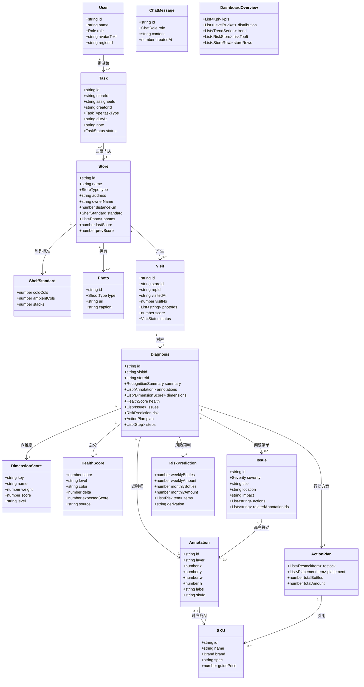
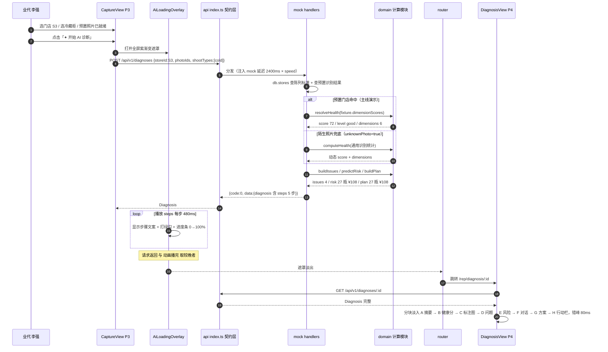
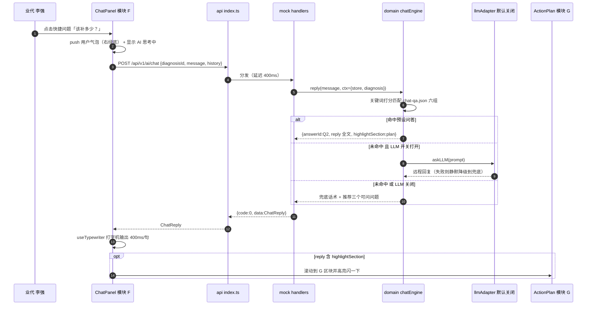
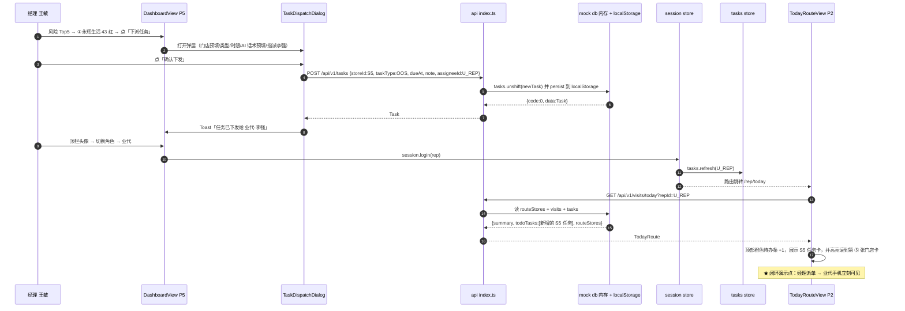

# 店小C · 蒙牛 AI 巡店助手 —— 系统架构设计与任务分解

> 版本：v1.0 ｜ 日期：2026-10-02 ｜ 架构师：高见远（Gao）
> 需求基线：`03_产品Demo/PRD.md`（v1.0，唯一权威）
> 代码根目录：`C:/Users/21820/Desktop/蒙牛/03_产品Demo/store-app/`
> 交付定位：**校园创新大赛高保真可演示原型**。不追求上线，只追求"打开即跑通、断网能演示、截图能进 PDF、录屏能讲故事"。

---

## 0. 架构总纲（先讲三条铁律）

### 铁律 1：API 层是唯一的"假后端"，也是将来的真后端契约

```
页面/组件  ──只允许──▶  src/api/index.ts  ──▶  client.ts ──┬─▶ mock/handlers.ts  (Phase 1，默认)
                                                          └─▶ endpoints.ts      (Phase 2，切环境变量)
```

- **页面代码永不 import `src/fixtures/*`，永不 import `src/api/mock/*`。**（用 ESLint 规则或一句约定保证）
- `src/api/index.ts` 里每个方法的**签名 = 真实 REST 接口**：方法、路径、请求体、响应体字段名全部与将来 Express 后端一致。
- mock 实现返回 `Promise`，并注入人为延迟（默认 300–2400ms，可通过演示设置调慢到 4s 便于解说）。
- **Phase 2 接真后端时：只改 `client.ts` 的分发开关 + 补全 `endpoints.ts`，页面代码一行不动。** 这是本架构的硬性分层约束。

### 铁律 2：一切资源本地化，零外网请求

字体用系统字体栈、图标用内联 SVG、图表用 npm 安装的 ECharts 按需引入、图片放 `public/`。**构建产物里不允许出现任何 `http(s)://` 外域请求**（需求池 ㊺）。验收方式：断网 + Network 面板外域请求数 = 0。

### 铁律 3：数据以 fixture 为准，公式只做兜底

PRD 7.4 明确"演示数据以 fixture 为准，公式允许 ±3 偏差，不必强行反解"。因此：
- **预置 5 家店的分数 / 风险数字 / 对话答案 → 全部直接读 fixture 权威值**（保证 P2/P4/P5/PDF 三处数字一字不差）。
- **7.1/7.3 的公式只在"陌生照片兜底路径"启用**（评委现场换图时动态计算），并且把分档、权重、弹性系数做成常量，便于答辩时解释。

已用权重回算校验（见 §5.4）：S1/S2后/S3/S4/S5 与 PRD 表误差 ≤0.35 分，S2整改前差 2.5 分（在 PRD 允许的 ±3 内）。**显示一律取 fixture 值。**

---

## 1. 实现方案与技术选型

### 1.1 整体形态

| 维度 | 决策 |
|---|---|
| 应用形态 | **单页应用（SPA）**，Vue 3 + Vite，路由 6 个页面级视图 |
| 数据来源 | Phase 1：本地 JSON fixture + 模拟 API（**主线**）；Phase 2：Node/Express + SQLite（仅设计预留） |
| 演示尺寸 | 业代端/店员端 = **390×844 竖屏**（桌面浏览器内嵌 CSS 手机壳）；经理看板 = **1440×900 宽屏**（≤1024px 折叠单列） |
| AI 能力 | 100% 本地规则引擎：识别 = fixture 标注坐标；诊断 = 6 维度打分函数；对话 = 关键词匹配预设问答库（6 组全文 + 2 兜底） |
| 持久化 | 内存对象 + `localStorage` 镜像（仅用于"经理下派任务 → 业代待办"跨路由/刷新存活） |

### 1.2 选型与理由（全部可离线打包）

| 类别 | 选型 | 版本建议 | 理由 |
|---|---|---|---|
| 框架 | **Vue 3**（`<script setup>` + Composition API） | `^3.4.38` | 队长熟悉；单文件组件写 6 个高保真页面最快；无 JSX 心智负担 |
| 构建 | **Vite 5** | `^5.4.3` | 冷启动秒级、改代码即时热更（做视觉微调时极其重要）；`base:'./'` 后产物可放任意目录 |
| 语言 | **TypeScript**（宽松模式） | `^5.5.4` | **核心理由：API 契约要靠类型锁死**，将来换后端时类型就是护栏。但 `vue-tsc` 只做可选检查，**类型报错不阻塞 `dev`/`build`**，避免 demo 卡住 |
| 路由 | **vue-router 4** | `^4.4.3` | 6 个页面 + 只读态/历史态靠 query 或独立路由区分 |
| 状态 | **Pinia** | `^2.2.2` | 只管 3 件事：`session`（当前角色）、`demo`（演示设置）、`tasks`（待办）。**跨角色联动必须靠它** |
| 图表 | **ECharts 5（按需引入）** | `^5.5.1` | PRD 3.3 点名；只引 `PieChart`/`LineChart` + `CanvasRenderer`，按需后约 350KB，本地打包无 CDN |
| 样式 | **Tailwind CSS 3 + CSS 变量** | `^3.4.10` | Tailwind 加速 6 页布局；**PRD 3.1/3.2 的配色全部落成 CSS 变量写进 `tokens.css`**，Tailwind 只负责排版本身的 spacing/flex。若队长不熟 Tailwind，可退化为 `scoped CSS`，`tokens.css` 变量通用，架构不受影响 |
| 图标 | **内联 SVG 组件**（`AppIcon.vue` + 一份 path 常量表） | 无依赖 | 全站约 24 个线性图标，手写 path 比引图标库更可控、更轻、100% 离线 |
| 字体 | 系统字体栈 `PingFang SC / HarmonyOS Sans / Microsoft YaHei` | 无依赖 | PRD 3.3 明确不引外部字体 |
| HTTP（Phase 2） | 原生 `fetch` | 无依赖 | `endpoints.ts` 里直接用 fetch，**不装 axios**，少一个依赖 |
| 单文件保底构建 | `vite-plugin-singlefile` | `^2.0.2` | **推荐**：`npm run build:single` 产出单个 `index.html`（JS/CSS 全内联），**双击即开、不需要任何服务器**，是现场最稳的兜底 |

### 1.3 目录层（分层架构，四层）

```
视图层  views/          6 个页面级视图，只做布局与编排
        ↑
组件层  components/     公共组件 + 业务组件（标注图、对话、风险卡…）
        ↑
领域层  domain/         纯函数：健康分、风险、问题清单、行动方案、对话引擎
        ↑
数据层  api/ + fixtures/ 契约层（mock / http 双实现）+ 静态数据
```

**依赖方向严格单向向下**：`views` 可 import `components`/`stores`/`api`；`components` 可 import `domain`/`stores`/`api`；`domain` **不允许** import 任何上层与 `api`（保证纯函数、可单独测）。

### 1.4 明确不做（克制清单）

不做真实鉴权/JWT 校验 ｜ 不做微服务 ｜ 不做真实摄像头强制调用 ｜ 不做在线地图（静态 SVG 代替）｜ 不做 SSR ｜ 不做单元测试框架（只用 `domain/` 纯函数 + 一张手算校验表）｜ 不做 i18n ｜ 不做复杂动画库（CSS transition 足够）｜ 不做真实支付/下单。

---

## 2. 目录与文件列表

```
store-app/
├─ index.html                        # 挂载点；<title> 店小C · 蒙牛 AI 巡店助手
├─ package.json                      # 依赖 + dev/build/build:single/preview 脚本
├─ vite.config.ts                    # vue 插件、base:'./'、@ 别名、singlefile 插件（可选）
├─ tsconfig.json                     # 宽松 TS（strict:false），paths 配 @/*
├─ tailwind.config.js                # 主题色映射到 CSS 变量；content 扫描 src
├─ postcss.config.js                 # tailwind + autoprefixer
├─ .env                              # VITE_API_MODE=mock｜VITE_DEMO_SPEED=1
├─ README.md                         # 启动/演示/录屏/换图 四件事的操作说明
│
├─ public/
│  └─ stores/                        # ★ 货架照片：只换文件、不动代码
│     ├─ S1/{cold.jpg, ambient.jpg}
│     ├─ S2/{cold.jpg, cold_before.jpg}          # before 用于 48→80 整改前后对比
│     ├─ S3/{cold.jpg, ambient.jpg, stack.jpg}   # 主线演示店，三张
│     ├─ S4/cold.jpg
│     ├─ S5/cold.jpg
│     └─ fallback/generic-shelf.jpg              # 陌生照片兜底时的占位图
│
└─ src/
   ├─ main.ts                        # createApp + pinia + router + 全局样式
   ├─ App.vue                        # 根组件：PhoneFrame 容器 + ToastHost + RouterView
   ├─ router/index.ts                # 6 条路由；默认 / 重定向到 /rep/today（开发期先跑主线）
   │
   ├─ types/index.ts                 # ★ 全量实体 + DTO 类型（= 将来后端契约，单一出处）
   │
   ├─ api/
   │  ├─ index.ts                    # ★ 页面唯一入口：导出 17 个 API 方法（含 JSDoc 标注路径）
   │  ├─ client.ts                   # request() 通用封装：信封包装/延迟/错误/ mock|http 分发
   │  ├─ endpoints.ts                # 真实 HTTP 实现（Phase 2 启用，Phase 1 只留 fetch 骨架）
   │  └─ mock/
   │     ├─ db.ts                    # 内存"数据库"：fixture 深拷贝 + 可写集合 + localStorage 镜像
   │     └─ handlers.ts              # 17 个接口的 mock 实现（路由到 domain 计算或 fixture 直取）
   │
   ├─ fixtures/
   │  ├─ schema.ts                   # SCHEMA_VERSION='1.0' 常量 + FixtureRoot 类型 + 版本校验
   │  ├─ users.json                  # 李强/王敏/张大姐 3 个用户
   │  ├─ stores.json                 # 5 家门店：类型/标准/距离/photoUrl/上次分/预置维度分
   │  ├─ skus.json                   # 蒙牛 + 竞品 SKU 主数据（名称、规格、指导价）
   │  ├─ visits.json                 # 历史巡店记录（S1 91、S2 48→80 两次）
   │  ├─ diagnoses.json              # ★ 5 店预置诊断：标注框/维度分/问题/风险/行动方案/加载步骤
   │  ├─ dashboard.json              # 区域 KPI / 4 档分布 / 8 周趋势 / 明细 12 行 / 风险 Top5
   │  ├─ chat-qa.json                # 6 组问答全文 + 2 条兜底 + 快捷问题 chips
   │  └─ index.ts                    # 汇总导出 + 启动时校验 SCHEMA_VERSION
   │
   ├─ domain/                        # 纯函数，不依赖 Vue
   │  ├─ constants.ts                # 分档表/6 维度元数据/框样式映射/风险系数
   │  ├─ healthScore.ts              # 6 维度打分 + 总分 + 分档 + 预期提升分（双轨）
   │  ├─ riskForecast.ts             # 风险预判公式 + 推导依据文案生成
   │  ├─ issueBuilder.ts             # 识别结果 → 问题清单（严重度排序）
   │  ├─ planBuilder.ts              # 千店千面行动方案：补货/陈列/订货三段
   │  ├─ chatEngine.ts               # 关键词打分匹配 + 兜底 + 打字机分段
   │  └─ llmAdapter.ts               # 可选 LLM 适配器（默认关闭，失败静默降级）
   │
   ├─ stores/                        # Pinia
   │  ├─ session.ts                  # 当前用户/角色、切换角色、login(roleId)
   │  ├─ demo.ts                     # 演示设置：加载速度倍率、骨架屏开关（影响 mock 延迟）
   │  └─ tasks.ts                    # 待办任务集合（★ 跨角色联动的落点）
   │
   ├─ components/
   │  ├─ common/
   │  │  ├─ AppIcon.vue              # 内联 SVG 图标（name → path 映射）
   │  │  ├─ AiBadge.vue              # ✦ AI 紫色胶囊徽标
   │  │  ├─ ScoreRing.vue            # SVG 环形分数仪表，环色随分档
   │  │  ├─ HealthBadge.vue          # 分档色 Badge（优秀/良好/预警/风险）
   │  │  ├─ SectionCard.vue          # 白卡容器 + 标题行 + 可选 AI 徽标
   │  │  ├─ SkeletonBlock.vue        # 骨架屏块
   │  │  ├─ ToastHost.vue            # Toast 容器（配合 useToast）
   │  │  ├─ PhoneFrame.vue           # 桌面端 390×844 手机壳 + 外挂演示设置齿轮
   │  │  └─ EmptyState.vue           # 空态插画 + 文案 + 行动按钮
   │  ├─ business/
   │  │  ├─ StoreCard.vue            # P2 巡店线路卡片（序号/类型/距离/上次分/状态/按钮）
   │  │  ├─ DimensionBars.vue        # 6 维度条形小分
   │  │  ├─ AnnotatedImage.vue       # ★ 图片 + 百分比标注框 + 图层筛选 + 高亮联动
   │  │  ├─ CompareSlider.vue        # ★ 原图/标注图 拖拽分割对比
   │  │  ├─ IssueList.vue            # 问题清单（左侧严重度色条 + 快捷动作）
   │  │  ├─ RiskCard.vue             # 风险预判卡 + 「推导依据」展开区
   │  │  ├─ ActionPlan.vue           # 千店千面行动方案三段 + 合计金额
   │  │  ├─ ChatPanel.vue            # 对话气泡 + 快捷问题 chips + 输入框 + 打字机
   │  │  ├─ AiLoadingOverlay.vue     # ★ 全屏紫渐变 5 步文字流加载动画
   │  │  ├─ TaskDispatchDialog.vue   # 经理下派任务弹层
   │  │  └─ charts/
   │  │     ├─ DonutChart.vue        # 门店健康分布环图（ECharts pie doughnut）
   │  │     └─ TrendLine.vue         # 近 8 周趋势折线（3 指标切换）
   │  └─ layout/
   │     ├─ MobileLayout.vue         # 390 竖屏外壳：顶栏插槽 + 内容 + TabBar
   │     ├─ TabBar.vue               # 底部 4 项 Tab
   │     └─ DesktopHeader.vue        # 经理看板顶栏（Logo/区域下拉/角色切换）
   │
   ├─ views/
   │  ├─ RoleSelectView.vue          # P1 登录/角色选择
   │  ├─ rep/TodayRouteView.vue      # P2 业代端今日巡店
   │  ├─ rep/CaptureView.vue         # P3 业代端巡店拍照
   │  ├─ rep/DiagnosisView.vue       # P4 业代端诊断结果（★ 最核心，A–H 八模块）
   │  ├─ rep/HistoryView.vue         # Tab3 巡店记录（简化列表，点击进 P4 只读态）
   │  ├─ manager/DashboardView.vue   # P5 区域经理看板
   │  ├─ owner/OwnerFlowView.vue     # P6 店员端：引导→拍照→结果→成功（内部 step 状态机）
   │  └─ PlaceholderView.vue         # Tab4「我的」等占位页
   │
   ├─ composables/
   │  ├─ useApi.ts                   # 通用请求 hook：loading/error/data + 重试
   │  ├─ useToast.ts                 # Toast 队列
   │  ├─ useTypewriter.ts            # 打字机逐字输出（400ms/句）
   │  └─ useLoadingSteps.ts          # 分步加载步骤播放（与 AiLoadingOverlay 配合）
   │
   └─ styles/
      ├─ tokens.css                  # ★ CSS 变量：PRD 3.1 配色 + 3.2 分档 + 圆角/阴影/字号
      └─ global.css                  # reset + 字体栈 + Tailwind 指令 + 少量原子类
```

**文件数**：配置 8 + 源码约 48 ≈ **56 个**。全部为小文件，单人可快速写完。

---

## 3. 数据结构与接口

### 3.1 类图（实体关系）



### 3.2 TypeScript 类型（字段级定义，落 `src/types/index.ts`）

```ts
// ───────── 基础枚举 ─────────
export type Role = 'rep' | 'manager' | 'owner'
export type StoreType = 'A' | 'B' | 'C'          // A连锁超市 / B大卖场·社区生鲜 / C便利店
export type ShootType = 'cold' | 'ambient' | 'stack'
export type Severity = 'severe' | 'medium' | 'low'   // 严重 / 中度 / 轻度
export type HealthLevelKey = 'excellent' | 'good' | 'warning' | 'risk'
export type VisitStatus = 'done' | 'pending' | 'alert'
export type TaskType = 'OOS' | 'FACING' | 'PRICETAG' | 'STACK'
export type TaskStatus = 'open' | 'done'
export type ChatRole = 'user' | 'ai'
/** 标注框图层：决定框色与样式，见 §8.4 */
export type AnnotationLayer = 'mengniu' | 'oos' | 'empty' | 'competitor' | 'pricetag' | 'stack'

// ───────── 主数据 ─────────
export interface User { id: string; name: string; role: Role; avatarText: string; regionId?: string }

export interface ShelfStandard { coldCols: number; ambientCols: number; stacks: number }

export interface Photo { id: string; type: ShootType; url: string; caption?: string }

export interface Store {
  id: string                      // 'S1'..'S5'
  name: string
  type: StoreType
  typeLabel: string               // 'C类便利店'
  address: string
  ownerName: string
  distanceKm: number
  standard: ShelfStandard
  photos: Photo[]                 // ★ 换图只改这里的 url
  lastScore: number
  prevScore?: number              // 有值则显示 '48 → 80 (+32)'
  alert?: boolean                 // S5 红点告警
}

export interface SKU { id: string; name: string; brand: string; spec: string; guidePrice: number }

// ───────── 巡店与诊断 ─────────
export interface Visit {
  id: string; storeId: string; repId: string; visitedAt: string
  visitNo: number; photoIds: string[]; score: number; status: VisitStatus
}

export interface RecognitionSummary {
  total: number                   // 14
  skuCount: number                // 8
  emptyCount: number              // 1
  competitorCount: number         // 2
  priceTagCount: number           // 3
  text: string                    // '✦ AI 识别摘要：蒙牛SKU 8 项 / 空位 1 / 竞品占位 2 / 价签问题 3 / 堆头未执行 1'
}

export interface Annotation {
  id: string
  layer: AnnotationLayer
  x: number; y: number; w: number; h: number   // ★ 0–100 相对百分比
  label: string                                 // '优益C 100ml ✔满排'
  skuId?: string
}

export interface DimensionScore {
  key: 'D1'|'D2'|'D3'|'D4'|'D5'|'D6'
  name: string                    // '排面达标'
  weight: number                  // 0.30
  score: number                   // 0–100
  level: HealthLevelKey
}

export interface HealthScore {
  score: number                   // 72
  level: HealthLevelKey
  color: string                   // '#FF9800'
  delta: number                   // 环比 ±
  expectedScore: number           // 89
  source: 'fixture' | 'computed'  // 权威值 / 公式计算
}

export interface Issue {
  id: string
  severity: Severity
  title: string                   // '冷柜第 2 层第 3 列整列缺货'
  location: string                // '冷藏柜 · 应陈列 优益C 100ml'
  impact?: string                 // '影响：日均约 3.9 瓶销量流失'
  actions?: string[]              // ['补货 12 瓶','标记已处理']
  relatedAnnotationIds: string[]  // ★ 与标注框双向高亮
}

export interface RiskItem {
  skuId: string; skuName: string
  dailyAvgSales: number           // 11
  stdFacings: number              // 4
  actualFacings: number           // 2.5
  gapRatio: number                // 0.375
  elasticity: number              // 0.35
  dailyLossBottles: number        // 3.9
  unitPrice: number               // 4.0
}

export interface RiskPrediction {
  weeklyBottles: number           // 27
  weeklyAmount: number            // 108
  monthlyBottles: number          // 117
  monthlyAmount: number           // 468
  items: RiskItem[]
  derivation: string              // ★「推导依据」展开区文本（含算式）
}

export interface RestockItem { skuId: string; skuName: string; bottles: number; amount: number }
export interface PlacementItem { text: string }
export interface ActionPlan {
  storeTypeLabel: string          // '该店类型为 C类便利'
  restock: RestockItem[]          // 补什么货（3 项）
  placement: PlacementItem[]      // 怎么摆（2 项）
  totalBottles: number            // 36
  totalAmount: number             // 144
  coverDays: number               // 3
}

export interface Step { text: string; delayMs: number }  // 分步加载：5 步

export interface Diagnosis {
  id: string; visitId?: string; storeId: string
  createdAt: string
  steps: Step[]
  summary: RecognitionSummary
  annotations: Annotation[]
  dimensions: DimensionScore[]
  health: HealthScore
  issues: Issue[]
  risk: RiskPrediction
  plan: ActionPlan
}

// ───────── 任务 / 工单 / 对话 ─────────
export interface Task {
  id: string; storeId: string; storeName: string
  assigneeId: string; assigneeName: string
  creatorId: string; creatorName: string
  taskType: TaskType; taskTypeLabel: string
  dueAt: string; note: string; status: TaskStatus
}

export interface Ticket {          // 整改单 / 订货建议
  id: string; kind: 'rectification' | 'order'
  storeId: string; items: RestockItem[]; note: string; createdAt: string
}

export interface ChatMessage { id: string; role: ChatRole; content: string; createdAt: number }

// ───────── 看板 ─────────
export interface Kpi { key: string; label: string; value: string; delta: string; trend: 'up'|'down'; target?: string; danger?: boolean }
export interface LevelBucket { level: HealthLevelKey; label: string; count: number; ratio: number; color: string }
export interface TrendSeries { key: 'score'|'oosRate'|'coverage'; name: string; points: number[]; weeks: string[] }
export interface RiskStore { storeId: string; storeName: string; score: number; level: HealthLevelKey; reason: string }
export interface StoreRow { storeId: string; storeName: string; score: number; level: HealthLevelKey; mainIssue: string; weekDelta: number }
export interface DashboardOverview { regionId: string; kpis: Kpi[]; distribution: LevelBucket[]; trend: TrendSeries[]; riskTop5: RiskStore[]; storeRows: StoreRow[] }

// ───────── 统一响应信封 ─────────
export interface ApiEnvelope<T> { code: number; message: string; data: T }
```

### 3.3 模拟 API 层完整接口清单

> **以下 17 个接口即为将来 Express 后端的契约。** 路径、方法、请求体、响应体字段名在 Phase 2 中一字不改。
> 统一前缀 `/api/v1`；统一响应信封 `{ code: 0, message: 'ok', data: T }`（`code !== 0` 视为业务错误，前端统一 Toast，绝不弹原生报错）。
> mock 延迟由 `VITE_DEMO_SPEED` 控制，默认 1×。

| # | 方法 | 路径 | 请求体 / 参数 | 响应 `data` | 用途 |
|---|---|---|---|---|---|
| 1 | GET | `/api/v1/meta/roles` | — | `{ roles: Array<{id:Role,name,desc,sub,recommended}> }` | P1 三角色卡 |
| 2 | POST | `/api/v1/session/login` | `{ roleId: Role }` | `{ token: string, user: User }` | 模拟登录/切换角色 |
| 3 | GET | `/api/v1/stores` | `?repId=` / `?regionId=` | `{ stores: Store[] }` | 门店列表 |
| 4 | GET | `/api/v1/stores/:id` | — | `{ store: Store }` | 门店详情（P3 门店卡） |
| 5 | GET | `/api/v1/visits/today` | `?repId=` | `{ date, weather, summary:{total,done,avgScore,avgDelta}, todoTasks: Task[], routeStores: RouteStore[] }` | **P2 首页**（含经理下派的待办） |
| 6 | GET | `/api/v1/visits` | `?storeId=&limit=` | `{ visits: Visit[] }` | 巡店记录 Tab |
| 7 | GET | `/api/v1/visits/:id` | — | `{ visit: Visit, diagnosis: Diagnosis }` | P4 只读历史态 |
| 8 | POST | `/api/v1/visits` | `{ storeId, photoIds[], shootTypes[], checkin:{lat,lng,at} }` | `{ visit: Visit }` | 完成巡店回写 |
| 9 | **POST** | **`/api/v1/diagnoses`** | `{ storeId, photoIds: string[], shootTypes: ShootType[], unknownPhoto?: boolean }` | `{ diagnosis: Diagnosis }`（**含 `steps[5]`**） | **★核心：拍照 → AI 诊断** |
| 10 | GET | `/api/v1/diagnoses/:id` | — | `{ diagnosis: Diagnosis }` | P4 渲染 / P5 查看 |
| 11 | POST | `/api/v1/ai/chat` | `{ diagnosisId, message, history: ChatMessage[] }` | `{ reply: string, answerId?: string, highlightSection?: 'plan'\|'risk', suggestions?: string[] }` | **★多轮追问** |
| 12 | GET | `/api/v1/ai/chat/suggestions` | `?diagnosisId=` | `{ suggestions: string[] }` | 快捷问题 chips |
| 13 | POST | `/api/v1/tickets` | `{ kind:'rectification'\|'order', storeId, items[], note }` | `{ ticket: Ticket }` | 生成整改单 / 订货建议 |
| 14 | GET | `/api/v1/tasks` | `?assigneeId=` | `{ tasks: Task[] }` | 业代待办列表 |
| 15 | POST | `/api/v1/tasks` | `{ storeId, taskType, dueAt, note, assigneeId }` | `{ task: Task }` | **★经理下派任务** |
| 16 | PATCH | `/api/v1/tasks/:id` | `{ status: TaskStatus }` | `{ task: Task }` | 标记已处理 |
| 17 | GET | `/api/v1/dashboard/overview` | `?regionId=` | `{ overview: DashboardOverview }` | **P5 看板一次性取全量** |

> 说明：#9 是唯一"重"接口。演示版**不引入轮询/SSE**——`steps[]` 随响应一并返回，前端 `useLoadingSteps` 按 `delayMs` 播放；若请求先返回而动画未播完，则动画播完再跳转（保证 2.4s 的"智能感表演"完整）。真实后端若改成异步任务，只需把 #9 拆成 `POST /diagnoses` → `{jobId}` + `GET /diagnoses/:id` 轮询，**前端仍只改 `api/index.ts`**。

### 3.4 Phase 2（Node/Express + SQLite）映射预留

| 接口 | Express 路由 | SQLite 表 |
|---|---|---|
| #2 session/login | `POST /api/v1/session/login` | `users`（演示期可免鉴权，返回固定 token） |
| #3–4 stores | `GET /api/v1/stores` | `stores`, `store_standards`, `store_photos` |
| #5–8 visits | `/api/v1/visits/*` | `visits`, `visit_photos` |
| #9–10 diagnoses | `/api/v1/diagnoses` | `diagnoses`, `annotations`, `dimension_scores`, `issues`, `risk_items`, `action_items` |
| #11–12 ai/chat | `/api/v1/ai/chat` | `chat_messages`（+ 真实 LLM 代理） |
| #13 tickets | `/api/v1/tickets` | `tickets`, `ticket_items` |
| #14–16 tasks | `/api/v1/tasks` | `tasks` |
| #17 dashboard | `/api/v1/dashboard/overview` | 视图聚合（`weekly_metrics`, `stores`） |

**Phase 2 只做设计预留，本次不实现。** 前端切换方式：`VITE_API_MODE=http` + `VITE_API_BASE=http://localhost:3000`。

---

## 4. 核心流程时序图

### 4.1 拍照 → AI 诊断 → 结果渲染（含分步加载动画）



### 4.2 多轮追问



### 4.3 经理下派任务 → 业代端待办可见（跨角色闭环）



---

## 5. 健康分计算模块设计

### 5.1 常量（`domain/constants.ts`）

```ts
export const HEALTH_LEVELS = [
  { key:'excellent', min:85, max:100, label:'优秀', color:'#009639', icon:'✓', advice:'保持当前陈列水平' },
  { key:'good',      min:70, max:84,  label:'良好', color:'#8BC34A', icon:'◐', advice:'有小问题，本周内处理' },
  { key:'warning',   min:60, max:69,  label:'预警', color:'#FF9800', icon:'△', advice:'需立即处理，否则影响销量' },
  { key:'risk',      min:0,  max:59,  label:'风险', color:'#E02020', icon:'✖', advice:'红色告警，24 小时内整改' },
] as const

export const DIMENSIONS = [
  { key:'D1', name:'排面达标', weight:0.30 },
  { key:'D2', name:'缺货控制', weight:0.25 },
  { key:'D3', name:'价签合规', weight:0.15 },
  { key:'D4', name:'竞争位势', weight:0.15 },
  { key:'D5', name:'陈列执行', weight:0.10 },
  { key:'D6', name:'期效新鲜', weight:0.05 },
] as const

export const RISK = { ELASTICITY: 0.35, GAP_FACTOR: 1.0, WEEK_DAYS: 7, MONTH_WEEKS: 4.3 } as const
```

### 5.2 六维度打分（PRD 7.1 逐条落地）

```ts
// domain/healthScore.ts
export interface ScoreInput {
  standard: ShelfStandard
  coldFacings: number; ambientFacings: number; stackFacings: number   // 实际蒙牛有效排面列数
  oosSkuCount: number          // 断货/空位 SKU 数
  lowStockSkuCount: number     // 缺货预警 SKU 数（低于安全库存 50%）
  priceTagMissing: number
  priceMismatch: number
  competitorFacings: number
  mengniuFacings: number
  goldenCompetitorCols: number // 黄金层被竞品占用列数
  materialsDone: number; materialsRequired: number
  nearExpiryCount: number; expiredCount: number
}

/** D1 排面达标：区域加权 冷柜0.5 + 常温0.3 + 堆头0.2 */
export function scoreD1(i: ScoreInput): number {
  const rCold = i.coldFacings / Math.max(1, i.standard.coldCols)
  const rAmb  = i.ambientFacings / Math.max(1, i.standard.ambientCols)
  const rStk  = i.standard.stacks > 0 ? i.stackFacings / i.standard.stacks : 1
  return clamp(Math.round((rCold*0.5 + rAmb*0.3 + rStk*0.2) * 100), 0, 100)
}
/** D2 缺货控制：100 − 缺货SKU×12 − 预警SKU×5 */
export function scoreD2(i: ScoreInput): number {
  return clamp(100 - i.oosSkuCount*12 - i.lowStockSkuCount*5, 0, 100)
}
/** D3 价签合规：100 − 缺失×8 − 不符×5 */
export function scoreD3(i: ScoreInput): number {
  return clamp(100 - i.priceTagMissing*8 - i.priceMismatch*5, 0, 100)
}
/** D4 竞争位势：份额×标准系数×100 − 黄金层被占 15/列 */
export function scoreD4(i: ScoreInput): number {
  const share = i.mengniuFacings / Math.max(1, i.mengniuFacings + i.competitorFacings)
  return clamp(Math.round(share * 100) - i.goldenCompetitorCols*15, 0, 100)
}
/** D5 陈列执行：已执行/应执行×100，本月无活动按满分 */
export function scoreD5(i: ScoreInput): number {
  if (i.materialsRequired === 0) return 100
  return clamp(Math.round(i.materialsDone / i.materialsRequired * 100), 0, 100)
}
/** D6 期效新鲜：100 − 临期×20 − 过期×50，无数据默认 85 */
export function scoreD6(i: ScoreInput): number {
  if (i.nearExpiryCount === 0 && i.expiredCount === 0) return 85
  return clamp(100 - i.nearExpiryCount*20 - i.expiredCount*50, 0, 100)
}
```

### 5.3 总分、分档与双轨装配

```ts
export function levelOf(score: number): HealthLevelKey        // 查 HEALTH_LEVELS 区间
export function colorOf(level: HealthLevelKey): string
export function clamp(n: number, min: number, max: number): number

/** 纯公式路径：用于陌生照片 / 新增门店 */
export function computeHealth(i: ScoreInput): HealthScore {
  const raw = [scoreD1, scoreD2, scoreD3, scoreD4, scoreD5, scoreD6].map(fn => fn(i))
  const score = Math.round(raw.reduce((s, v, k) => s + v * DIMENSIONS[k].weight, 0))
  return { score, level: levelOf(score), color: colorOf(levelOf(score)),
           delta: 0, expectedScore: estimateAfterFix(score), source: 'computed' }
}

/** ★ 双轨入口：预置门店走 fixture 权威值，否则走公式 */
export function resolveHealth(
  input: ScoreInput,
  fixture?: { dimensions: number[]; expectedScore?: number; prevScore?: number }
): { health: HealthScore; dimensions: DimensionScore[] } {
  if (fixture && fixture.dimensions?.length === 6) {
    const score = Math.round(fixture.dimensions.reduce((s,v,k)=> s + v*DIMENSIONS[k].weight, 0))
    return {
      health: { score, level: levelOf(score), color: colorOf(levelOf(score)),
                delta: fixture.prevScore != null ? score - fixture.prevScore : 0,
                expectedScore: fixture.expectedScore ?? estimateAfterFix(score),
                source: 'fixture' },
      dimensions: DIMENSIONS.map((d,k)=>({ ...d, score: fixture.dimensions[k], level: levelOf(fixture.dimensions[k]) }))
    }
  }
  const h = computeHealth(input)
  return { health: h, dimensions: DIMENSIONS.map((d,k)=>({ ...d, score: [scoreD1,scoreD2,scoreD3,scoreD4,scoreD5,scoreD6][k](input), level: levelOf(0) })) }
}

/** 预期提升分：执行全部建议后（演示口径 = 修复严重+中度问题带来的加权回升） */
export function estimateAfterFix(score: number): number   // 下限 89 上限 96，默认 89（与 PRD S3 一致）
```

### 5.4 权重回算校验表（已验算，供工程师对照）

| 门店 | 公式加权结果 | 四舍五入 | PRD fixture 值 | 偏差 |
|---|---|---|---|---|
| S1 | 90.80 | 91 | **91** | −0.20 ✅ |
| S2 整改后 | 80.10 | 80 | **80** | +0.10 ✅ |
| S2 整改前 | 45.50 | 46 | **48** | −2.50（±3 内 ⚠） |
| S3 | 72.05 | 72 | **72** | +0.05 ✅ |
| S4 | 63.65 | 64 | **64** | −0.35 ✅ |
| S5 | 42.85 | 43 | **43** | −0.15 ✅ |

> 结论：**显示一律取 fixture 权威值**（`source:'fixture'`），公式仅作兜底与答辩解释。S2 整改前以 **48** 展示（PRD 文案"48 → 80 (+32)"必须一致）。

### 5.5 风险预判（`domain/riskForecast.ts`）

```ts
export function predictRisk(items: Array<{
  skuId: string; skuName: string; dailyAvgSales: number
  stdFacings: number; actualFacings: number; unitPrice: number
}>): RiskPrediction {
  const list = items.map(it => {
    const gapRatio = (it.stdFacings - it.actualFacings) / Math.max(1, it.stdFacings)
    const dailyLoss = it.dailyAvgSales * (gapRatio * RISK.GAP_FACTOR) * RISK.ELASTICITY
    return { ...it, gapRatio, elasticity: RISK.ELASTICITY, dailyLossBottles: round1(dailyLoss) }
  })
  const weeklyBottles = Math.round(list.reduce((s,i)=>s+i.dailyLossBottles,0) * RISK.WEEK_DAYS)
  const weeklyAmount  = Math.round(weeklyBottles * avgUnitPrice(list))
  const monthlyBottles= Math.round(weeklyBottles * RISK.MONTH_WEEKS)
  const monthlyAmount = Math.round(monthlyBottles * avgUnitPrice(list))
  return { weeklyBottles, weeklyAmount, monthlyBottles, monthlyAmount,
           items: list, derivation: buildDerivation(list) }
}

function buildDerivation(list): string   // 生成「推导依据」展开区多行文本，含算式与假设
```

**⚠ 公式与 PRD 数字不自洽（已定位，见 §9 待明确 #1）**：按 PRD 7.3 字面公式 `11 × 37.5% × 0.35 = 1.44 瓶/天`，但 PRD 成品数字是 **3.9 瓶/天 → 27 瓶/周 → ¥108**。反向验证：`11 × 0.35 = 3.85 ≈ 3.9`，`×7 = 26.95 ≈ 27`，`×4.0 = 107.8 ≈ 108`，`×4.3 = 115.9 ≈ 117`，`×4.0 = ¥463 ≈ 468`。
→ **工程默认值：预置门店的 `dailyLossBottles` 直接由 fixture 提供（3.9），`derivation` 文案由 fixture 提供；公式（`GAP_FACTOR=1.0`、`ELASTICITY=0.35`）仅在兜底路径使用。** 这样屏幕上永远是 27/108/117/468，且"推导依据"照样可展开解释。

### 5.6 问题清单与行动方案

```ts
// issueBuilder.ts：识别统计 → Issue[]（严重度排序：severe > medium > low）
export function buildIssues(rec: RecognitionSummary, annotations: Annotation[], skus: SKU[]): Issue[]

// planBuilder.ts：千店千面 —— 门店类型决定排面标准与补货系数
export function buildPlan(store: Store, diagnosis: Diagnosis, skus: SKU[]): ActionPlan
// 补货量 = (标准排面列数 − 实际有效列数) × 单列容量，再按到店间隔天数 × 日均动销取安全库存
// S3 期望输出：优益C100ml×12(¥48) / 优益C450g×9(¥36) / 真果粒250ml×6(¥24) → 合计 27 瓶 ¥108（12+9+6 瓶、48+36+24 元），覆盖 3 天
```

### 5.7 对话引擎（`domain/chatEngine.ts`）

```ts
export interface ChatContext { store: Store; diagnosis: Diagnosis }
export function reply(message: string, ctx: ChatContext): {
  answerId?: string; reply: string; highlightSection?: 'plan'|'risk'; suggestions?: string[]
}
// 1) 归一化：去空格/标点，转小写
// 2) 关键词打分：每组问答配置 keywords[]，命中数 × 权重取最高分；阈值 ≥2 视为命中
// 3) 命中 → 取 chat-qa.json 全文；若该条配置 highlight，则返回 highlightSection:'plan'（Q6 自动高亮行动方案）
// 4) 未命中 且 llmAdapter.enabled() → 调 LLM；失败或超时 3s 静默降级
// 5) 仍未命中 / 输入为空 → 返回兜底话术 + 3 个推荐问题
```

**6 组预设问答的关键词建议**（落 `chat-qa.json`）：
- Q1 为什么这位置不好 → `为什么/位置/不好/黄金/层级/视线`
- Q2 该补多少 → `补多少/补货/订多少/数量/几瓶`
- Q3 跟店主怎么说 → `店主/怎么说/话术/沟通/谈判`
- Q4 竞品占位置 → `竞品/味全/占位/不让/竞争`
- Q5 先做哪一件 → `先做/优先/顺序/哪件/第一步`
- Q6 定整改动作 → `整改/动作/方案/整理/生成`

---

## 6. 有序任务列表

> 顺序原则：**先业代端核心（P2→P3→P4 主线跑通）→ 再 P1 登录壳 → 再 P5 经理看板 → 最后 P6 店员端**。
> 5 个主阶段 / 20 个子任务。每个子任务 1 天内可完成。**标记 🟢=P0 必做，🔵=P1 可选增强（做不完直接砍，不影响演示主线）。**

### T01 项目基础设施与设计系统 🟢

| 子任务 | 内容 | 涉及文件 | 依赖 | 验收标准 |
|---|---|---|---|---|
| T01.1 | 脚手架与构建配置 | `package.json`、`vite.config.ts`（`base:'./'` + `@` 别名）、`tsconfig.json`、`tailwind.config.js`、`postcss.config.js`、`.env`、`index.html`、`src/main.ts`、`src/App.vue` | — | `npm i && npm run dev` 秒开；`npm run build` 成功 |
| T01.2 | 设计令牌与全局样式 | `src/styles/tokens.css`（PRD 3.1/3.2 全量变量）、`src/styles/global.css` | T01.1 | 逐个变量与 PRD 表对照无误；页面背景 `#F5F7F5`、主按钮 `#009639` 生效 |
| T01.3 | 公共组件 | `AppIcon.vue`、`AiBadge.vue`、`ScoreRing.vue`、`HealthBadge.vue`、`SectionCard.vue`、`SkeletonBlock.vue`、`EmptyState.vue`、`ToastHost.vue` + `useToast.ts` | T01.2 | `ScoreRing(72)` 显示橙色环 + 72 +「预警/良好边界」；Toast 可弹出 |
| T01.4 | 布局、路由骨架、手机壳 | `router/index.ts`、`MobileLayout.vue`、`TabBar.vue`、`DesktopHeader.vue`、`PhoneFrame.vue`、`PlaceholderView.vue` | T01.3 | 桌面浏览器居中显示 390×844 手机壳 + 底部 4 Tab；6 条路由可空转，`/` 重定向到 P2 |

### T02 数据契约层（fixture + 模拟 API）🟢

| 子任务 | 内容 | 涉及文件 | 依赖 | 验收标准 |
|---|---|---|---|---|
| T02.1 | 全量类型定义 | `src/types/index.ts` | T01.1 | 覆盖 User/Store/SKU/Visit/Diagnosis/Annotation/Issue/Risk/ActionPlan/Task/ChatMessage/Dashboard + `ApiEnvelope` |
| T02.2 | Fixture 数据落盘 | `fixtures/schema.ts`、`users.json`、`stores.json`、`skus.json`、`visits.json`、`diagnoses.json`、`dashboard.json`、`chat-qa.json`、`index.ts` | T02.1 | 5 店数据齐全；S3 含 14 个标注框；`SCHEMA_VERSION='1.0'` 校验通过；数字与 PRD 6.1/6.2/6.3/7.4 逐条一致 |
| T02.3 | 契约客户端 | `api/client.ts`（信封/延迟/错误/分发）、`api/endpoints.ts`（fetch 骨架） | T02.1 | `VITE_API_MODE` 切换生效；`code!==0` 走统一 Toast，不出现原生报错 |
| T02.4 | Mock 实现 | `api/mock/db.ts`（含 localStorage 镜像 + reset）、`api/mock/handlers.ts`、`api/index.ts` | T02.2, T02.3 | 17 个接口全部可调用并返回符合契约的数据；下派任务写入后刷新仍存在 |

> **分层验收（硬性）**：全局搜索 `src/views` 与 `src/components` 中不得出现 `from '@/fixtures'` 或 `from '@/api/mock'`。

### T03 领域计算模块（纯函数）🟢

| 子任务 | 内容 | 涉及文件 | 依赖 | 验收标准 |
|---|---|---|---|---|
| T03.1 | 常量与分档 | `domain/constants.ts` | T02.1 | 4 档区间/色值/图标与 PRD 3.2 一致；6 维度权重与 7.1 一致 |
| T03.2 | 健康分模块 | `domain/healthScore.ts` | T03.1 | `resolveHealth` 对 S3 → 72/good；`computeHealth` 对兜底输入返回 0–100 合法值；结果符合 §5.4 校验表 |
| T03.3 | 风险预判 + 推导文案 | `domain/riskForecast.ts` | T03.1 | S3 fixture 路径输出 27 / 108 / 117 / 468；`derivation` 文本含算式与假设 |
| T03.4 | 问题清单 + 行动方案 | `domain/issueBuilder.ts`、`domain/planBuilder.ts` | T03.1 | S3 → 4 条问题（2 严重 + 2 中度），顺序正确；方案合计 27 瓶 ¥108，覆盖 3 天 |
| T03.5 | 对话引擎（+ LLM 可选） | `domain/chatEngine.ts`、`domain/llmAdapter.ts`（默认关闭） | T02.2 | 6 个快捷问题全部命中对应答案；乱输入走兜底且给出 3 个推荐问题 |

### T04 业代端主线 P2 → P3 → P4 🟢

| 子任务 | 内容 | 涉及文件 | 依赖 | 验收标准 |
|---|---|---|---|---|
| T04.1 | **P2 今日巡店** | `views/rep/TodayRouteView.vue`、`components/business/StoreCard.vue` | T02.4 | 三格概览（5 / 2/5 / 85.5↑2.4）；5 张线路卡；S2 显示 `48 → 80 (+32)`；S5 红点告警；待办条可折叠；骨架屏与空态可用 |
| T04.2 | **P3 巡店拍照** | `views/rep/CaptureView.vue` | T02.4 | 门店卡 + 切换门店弹层；三选一分段控件；三入口照片（模拟拍照/相册上传/换一张）；缩略图 ≤6 可删；打卡行；无照片时主按钮置灰 |
| T04.3 | **P4 上屏**（A 摘要 / B 健康分 / C 标注图） | `views/rep/DiagnosisView.vue`（上屏）、`DimensionBars.vue`、`AnnotatedImage.vue`、`CompareSlider.vue` | T02.4, T03.2 | ScoreRing 显示 72 橙；6 维度条 76/68/70/62/82/85；标注图 14 框样式符合 §8.4；**原图/标注图拖拽滑块可拖**；「预计可提升至 89 分（+17）」可见 |
| T04.4 | **P4 下屏**（D 问题 / E 风险 / F 对话 / G 方案 / H 行动栏） | `DiagnosisView.vue`（下屏）、`IssueList.vue`、`RiskCard.vue`、`ChatPanel.vue`、`ActionPlan.vue`、`useTypewriter.ts` | T03.3, T03.4, T03.5 | 4 条问题带严重度色条；风险卡 27瓶/¥108 + 推导依据可展开；对话打字机 400ms/句；方案三段 + 合计 ¥108；底部双按钮 |
| T04.5 | **AI 分步加载动画** | `AiLoadingOverlay.vue`、`useLoadingSteps.ts` | T04.3 | 全屏紫渐变 + 5 步文字流（每步 ~480ms，共 ~2.4s）；每步打绿勾 + 进度条；演示设置可调至 4s |
| T04.6 | 整改单 / 订货建议 + 状态回写 | `DiagnosisView.vue` 行动栏、`PlaceholderView` 复用或内联成功页、`views/rep/HistoryView.vue` | T04.4 | 生成整改单 → 预览 → 提交成功页 → 返回 P2，该卡变「已完成」绿色闪光 + Toast「已保存 · 健康分 72」；历史记录可点进 P4 只读态（隐藏输入与行动栏） |

> **T04 整体验收**：PRD 6.5 录屏脚本 **0:08–1:20** 段可完整跑通，无需讲解。

### T05 P1 登录壳 + P5 看板 + P6 店员端 + 闭环联动 🟢

| 子任务 | 内容 | 涉及文件 | 依赖 | 验收标准 |
|---|---|---|---|---|
| T05.1 | **P1 角色选择** | `views/RoleSelectView.vue`、`stores/session.ts` | T02.4 | 三角色卡（业代大卡 + 推荐角标）；点击进入对应端；全站常驻「切换角色」入口；Toast「已切换为：业代 · 李强」；路由 `/` 改回 P1 |
| T05.2 | **P5 经理看板** | `views/manager/DashboardView.vue`、`charts/DonutChart.vue`、`charts/TrendLine.vue`、`TaskDispatchDialog.vue` | T02.4 | 4 张 KPI（74.3↑3.8 / 12↓5 / 7.2%↓2.6pt / 86.4%↑3.1pt）；环图中心 74.3 + 4 档图例；8 周趋势 3 指标切换；明细表按分升序 12 行；风险 Top5 + 下派弹层 |
| T05.3 | **★跨角色闭环联动** | `stores/tasks.ts`、`TodayRouteView.vue` 待办区 | T05.1, T05.2 | 经理下派 → Toast → 切角色业代 → P2 待办条立刻多一条 S5 任务卡并高亮。**这是讲"闭环"的关键证据，必须联调通过** |
| T05.4 | **P6 店员端** | `views/owner/OwnerFlowView.vue` | T02.4 | 引导三步 → 轻量拍照 → 口语化结果（**不出现"健康分/维度/雷达"字样**）→ 一键订货 → 成功页含订单摘要 +「李强将在 2 小时内与你联系」 |
| T05.5 | 🔵 P1 增强项（按序做，做不完即砍） | 见下 | T04 | 见下 |

**T05.5 增强项优先级（从高到低，时间不够就砍后面的）**：
1. 🔵 **问题 ↔ 标注框双向高亮**（`IssueList` ↔ `AnnotatedImage`，PRD ㊲，评委最易被打动的细节）
2. 🔵 桌面手机壳模式 + 演示设置齿轮（加载速度/骨架屏开关）
3. 🔵 图层筛选 chips（全部/缺货/价签/竞品）
4. 🔵 整改前后对比视图（S2 48→80，复用 `cold_before.jpg`）
5. 🔵 图例点击联动筛选明细表
6. 🔵 多图 ≤6 张（缩略图 + 虚线加号）
7. 🔵 静态 SVG 线路地图（禁在线地图 API）
8. 🔵 陌生照片兜底识别（上传任意图 → 通用陈列结果，不白屏）

**T05.6 收尾（必做）**：断网验收（拔网线 / 飞行模式）+ Network 面板外域请求 = 0 + `npm run build && npm run preview` 可跑 + `npm run build:single` 单文件产物双击可开 + `README.md` 写清"启动 / 演示路线 / 录屏参数 / 换图方法"四件事。

---

## 7. 依赖包列表

```jsonc
// dependencies —— 运行时，全部本地打包，无 CDN
"vue":           "^3.4.38",   // 框架
"vue-router":    "^4.4.3",    // 路由
"pinia":         "^2.2.2",    // 状态（跨角色联动必需）
"echarts":       "^5.5.1",    // 图表（按需引入 PieChart / LineChart / CanvasRenderer）

// devDependencies —— 构建期，装一次即可离线
"vite":                    "^5.4.3",
"@vitejs/plugin-vue":      "^5.1.3",
"typescript":              "^5.5.4",
"tailwindcss":             "^3.4.10",
"postcss":                 "^8.4.41",
"autoprefixer":            "^10.4.20",
"vite-plugin-singlefile":  "^2.0.2"   // 可选：单文件保底构建
```

**明确不引入**：axios（用 fetch）、Element Plus / Vant（组件量太大、样式覆盖成本高）、图标库（内联 SVG）、字体包（系统字体栈）、地图 SDK（静态 SVG）、任何 CDN `link/script`。

**离线可用性**：以上均为 npm 包，`npm install` 一次后 `node_modules` 完全本地，**后续 `dev`/`build`/`preview` 全程不需要网络**。建议装完后立刻 `npm run build` 验证一次，并**备份 `node_modules` 或产物 `dist/` 到 U 盘**作为现场灾备。

**环境**：当前机器 Node `v22.22.2` / npm `10.9.7` ✅（Vite 5 要求 Node ≥18，满足）。未装 pnpm，统一用 npm。

---

## 8. 共享知识 / 跨文件约定

### 8.1 命名规范
- 组件文件 `PascalCase.vue`；视图 `XxxView.vue`；composable `useXxx.ts`；领域模块 `xxxXxx.ts`。
- 路由路径：`/role`（P1）、`/rep/today`（P2）、`/rep/capture/:storeId?`（P3）、`/rep/diagnosis/:id`（P4，`?readonly=1` 历史态）、`/manager/dashboard`（P5）、`/owner`（P6）。
- 路径别名：`@` → `src`（`vite.config.ts` + `tsconfig.json` 同时配）。
- 门店 ID 统一 `S1`–`S5`；用户 ID 统一 `U_REP` / `U_MGR` / `U_OWNER`；SKU ID 统一 `SKU_001` 起。

### 8.2 配色 CSS 变量清单（`src/styles/tokens.css`，与 PRD 3.1/3.2 一一对应）

```css
:root{
  /* 品牌 */
  --mn-green:#009639;  --mn-green-dark:#00662A;  --mn-green-light:#E8F5EC;
  /* 背景与容器 */
  --bg-page:#F5F7F5;   --bg-card:#FFFFFF;
  --radius-card:12px;  --radius-btn:24px;  --space-unit:4px;
  --shadow-card:0 2px 8px rgba(0,0,0,.06);
  /* 文字 */
  --text-1:#1A1F1C;    --text-2:#4B5563;   --text-3:#9CA3AF;
  /* AI 专属 */
  --ai-purple:#6D3BF5; --ai-purple-2:#9B6BFF;
  /* 健康分分档 */
  --level-excellent:#009639;  --level-good:#8BC34A;
  --level-warning:#FF9800;    --level-risk:#E02020;
  /* 竞品 */
  --competitor:#3B82F6;
  /* 字体 */
  --font-sans:'PingFang SC','HarmonyOS Sans','Microsoft YaHei',system-ui,sans-serif;
}
```

### 8.3 健康分分档常量
统一从 `domain/constants.ts` 的 `HEALTH_LEVELS` 读取，**任何页面不得硬编码色值或区间**。Badge / 环色 / 条形色 / 门店卡状态色全部走 `colorOf(level)`。
分档：优秀 85–100 ｜ 良好 70–84 ｜ 预警 60–69 ｜ 风险 0–59。
维度权重：D1 0.30 / D2 0.25 / D3 0.15 / D4 0.15 / D5 0.10 / D6 0.05。

### 8.4 标注框坐标系约定（★ 关键）

- **坐标系**：`x / y / w / h` 均为 **0–100 的浮点数，表示相对图片自身宽/高的百分比**，原点在图片左上角。
- **渲染**：容器 `position:relative`，内部 `` 宽度 100% 且 `display:block`（容器高度由图片撑开）；标注 div 用 `left:x%; top:y%; width:w%; height:h%; position:absolute`。**这样标注与图片像素尺寸完全解耦**——换任何分辨率的实拍图，只要构图相近，坐标无需改动。
- **换图流程**：替换 `public/stores/{storeId}/*.jpg` 文件 → 若构图变化，只调 `fixtures/stores.json` / `diagnoses.json` 里的百分比坐标 → **不改任何 .vue / .ts 代码**（PRD 6.6 第 3 条）。
- **框样式映射**（PRD 3.1 + 4.4）：

| layer | 含义 | 样式 |
|---|---|---|
| `mengniu` | 蒙牛正常 | `#009639` 实线 2px |
| `oos` | 缺货预警 | `#FF9800` 实线 2px |
| `empty` | 空位 | `#E02020` **虚线** 2px |
| `competitor` | 竞品 | `#3B82F6` **虚线** 2px |
| `pricetag` | 价签问题 | `#FF9800` 右上角标（小徽标，不画整框） |
| `stack` | 堆头未执行 | `#FF9800` 虚线大框 |

- **标签**：渲染在框**上方外侧**（`top:-22px`），黑底白字 11px，避免遮挡商品；`pricetag` 用角标形式贴在框右上。
- **价签 / SKU 名称等文字一律由前端 overlay 渲染**，图片内文字不作为数据来源（AI 生成图内文字不可靠）。

### 8.5 Fixture Schema 版本
`fixtures/schema.ts` 导出 `SCHEMA_VERSION = '1.0'`；`fixtures/index.ts` 启动时校验每个 JSON 的 `schemaVersion` 字段，不匹配则 console.warn（不阻断，避免演示翻车）。**结构变更必须 +1 版本号并在本文件登记变更说明。**

### 8.6 图片资源约定
- 目录：`public/stores/{storeId}/{cold|ambient|stack}.jpg`；S2 额外 `cold_before.jpg`。
- fixture 中只存 URL 字符串 `'/stores/S3/cold.jpg'`（**以 `/` 开头，配合 `base:'./'` 时改为相对路径 `stores/S3/cold.jpg`** —— 统一用前者，构建产物同目录拷贝即可）。
- 占位图未到位时，**先用 `public/fallback/generic-shelf.jpg` + 一份纯 CSS 绘制的货架示意图**顶上，保证 Demo 不停摆。
- **与素材同学的交接约定（需 team-lead 转达）**：请按 `S1…S5` 门店编号 + `cold/ambient/stack` 命名输出，构图尽量"正面平视、冷柜第二层居中、层列清晰"，便于百分比坐标复用。

### 8.7 API 层使用约定
```ts
// ✅ 正确：页面只认契约层
import { getTodayRoute, createDiagnosis, chat } from '@/api'
// ❌ 禁止
import stores from '@/fixtures/stores.json'
import { db } from '@/api/mock/db'
```
`useApi.ts` 统一处理 loading / error / 空态；**任何接口失败都吞掉异常并 Toast 友好文案，绝不允许浏览器原生报错弹窗中断演示**（PRD 4.4 异常条款）。

### 8.8 演示态约定
- 默认路由在开发期重定向到 P2（先跑主线），T05.1 完成后改回 P1。
- `?readonly=1` 使 P4 进入历史只读态：隐藏追问输入与底部行动栏，顶部加「历史记录」标签与日期。
- 手机壳外挂一个齿轮（**只在桌面端显示，不进手机屏截图**），可调：加载速度 1×/2×、骨架屏开关、重置演示数据。

---

## 9. 待明确事项（5 条，请队长拍板）

| # | 事项 | 我的建议 | 影响 |
|---|---|---|---|
| **1** | **风险公式与 PRD 数字不自洽**：PRD 7.3 字面式 `11 × 37.5% × 0.35 = 1.44`，但成品数字是 3.9/天 → 27 瓶/周 → ¥108。 | **以成品数字为准**：预置店 `dailyLossBottles` 与「推导依据」文案直接写进 fixture（3.9 / 27 / 108 / 117 / 468），公式只用于兜底路径。备选：把弹性系数从 0.35 改成 0.945 使公式自洽——但需同步改 PRD 与 PDF 文案，**不推荐**。 | 影响 P4 风险卡数字与 PDF 引用的一致性。**此项不定，P4 风险卡无法定稿。** |
| **2** | **货架占位图的落位与坐标复用**：`02_实拍素材/占位图/` 目前为空，asset-gen 正在生成。 | 请按 `S1–S5 / cold·ambient·stack.jpg` 命名输出并拷到 `store-app/public/stores/`；**标注框按占位图构图一次性调好百分比坐标**，实拍图回来后若构图相近可直接复用，差异大时只微调 fixture 坐标、不动代码。 | 阻塞 T04.3 标注图开发。若 10-08 前拿不到图，先跑 fallback 占位图路线。 |
| **3** | **S2 整改前 48 分 vs 公式 45.5**：差 2.5 分，在 PRD 允许的 ±3 内。 | 确认按 PRD 的 **48** 展示（"48 → 80 (+32)"是闭环核心文案，必须一致）；公式仅作解释，不作为显示来源。 | 低。不确认则按建议执行。 |
| **4** | **现场演示形态**：`npm run preview`（本地静态服务，最稳）还是"双击单个 HTML"（`vite-plugin-singlefile`）？ | **两个都做**：`build` 产出常规 dist 用 preview；`build:single` 产出单文件 HTML 作灾备（双击即开，不需要任何服务器/网络）。成本极低（一个插件 + 一条 script）。 | 低。影响现场翻车风险。 |
| **5** | **P1 增强项是否做**（问题↔标注框双向高亮、图层筛选、整改前后对比、手机壳、静态地图、多图）：距 10-22 时间紧。 | 按 T05.5 的 1→8 顺序做，**做完一项是一项，做不完直接砍**；其中第 1 项（双向高亮）性价比最高，建议至少保住。第 7、8 项可砍。 | 低。不影响 P0 主线（37 项）完整交付。 |

---

## 附：需求池覆盖自检

| 优先级 | 数量 | 覆盖情况 |
|---|---|---|
| P0（37 项） | 37 | **100% 覆盖**：T01–T05 全部落到具体文件与验收标准 |
| P1（8 项） | 8 | 全部排入 T05.5 增强项，按序做、可砍 |
| P2（2 项） | 2 | 静态地图（T05.5-7）、演示设置面板（T01/T05.6 已含齿轮版） |

**明确的裁剪线**：P1/P2 全部砍掉，P0 主线（P1→P2→P3→P4→P5→P6 六页 + 跨角色联动 + 离线资源本地化）依然完整可演示，这就是最小可交付。
