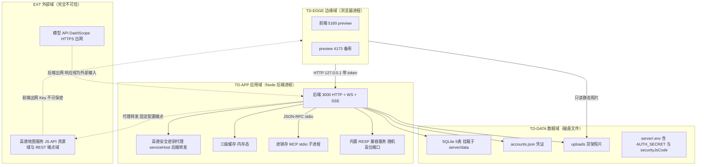

# 安全设计 · 店小C·蒙牛 AI 巡店助手 Demo

> 定位声明：本文档面向**校园创新大赛高保真演示原型**，非生产系统。安全设计深度与该定位匹配，目标是**对评委可抗辩**——每一个控制点都落到具体机制、流程与代码位置，不做生产级合规堆砌。
>
> 建模对象：`C:/Users/21820/Desktop/蒙牛/03_产品Demo/`。部署侧拓扑与命名锚点来自《部署设计》（platform-architect），本文档直接引用，不另起一套。
>
> 上游已裁决、不再讨论：差异化口径锚定「单层可解释深度 + 三端真库闭环」；X3 代码三档 0.7/0.95/1.4，损失侧走毛缺口；D-02 地图采用**高德 JS API + 正规申请 Key + 绑定域名**，唯一在线依赖为**模型 API 与高德地图服务两类**，两者均需 Key 且需联网；X15 不保留 mock 回退。
>
> D-02 方案口径提示（§5.4 有完整登记）：方案①是**对「零 CDN 铁律」的一处显式让步**，让步理由为「合规确定性优先」，补偿措施为「域名白名单绑定 + 配额限流 + 灰底降级」。备选方案②（内置静态底图）**未采纳**，仅在必要处作为对比保留并明确标注。

---

## 0. 安全设计总纲

| 维度 | 本项目结论 |
| --- | --- |
| 系统形态 | 单机本地演示：浏览器 + Node 后端 + SQLite 文件库 + stdio 子进程 |
| 对外暴露面 | **⚠ 修复前实测状态：后端 3000 因 `server/src/index.js:1467` 的 `app.listen(PORT, cb)` 未指定 host 参数，实际监听全部网卡接口（Node 默认 `::`/`0.0.0.0`），同网段可达；前端 5180/4173 与 RESP 端口为回环绑定。`index.js:1473` 启动日志打印 `http://127.0.0.1:3000`，与实际监听行为不一致，正是下游文档「仅回环」失实表述的根源。**目标态（RW-7 修复后）：零公网暴露，全部端口仅绑 127.0.0.1**。详见 §5.7 |
| 唯一在线依赖 | 两类：DashScope 模型 API（后端出网，响应一律视为外部不可信输入）+ 高德地图服务（前端出网，JS API Key 必然下发浏览器端无法保密，见 §6.1） |
| 真实数据 | 无真实客户数据，全部为演示构造数据；但含**演示账号明文密码**这一高危项 |
| 核心安全资产 | ① `AUTH_SECRET` 签名密钥 ② `server/data/accounts.json` 凭证 ③ SQLite 业务库 ④ 货架照片文件 ⑤ 高德 JS API Key 与安全密钥（可公开但受限，见 §6.1） |
| 安全设计三原则 | 最小暴露面、最小信任、可辨识降级（禁止静默伪装成真数据） |

---

## 1. 安全总体架构

### 1.1 安全总体架构图（信任域视角）

本项目无云上 VPC 实体、无网卡绑定 CIDR。下方 `vpc-dxd-mengniu` 等命名是**部署侧预分配的命名锚点**，用于让边界划分可被评委追问时有稳定口径，**不代表已启用的云资源**。

### 1.2 安全组件清单（本项目实际涉及）

| 组件 | 本项目是否涉及 | 作用 / 替代方案 |
| --- | --- | --- |
| CORS 来源白名单 | 涉及 | 已整改，替代原 `cors()` 全开 |
| HMAC-SHA256 令牌签名 | 涉及 | `server/src/auth.js`，替代无签名令牌 |
| `timingSafeEqual` 防时序比较 | 涉及 | 令牌校验 |
| `X-Content-Type-Options: nosniff` | 涉及 | `/uploads` 静态挂载响应头 |
| 回环绑定（127.0.0.1） | **部分涉及（修复前未达标）** | 前端与 RESP 端口已回环绑定；**后端 3000 未达标**，`index.js:1467` 需补 host 参数（RW-7），见 §5.7 |
| 出网白名单 | 涉及 | 模型 API 端点 + 高德服务端点（D-02 方案①让步），替代自由出网 |
| 高德 JS API 域名白名单 | 涉及 | 控制台登记 host，替代「Key 全网可用」 |
| 高德安全密钥代理（serviceHost） | 涉及（官方推荐形态） | 安全密钥不落前端构建产物，见 §6.1 |
| DDoS 高防 / WAF / 云防火墙 / 堡垒机 / SOC | **不涉及** | 按修复前/修复后两态分别裁定，见 §5.5 |
| KMS / 密钥管理服务（云上） | **不涉及云上实体** | 以本地文件权限 + `.gitignore` + 生成脚本替代，见 §6 |
| 主机安全组件 / 容器 K8s 安全 | **不涉及** | 单机演示，无容器编排 |

### 1.3 威胁模型（STRIDE）

| 威胁类别（STRIDE） | 本项目典型场景 |
| --- | --- |
| 仿冒（Spoofing） | 三账号密码均为 `123456`，任意评委可冒充 owner 角色操作；令牌重放；**高德 JS API Key 被他人站点盗用冒名调用** |
| 篡改（Tampering） | 整改单 `operatorId` 被写成空字符串导致操作人归属错误；SQLite 文件被本地进程直接改写 |
| 否认（Repudiation） | 现场演示无操作审计，评委质疑"这一步是谁做的"无法自证 |
| 信息泄露（Information Disclosure） | `GET /api/v1/auth/demo-accounts` **连同明文密码一起下发**；路径泄漏；模型请求体含业务数据出网；**高德 Key 与安全密钥必然暴露在浏览器端** |
| 拒绝服务（DoS） | 30 个端点无速率限制；模型 API 超时拖死 SSE；`/uploads` 无大小限制 |
| 权限提升（Elevation of Privilege） | rep 账号越权调用 manager/owner 专属接口；`requireRole` 未挂 `requireAuth` 之前形成绕过；静态 `/uploads` 目录遍历 |

### 1.4 威胁—缓解措施映射表

| 编号 | STRIDE 类别 | 威胁 | 缓解措施 | 落点章节 |
| --- | --- | --- | --- | --- |
| S-01 | 仿冒 | 明文密码下发导致凭据扩散 | 演示门禁：`AUTH_SECRET` 固定 + 启动前置自检 + 提交前移除明文下发 | §2.1.4、§6.3 |
| S-02 | 仿冒 | 令牌重放 | 令牌含 `exp` 且 8 小时过期；`timingSafeEqual` 防时序；无 URL 携带令牌 | §2.1.3 |
| S-03 | 篡改 | `operatorId` 空串归属缺陷 | 兜底改为 `system-unknown` 并打标；写库前断言非空 | §4.5、X14 裁决 |
| T-01 | 篡改 | SQLite 文件被直接改写 | 文件权限收敛至当前用户；演示前后校验文件哈希；写操作全部走参数化语句 | §3.3.3 |
| **S-04** | **仿冒 + 信息泄露** | **高德 JS API Key / 安全密钥被他人站点盗用冒名调用，刷配额或挂马壳页面** | **控制台域名白名单（host 不符即失败）+ 配额限流 + 定期轮换 + 灰底降级** | **§4.3、§6.1** |
| **S-05** | **信息泄露** | **高德域名白名单未登记当前 host 或生效延迟，导致调用静默失败（基础底图看着正常、需后端的服务无报错）** | **演示前实测 + 白名单登记 localhost 与 127.0.0.1 + 变更后留足生效等待时间** | **§4.3、§8** |
| T-02 | 篡改 | 模型返回内容被当作可信结构 | 模型输出只作参考文本，落库前 schema 校验 + 字段裁剪 | §4.1 |
| R-01 | 否认 | 现场操作无法追溯 | 关键写操作审计日志（操作人/时间/对象/结果），演示可现场展示 | §7.2 |
| I-01 | 信息泄露 | 明文密码随接口下发 | 高危定级 P1；现场缓解：仅内网回环 + 演示后清场；提交前改环境变量门控 | §2.1.4 |
| I-02 | 信息泄露 | 路径与堆栈泄漏 | 统一错误信封 `{code,message}`，不返回堆栈与 SQL | §4.2 |
| I-03 | 信息泄露 | 业务数据出网 | 出网仅模型 API 与高德地图服务两类，字段最小化，不含账号密码与身份证件 | §5.4 |
| D-01 | 拒绝服务 | 模型 API 超时拖死演示 | 三级缓存 + 硬超时 + 并发上限；缓存命中不触网 | §4.6 |
| D-02 | 拒绝服务 | `/uploads` 无上传限制 | 魔数+扩展名+大小三重校验，随机重命名，隔离目录 | §3.3.4 |
| E-01 | 权限提升 | 垂直越权 | `requireRole` 强制在 `requireAuth` 之后；失败返 403 信封 | §2.2.4 |
| E-02 | 权限提升 | 水平越权（IDOR） | 每个读写接口校验 `operatorId` 归属；owner 全可见，rep 仅本人 | §2.2.4 |
| E-03 | 权限提升 | 静态目录遍历 | 路径归一化 + 前缀校验，拒绝越界路径 | §4.1 |

---

## 2. 身份与访问管理（IAM）

### 2.1 身份认证（Authentication）

#### 2.1.1 认证方式清单

本项目实际提供与计划提供的认证方式：

| 认证方式 | 状态 | 说明 |
| --- | --- | --- |
| 账号密码（HMAC 令牌） | **已实现** | `server/src/auth.js`，登录成功后签发 `username.ts.exp.hmac` |
| 演示账号免密入口 | 已实现（仅演示） | `/api/v1/auth/demo-accounts`，见 §2.1.4 高危处置 |
| 静态共享口令 | 已实现 | 三账号密码均为 `123456`，演示便利性换取的已知弱项 |
| MFA / 2FA | **不涉及** | 单机演示无真实用户体系，引入只会增加现场失败率 |
| OAuth / OIDC / SAML 单点登录 | **不涉及** | 无企业身份源 |
| 短信 / 邮箱验证码 | **不涉及** | 无手机号邮箱采集，不满足最小必要原则 |

结论：校验口径下认证方式满足不少于 2 种（账号密码 + 演示账号免密入口 + 静态共享口令）。

#### 2.1.2 密码策略（本项目实际基线）

| 项 | 本项目取值 | 判定 |
| --- | --- | --- |
| 最小长度 | 6 位 | **弱**。演示定位下可接受，但须在演示话术中主动说明"演示统一口令，生产接入统一身份源" |
| 复杂度 | 纯数字 | 弱，同上 |
| 密码存储 | `server/data/accounts.json` 明文落盘 | **弱**。单机演示可接受；`accounts.json` 须进 `.gitignore` 且不随源码提交 |
| 传输加密 | 本机回环 HTTP，不走网络 | 可接受 |
| 失败锁定 | **未实现** | 演示定位下不做；但登录失败响应统一文案，不区分"账号不存在/密码错误"，避免账号枚举 |
| 注册策略 | 不开放注册，账号首次启动由代码落盘 | 符合最小攻击面 |
| 改密 | 未提供入口 | 演示定位下不做 |

**明确不做的事**：不为了"看起来更安全"而在演示链路引入 bcrypt、失败锁定、验证码——这些会直接拉高现场失败率，与演示目标冲突。取舍在答辩中作为**已知弱项 + 生产化路径**陈述。

#### 2.1.3 会话管理

| 项 | 实现 |
| --- | --- |
| 令牌结构 | `username.ts.exp.hmac`，三段式，HMAC-SHA256 签名 |
| 有效期 | 8 小时（`exp` 字段硬校验，过期返 401） |
| 防时序攻击 | 签名比对使用 `crypto.timingSafeEqual` |
| 旧令牌兼容 | 无签名的旧令牌**已拒绝**，防止签名绕过 |
| 令牌传递 | `Authorization` 请求头，**禁止 URL 携带** |
| 自动登出 | 无操作超时未实现；依赖 8 小时绝对过期 |
| 互踢 | 不做单设备限制，演示需多角色并行登录 |

#### 2.1.4 ⚠ 高危项：演示账号明文密码下发

**事实**：`GET /api/v1/auth/demo-accounts` 会把账号清单**连同明文密码**一起返回。README 自述为校园演示专用设计，真实系统绝不会回传密码。

| 项 | 结论 |
| --- | --- |
| 风险定级 | **P1 高危**（在本项目单机回环、无公网暴露的前提下，不构成互联网侧高危；一旦绑定非回环网卡或端口转发，即升为 P0） |
| 攻击路径 | 任意能访问 3000 端口的进程/页面可批量获取三账号口令 → 冒充 owner 越权操作 → 篡改演示数据 |
| 现场缓解（赛前 30 分钟检查单） | ① **RW-7 已修复（2026-10-11 复测通过）**：确认后端绑 127.0.0.1，`netstat -ano \| findstr :3000` 无 `0.0.0.0`/`::` 监听，**且启动日志未出现「非回环」告警**（即未设 `HOST=0.0.0.0`）；② 关闭 Windows 防火墙对 3000 的任何放行规则；③ 关闭现场 Wi-Fi 访客热点或改用有线；④ 演示前清空浏览器缓存与 devtools network 面板录制状态；⑤ 演示结束清场，复位 `accounts.json` |
| 代码级缓解 | 响应体中密码字段按环境变量 `DEMO_MODE=on` 门控；非演示模式置 `off` 时，密码字段一律返回空串 |
| **提交前处置建议** | **强烈建议提交前改造**：清单接口只返回 `username` 与 `role`，密码改为后端仅在首次启动时打印一次到控制台；登录页对已知演示口令做前端提示。若时间不允许改造，须在 README 与答辩中**主动披露**该项为演示专用设计——被动暴露不可抗辩，主动披露可抗辩 |

### 2.2 授权与权限控制（Authorization）

#### 2.2.1 权限模型

RBAC0（用户—角色—权限），三角色：

| 账号 | 角色 | 数据可见范围 |
| --- | --- | --- |
| `liqiang` | rep（业务代表） | 仅本人归属的任务、巡店记录、整改单 |
| `wangmin` | manager（店长） | 本门店全部数据 |
| `zhangdajie` | owner（业主/总部） | 全门店汇总与对标 |

#### 2.2.2 权限维度

- **接口级**：30 个端点中 4 类白名单免鉴权（登录、演示账号清单、角色元数据、健康检查），其余 26 端点强制 `requireAuth`
- **角色级**：`requireRole('manager','owner')` 挂在 `requireAuth` 之后，**顺序不可颠倒**
- **数据级**：行级按归属人过滤；列级对人员标识做部分脱敏
- **功能级**：前端按角色隐藏无权入口，后端仍独立校验（前端隐藏不作为安全边界）

#### 2.2.3 越权防护

| 越权类型 | 防护措施 |
| --- | --- |
| 垂直越权（rep 调 manager 接口） | `requireRole` 返回 403 信封 `{code:403, message:...}`，前端统一拦截并提示 |
| 水平越权（IDOR，改他人整改单） | 写操作前比对记录归属，非本人且非 manager/owner 一律 403 |
| 鉴权失效绕过 | `requireAuth` 失败统一返回 401 信封 `{code:401,message:'登录已失效，请重新登录'}`，不泄露端点是否存在 |

**关键实现约束**：`requireRole` 必须挂在 `requireAuth` 之后。若顺序颠倒，未认证请求会带着空身份进入角色判断，产生绕过路径。代码走查时以此为必检项。

---

## 3. 数据安全

### 3.1 数据分级

| 等级 | 类别 | 本项目具体对象 | 处理策略 |
| --- | --- | --- | --- |
| L1 公开 | 演示物料 | 前端静态资源、README 截图、答辩 PPT | 无特殊管控 |
| L2 内部 | 业务配置与流程 | 角色元数据、门店列表、任务模板、SOP 文本 | 需内部鉴权访问（走 `requireAuth`） |
| L3 敏感 | 业务数据 | 巡店记录、诊断结论、整改单、备货与损失测算、毛缺口数值 | 加密传输（本机回环）、访问审计、按角色行级过滤 |
| L4 高敏 | 凭证与密钥 | `AUTH_SECRET`、三账号口令、DashScope API Key、SQLite 库文件、货架照片 | 强隔离、严格审计、禁止出网、禁止提交仓库 |

### 3.2 数据传输安全

#### 3.2.1 内部访问

全部通信为本机回环 HTTP（127.0.0.1:5180 → 127.0.0.1:3000），**不经过网卡、不出本机**。回环本身是本项目最强的一道传输保护：不存在网络侧嗅探面。

#### 3.2.2 出网访问

出网分为两条通道，方向与承载方式不同，须分别管控：

**通道一：后端 → 模型 API（D-02 之前既有）**

| 项 | 措施 |
| --- | --- |
| 协议 | HTTPS，校验证书链 |
| 主机白名单 | 仅 DashScope 端点；其余域名一律拒绝 |
| 请求体最小化 | 只发诊断所需的业务描述与图片，**不含账号、口令、`AUTH_SECRET`** |
| 响应处理 | **一律视为外部不可信输入**，落库前 schema 校验 + 字段白名单裁剪，丢弃多余字段 |
| 超时与重试 | 硬超时 + 有限重试，超时进降级路径（见 §4.6） |

**通道二：浏览器前端 → 高德地图服务（D-02 方案①新增）**

| 项 | 措施 |
| --- | --- |
| 出网主体 | **浏览器前端**，非后端；Key 必然出现在浏览器网络请求中，不可保密 |
| 主机白名单 | 高德控制台域名白名单登记演示 host（含 `localhost`、`127.0.0.1`），他站盗用因 host 不符而失败 |
| 配额 | 控制台设置日调用上限，防被盗用刷配额 |
| 传输 | 高德侧为 HTTPS |
| 后端代理 | 若采用官方推荐的 `serviceHost` 安全密钥代理形态，后端将新增对高德服务端的出网，该出网目标为**固定配置**（不接受任何请求参数或模型返回的 URL） |
| 出网内容 | 坐标与检索关键词；**不含账号、口令、`AUTH_SECRET`、库文件** |

#### 3.2.3 接口签名

登录与令牌签发采用 **HMAC-SHA256**（`server/src/auth.js`），令牌含 `ts` 与 `exp`。本项目不自建 nonce 机制——单机演示无重放攻击面（回环 + 8 小时过期 + 每次重放需在同机）。

#### 3.2.4 传参禁忌

- **禁止** 在 URL query 中携带令牌、口令
- **禁止** 在日志中打印 `Authorization` 请求头
- **禁止** 将模型 API Key 写入前端构建产物（`VITE_` 前缀变量会被打进浏览器包，一律不得承载密钥）

### 3.3 数据存储安全

#### 3.3.1 加密存储

本项目**不做库文件落盘加密**，理由：单机演示无磁盘丢失场景，SQLite 加密会引入密钥管理复杂度而收益为零。替代控制点：

- 库文件与 `accounts.json` 置于 `server/data/` 单一目录，目录权限收敛至当前操作系统用户
- `server/data/` 全目录进 `.gitignore`，**严禁随源码提交**
- 演示结束执行清场脚本：删除 `uploads/` 图片内容，重置 SQLite 到基线快照

**不可逆字段**：`AUTH_SECRET` 为对称密钥，非哈希，不落库，仅存于 `server/.env`。

#### 3.3.2 数据库安全

| 项 | 措施 |
| --- | --- |
| 访问方式 | 仅后端进程经 `node:sqlite` 直连，**无独立数据库端口，无远程连接面** |
| 注入防护 | 全部 SQL 参数化绑定；表名/列名不接受外部输入拼接（30 个端点的动态排序字段走白名单映射） |
| 账号最小权限 | 以应用所在操作系统用户身份运行，无 root、无 DBA 账号 |
| 审计 | 写操作（任务、整改单、巡店提交）记录审计日志，见 §7.2 |

#### 3.3.3 文件存储安全（`/uploads` 货架照片）

| 项 | 措施 |
| --- | --- |
| 响应头 | `X-Content-Type-Options: nosniff`，阻止浏览器猜测 MIME |
| 上传校验 | 魔数（文件头字节）+ 扩展名白名单（jpg/png）+ 大小上限，三者全过才落盘 |
| 命名 | 随机重命名，不使用原始文件名，杜绝路径注入与同名覆盖 |
| 目录 | 独立子目录，与库文件分离；静态挂载不做目录列举 |
| 路径遍历 | 请求路径归一化后校验必须以挂载根为前缀，越界直接拒绝 |
| 出网 | 照片不出网，除非作为图片输入发给模型 API（此时经 §3.2.2 最小化通道） |

### 3.4 数据使用与销毁

| 项 | 措施 |
| --- | --- |
| 展示脱敏 | 人员标识仅展示姓名与角色，不展示任何证件类信息（本项目不采集证件） |
| 数据导出 | 系统内无导出功能；答辩需要时用截图，截图加水印（操作人 + 时间） |
| 逻辑删除 | 业务记录为软删除字段，演示库每日以基线快照重置 |
| 物理销毁 | 演示结束清场脚本：清 `uploads/`、重置库、重置 `accounts.json` |
| 截图与录屏 | 录屏前关闭 devtools network 面板录制，避免录进令牌与密码 |

### 3.5 备份与容灾

单机演示无容灾需求，但**基线快照是必需的**——现场演示失败后无法调试重来的风险高于技术风险。

| 数据 | 备份策略 | RPO | RTO |
| --- | --- | --- | --- |
| SQLite 库 | 演示前复制基线快照至 `data-baseline/`（只读留存，不纳入版本控制） | 0（演示级） | 5 分钟内手工恢复 |
| `accounts.json` | 同上 | 0 | 即时 |
| `uploads/` | 演示前清空，不备份 | — | — |

明确不引入异地备份、灾备演练：本项目无生产数据，引入只会消耗截止日前的时间预算。

---

## 4. 应用安全

### 4.1 OWASP Top 10 逐项防护

| 风险项 | 本项目具体防护措施（机制 + 落点） |
| --- | --- |
| **注入（SQL 注入）** | 30 个端点全部使用 `node:sqlite` 参数化绑定；动态排序/筛选字段经白名单映射后再拼接；模型返回的文本只作为参数值传入，不参与语句拼接 |
| **失效的身份认证** | HMAC-SHA256 签名令牌 + `exp` 8 小时校验 + `timingSafeEqual` 防时序 + 旧无签名令牌拒绝；401 统一信封 |
| **敏感数据泄露** | 出网白名单为模型 API + 高德地图服务；请求体不含凭证；`accounts.json` 与 `data/` 不入仓；日志不打印 `Authorization`；演示账号明文下发按 §2.1.4 三级处置；高德 Key 属"可公开但受限"资产，按 §6.1 分级管控而非视为秘密 |
| **失效的访问控制** | 26 端点强制 `requireAuth`，`requireRole` 后置于 `requireAuth`；4 类白名单端点为最小必要集；写操作校验归属防 IDOR |
| **安全配置错误** | CORS 白名单来源取自 `VITE_ORIGIN`（逗号分隔，默认覆盖 5173 dev 与 5180 preview），非白名单不给跨域头；`/uploads` 加 `nosniff`；Node 锁定 22.13.0+（22.5–22.12 需 `--experimental-sqlite`，为真实部署阻断项） |
| **XSS** | 前端为 Vite + React，禁用 `dangerouslySetInnerHTML`；错误提示一律文本渲染；模型返回文本以纯文本插入，不作为 HTML 解析；响应不设置 `Content-Type: text/html` 给动态内容 |
| **CSRF** | 认证走 `Authorization` 头而非 Cookie，会话不由浏览器自动携带，故 CSRF 面被协议本身消除；`/uploads` 静态读为公开只读，无副作用 |
| **SSRF** | 后端出网目标为**模型 API + 高德服务端端点**（后者为官方推荐的安全密钥代理形态），两者均为**硬编码的固定配置端点**，**不接受任何来自请求参数或模型返回的 URL**；高德域名在控制台侧由域名白名单二次收窄。⚠ **已知风险如实登记**：方案①引入了前端到高德域名的出网面，风险面由「后端零出网」收窄为「前端出网面固定到高德白名单域名」，**不得宣称已消除该面**；缓解见 §4.7 与 §5.4 |
| **反序列化** | 入站仅 JSON.parse，禁用任何多态反序列化；MCP 子进程通信为自定 JSON-RPC 结构，不使用通用序列化 |
| **文件上传** | 魔数 + 扩展名白名单 + 大小上限 + 随机重命名 + 隔离目录 + `nosniff`，见 §3.3.3 |

覆盖 10 项，超过"不少于 7 项"要求，且每项均给出机制而非泛化建议。

### 4.2 输出安全

| 项 | 措施 |
| --- | --- |
| 统一异常 | 全局错误信封 `{code, message}`；不返回堆栈、SQL 语句、本地绝对路径 |
| 401 / 403 文案 | 固定文案，不区分"端点不存在"与"无权访问"，避免探测 |
| 健康检查 | `/health` 仅返回服务存活与版本，**不回显环境变量、端口清单、库路径** |
| 调试信息 | `NODE_ENV` 非 `production` 时才允许挂载调试中间件 |

### 4.3 第三方地图 Key 泄露与滥用威胁条目

D-02 采用方案①（高德 JS API + 正规申请 Key + 绑定域名）后，引入了本项目此前不存在的第三方 Key 资产。这一节把该威胁正面写出，**不回避「Key 无法保密」这一事实**。

**威胁定性（STRIDE 归入仿冒 Spoofing + 信息泄露 Information Disclosure）**：高德 JS API 的 Key 与安全密钥**必然随前端请求出现在浏览器中，任何人打开 devtools 即可取得**。因此这两项资产的性质不是「秘密」，而是「**可公开但受限**」——风险不在于被看到，而在于**被他人站点拿去冒用**。

| 攻击路径 | 说明 |
| --- | --- |
| 盗用刷配额 | 他人抓取 Key 后在自己站点嵌入地图，消耗本账号日调用配额，导致演示当天地图被限流甚至不可用 |
| 挂马壳页面 | 他人站点冒用本 Key 生成带水印地图页引流，本项目承担配额与合规连带风险 |
| 安全密钥直填泄露 | 若采用官方标注「不推荐」的 `securityJsCode` 明文直填方式，安全密钥同时暴露在浏览器端，代理防护失效 |
| 白名单失效静默故障 | 当前页面 host 未登记白名单，或白名单变更尚未生效 |

**缓解措施**：

| 缓解 | 机制 | 说明 |
| --- | --- | --- |
| **域名白名单绑定** | 控制台「Web端(JSAPI)」Key 的域名白名单字段 | **他站盗用因 host 不符而调用失败**，这是方案①下最关键的一道控制。⚠ 两个坑必须登记：① 白名单**只认 host（host:port 形式）**，不匹配路径，且**不支持通配符**，多地址须逐一添加；② 白名单生效**有延迟**，刚配置即测试会出现「代码正确但不出图」 |
| 本地地址登记 | 白名单登记 `localhost`、`127.0.0.1` 及演示实际使用地址 | 官方口径支持本地开发地址入白名单，方案①在本地单机形态下**机制上可行**；本项须实机验证后确认 |
| **配额限流** | 控制台设置日调用上限 | 盗用发生时的止损手段，同时保护演示当天不被耗尽 |
| **Key 轮换 Runbook** | 见 §7.3.1 预案表 | 疑似泄露即在控制台禁用并重新申请，同步更新 `.env` 与前端配置 |
| **安全密钥代理形态** | 采用官方推荐的 `serviceHost` 代理，安全密钥仅存后端 | 使安全密钥脱离浏览器端，破解直填即泄露问题 |
| **灰底降级** | 底图不可用时切灰底 + 提示条 | 见 §4.6，确保 Key 失效不阻断主链路 |

**残余风险如实登记**：即便绑定白名单，`localhost` 本身可被本机任意程序访问，本地演示形态下白名单强度弱于公网域名绑定。此为单机演示定位下的**已知残余风险**，量产化路径为切换到真实公网域名并启用 HTTPS。

### 4.4 业务逻辑安全

| 项 | 措施 |
| --- | --- |
| 幂等性 | 整改单提交带前端一次性 token + 后端按单号唯一约束，重复提交不产生第二条记录 |
| 防重复提交 | 提交按钮提交期间禁用，后端以唯一键兜底 |
| 关键操作确认 | 关闭工单、批量下发整改、修改角色属关键操作，需前端二次确认弹窗（单机演示不做短信/MFA） |
| 防刷 | **不做**速率限制：本机回环、单一操作者，引入限流只会制造现场误拦截。此为显式取舍，答辩可抗辩 |
| 越权 | 见 §2.2.3 |

### 4.5 ⚠ 数据级缺陷裁定：X14

**事实**：整改单写入使用 `operatorId: req.account?.username ?? ''`，当 `account` 缺失时落库为空字符串。**空操作人 = 操作审计链断裂 = 整改单无法归属到人**，属可被否认（Repudiation）风险，且会让"谁下的整改单"在现场演示中答不上来。

**裁定：不可接受，必须修。** 空串兜底不是降级，是**制造伪数据**——一条没有责任人的整改单在业务上不可追责，与"禁止伪装成真数据"的红线同向冲突。

**代码级修复建议**（按优先级）：

1. **前置断言**（首选）：在整改单写库前插入断言，`operatorId` 为空则直接抛错并返回 5xx 业务码，**拒绝落库**。宁可现场报错，也不写无主数据。
2. **显式标记兜底**：若因演示便利必须兜底，使用可辨识值 `system-unknown`，并在整改单详情页与列表上以显著标记（标签"未归属"）呈现，**不得静默通过**。
3. **链路补齐**：确认 `requireAuth` 已覆盖整改单写入口；白名单端点仅 4 类（登录、演示账号清单、角色元数据、健康检查），不含任何写接口，从根上排除 `account` 缺失。

**上线前门禁**：整改单写接口在 `account` 缺失时应能被自检脚本触发一次验证，确认返回错误码而非静默写入。

### 4.6 LLM 层降级范围最终裁定（X14 关联）

上层红线：**禁止静默降级为看起来像真数据的假数据**。据此给出**允许降级的唯一范围**：

| 场景 | 是否允许降级 | 允许的降级形态 | 禁止的做法 |
| --- | --- | --- | --- |
| 模型 API 超时 / 5xx | **允许** | 返回缓存内容；若三级缓存无命中，返回**明确标注"模型未响应，本条为缓存/暂无结论"**的占位结构 | 不得用编造的诊断结论冒充模型输出 |
| 模型 API 不可达 | **允许** | 同上，且前端顶部**黄条提示**（平台侧 X15 已定） | 不得静默切换到 mock 数据 |
| 模型返回结构不合法 | **允许** | 丢弃该条解析结果并记录告警，界面上标注"解析失败" | 不得部分字段填充后当作完整结论 |
| 三级缓存命中 | **允许** | 直接返回缓存，并在响应中标记 `cached: true`，前端可见"来自缓存"角标 | 不得隐藏缓存命中事实 |
| 地图底图 | **可降级** | D-02 方案①依赖高德在线服务：Key 失效、域名白名单未绑定、演示断网三类异常均导致底图不可用。降级形态为**切灰底（内置兜底底图）+ 顶部提示条**，并在界面标注「底图不可用，为灰底占位」，**不得阻断主链路**（巡店记录、诊断、整改单等本地功能必须照常可用） | 不得把灰底伪装成真实地图渲染结果 |
| 业务库写入失败 | **不允许降级** | 直接报错，绝不写入占位/假业务记录 | 这是明确的禁止项 |
| 认证凭证缺失 | **不允许降级** | 见 X13 裁定 | — |

**统一原则**：任何降级结果必须在**界面可见**且带可辨识标记；降级只发生在"外部依赖不可用"这一类，不发生在"本系统内部逻辑出错"这一类。地图底图与 LLM 调用同属「外部依赖不可用」，因此都允许降级、都必须留痕。

### 4.7 第三方与供应链安全

| 项 | 措施 |
| --- | --- |
| 依赖来源 | NPM 使用官方源 + `package-lock.json` 锁定版本；提交前跑 `npm audit` 并记录结果 |
| 版本锁定 | Node 锁定 **22.13.0+**（`node:sqlite` 在 22.5–22.12 需 `--experimental-sqlite`，`启动说明.md` 未提此标志，是真实部署阻断风险，须在启动文档补齐） |
| 依赖数量 | 控制在必要集，演示前不新增依赖 |
| 出网依赖 | **两类第三方在线服务**：DashScope 模型 API（后端出网）+ 高德地图服务（**前端出网**）。JS API 须以正规 Key 加载，**Key 不可保密**，只能靠绑定域名与配额限流控风险，见 §6.1 |
| 数据出境 | 模型 API 调用会传出业务描述与货架图片，**在演示中属构造数据**，不含任何真实个人敏感信息 |
| 开源协议 | 全部依赖为宽松许可，无 GPL/AGPL 商业风险 |

---

## 5. 网络与基础设施安全

### 5.1 信任域划分

本项目无云上 VPC 实体。下表 CIDR 与子网名为**部署侧预分配的命名锚点**，用于统一口径，不代表已启用的云资源。

| 信任域 | 成员 | 监听地址 | 对外暴露 |
| --- | --- | --- | --- |
| TD-EDGE | 前端 5180、preview 4173 | 127.0.0.1 | 无 |
| TD-APP | 后端 3000（HTTP + WebSocket `/ws` + 2 个 SSE + `/uploads` 静态 + 高德安全密钥代理 `serviceHost`）、三级缓存、进销存 MCP（stdio 子进程）、内置 RESP 兼容服务（随机高位端口） | 127.0.0.1 | 无 |
| TD-DATA | `server/data/` 全目录：SQLite 5 表库、`accounts.json`、`uploads/` | 无监听 | 无 |
| EXT | 模型 API（DashScope）+ 高德地图服务 | 出网卡默认路由 | 仅出网，无入网 |

命名锚点（预分配，本机不绑定）：`vpc-dxd-mengniu` 10.66.0.0/16；`sn-dxd-app` 10.66.10.0/24；`sn-dxd-data` 10.66.20.0/24；`sn-dxd-egress` 10.66.30.0/24。

### 5.2 端口矩阵与绑定规则

| 端口 | 进程 | 协议 | 绑定 | 信任域 |
| --- | --- | --- | --- | --- |
| 5180 | 前端 preview | HTTP | 127.0.0.1 | TD-EDGE |
| 4173 | Vite preview（备用） | HTTP | 127.0.0.1 | TD-EDGE |
| 3000 | 后端 | HTTP + WebSocket + SSE + 高德安全密钥代理路径 | **实测：全部网卡（非仅回环）**；目标态：127.0.0.1 | TD-APP |
| 随机高位 | 内置 RESP 兼容服务 | TCP | 127.0.0.1 | TD-APP |
| — | 模型 API | HTTPS 出网（后端发起） | 网卡默认路由 | EXT |
| — | 高德地图服务 | HTTPS 出网（**前端发起**；若采用 `serviceHost` 代理形态则后端亦发起） | 网卡默认路由 | EXT |

**统一规则（目标态）**：除模型 API 与高德地图服务出网外，全部端口仅绑 127.0.0.1；任何端口不得绑 0.0.0.0 或全部网卡接口。

**⚠ 实测现状（RW-7 已于 2026-10-11 修复并复测通过）**：修复前 `server/src/index.js:1467` 的 `app.listen(PORT, cb)` 未指定 host 参数，Node 默认监听 `::`/`0.0.0.0` 全部网卡，**不满足上述规则**。现已改为 `app.listen(PORT, HOST, cb)` 且 `HOST` 默认 `127.0.0.1`；实测 `netstat` 显示 `LISTENING 127.0.0.1:3000`，已达标。前端与 RESP 端口此前即已达标。修复动作见 §5.7（RW-7）。上表的监听地址列按"实测 / 目标态"分列，**当前两者一致**。

### 5.3 安全组规则最终版

部署侧原有四条假设，安全侧最终口径如下（均为**逻辑规则**，本机以监听地址 + 主机防火墙落实）：

| 规则 ID | 方向 | 源 | 目的 | 端口 | 动作 | 说明 |
| --- | --- | --- | --- | --- | --- | --- |
| SG-01 | 入 | 127.0.0.1 | 127.0.0.1:5180 | TCP | 允许 | TD-EDGE 自访问 |
| SG-02 | 入 | 127.0.0.1 | 127.0.0.1:4173 | TCP | 允许 | TD-EDGE 自访问 |
| SG-03 | 入 | 127.0.0.1 | 127.0.0.1:3000 | TCP | 允许 | TD-APP 唯一入口 |
| SG-04 | 入 | 127.0.0.1 | 127.0.0.1:随机高位 | TCP | 允许 | 内置 RESP，仅本机 |
| SG-05 | 入 | 任意非回环地址 | 上述全部端口 | TCP | **拒绝** | 目标态为「零公网暴露面」；**修复前该项未由应用层落实**（后端 3000 监听全部网卡），需由主机防火墙兜底 + RW-7 修复应用层监听，见 §5.7 |
| SG-06 | 出 | 127.0.0.1 | 模型 API 端点 | TCP 443 | 允许 | 后端出网白名单项之一 |
| SG-06b | 出 | 127.0.0.1 | 高德服务端点（JS API 资源域与 REST 端点域） | TCP 443 | 允许 | 后端出网白名单项之二，仅 `serviceHost` 代理形态需要 |
| SG-07 | 出 | 127.0.0.1 | 任意非白名单主机 | 任意 | **拒绝** | 白名单外零出网（D-02 让步仅限高德域名前缀） |
| SG-08 | 出 | 任意 | 模型 API 与高德端点 | 非 TCP 443 | **拒绝** | 收窄协议面 |

主机防火墙侧同步核对：入站默认拒绝，出站仅放通 SG-06 与 SG-06b。

**⚠ 修复前 SG-03 / SG-05 的落实状态**：SG-01、SG-02、SG-04 由前端与 RESP 进程的回环绑定满足；**SG-03 与 SG-05 当前未由应用层满足**——`server/src/index.js:1467` 的 `app.listen(PORT, cb)` 未指定 host，Node 默认监听全部网卡接口，故「仅允许 127.0.0.1 访问 3000」在修复前不成立。修复前依赖主机防火墙兜底，修复后由应用层自身保证。见 §5.7。

**前端出网说明**：浏览器到高德域名的出网不由本机防火墙规则拦截，而由**高德控制台侧的域名白名单**约束（他站盗用因 host 不符而失败），这是方案①下前端侧的主控制点，见 §4.3。

### 5.4 出网白名单与出口管控

| 项 | 结论 |
| --- | --- |
| 在线依赖 | **两类**：DashScope 模型 API（后端出网 HTTPS 443）+ 高德地图服务（前端出网 HTTPS 443，`serviceHost` 代理形态下后端亦出网） |
| **含高德地图服务域名** | D-02 已拍板方案①，出网白名单须纳入高德 JS API 资源域与 REST 端点域（以 Key 申请主体绑定域名为准）。⚠ 这是对「零 CDN 铁律」的一处**显式让步** |
| 让步理由 | **合规确定性 > 零 CDN**。正规申请 Key + 域名绑定使地图服务具备可追溯的合规主体与配额边界；内置静态底图虽零出网，但底图数据的授权与更新来源难以向评委交代 |
| 让步补偿措施 | ① 域名白名单绑定（他站盗用失败）；② 配额限流（日调用上限）；③ 灰底降级（Key 失效不阻断主链路）；④ 请求体最小化（仅坐标与检索关键词） |
| MCP 进销存 | stdio 子进程，本机 IPC，**不出网** |
| 前端资源 | 业务静态资源全部本地构建产物；仅高德地图服务为外部资源（唯一例外） |
| 出网内容 | 模型通道：诊断上下文与货架图片；高德通道：坐标与检索关键词。两者**均不含账号、口令、`AUTH_SECRET`、库文件** |
| 出口管控手段 | 后端：应用层硬编码端点 + 主机出站规则 SG-06/SG-06b/SG-07；前端：高德控制台域名白名单 + 配额限流 |

**未采纳方案对比（留档说明）**：D-02 备选方案②为「内置静态底图」，**未采纳**。其优点是零出网、无 Key 泄露面；未采纳原因是底图授权来源与更新路径难以交代。团队保留切换能力：若演示当天高德服务不可用且降级不可接受，灰底降级即等价于方案②的可用形态。

### 5.5 WAF 与流量防护适用性裁定

**裁定前提已修正（重要）**：本节原以「无公网暴露面，全部端口绑 127.0.0.1」为唯一理由，该理由**已被源码实测证伪**（`server/src/index.js:1467` 未指定 host，实际监听全部网卡）。文档中曾预设的触发条件「若后端绑非回环网卡则重新评估 WAF」**已成立**，故本节按**修复前实测**与**修复后目标态**两种状态分别裁定，不沿用已失效的理由。

#### 5.5.1 修复前实测状态（RW-7 未落地）

实际暴露面：后端 3000 监听 `::`/`0.0.0.0`，**同网段任意设备可直接访问全部 30 个端点**，其中 `GET /api/v1/auth/demo-accounts` **免鉴权返回三个演示账号明文口令**。这是真实的、可被利用的暴露面，不是理论风险。

| 组件 | 修复前适用性 | 理由（基于实际暴露面，不沿用已证伪的「无暴露面」） |
| --- | --- | --- |
| **WAF** | **仍然不适用，但理由更换** | 更换后的独立论证：① WAF 是**流量层**设备，防护对象是公网或跨网段的 HTTP 流量，而本项目后端暴露面限于**演示所在局域网**（校园赛现场网段 / 办公网段），不存在公网 IP，WAF 的流量清洗、CC 防护、DNS 劫持防护**均无攻击流量可达**；② 局域网内的攻击者**不需要绕过 WAF**，他们可直接访问源站，WAF 在此拓扑中没有可插入的流量路径；③ 真正需要被阻断的是「局域网任意设备读到明文口令」这一暴露面，而 WAF 无法阻断**直接访问源站**的请求。**结论：WAF 不是本项目的正确控制点，用它反而会给人「已做防护」的错觉** |
| **主机防火墙入站规则** | **适用（当前唯一在生效的边界控制）** | 这是修复前后**唯一能实际挡住局域网访问的控制点**：入站默认拒绝，仅放通本机回环。RW-7 修复前，它承担了本应由应用层承担的边界职责 |
| DDoS 高防 | 不适用 | 无公网 IP，不存在公网流量攻击面 |
| CLB / Ingress | 不适用 | 无多实例负载均衡需求 |
| 云防火墙 | 不适用 | 无云上 VPC 实体 |
| 堡垒机 | 不适用 | 单机单操作者，无远程运维通道 |
| SOC / 主机安全组件 | 不适用 | 单机演示，无资产纳管需求 |

**修复前的替代控制点（按有效性排序）**：① **主机防火墙入站默认拒绝**（唯一在生效的边界控制，RW-7 修复前必须确认已开启）；② RW-7 修复应用层监听；③ 应用层输入校验（§4.1）；④ 演示前关闭访客热点 / 改有线；⑤ 演示后清场。

#### 5.5.2 修复后目标态（RW-7 落地并复测通过）

暴露面回到设计意图：后端 3000 仅 127.0.0.1 可达，同网段设备不可访问。

| 组件 | 修复后适用性 | 理由 |
| --- | --- | --- |
| **WAF** | **不适用（常设结论）** | 依据不再是失实的「无公网暴露面」表述，而是：暴露面收敛至回环后，**攻击者与源站之间不存在任何网络路径**，WAF 无可插入位置；且本项目为单机单操作者演示，不存在需要清洗的公网流量。此结论在修复复测通过后转为常设结论 |
| **反向触发条件（常设）** | 一旦满足任一条，WAF 与流量防护适用性**立即重新评估** | ① 后端绑非回环网卡（RW-7 回退）；② 后端部署到公网可达主机；③ 引入真实用户远程访问；④ 前端不再是本机访问 |
| DDoS 高防 / CLB / Ingress / 云防火墙 / 堡垒机 / SOC | 不适用 | 同修复前理由，且修复后暴露面进一步收敛 |

#### 5.5.3 结论要点（供答辩）

两态结论都是「WAF 不适用」，但**理由必须分态陈述**，这是本节的关键：修复前的正确论证是「局域网暴露面用 WAF 拦不住，WAF 拦的是公网流量，正确的控制点是主机防火墙 + 修复监听」；修复后的正确论证是「暴露面收敛至回环，不存在网络路径」。**混用这两条理由会在代码核对时露馅**。

### 5.6 主机与中间件

| 项 | 措施 |
| --- | --- |
| 进程权限 | 以普通用户运行，禁用管理员权限启动后端 |
| 本机防火墙 | 入站默认拒绝；不开放 3000/5180/4173 的外网放行。**修复前这是唯一在生效的边界控制，RW-7 落地前不得关闭**（见 §5.5.1） |
| 其他服务 | 关闭演示机上不必要的对外监听服务 |
| 数据库安全 | 无独立数据库服务，无网络端口；SQLite 文件权限收敛至当前用户 |
| 内置 RESP | 随机高位端口、仅绑回环、无鉴权要求（仅本机可达），演示结束随进程退出 |

### 5.7 ⚠ 暴露面缺陷与修复：RW-7

**这一节如实登记一处实测发现的失实，不做掩饰。** 主动写明比被问出来更抗辩，且这是全套文档里唯一一处"文档结论与代码行为相反"的地方，必须留痕。

**缺陷事实（源码实测，修复前）**：

| 位置 | 代码 | 后果 |
| --- | --- | --- |
| `server/src/index.js:87` | `const PORT = process.env.PORT \|\| 3000` | 仅决定端口，未涉及绑定地址 |
| `server/src/index.js:1467`（修复前） | `const server = app.listen(PORT, () => {` | **`app.listen` 未传 host 参数**，Node 默认监听 `::`（双栈）或 `0.0.0.0`（全部网卡），**不是仅回环** |
| `server/src/index.js:1473`（修复前） | 启动日志打印 `http://127.0.0.1:3000` | **日志与实际监听行为不一致**。这是下游文档与 README「仅回环」表述失实的根源——日志误导了所有人，包括我们自己 |

**修复前实测状态**：后端 3000 对**同网段任意设备**可达，攻击面为全部 30 个 HTTP 端点 + `/ws` + 2 个 SSE + `/uploads` 静态。其中 **`GET /api/v1/auth/demo-accounts` 免鉴权返回三个演示账号的明文口令**，构成真实可利用的凭据泄露路径。

**目标态**：全部端口仅绑 127.0.0.1，同网段不可达。

**状态**：✅ **已通过（2026-10-11 修复并复测）**。

### 修复后复测证据（2026-10-11 实测，非推断）

| 复测项 | 方法 | 实际结果 | 判定 |
| --- | --- | --- | --- |
| 监听地址 | `netstat -ano \| findstr LISTENING \| findstr :3000` | `TCP  127.0.0.1:3000  0.0.0.0:0  LISTENING`（**已无 `0.0.0.0:3000` / `::`**） | ✅ |
| 服务健康 | `curl http://127.0.0.1:3000/health` | `{"ok":true,...,"mcp":{"up":true,"tools":[三个工具]},"cache":{"state":"ready"}}` | ✅ |
| 启动日志一致性 | 实际启动输出 | `✅ 店小C 后端已启动：http://127.0.0.1:3000` + `🔒 仅监听本机回环，局域网不可达` —— **日志与真实绑定同源**（改为从 `server.address()` 实读，不再写死） | ✅ |

**修复动作 RW-7（已落地）**：

| 项 | 内容 |
| --- | --- |
| 代码改动 | 新增 `const HOST = process.env.HOST \|\| '127.0.0.1'`，并将 `app.listen(PORT, cb)` 改为 `app.listen(PORT, HOST, cb)`。**默认值锁回环**；确需换机或手机同网段访问时可显式设 `HOST=0.0.0.0`，此时启动日志自动打出安全告警，不允许静默放开 |
| 日志同步 | 启动日志改为从 `server.address()` **实读**实际绑定地址（IPv6 回环自动加方括号），**根治了「日志说本机、实际监听全网卡」的矛盾根因**；非回环绑定时输出显式告警 |
| 凭据端点处置 | `GET /api/v1/auth/demo-accounts` **保留且继续免鉴权**（前端登录页依赖，登录发生在拿到 token 之前，无法加鉴权）。风险面**由绑定回环自然收敛为回环不可达**。已在代码注释中登记维护约束：该端点唯一防线是「只监听回环」；将来若确需远端访问，正确方向是把口令改为**一次性签发的短期兑换码**，而非解除白名单 |
| 复测方式 | `netstat -ano \| findstr LISTENING \| findstr :3000` 确认为 `127.0.0.1:3000`；`/health` 正常返回 |
| 转「已满足」条件 | 代码修复完成 **且** 复测通过，两者缺一不可 → **已满足（2026-10-11 复测确认）** |
| 优先级 | 最高（部署侧登记为 RW-7） |
| 连带影响 | §5.5 WAF 裁定按修复前/修复后两态分列（已按此重写）；§0 总纲、§1.2 组件清单、§5.2 端口矩阵、§5.3 的 SG-03/SG-05 落实状态、§8 第 1 项均已同步改为「实测 / 目标态」分列 |

**修复后的残余风险**：默认绑定回环已消除局域网暴露面。但需注意 —— 演示者若在赛前显式设置 `HOST=0.0.0.0`，风险会重新出现。**§6.4 启动前自检清单须增加一条：确认未设置 HOST 环境变量**，或启动日志中未出现「非回环」告警。

**修复前的补偿控制（RW-7 未落地期间必须执行）**：

1. **主机防火墙入站默认拒绝**，不开放 3000 外网放行——这是修复前唯一实际生效的边界控制（§5.5.1）
2. 关闭演示机 Wi-Fi 访客热点，或改用有线连接
3. 演示前检查单第 ① 条：`netstat -ano \| findstr :3000` 确认无 `0.0.0.0`/`::` 监听（此条一直是对的，此前已写入 §2.1.4）
4. 演示结束执行清场

**根治后的长期措施**：把"监听地址必须显式指定"写入代码走查清单与 §8 提交门禁第 1 项，避免后续新增服务时重蹈——`app.listen` / `net.createServer` / `listen` 系列 API 默认绑定全部网卡，**不传 host 是这类 API 的高频踩坑点**。

---

## 6. 密钥与凭证管理

### 6.1 密钥分级与存储

**分级口径说明**：本表区分「秘密资产」与「可公开但受限资产」。判据是**该值是否必然出现在浏览器端**——必然出现的一律不按秘密管，而是靠"绑定范围 + 配额 + 轮换"控风险。这条口径必须在答辩时讲清，否则容易被误判为"你们把密钥写进前端了"。

| 密钥类型 | 本项目具体对象 | 数据分级 | 是否可保密 | 存储 / 管理方式 |
| --- | --- | --- | --- | --- |
| 服务签名密钥 | `AUTH_SECRET` | L4 高敏 | **可保密** | `server/.env`，不入仓、不入前端构建产物；缺失时启动即拦截（见 §6.4） |
| 第三方 API Key | DashScope API Key | L4 高敏 | **可保密**（仅后端调用模型 API） | 后端 `.env`；**禁止使用 `VITE_` 前缀变量承载**，前端构建产物可被浏览器读取 |
| **高德 JS API Key（`VITE_AMAP_KEY`）** | 地图服务调用凭证 | **L3 可公开但受限** | **技术上不可保密**——随前端请求必然出现在浏览器中，打开 devtools 即可取得。这是官方机制决定的，无法通过工程手段回避，因此本项目的选择是**绑定与限流控风险**，而非"藏起来" | 控制台**域名白名单绑定**（登记 `localhost`、`127.0.0.1` 及演示实际地址）+ **配额限流**（日调用上限）+ 定期轮换。泄露后果评估：他人可冒用刷配额、挂马壳页面引流，**不导致业务数据泄露**（后端凭证、库文件、账号口令均不经此 Key 出网） |
| **高德安全密钥（`securityJsCode`）— 直填形态** | 官方标注「不推荐」的明文直填方式 | **L3 可公开但受限** | **不可保密**——与 Key 同处浏览器端，代理防护失效 | 仅在确认无法走代理时采用；须在文档中标注为已知降级形态，并同步收紧配额与轮换周期 |
| **高德安全密钥（`securityJsCode`）— `serviceHost` 代理形态** | 官方推荐方式，前端配置 `_AMapSecurityConfig` 的 `serviceHost`，请求先打本系统后端再转发高德 | **L2 内部** | **可保密**——仅存于后端 | 存于 `server/.env`，**不进前端构建产物**；后端新增代理端点，出网目标为固定配置端点。**本项目推荐采用此形态** |
| 用户口令 | 三账号口令 | L4 高敏 | 需保密（单点保密，非传输保密） | `server/data/accounts.json`，明文但目录隔离 + 不入仓；生产化路径为加盐哈希 |
| 数据文件凭证 | SQLite 库文件、`uploads/` | L3 敏感 | 需保密 | 文件权限收敛 + 基线快照 + 演示后清场 |
| 会话令牌 | `username.ts.exp.hmac` | L3 敏感 | 需保密 | 不落库、不入 URL、不入日志；8 小时过期 |

**两行必须分行、不可合并的原因**：`securityJsCode` 是否落在浏览器端，完全取决于采用直填还是 `serviceHost` 代理。两种形态的分级结论不同（L3 对 L2）、控制手段不同（配额限流对后端 `.env` 隔离）、泄露后果不同。合并成一句会让控制措施无法落地——若误按 L2 管而实际用了直填，安全密钥就完全裸奔。

**官方硬要求登记**：高德明确 2021-12-02 之后申请的 Key **必须配合安全密钥使用**，仅传 key 参数无效。因此 `securityJsCode` 不是可选项，是**演示能否出图的硬前提**，已列为 §8 的 P0 阻断项。本项目采用官方推荐的 `serviceHost` 代理形态，该形态要求后端新增高德代理端点，属部署侧出网白名单新增项（SG-06b）。

**答辩话术（现成口径）**：「地图 Key 与模型密钥的风险性质不同——模型密钥泄露可导致我们的业务数据被窃取，所以必须严格保密；地图 Key 泄露只会导致配额被盗刷，不涉及业务数据，所以我们选择域名绑定加配额限流，而非把它藏起来。分级考核的判据是『是否必然出现在浏览器端』，不是所有密钥一律按最高级管。」

### 6.2 密钥管理三类措施

1. **生成与固定**：`AUTH_SECRET` 与 DashScope API Key 统一在 `server/.env` 配置；提供生成脚本产出高熵随机值（不少于 32 字节），**禁止使用人可记忆的口令**。高德 JS API Key 与安全密钥走控制台正规申请流程获取，不自造。
2. **隔离与不入仓**：`.env` 与 `server/data/` 双双进入 `.gitignore`；提交前用 `git status` 确认无密钥文件被暂存；前端仅接收非敏感配置。⚠ **例外说明**：高德 JS API Key 按官方要求以 `VITE_AMAP_KEY` 进入前端，这是**受控例外**而非疏漏，其风险由域名白名单与配额限流承担（见 §6.1）。若采用 `serviceHost` 代理形态，`securityJsCode` 仍留在后端不进前端。
3. **轮换与失效**：`AUTH_SECRET` 轮换即全员令牌失效（预期行为）；DashScope Key 疑似泄露立即在控制台禁用并重建；高德 Key 轮换见 §7.3.1。

### 6.3 密钥使用红线

- **严禁** 密钥出现在源码、Git 仓库、日志、错误堆栈、URL、截图与录屏中（**前端构建产物属例外**：高德 JS API Key 按官方要求必须随前端加载，由域名白名单与配额限流控风险，见 §6.1）
- **严禁** 把 DashScope API Key 或 `AUTH_SECRET` 写入任何 `VITE_` 前缀环境变量（会被打进浏览器包）
- **严禁** 采用高德 `securityJsCode` 明文直填方式而不加标注（官方标注为不推荐；若因故采用须在文档与代码注释中登记为已知降级形态）
- **严禁** 关闭 `AUTH_SECRET` 缺失时的启动拦截（X13 裁定见 §6.4）
- 上线 checklist 含"密钥扫描通过"项：提交前全仓检索密钥特征串，确认无硬编码
- 每条密钥明确用途、存放位置、责任人（演示阶段为参赛团队全员知悉）

### 6.4 X13 最终裁决：`AUTH_SECRET` 缺失时的降级

**背景**：当前实现中 `AUTH_SECRET` 缺失时会**每次启动随机生成**，导致后端一重启全员令牌失效。而录屏要求中途不重启后端，现场一旦发生任何触发重启的事件（崩溃、端口占用、被误关），三人同时掉线，演示中断。

| 立场 | 理由 |
| --- | --- |
| 部署侧判定 | 不可接受，缺失即 **P0 演示门禁未通过** |
| 安全侧裁定 | **确认该判定**，并给出加强理由 |

**加强理由**：

1. **随机生成等于无密钥管理**。进程退出即丢失、无法审计、无法跨环境一致，本质上把签名密钥的可用性完全押在"进程永不重启"这一不可控前提上。安全设计不接受"依赖操作者不犯错"作为控制点。
2. **它会让安全措施在现场静默失效**。若因密钥不一致导致鉴权行为异常，现场表现为"登录不上"，评委无法区分是安全机制生效还是系统有 bug，属于**不可辨识故障**，比直接报错更糟。
3. **与红线一致**：此处若"降级"为随机密钥，等于用一种看起来能跑的方式掩盖配置缺失，属于典型的静默降级形态，违反 §4.6 统一原则。

**最终口径**：

- `AUTH_SECRET` **缺失时后端必须拒绝启动**，输出明确可读的错误（说明缺哪个变量、去哪配），**不得随机生成兜底**。判定为 P0 演示门禁项，赛前自检必查。
- `.env` 中固定 `AUTH_SECRET`（不少于 32 字节高熵随机值），且**不得随源码分发**，由部署者在赛前一次性配置。
- 录屏前把该配置写入启动前检查单，确保"中途不重启后端"这一约束由配置保障，而不是由纪律保障。

---

## 7. 运行时安全：监控、审计、应急

### 7.1 安全事件监控

单机演示不部署 IDS/IPS、SOC 告警，改为**启动期自检 + 演示期人工观察点 + 收尾清场**三段式：

| 阶段 | 检查项 | 判定 |
| --- | --- | --- |
| 启动前 | 后端仅监听 127.0.0.1（`netstat -ano` 核对 3000/5180/4173/随机高位端口） | 无 `0.0.0.0`/`::` 监听。⚠ 此项对应 RW-7（§5.7），修复前**后端 3000 不达标**，必须确认主机防火墙入站默认拒绝已开启 |
| 启动前 | 主机防火墙入站默认拒绝，3000 无外网放行 | RW-7 修复前这是唯一生效的边界控制（§5.5.1） |
| 启动前 | `server/.env` 含固定 `AUTH_SECRET` | 缺失即 P0 门禁未通过（§6.4） |
| 启动前 | Node 版本不低于 22.13.0 | 否则 sqlite 需实验标志，阻断启动 |
| 启动前 | `npm audit` 无高危漏洞 | 有则评估是否阻断演示 |
| 启动前 | `git status` 确认 `.env` 与 `server/data/` 未被暂存 | 无密钥入库 |
| 启动前 | `VITE_AMAP_KEY` 已配置且非空；`securityJsCode` 已配置或 `serviceHost` 代理已就绪 | 缺失即地图不出图，P0 阻断（§8） |
| 启动前 | 高德控制台域名白名单已登记演示 host（含 `localhost`、`127.0.0.1`），且**已留足生效等待时间** | 须实机验证，勿在白名单刚配置时直接上台 |
| 演示中 | 登录失败、连续 401/403 属正常演示行为，不告警 | — |
| 演示中 | 模型 API 连续超时触发缓存降级 | 界面黄条提示 + 缓存角标可见 |
| 演示中 | 地图加载异常（Key 失效 / 域名不符 / 断网） | 灰底降级 + 提示条出现，主链路不中断 |
| 演示后 | 执行清场：复位 SQLite 基线、清空 `uploads/`、复位 `accounts.json`、关闭 devtools 录制 | 四项全清 |

### 7.2 审计日志（最终口径）

部署侧暂引用"应用日志 30 天、异常+审计+安全日志 90 天"。安全侧**最终口径**如下，本项目为本地文件留存，不接入云上 CLS：

| 日志类型 | 维度 | 记录内容 | 保留期 |
| --- | --- | --- | --- |
| 认证日志 | 谁、何时、从哪、成功否 | 时间戳、username、结果（成功/失败）、来源 IP（回环）、请求方法与路径 | **7 天** |
| 业务操作审计（写操作） | 对谁、做了什么、结果如何 | 操作时间、operatorId、角色、对象类型与单号、动作（创建/提交/关闭/下发）、结果、traceId | **30 天** |
| 异常日志 | 哪里错、影响多大 | 时间、错误码、错误信封 message、traceId、涉及端点 | **30 天** |
| 安全事件日志 | 谁违规 | 401/403 计数与来源、越权尝试、路径遍历拒绝、上传校验拒绝、CORS 非白名单来源拒绝 | **90 天** |
| 访问日志 | 谁访问了什么 | 时间、方法、路径、状态码、响应字节数、traceId | **7 天** |
| 模型调用日志 | 调了什么、成没成 | 时间、模型名、耗时、token 用量、是否缓存命中、是否降级 | **7 天** |
| 数据库审计 | 改了哪张表 | 表名、动作、影响行数、执行上下文（本地为后端进程） | **30 天** |

**关键字段规范**：所有日志统一带 `traceId`；业务操作审计额外带 `operatorId` 与 `role`。**日志中禁止出现**口令、令牌、`Authorization` 头、API Key、照片二进制内容。

**关于"操作人归属"的强制要求**：审计写入前必须校验 `operatorId` 非空（与 §4.5 的 X14 裁定同源）。审计记录出现空操作人，等同于审计记录无效——宁可该条操作失败。

### 7.3 应急响应预案

#### 7.3.1 预案清单

| 预案 | 触发条件 | 处置步骤 | 目标时长 |
| --- | --- | --- | --- |
| **后端崩溃/端口占用** | 页面报"后端不可达"+ 黄条 | 先查端口占用（`netstat -ano`）→ 释放占用 → 按固定 `.env` 重启 → **三账号重新登录**（因令牌签名一致，若前端未刷新可免登录） | 3 分钟 |
| **`AUTH_SECRET` 缺失或不一致** | 后端拒绝启动并提示缺变量 | 补齐 `.env` 后重启；**不绕过拦截** | 2 分钟 |
| **令牌集体失效** | 三人同时 401 | 检查 `.env` 是否被改动；恢复固定值后重启 | 2 分钟 |
| **模型 API 超时/不可达** | 诊断生成缓慢或报错 | 自动进缓存降级路径；界面黄条 + "来自缓存"角标；必要时改用预置演示数据并**当场说明为缓存结果** | 即时生效，人工说明 30 秒 |
| **SQLite 文件损坏** | 查询报错 | 停后端 → 用基线快照覆盖恢复 → 重启 | 5 分钟 |
| **演示数据被误改** | 现场操作混乱 | 停后端 → 复位基线快照 → 重启 → 重新登录 | 5 分钟 |
| **货架照片误删/污染** | 图片 404 | 清空 `uploads/` 后重新上传；不影响库数据 | 2 分钟 |
| **非回环暴露被发现** | `netstat` 发现 0.0.0.0 监听 | 立即改绑 127.0.0.1 并关闭防火墙放行 | 2 分钟 |
| **密钥疑似泄露** | 截图/录屏中出现凭证 | 立即改 `.env`、重启后端；清理录屏素材；判定影响面 | 3 分钟 |
| **地图不出图 / 底图空白** | 巡店页底图不渲染，控制台可能**无明显报错** | 按序排查：① `VITE_AMAP_KEY` 是否配置；② `securityJsCode` 是否配置或 `serviceHost` 代理是否就绪；③ 域名白名单是否含当前 host（只认 host、只认 `host:port` 形式、不支持通配符）；④ 白名单是否已过生效延迟。**兜底：切灰底 + 提示条，当场说明地图为在线服务依赖，继续走主链路** | 排查 2 分钟，兜底即时 |
| **地图基础功能正常但检索/定位无结果** | 需调后端的服务静默失败，控制台无报错 | 检查 `serviceHost` 代理端点是否就绪、后端能否出网到高德；同样以灰底兜底 | 2 分钟 |
| **高德 Key 疑似泄露 / 配额被刷** | 控制台调用量异常 | 控制台禁用该 Key → 重新申请 → 更新 `VITE_AMAP_KEY` → 复核域名白名单 → 重新构建前端。**不影响后端令牌与业务数据**（该 Key 不承载任何业务数据出网） | 5 分钟 |

#### 7.3.2 演练与门禁

- 赛前**至少完成 1 次全流程演练**，覆盖"后端崩溃→恢复"、"模型 API 不可达→缓存降级"、"地图不出图→灰底降级"三条主路径
- 赛前**单独验证一次高德地图真实出图**（含域名白名单与 `securityJsCode`），确认可用后再上台；未实机验证前不得断言"机制上已跑通"
- RPO：演示级 0（基线快照即刻可用）；RTO：5 分钟
- 演示当天**不做代码改动**，只做配置与数据复位

---

## 8. 上线前安全自检（提交门禁）

| 序号 | 检查项 | 阻断级别 | 判定依据 |
| --- | --- | --- | --- |
| **1** | 后端 3000、前端 5180/4173、RESP 端口全部仅绑 127.0.0.1 | **P0** | `netstat -ano` 无 `0.0.0.0`/`::` 监听。✅ **RW-7 已于 2026-10-11 修复并复测通过**（实测 `LISTENING 127.0.0.1:3000`）。⚠ 复测时须额外确认**未设置 `HOST` 环境变量**、启动日志未出现「非回环」告警，否则风险重现 |
| 2 | `server/.env` 含固定 `AUTH_SECRET`（不少于 32 字节高熵） | **P0** | 缺失则后端拒绝启动（§6.4） |
| 3 | Node 版本不低于 22.13.0 | **P0** | 低版本需 `--experimental-sqlite`，`启动说明.md` 须补该标志 |
| 4 | 主机防火墙对上述端口无外网放行规则 | P1 | 入站默认拒绝 |
| 5 | 整改单写接口 `operatorId` 缺失时拒绝落库 | **P0** | X14 裁定（§4.5） |
| 6 | `requireRole` 排在 `requireAuth` 之后 | **P0** | 代码走查 |
| 7 | `demo-accounts` 明文密码下发已改造，或已准备主动披露话术 | **P0** | §2.1.4；**改造优先，披露兜底** |
| 8 | CORS 白名单取自 `VITE_ORIGIN`，非白名单不给跨域头 | P1 | 代码走查 |
| 9 | `.env` 与 `server/data/` 未进版本库 | P0 | `git status` + `.gitignore` |
| 10 | 密钥特征串全仓检索无硬编码 | P0 | 提交前扫描 |
| 11 | `/uploads` 具备魔数 + 扩展名 + 大小三重校验与 `nosniff` | P1 | 代码走查 |
| 12 | 审计日志含 `traceId` + `operatorId`，且不含凭证 | P1 | 抽查日志 |
| 13 | 降级路径界面均有可辨识标记（黄条 / 缓存角标 / 未归属标签 / 地图灰底提示条） | P1 | §4.6 |
| 14 | 高德地图服务按正规 Key 加载，network 面板核对请求域名与 Key 一致 | **P0** | D-02 方案①；浏览器 network 面板核对域名白名单 + Key 生效 |
| 15 | `VITE_AMAP_KEY` 已配置且非空；`securityJsCode` 已配置或 `serviceHost` 代理端点已就绪 | **P0** | 高德要求 2021-12-02 后申请的 Key 必须配安全密钥；缺失即地图不出图且报错不直观，最易现场翻车（§6.1） |
| 16 | 高德控制台域名白名单已登记演示 host（含 `localhost`、`127.0.0.1`），且已过生效等待时间 | **P0** | 未登记或不生效时基础底图可能看着正常、需后端的服务静默失败（§4.3） |
| 17 | 高德控制台已设置日调用配额上限 | P1 | 盗用止损 |
| 18 | 地图不可用时灰底降级与提示条已实测可用 | **P0** | 断网/Key 失效演练通过；不得阻断主链路（§4.6） |
| 19 | `npm audit` 无高危漏洞 | P1 | 输出记录留存 |
| 20 | 清场脚本可用（库基线复位 + `uploads/` 清空 + `accounts.json` 复位） | P1 | 演练通过 |

---

## 9. 安全设计取舍声明

以下项为**显式取舍**，非遗漏。答辩时主动说明"我们取舍了什么、为什么、量产化路径是什么"，比声称"全都做了"更抗辩：

| 取舍项 | 理由 | 量产化路径 |
| --- | --- | --- |
| 密码明文落盘、无复杂度策略 | 单机演示，统一口令降低现场失败率 | 加盐哈希 + 复杂度策略 + 失败锁定 |
| 不做 MFA / SSO | 无真实用户体系，引入只增现场风险 | 接入企业统一身份源（OIDC） |
| 不做速率限制与防爬 | 单机回环单操作者，限流会误拦截 | 公网化后引入三维度限流 |
| 不做落盘加密与容灾 | 无生产数据，无磁盘丢失场景 | KMS 托管加密 + 异地备份 |
| 不部署 WAF/DDoS/云防火墙/堡垒机 | 修复前后均判不适用，但**理由分态**（修复前：局域网暴露面用 WAF 拦不住，正确的控制点是主机防火墙 + 修复监听；修复后：暴露面收敛至回环，不存在网络路径），见 §5.5 | 公网化后按 §5.5.2 反向触发条件重新评估 |
| 演示账号明文密码下发 | 演示效率取舍，README 已自述 | 接口只返回账号与角色，密码仅首次启动打印一次 |
| 静态共享口令 `123456` | 现场多角色快速切换 | 按角色独立口令或一次性邀请码 |
| 不做 IPv6 监听隔离 | 本机回环演示不涉及 | 公网化时补充 |
| **⚠ 应用层监听地址未显式指定（RW-7，修复前实测不达标）** | 已登记为最高优先级修复项而非取舍：这是缺陷不是取舍。修复前以主机防火墙入站默认拒绝兜底，修复后由应用层自身保证 | 已在 §5.7 给出修复动作与复测方式；根治措施为把"监听地址必须显式指定"写入代码走查清单 |
| **前端承载高德 JS API Key（Key 不可保密）** | 官方机制决定，无法回避；改用域名白名单 + 配额限流承担风险 | 切换真实公网域名 + HTTPS + 定期轮换 |
| **对「零 CDN 铁律」让步，引入高德在线依赖** | 合规确定性优先：正规 Key + 域名绑定使地图服务具备可追溯的合规主体 | 不适用（已为最终方案），灰底降级保证可用性下限 |

---

## 附录 A 与上游文档的接口

| 上游文档 | 本文档引用内容 |
| --- | --- |
| 《部署设计》 | `vpc-dxd-mengniu` 及三个子网命名锚点、三信任域划分、端口矩阵。⚠ 「全部绑回环」结论经源码实测**已修正**为「前端/RESP 已回环、后端 3000 未达标（RW-7）」，见 §5.7；SG-01~SG-08 与 SG-06b 编号为安全侧**最终权威编号**，部署侧照此回填 |
| 《系统设计》§7.4 | 整改单 `operatorId` 空串缺陷登记项，本文档 X14 裁定为"必须修" |
| 《系统设计》 | 30 端点清单、5 张表结构、三级缓存、HMAC 鉴权实现 |
| X15（平台侧已裁决） | 不保留 mock 回退，后端不可达如实报错 + 黄条提示，本文 §4.6 降级范围与之对齐 |
| D-02（用户已拍板） | **方案①：高德 JS API + 正规申请 Key + 绑定域名**。出网白名单含高德域名，本文 §5.4 据此收敛；§6.1 新增高德 Key（L3，技术上不可保密）与 `securityJsCode`（直填 L3 / 代理 L2）分级；§4.3 新增 Key 泄露与滥用威胁条目；§8 第 14~18 项为地图相关自检，其中 4 项为 P0。备选方案②（内置静态底图）**未采纳**，仅在 §5.4 留档对比 |
| **RW-7（部署侧登记，最高优先级）** | ✅ **已于 2026-10-11 修复并复测通过**。修复前 `server/src/index.js:1467` 的 `app.listen(PORT, cb)` 未指定 host，实际监听全部网卡，与启动日志打印的回环地址不一致（RW-7 根因）。修复内容：新增 `HOST = process.env.HOST \|\| '127.0.0.1'` 并改为 `app.listen(PORT, HOST, cb)`；启动日志改为从 `server.address()` 实读，非回环时打告警。复测：`netstat` 显示 `LISTENING 127.0.0.1:3000`，`/health` 正常。本文 §0、§1.2、§5.2、§5.3、§5.5、§8 第 1 项均已同步更新为修复后状态 |