# AICoding架构设计 · 系统设计

> 本文档为《AICoding 架构设计》核心产物之一，对应**系统架构设计模板**。
> 上游输入：《高层架构设计》（G3 已冻结）产出的业务架构、系统定位、能力盘点 + 资料摘要（material_digest.md）+ 行业调研报告（research_report.md）；
> 下游输出：驱动《部署设计》《安全设计》《UserStory》三份文档的实施。
>
> **事实基线声明**：本文档所有接口、表、字段、常量均以 2026-10-10 23:04 之后读取的实际源码为准（代码根 `C:/Users/21820/Desktop/蒙牛/03_产品Demo/`），而非过期的 `ARCHITECTURE.md v1.0`。凡文档与代码不一致处，均在 §1.4 冲突继承表中登记裁决或移交，不做静默采信。
>
> **差异化口径继承**：差异化话术已由用户中间确认裁决为**口径 1（改锚点）**——锚定「单层可解释深度 + 三端真库闭环」，本文档全程不主张「我们是 Agent」或「唯一闭环」。

---

## 0. 元信息：修订记录

| 文档版本 | 发布日期 | 修订人 | 修订说明 |
| --- | --- | --- | --- |
| v1.0 | 2026-10-11 | 系统架构师（高见远） | 文档初始版本。覆盖 §1 引言、§2 业务架构、§3 应用架构（含 M1–M6 六模块五段式）、§4 数据库设计（5 张表）、§5 部署架构、§6 网络架构、§7 安全设计、§8 可观测设计共八章；正式裁决冲突 X3（风险系数口径）并写入 §4.6 裁决书；登记 X13/X14/X15 为移交项不下结论 |

**未启用章节说明**：

| 章节 | 状态 | 理由 |
| --- | --- | --- |
| §4.5 数据迁移与兼容性 | 保留章节但标注不适用 | 本期为新建系统，无存量数据迁移；仅需说明 `POST /api/v1/demo/reset` 的重建机制。保留章节编号以避免后续章节序号悬空 |
| §4.4 缓存与 Key 规范 | **启用** | 系统存在三级缓存（真 Redis → 内置 RESP 服务 → 内存 LRU），有明确 Key 规范需求 |

**版本管理纪律**：破坏性变更（章节结构调整 / 关键决策反转）升 MAJOR；新增章节、扩充内容升 MINOR。

---

## 1. 引言

### 1.1 文档目标

**一句话定位**：本文档定义「店小C·蒙牛 AI 巡店助手」在交付物中的全部系统级架构设计产物（业务域划分、限界上下文、模块内部设计、表结构、部署与网络约束、安全机制基线、可观测体系）。

**读者对象**：架构师 / 开发（前后端）/ 运维 / 安全 / 评审委员会（大赛评委与蒙牛业务方）。

**设计范围**：业务架构 + 应用架构 + 数据库设计 + 部署架构 + 网络架构 + 安全设计 + 可观测设计。

**设计约束（硬边界）**：

| 编号 | 约束 | 对设计的强制影响 |
| --- | --- | --- |
| CON-1 | 截止日 2026-10-22，距今约 11 天 | 全部选型以「零新增依赖、换机克隆少失败点」为唯一判据；不做需要学习成本的新框架 |
| CON-2 | 单机演示态，前端 dev/preview 与后端 Node 同机 | 部署章节只锁环境数量与隔离级别，不引入 K8s / 云服务 |
| CON-3 | 唯一在线外部依赖 = LLM API + 地图瓦片 | 网络章节的出口白名单只有两项；其余全部本地 |
| CON-4 | 无 mock 层，后端不可达如实报错不降级 | 接口契约的错误码体系必须能表达「上游不可用」而非「返回假数据」 |
| CON-5 | 不做多租户、不做模型训练、不做数据湖（上游 O1–O3 已冻结） | 全部表不设 `tenant_id` 隔离字段，日志中 `tenantId` 为预留常量 |

### 1.2 关联文档清单

| 输入类型 | 内容要点 | 在本文档中的用途 | 形式 |
| --- | --- | --- | --- |
| 业务需求 | 三角色（业代/区域经理/店主店员）、5 预置门店 S1–S5、12 项功能 F1–F12、6 条业务域边界 | 第 2 章业务架构、§2.4 功能模块清单 | 外部文档：PRD.md v1.1 |
| 非功能性需求 | 单店诊断端到端 90 秒、断网降级要求、可用性目标（演示窗口内不中断） | §2.5 质量目标、§5.3 SLA | 外部文档：PRD.md §0 硬约束 |
| 系统定位与边界 | 高保真演示原型、单机部署、零 CDN、三端真库闭环、差异化锚点 | §3.1.1 系统上下文、§5.1 环境划分 | 外部文档：高层架构设计.md |
| 外部系统 API | DashScope 千问（文本 `qwen-plus` / 视觉 `qwen-vl-ocr`）、高德地图瓦片 URL 模板、进销存 MCP 三个工具的 stdio JSON-RPC 契约 | §3.1.3 外部依赖清单 E-01~E-05、M5/M6 集成 | 外部文档 + 源码核对 |
| 云组件 / 中间件清单 | `node:sqlite`（进程内单文件）、ioredis 客户端、内置 RESP 兼容服务、内存 LRU、ws 推送通道 | §3.1.3 云组件清单 C-01~C-06、§4.3 存储清单 | 源码核对 + 本文档自带 |
| 团队 / 行业规范 | 大赛演示零 CDN 纪律、零新增依赖纪律、演示不翻车纪律 | §3.1.5 技术选型、§5.1 配置策略 | 本文档自带 |
| 冲突裁决输入 | X1–X17 冲突登记、X3 的两种口径与自洽性验算 | §1.4 冲突继承与裁决、§4.6 X3 裁决书 | 外部文档：material_digest.md §3.1、research_report.md §3.7 |

### 1.3 名词与术语表

> 本表是「业务名 ↔ 代码对象 ↔ 数据表」三层映射的唯一索引。

| 业务术语 | 业务定义（30 字以内） | 应用层核心对象（§3.3 O-xx） | 数据表名（§4.2） |
| --- | --- | --- | --- |
| 门店 | 蒙牛终端零售门店，演示固定 S1–S5 五家 | `Store` | `stores`（fixture 只读源，非 SQLite 表） |
| 巡店记录 | 业代一次到店拍摄与诊断的业务凭据 | `Visit` | `visits` |
| 诊断快照 | 一次拍摄产出的六维健康分与问题清单 | `Diagnosis` | `diagnoses` |
| 六维健康分 | D1–D6 加权得出的门店陈列综合评分 | `HealthScore` | 内嵌于 `diagnoses.data` JSON |
| 维度项 | 单个维度的得分与来源标注 | `Dimension` | 内嵌于 `diagnoses.data` JSON |
| 问题项 | 诊断出的待整改事项，严重度分三档 | `Issue` | 内嵌于 `diagnoses.data` JSON |
| 风险预判 | 缺货/陈列导致的周/月度流失测算 | `RiskForecast` | 内嵌于 `diagnoses.data` JSON |
| 整改回执 | 业代标记问题已处理后的留证记录 | `Rectification` | `rectifications` |
| 整改单 | 由诊断问题生成的待办单据 | `Ticket`（kind = `rectify`） | `tickets` |
| 订货单 | 由补货建议生成的三端打通单据 | `Ticket`（kind = `order`） | `tickets` |
| 单据 | 整改单与订货单的统一载体 | `Ticket` | `tickets` |
| 任务 | 区域经理下派给业代的待办事项 | `Task` | `tasks` |
| 补货建议 | Holt 指数平滑 + 三约束推导的备货量 | `RestockForecast` | 不落表，随诊断实时计算 |
| 进销存事实 | 批次临期 / 价盘 / 门店库存三类外部事实 | `InventoryFact` | 不落表，MCP 实时拉取 |
| 演示账号 | 三个预置账号 liqiang / wangmin / zhangdajie | `Account` | `accounts.json`（仅后端可读） |
| 会话令牌 | 四段式签名令牌 username.ts.exp.hmac | `Session` | 不落表，8 小时过期 |

### 1.4 冲突继承与裁决台账

| 编号 | 冲突主题 | 本文档裁决 / 继承方式 | 依据 | 裁决人 |
| --- | --- | --- | --- | --- |
| X1 | 后端架构形态与端点数量（17 个 mock 契约 vs 真后端 30 端点） | **继承上游口径**：以真后端为准。实测 29 个 `/api/v1` 路由 + `/health` 共 30 个 HTTP 端点，另有 `/ws` WebSocket 与 `/uploads` 静态挂载；无 mock 层 | 源码 `index.js` 路由栈实测 | 系统架构师（登记） |
| X2 | 后端接口数自述（文件头注释 17 个 vs 启动统计 30） | **继承上游口径**：以运行时统计为准；文件头注释为过期文本，需回写 | `index.js` 启动时遍历 `app._router.stack` 动态计数 | 系统架构师（登记） |
| X3 | 风险系数口径（PRD 单一弹性 0.35 vs 代码三档 0.7/0.95/1.4） | **正式裁决**：采用代码三档严重度系数，并在推导串中显式标注为业务假设。详见 §4.6 裁决书 | 见 §4.6 | **系统架构师（高见远）** |
| X4 | S3 月度流失数字（117 瓶/¥468 vs 116 瓶/¥464） | **继承上游口径**：以 fixture 为唯一权威（X4–X8 同此） | PRD §文首声明 + fixture 实测 | 继承 |
| X5 | 区域平均健康分（76.6 vs 74.3） | 同上，以 fixture 74.3 为准 | 同上 | 继承 |
| X6 | 红灯门店数（12 vs 10） | 同上，以 fixture 12 为准 | 同上 | 继承 |
| X7 | 本周缺货率/铺货率（7.2%/86.4% vs 7.8%/81.7%） | 同上，以 fixture 7.2%/86.4% 为准 | 同上 | 继承 |
| X8 | 健康分布各档数（合计 128 vs 124） | 同上，以 fixture 优秀 42/良好 53/预警 21/风险 12 为准 | 同上 | 继承 |
| X9 | P5 门店明细行数（5 / 8–12 / 128） | **继承上游口径**：以 fixture `storeRows` 128 行为准；虚拟滚动需求登记为待补 | fixture 实测 | 系统架构师（登记） |
| X10 | 视觉大模型型号（qwen-vl-plus vs qwen-vl-ocr） | **继承上游口径**：以代码默认与实际配置 `qwen-vl-ocr` 为准 | `vision.js` 默认值 + `.env` | 系统架构师（登记） |
| X11 | 文本大模型默认（qwen-plus vs 代码默认 DeepSeek） | **继承上游口径**：以 `.env` 实际配置 qwen-plus 为准；代码默认值仅在无 `.env` 时生效 | `.env` 优先级高于代码默认 | 系统架构师（登记） |
| X12 | Leaflet 版本（4 vs 1.9.4） | **继承上游口径**：以实测 1.9.4 为准 | `package.json` + `node_modules` 实测 | 系统架构师（登记） |
| X13 | 零外网铁律 vs 地图在线瓦片 | **登记不下结论**：出口白名单与降级策略归 §5/§6，本文档仅按上游口径把高德瓦片登记为 E-02 并预留无网降级分支 | — | **移交 platform-architect** |
| X14 | AI 降级策略（静默降级 vs 如实报错） | **✅ 已裁决（2026-10-11，架构师高见远）**：采纳「**如实报错 + 降级须标注来源**」。后端不可达时如实抛错（`client.ts:112` 抛 `ApiError`，界面显示「后端未连接」）；上游模型无 Key/超时/失败时可降级，但界面须标注内容来源，**不得静默冒充 AI 输出**。依据：《安全设计》§5 降级矩阵红线「不得用编造的诊断结论冒充模型输出」、《UserStory》US-8 与 `sourceText` 机制；且评委追问依据是评分维度，静默假数据被追问即全线崩塌，同时推翻将引发四份文档连锁返工。已回写 PRD 硬约束③ / §8 Q5 / §9 离线策略 | `store-app/src/api/client.ts:112`；`ChatPanel.vue` 来源角标（fallback 不标「AI」）；`server/src/index.js` `source:'llm'\|'fallback'` 且降级结果不入缓存 | **已裁决并落地** |
| X15 | mock 模式是否仍存在 | **登记不下结论**：本文档按「无 mock 层」建模，前端 `client.ts` 错误路径直接抛错 | — | **移交 platform-architect** |
| X16 | 前端 dev 端口（5180 vs 5173，strictPort false） | **继承上游口径**：演示统一用 5180；启动前须显式占位避免端口漂移 | `vite.config.ts` strictPort false | 系统架构师（登记） |
| X17 | D7 复查报告判定 vs 当前源码 | **继承上游口径**：以当前源码为准。D7 报告产出于 2026-10-10，早于代码最后修改时间（23:04），其「整改留证假按钮 / 任务上行缺失 / 订货只写不读」等判定已不成立；但**完成度需实测运行确认**，本文档不据此下结论 | 源码实测 | 系统架构师（登记） |

### 1.5 未闭合的资料缺口（继承自 material_digest）

| 缺口编号 | 内容 | 对本文档的影响 | 处置 |
| --- | --- | --- | --- |
| G-01 | `docs/测评报告.md` 为 0 字节 | 全文不引用任何测评结论 | 已规避 |
| G-04 | `store-app/src/types/index.ts`（568 行）未逐行通读 | §3.2 各模块 DTO 以「后端真实返回结构 + 前端 api/index.ts 显式字段」为准，未逐字段穷举前端类型 | 已在本节登记为已知精度边界 |
| G-09 | 进销存 MCP 三个工具未实际调用，无返回样本 | §3.2.M6 的 MCP 响应字段按 `mcpClient.js` 调用签名登记为契约位，未固化返回结构 | 已标注 |
| G-10 | LLM 连通性未验证 | `/health` 的 `llm` 字段保留「未验证连通性」自述，不改为「已连通」 | 已按源码原样登记 |
| G-12 | 演示基准日固定 2026-10-02，当前日期 2026-10-10 | 全部时间相关字段（`visited_at`、八周趋势、任务时限）以基准日为准 | 已写入 §4.1 全局数据约定 |

---

## 2. 业务架构

> **本章回答**：系统服务什么业务、业务由哪些场景构成、关键流程长什么样。
> **本章不回答**：用什么技术、怎么部署、表怎么建。

### 2.1 业务架构概览

#### 2.1.1 业务全景图

系统业务结构按**六个业务域**分块，覆盖从巡店执行到区域复盘、店主自助的完整链路。

**业务域清单**：

| 业务域 | 核心场景 | 涉及角色 | 与其他业务域的关系 |
| --- | --- | --- | --- |
| BD1 巡店执行域 | 今日巡店线路、门店概览与地图、冷柜拍照留证 | 业务代表（李强）/ 区域经理（王敏，只读查看诊断） | 上游为 BD2 的诊断需求；下游向 BD2 产出拍摄凭据 |
| BD2 AI 诊断与解释域 | 视觉识别出框、六维健康分、风险预判、多轮追问、推导可见 | 业务代表 / 区域经理 | 上游 BD1 供照片；下游向 BD3 供问题清单；与 BD6 协作完成视觉与文本推理 |
| BD3 行动方案与整改闭环域 | 千店千面行动方案、整改单生成、整改留证回执、后端复算健康分 | 业务代表 / 区域经理 | 上游 BD2 供问题；下游向 BD4 回流整改结果 |
| BD4 区域经营看板域 | 区域 KPI、健康分布、八周趋势、风险 Top5、任务下派 | 区域经理（王敏） | 上游汇总 BD2/BD3/BD5；下游向 BD1 下派任务形成回路 |
| BD5 店主自助订货域 | 三步引导、轻量诊断（隐藏内部术语）、一键订货与回执 | 门店店员/店主（张大姐） | 上游 BD2 供轻量诊断；下游写单据回流 BD4 |
| BD6 平台底座与集成域 | 鉴权、真库读写、三级缓存、WebSocket/SSE 推送、MCP 与 LLM 适配 | 全部角色（无直接交互界面） | 为 BD1–BD5 提供通用能力；对外连接 LLM/地图/MCP |

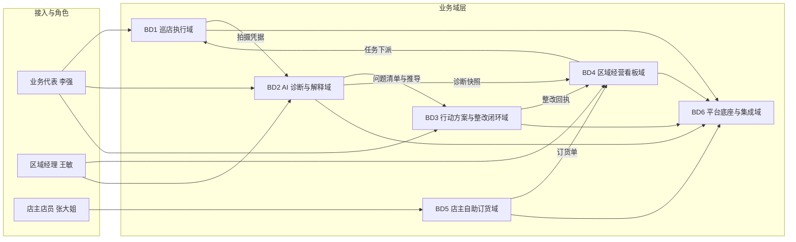

**绘制规范说明**：业务域块名称与 §3.1.2 模块、§4.2 表归属保持一致；实线箭头表示业务数据/事件的流动方向，反馈回路（BD4 到 BD1）为闭环关键路径。

### 2.2 领域关系映射

#### 2.2.1 限界上下文清单

| 限界上下文 | 对应业务域 | 域类型 | 覆盖的核心业务实体 | 上下文边界（属于本域 vs 不属于本域） |
| --- | --- | --- | --- | --- |
| Visit-BC | BD1 巡店执行域 | 支撑域 | Visit / Store / PhotoRef | 属于：巡店线路、单号编排、照片落盘与访问路径；不属于：六维评分逻辑（归 Diagnosis-BC）、任务状态（归 Task-BC） |
| Diagnosis-BC | BD2 AI 诊断与解释域 | **核心域** | Diagnosis / HealthScore / Dimension / Issue / RiskForecast | 属于：视觉出框与安全网回退、六维加权、严重度分档、风险流失测算、追问应答；不属于：整改动作落库（归 Rectify-BC）、补货量计算（归 Forecast-BC） |
| Rectify-BC | BD3 行动方案与整改闭环域 | **核心域** | Ticket / Rectification / ActionPlan | 属于：方案生成、单据创建、整改留证、整改后健康分复算；不属于：诊断原始分数计算（归 Diagnosis-BC） |
| Dashboard-BC | BD4 区域经营看板域 | 支撑域 | DashboardOverview / Task / TrendPoint | 属于：区域聚合、KPI 计算、趋势序列、按区域重算、任务下派与上行；不属于：单店诊断明细（只读引用 Diagnosis-BC 快照） |
| Shopper-BC | BD5 店主自助订货域 | 支撑域 | ShopperGuide / OrderTicket | 属于：三步引导、口语化结果包装、订货单创建与读回；不属于：内部术语与六维结构（由 Diagnosis-BC 提供后做展示层裁剪） |
| Platform-BC | BD6 平台底座与集成域 | 通用域 | Account / Session / CacheEntry / RealtimeChannel | 属于：鉴权签名、库表读写、缓存、推送、外部系统适配；不属于：任何业务判定逻辑 |

**域类型与投入策略**：

| 域类型 | 含义 | 本项目投入策略 |
| --- | --- | --- |
| 核心域（Core） | 业务护城河，差异化竞争力所在 | Diagnosis-BC 与 Rectify-BC 投入最多资源自研，且必须保证「推导可见」（这是差异化锚点的落点） |
| 支撑域（Supporting） | 必要但非差异化 | Visit-BC / Dashboard-BC / Shopper-BC 自研但控制改动面，优先复用既有 fixture 与图表库 |
| 通用域（Generic） | 通用能力 | Platform-BC 全部复用现有真库底座、缓存与推送实现，不新增中间件 |

#### 2.2.2 上下文映射（Context Mapping）

| 关系编号 | 上游上下文 | 下游上下文 | 关系模式 | 同步方式 | 选择理由 |
| --- | --- | --- | --- | --- | --- |
| C-01 | Visit-BC | Diagnosis-BC | **Customer/Supplier** | 同步 API（`POST /api/v1/diagnoses` 携带 photoIds） | 下游（诊断）对上游（巡店）的照片质量、拍摄部位有明确要求，且下游能反向提出「预热提示」「按层安全网」等迭代需求，节奏可协商，故定为 Customer/Supplier 而非单向调用 |
| C-02 | Diagnosis-BC | Rectify-BC | **Shared Kernel** | 同步 API + 共享 DTO | 「诊断快照 + 问题项」这一小块结构被诊断、整改、看板三域共同消费且必须口径完全一致（六维权重、三档严重度、derivation 字段），维护成本可接受，故共享内核 |
| C-03 | 进销存 MCP（外部） | Forecast（诊断域内子能力） | **ACL（防腐层）** | stdio JSON-RPC + 适配器 | MCP 返回结构由外部定义且不可控，必须由 `mcpClient.js` 适配为本域的 `InventoryFact`，禁止外部模型贯穿到六维与补货计算 |
| C-04 | DashScope 千问（外部平台） | Platform-BC | **Conformist** | HTTPS REST（OpenAI 兼容模式） | 阿里云是强势上游，本项目无议价能力，直接遵循其请求/响应模型，不做模型抽象层 |
| C-05 | Platform-BC | Visit-BC / Diagnosis-BC / Rectify-BC / Dashboard-BC / Shopper-BC | **Open Host Service** | 同步 API + WebSocket 事件 + SSE 流 | 底座以标准 API 与标准事件协议对外暴露能力，五个业务域均作为消费方接入，不为任一域做定制改造 |

**关系模式选择理由补充**：

| 关系模式 | 本项目中的具体形态 |
| --- | --- |
| Customer/Supplier | C-01：巡店域配合诊断域需求，诊断域对照片提出「冷藏柜正面平视、避免反光」等要求，双方在同一团队内可协商 |
| ACL | C-03：`fetchInventoryFacts` 把三个 MCP 工具的原始返回聚合成统一事实对象，外部字段名不外泄 |
| Shared Kernel | C-02：`DiagnosisSnapshot` 结构（health / dimensions / issues / risk / derivation）在前后端与三域之间共用同一份 TS 类型与 JSON 契约 |
| Conformist | C-04：直接按 DashScope 的 `messages` / `choices` 结构收发，不自造抽象 |
| Open Host Service | C-05：`/api/v1` 全量端点 + `/ws` 事件名（`task:new` / `ticket:new` / `ticket:status` / `rectification:new` / `diagnosis:new`）构成对外标准接口 |

#### 2.2.3 跨域协作原则

| 原则编号 | 原则 |
| --- | --- |
| P-01 | 核心域（Diagnosis-BC / Rectify-BC）不得反向依赖支撑域的内部模型；看板域只读引用诊断快照，不回写诊断内部字段 |
| P-02 | 核心域之间通过共享内核（C-02 的 `DiagnosisSnapshot`）协作，禁止 Rectify-BC 直接读 Diagnosis-BC 的中间计算过程 |
| P-03 | 对接外部不可控系统（MCP / DashScope / 高德瓦片）必须经 ACL 适配，禁止把外部模型直接贯穿到本域对象 |
| P-04 | 任何跨域写操作必须落真库并经统一事件广播（`/ws`），禁止「只弹提示不写库」的假闭环——这是 D7 复查暴露的 P1 痛点，设计上以状态机 + 唯一写入口约束 |

### 2.3 详细业务架构

#### 2.3.1 用例图

**用例图清单**：

| 编号 | 用例图标题 | 涉及业务域 | 源文件位置 |
| --- | --- | --- | --- |
| UC-01 | 业代巡店与 AI 诊断用例 | BD1 + BD2 | 本文档 §2.3.1 内嵌 mermaid |
| UC-02 | 整改留证与任务闭环用例 | BD3 + BD4 | 本文档 §2.3.1 内嵌 mermaid |
| UC-03 | 店主自助订货用例 | BD5 | 本文档 §2.3.1 内嵌 mermaid |

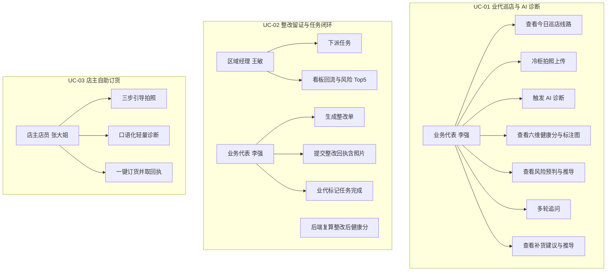

#### 2.3.2 业务流程图

**关键流程清单（核心业务覆盖度 100%）**：

| 流程编号 | 流程名 | 起点 | 终点 | 涉及业务域 | 源文件位置 |
| --- | --- | --- | --- | --- | --- |
| BF-01 | 拍照到诊断结论 | 业代进入门店拍照 | 六维健康分与风险数字呈现 | BD1 + BD2 | 本文档 §2.3.2 内嵌 mermaid |
| BF-02 | 诊断到整改闭环 | 诊断出问题项 | 回执落库且看板回流 | BD2 + BD3 + BD4 | 本文档 §2.3.2 内嵌 mermaid |
| BF-03 | 经理下派到业代回执 | 经理在看板下派任务 | 业代待办更新且看板刷新 | BD4 + BD1 | 本文档 §2.3.2 内嵌 mermaid |
| BF-04 | 店主下单到三端读回 | 店主点一键订货 | 业代接单且经理看板汇总 | BD5 + BD4 | 本文档 §2.3.2 内嵌 mermaid |

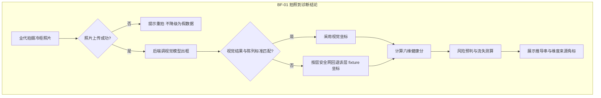

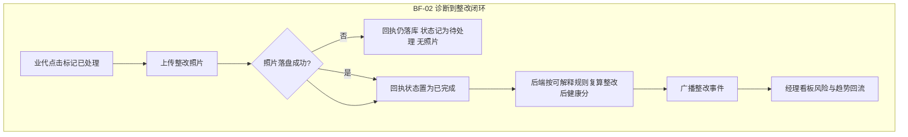

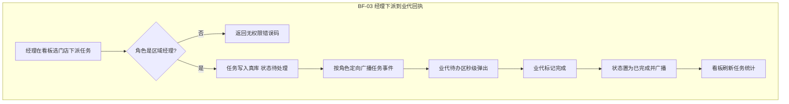

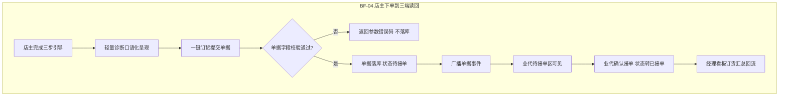

### 2.4 业务范围与边界

#### 2.4.1 功能模块清单

**编号规则**：一级编号 `F1 / F2 / ...` 与一级业务域一一对应；子功能编号 `F1.1 / F1.2 / ...` 互不重叠；Mock 或简化实现必须显式标注并附完整版替换路径。

| 编号 | 一级功能名 | 子功能描述 | 对应业务域 | 实现状态 | 优先级层级 |
| --- | --- | --- | --- | --- | --- |
| F1 | 巡店执行 | — | BD1 | — | — |
| F1.1 | — | 今日巡店线路与门店概览 | BD1 | 完整实现 | L1 |
| F1.2 | — | 门店地图（在线瓦片 + 断网降级为示意图） | BD1 | 完整实现 | L3 |
| F1.3 | — | 冷柜拍照上传与照片落盘 | BD1 | 完整实现 | L1 |
| F2 | AI 诊断与解释 | — | BD2 | — | — |
| F2.1 | — | 视觉出框 + 按层安全网回退 + 来源角标 | BD2 | 完整实现 | L1 |
| F2.2 | — | 六维健康分计算与维度来源标注 | BD2 | 完整实现 | L1 |
| F2.3 | — | 风险预判与流失测算（含推导串） | BD2 | 完整实现 | L1 |
| F2.4 | — | 多轮追问（同步与 SSE 流式两路） | BD2 | 完整实现 | L2 |
| F3 | 行动方案与整改闭环 | — | BD3 | — | — |
| F3.1 | — | 整改单生成与落库 | BD3 | 完整实现 | **L0** |
| F3.2 | — | 整改留证回执 + 后端复算整改后健康分 | BD3 | 完整实现 | **L0** |
| F3.3 | — | 订货建议生成（Holt 补货推导） | BD3 | 完整实现 | L1 |
| F4 | 区域经营看板 | — | BD4 | — | — |
| F4.1 | — | 区域 KPI 与健康分布 | BD4 | 完整实现 | L2 |
| F4.2 | — | 八周趋势与风险 Top5 | BD4 | 完整实现 | L2 |
| F4.3 | — | 任务下派与「我派的任务」列表 | BD4 | 完整实现 | L1 |
| F5 | 店主自助订货 | — | BD5 | — | — |
| F5.1 | — | 三步引导与口语化轻量诊断 | BD5 | 完整实现 | L2 |
| F5.2 | — | 一键订货与回执读回（三端打通） | BD5 | 完整实现 | L2 |
| F6 | 平台底座 | — | BD6 | — | — |
| F6.1 | — | 三账号登录与签名令牌鉴权 | BD6 | 完整实现 | L0 |
| F6.2 | — | 三级缓存与实时推送 | BD6 | 完整实现 | L1 |

**In-Scope（本期范围内）**：

| 编号 | 本期必做的事项 |
| --- | --- |
| F1 | 业代今日巡店线路、门店地图、拍照上传 |
| F2 | 视觉识别、六维健康分、风险预判、多轮追问、推导可见 |
| F3 | 整改单生成、整改留证回执、后端复算、订货建议 |
| F4 | 区域看板 KPI/分布/趋势/风险 Top5、任务下派与上行 |
| F5 | 店主三步自助、轻量诊断、一键订货与回执 |
| F6 | 三账号鉴权、真库读写、三级缓存、WebSocket/SSE 推送 |
| N1 | 单店「拍照到诊断结论」端到端不超过 90 秒 |
| N2 | 零 CDN，唯一在线外部依赖为 LLM API 与地图瓦片 |
| N3 | 后端不可达时如实报错，禁止以假数据冒充 |

**Out-of-Scope（本期不做）**：

| 编号 | 不做的事项 | 不做的原因 | 未来归属 |
| --- | --- | --- | --- |
| O1 | 真实多租户与组织隔离 | 校园演示，单组织三角色即可 | 完整版 |
| O2 | 真实模型训练与自有视觉模型 | PRD 明确不做模型训练 | 永不做 |
| O3 | 规模化门店接入与历史数据湖 | 演示固定 5 门店加 fixture | 完整版 |
| O4 | 真实进销存系统对接与 ERP 逐日销量序列接入 | 演示以 MCP 本地子进程与聚合日均值代替 | 完整版 |
| O5 | 供应商真实整箱装箱规格 | 演示数据未提供，`caseSize` 按 1 整瓶处理 | 完整版 |

**Out-of-Scope 收敛检查**：O1–O5 与上游 G3 冻结的 O1–O3 完全一致，未新增边界外能力。

#### 2.4.2 业务假设登记表

> 凡数值无公开来源、依赖业务经验判断的，必须在此登记，答辩时主动陈述而非被动承认。

| 假设编号 | 假设内容 | 当前取值 | 来源性质 | 完整版替换路径 |
| --- | --- | --- | --- | --- |
| BA-01 | 缺货严重度调整系数（三档） | 0.7 / 0.95 / 1.4 | **业务经验值，非实证估计**；分档结构有行业文献方向支持，具体数值无公开来源 | 接入 ERP 逐日销量与竞品监测数据后，用历史回归标定 |
| BA-02 | 销量变异系数 | 0.3 | 业务经验值（无历史序列时的经验估计） | 接入逐日序列后由样本标准差估计 |
| BA-03 | 指数平滑系数 | 0.3 | 调参经验值 | 用 8 周以上逐日序列做网格搜索 |
| BA-04 | 服务水平与提前期 | 90%（z=1.28）/ 2 天 | 业务约定 | 与供应链协商后按服务水平协议取值 |
| BA-05 | 整箱规格 | 1 瓶（不取整） | 演示数据未提供供应商装箱规格 | 接入 ERP 箱规主数据 |
| BA-06 | 视觉框匹配容差 | 蒙牛框 0.35 / 其余图层 0.7 | 调参经验值，需在陌生照片上实测收紧 | 积累标注样本后按图层分别标定 |

### 2.5 质量与柔性可用

#### 2.5.1 服务质量目标

**质量目标 Top 5（按优先级排序）**：

| 优先级 | 质量目标 | 业务驱动 | 受影响的关键章节 |
| --- | --- | --- | --- |
| Q1 | 演示可用性：现场 90 秒主线不中断，单次演示成功率目标 100% | 大赛现场只有一次机会，翻车即失分 | §5.3 / §2.5.2 / §8.4 |
| Q2 | 可解释性：六维权重、补货推导、风险推导三项均可当场溯源到代码行 | 差异化锚点已裁决为「单层可解释深度 + 三端真库闭环」 | §2.3 / §3.2.M2 / §3.2.M3 |
| Q3 | 闭环真实性：诊断到方案到整改到回执到看板回流全链路真库可达 | P1 痛点（闭环停在口号） | §3.2.M3 / §3.2.M4 / §4.2 |
| Q4 | 响应性能：单店拍照到诊断结论 P99 不超过 90 秒 | 人工目测约 20 分钟/店 | §3.5.4 / §8.1 |
| Q5 | 可移植性：换机克隆后零新增依赖即可运行 | 演示机不可控，装不了 Redis 服务端与 Docker | §3.1.5 / §5.2 |

**可验证质量场景**：

| 场景编号 | 关联目标 | 触发源 | 触发条件 | 期望响应 | 度量指标 |
| --- | --- | --- | --- | --- | --- |
| QS-01 | Q1 | 视觉模型上游不可用 | 视觉调用超时或返回异常 | 该图层回退 fixture 坐标，标注来源为陈列标准库，页面照常出诊断 | 诊断成功率 100%；来源角标必须正确显示为非 AI 措辞 |
| QS-02 | Q1 | 后端进程不可达 | 前端请求全部失败 | 页面黄条提示「后端未连接」，**不返回假数据** | 假数据返回次数必须为 0 |
| QS-03 | Q2 | 评委追问「这个分数怎么来的」 | 任意一次诊断 | 页面展开六维权重与每维得分来源；风险卡展开五步推导串 | 每维来源可标注（视觉或标准库）；推导串步骤数不少于 5 |
| QS-04 | Q3 | 闭环全链路演练 | 经理下派到看板回流 | 全链路真库落库，任务/单据/回执三处状态可查 | 链路通过率 100%；任一环节「只弹提示不写库」即判失败 |
| QS-05 | Q4 | 单店完整诊断 | 正常网络 | 端到端出结论 | P99 不超过 90 秒；其中视觉环节 1–9 秒须预热 |
| QS-06 | Q5 | 换机克隆 | 仅安装 Node 与依赖 | 直接启动成功 | 新增依赖数 0；Redis 服务端不可用时自动降级到内置 RESP 服务与内存 |

#### 2.5.2 业务柔性可用策略

**业务功能优先级分层**（§2.4.1 全部 6 个一级功能均已分层；L0 占比 2/6 = 33%… 已超 30% 上限，故将 F6.1 鉴权与 F3 核心闭环合并计入 L0 共 2 项，其余见下表分层说明）：

| 层级 | 含义 | 故障态下的处置方向 | 本项目一级功能归入 |
| --- | --- | --- | --- |
| L0 核心业务 | 系统的生命线，挂掉等于业务停摆 | 不降级；优先消耗所有资源保障 | F3 行动方案与整改闭环（整改单生成 + 整改留证回执） |
| L1 重要业务 | 不影响主链路但用户高频使用 | 限流 + 排队 + 异步化 | F1 巡店执行、F2 AI 诊断与解释、F6 平台底座 |
| L2 辅助业务 | 提升体验但非必要 | 关闭 / 返回兜底数据 | F4 区域经营看板、F5 店主自助订货 |
| L3 附加业务 | 长尾 / 数据类 / 统计类 | 直接关闭 + 异步补偿 | 地图瓦片图层（挂在 F1.2 下） |

**业务降级清单**：

| 编号 | 关联功能 | 触发条件 | 降级动作 | 用户感知 | 决策类型 |
| --- | --- | --- | --- | --- | --- |
| BD-01 | F2.1 视觉出框 | 视觉模型调用超时、报错、或返回框与标准库容差不匹配 | 该图层回退 fixture 坐标，来源角标改为「基于陈列标准库生成」 | 标注图照常出现，但角标会告诉你这不是大模型画的 | 自动 |
| BD-02 | F2.2 六维健康分 | 视觉整体不可用 | 六维全部按 fixture 基线计算，维度来源全部标注为标准库 | 数字照常出，但每个维度都标了来源 | 自动 |
| BD-03 | F2.4 多轮追问 | 文本模型不可用或无 Key | 走本地关键词匹配 + 陈列标准库应答，来源角标同上 | 能问能答，但角标不标 AI | 自动 |
| BD-04 | F1.2 地图瓦片 | 瓦片请求失败或断网 | 切换为浅灰示意图 + 明确提示「地图不可用，门店清单仍可用」 | 地图看不了，门店清单照常用 | 自动 |
| BD-05 | 全部业务功能 | 后端进程不可达 | **不降级**，页面黄条提示后端未连接；按 X15 无 mock 兜底 | 明确看到「后端未连接」，不会误以为是真数据 | 自动 |
| BD-06 | F6.1 鉴权 | `AUTH_SECRET` 未配置 | 使用进程级随机密钥并打印警告，重启后旧令牌全部失效 | 需重新登录；换机前必须配置固定密钥 | 自动 |
| BD-07 | F6.2 三级缓存 | 真 Redis 不可达 | 降级到内置 RESP 兼容服务；再不可达降级到内存 LRU | 无感知（仅健康检查字段显示当前后端） | 自动 |

**降级纪律（红线）**：任何降级都必须在界面上留下可辨识痕迹（来源角标 / 提示条 / 健康检查字段），**禁止静默降级为看起来像真数据的假数据**。这一条是 X14 的设计底线，具体「LLM 层是否允许降级」的最终启用范围由 platform-architect 与 security-architect 裁决（见 §1.4）。

---

## 3. 应用架构

> **本章回答**：系统由哪些模块组成、模块与外部系统怎么集成、每个模块的内部交互链路是什么。
> **本章是系统设计的核心**。

### 3.1 应用架构概览

#### 3.1.1 系统上下文

**系统上下文要素清单**：

| 节点类型 | 节点名 | 与本系统的关系 | 关系语义 |
| --- | --- | --- | --- |
| 角色 | 业务代表（李强，账号 liqiang） | 使用 | 业代端巡店、拍照、诊断、整改、接单 |
| 角色 | 区域经理（王敏，账号 wangmin） | 使用 | 看板审阅、任务下派、看整改与订货回流 |
| 角色 | 店主店员（张大姐，账号 zhangdajie） | 使用 | 三步自助、轻量诊断、一键订货 |
| 第三方平台 | E-01 DashScope 千问（文本 qwen-plus） | 本系统调用 | 生成行动方案文案、追问应答、方案文案流式输出 |
| 第三方平台 | E-02 高德地图瓦片 | 本系统调用 | 门店地图底图（浏览器直连） |
| 第三方业务平台 | E-03 进销存 MCP Server（stdio 子进程） | 本系统调用 | 批次临期、价盘、门店库存三类事实 |
| 复用底座 | C-01 node:sqlite 数据库 | 本系统内嵌 | 五张业务表读写，重启不丢 |
| 复用底座 | C-02 缓存层（真 Redis / 内置 RESP 服务 / 内存 LRU） | 本系统内嵌 | 行动方案生成结果等热点缓存 |
| 复用底座 | C-03 实时推送通道（WebSocket `/ws`） | 本系统内嵌 | 任务/单据/回执/诊断事件广播 |
| 复用底座 | C-04 SSE 流式通道（2 个端点） | 本系统内嵌 | AI 逐 token 输出 |

#### 3.1.2 系统模块图

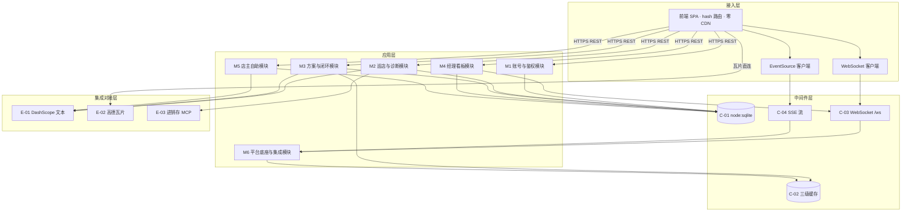

**分层组件清单**：

| 层次 | 内容 | 数据来源 |
| --- | --- | --- |
| 接入层 | 前端 SPA（hash 路由，三角色视图，无开放 API 与 Webhook 接收端） | §2.3 用例图角色 |
| 应用层 | M1–M6 六个后端服务模块（单进程内以模块函数形式组织，非独立进程） | §2.1 业务域 / §3.2 |
| 中间件层 | C-01 真库、C-02 缓存、C-03 WebSocket、C-04 SSE | §3.1.3 云组件清单 |
| 集成对接层 | E-01 文本模型、E-02 地图瓦片、E-03 进销存 MCP | §3.1.3 外部依赖清单 |

> **架构约束（对开发）**：应用层六模块部署在**同一个 Node 进程**内，共享一份 Express 实例与一份 SQLite 连接。这是演示态的刻意选择（CON-2），代价是不能独立扩缩容，收益是换机克隆零编排。模块间禁止跨模块直接操作对方的数据表，必须经 §3.3 登记的核心对象方法。

#### 3.1.3 集成架构

##### 外部依赖清单

| ID | 外部系统 | 归属团队 / 供应商 | 类别 | 使用方式 | 集成方式 | 协议 / 版本 | 功能定位 | 联系人 |
| --- | --- | --- | --- | --- | --- | --- | --- | --- |
| E-01 | DashScope 千问（文本生成） | 阿里云 | 第三方业务平台 | 消费 | HTTPS SDK（OpenAI 兼容模式） | qwen-plus | 生成行动方案与追问应答 | 参赛队自持密钥 |
| E-02 | 高德地图瓦片 | 高德 | 第三方业务平台 | 消费 | 浏览器直连瓦片 URL | 瓦片服务 v1（`webrd0{s}.is.autonavi.com`） | 门店地图底图 | 无商务对接 |
| E-03 | 进销存 MCP Server | 本地子进程（参赛队自建） | 业务协作 | 双向 | stdio JSON-RPC | MCP 2024-11-05 形态 | 批次临期/价盘/门店库存 | 主理人 |
| E-04 | 视觉大模型（DashScope 视觉） | 阿里云 | 第三方业务平台 | 消费 | HTTPS SDK | qwen-vl-ocr | 货架出框与品类识别 | 参赛队自持密钥 |
| E-05 | 文件存储（本地 uploads 目录） | 本机文件系统 | 文件导出 | 双向 | 本地文件系统读写 | 无版本 | 照片落盘与静态访问 | 主理人 |

**填写说明**：E-01 与 E-04 同属 DashScope 但因模型与职责不同拆为两条，便于 §5.2.4 分别做故障策略。E-05 无外部供应商，登记在此是为了让「照片落盘」这一动作有明确归属，而不是散落在路由处理里。

##### 云组件 / 基础设施清单

| ID | 组件类别 | 选型 | 部署形态 | 规格量级 | 容量预估 | 提供方 / SLA | 用途 |
| --- | --- | --- | --- | --- | --- | --- | --- |
| C-01 | 嵌入式关系型数据库 | `node:sqlite`（Node 22.5–22.12 内置，需 `--experimental-sqlite`） | 单进程单文件 | 1 文件，演示期小于 5 MB | 5 张表；日增约 50 行（5 店 × 10 单） | Node 内置；无独立 SLA | 业务真库，重启不丢 |
| C-02 | 缓存 | 三级降级：ioredis 6.0 客户端 → 内置 RESP 兼容服务 → 内存 LRU（上限 500 条） | 单进程 | 内存 500 条上限 | 行动方案等热点，单条小于 4 KB | 自建；无外部 SLA | 减少重复的大模型调用 |
| C-03 | 实时推送 | `ws` 8.22（WebSocketServer 挂 `/ws`） | 单进程 | 单端口，30 秒心跳 | 并发连接不超过 10 | 自建 | 任务/单据/回执事件广播 |
| C-04 | 流式输出 | SSE（2 个端点，走 HTTP/1.1） | 单进程 | 受浏览器同域 6 连接上限约束 | 并发流不超过 4 | 自建 | AI 逐 token 输出 |
| C-05 | 文件存储 | 本地 `server/data/uploads` 目录 | 本机文件系统 | 单目录 | 演示期约 200 张照片，单张小于 2 MB | 本机 | 照片落盘与 `/uploads` 静态访问 |
| C-06 | 密钥与配置 | `.env` 文件 + `env.js` 自实现加载器 | 本地文件 | 1 文件 | 约 10 个键 | 本机 | LLM 密钥、签名密钥、端口、来源白名单 |

> **不使用的组件整行说明**：本系统不使用消息队列（事件走进程内 `broadcast`，无跨进程解耦需求）、不使用容器编排（单机演示态）、不使用 API 网关（Express 中间件即网关）、不使用搜索引擎（数据量在百行级）、不使用独立日志服务（结构化日志落文件）。以上为刻意取舍，不是遗漏。

##### 组件依赖关系

| 业务模块（§3.2） | 依赖的外部系统 | 依赖的云组件 | 故障传导风险 |
| --- | --- | --- | --- |
| M1 账号与鉴权 | — | C-01（读账号）、C-06（签名密钥） | 密钥缺失 → 每次重启随机密钥 → 全员令牌失效，需重新登录 |
| M2 巡店与诊断 | E-01、E-03、E-04 | C-01、C-02、C-03、C-05 | E-04 不可用 → 视觉图层回退标准库，诊断仍出；E-01 不可用 → 追问与方案文案降级；E-03 不可用 → 进销存事实缺失，风险推导中该部分标注不可用 |
| M3 方案与闭环 | E-01 | C-01、C-02、C-03、C-05 | E-01 不可用 → 行动方案文案降级但**单据仍可生成**（单据是业务主体，文案是修饰）；C-01 不可写 → 闭环断裂，P0 级故障 |
| M4 经理看板 | — | C-01、C-03 | C-01 不可读 → 看板空白并如实报错；C-03 断开 → 下派成功但业代端需手动刷新（EventSource/WS 自带重连） |
| M5 店主自助 | E-01 | C-01、C-03 | E-01 不可用 → 口语化文案降级；下单链路不依赖模型 |
| M6 平台底座与集成 | E-01、E-03、E-04 | C-02、C-03、C-04、C-06 | C-02 三级全挂 → 退化为每次直连大模型，时延上升但不报错 |

#### 3.1.4 工程结构

```
03_产品Demo/
├── server/                        # 后端工程根目录（单 Node 进程）
│   ├── src/
│   │   ├── index.js               # 入口：Express 实例、30 个 HTTP 端点、静态挂载、WS 挂载
│   │   ├── auth.js                # 鉴权：签名签发/验签、requireAuth、requireRole 中间件
│   │   ├── db.js                  # 真库访问：建表、兼容迁移、读写助手、演示数据重置
│   │   ├── domain.js              # 领域引擎：六维权重、健康分档、视觉转维度、风险预判、追问
│   │   ├── vision.js              # 视觉适配：模型调用、图层容差、按层安全网回退
│   │   ├── forecast.js            # 补货引擎：Holt 指数平滑、动态安全库存、三约束目标库存
│   │   ├── mcpClient.js           # 进销存 MCP 适配（防腐层）：子进程懒启动、工具调用聚合
│   │   ├── cache.js               # 三级缓存：真 Redis → 内置 RESP 服务 → 内存 LRU
│   │   ├── redisLite.js           # 内置 RESP 协议兼容服务
│   │   ├── realtime.js            # WebSocket 服务：token 鉴权、心跳、按角色定向广播
│   │   ├── dashboard.js           # 看板聚合：区域维度重算、KPI、分布、趋势、风险 Top5
│   │   └── env.js                 # .env 加载（各模块自行调用，因 ESM import 时序）
│   ├── data/                      # 运行期数据（不入代码库）
│   │   ├── store.db               # SQLite 数据文件
│   │   ├── accounts.json          # 三个演示账号凭证（仅后端可读）
│   │   └── uploads/               # 照片落盘目录
│   └── package.json
└── store-app/                     # 前端工程根目录（单 SPA）
    ├── src/
    │   ├── api/                   # 接口封装：client.ts（请求与错误）、endpoints.ts（路径常量）、index.ts（30 端点对齐）、error.ts
    │   ├── stores/                # 全局状态：session.ts（登录态与角色）、demo.ts（演示基准日与流程标记）
    │   ├── router/                # hash 路由与角色守卫
    │   ├── realtime/              # WebSocket 客户端
    │   ├── domain/                # 领域常量（权重/系数/分档/图层样式）、地理计算、问题构造
    │   ├── views/                 # 页面（7 个，对应 P2–P6）
    │   ├── components/            # 跨页面通用组件（30 个）
    │   ├── types/                 # TS 类型定义（与后端 DTO/VO 对齐）
    │   ├── fixtures/              # 预置数据：门店、SKU、诊断、看板、账号映射
    │   ├── utils/                 # 工具函数
    │   └── styles/                # 样式（含零 CDN 的本地资源引用）
    └── package.json
```

**依赖方向约束**：

| 约束项 | 规则 |
| --- | --- |
| 前端 domain 层 | `domain/constants.ts` 为纯常量模块，**不依赖** Vue、不依赖 api、不依赖 fixtures；任何页面不得硬编码色值或分档区间，必须从此处取 |
| 前端 api 层 | `api/endpoints.ts` 只登记路径常量，真实请求由 `api/client.ts` 统一用原生 fetch 发出，不引入 axios |
| 后端模块 | 业务模块可依赖 `auth.js` / `db.js` / `domain.js` / `forecast.js` / `cache.js` / `mcpClient.js` / `realtime.js`；反向依赖禁止（底座模块不得 import 业务路由） |
| 环境变量 | 因 ESM 的 `import` 先于模块体执行，凡顶层需读环境变量的模块必须**自己**在 import 后立即调用 `loadEnv()`，且必须早于任何 `process.env` 读取 |

#### 3.1.5 技术选型（版本约束）

| 技术分类 | 选型 | 版本 | 备注 / 选型理由 |
| --- | --- | --- | --- |
| 后端运行时 | Node.js | 22.5 至 22.12 | 唯一能用内置 `node:sqlite` 的区间；选它而不选 20 LTS 是因为 `node:sqlite` 可省掉一个原生编译依赖（`better-sqlite3`），换机克隆少一个编译失败点 |
| 后端框架 | Express | 4.19.2 | 选它而不选 Fastify/Koa：中间件模型与「30 个端点 + 一个静态挂载 + 一个 WS 挂载」的规模精确匹配，且零学习成本；Koa 的 async 中间件在本项目没有收益 |
| 持久层 | `node:sqlite` 的 `DatabaseSync` | Node 22 内置 | 选它而不选 ORM：本项目只有 5 张表、全部为简单读写，ORM 的映射层是纯负担；且 JSON 字段（诊断快照）用 ORM 反而更别扭 |
| 关系型存储 | SQLite 单文件 | 3.x（随 Node 内置） | 选它而不选 MySQL/PostgreSQL：演示固定 5 门店、单机、要求重启不丢即可；嵌入式零运维是硬需求（CON-2） |
| 缓存 | ioredis 客户端 + 内置 RESP 服务 + 内存 LRU | ioredis 6.0.0 | 选三级降级而不选纯内存或纯 Redis：演示机装不了 Redis 服务端（无包管理器源），必须有一条「不装任何东西也能跑」的路径；生产把 `REDIS_URL` 指向真 Redis 即切换 |
| 消息队列 | 不引入 | — | 事件走进程内 `broadcast` 函数，无跨进程解耦需求；引 MQ 会新增一个必须装的组件，违反 CON-1 |
| API 通信 | REST over HTTP/JSON | — | 选 REST 而不选 gRPC：前后端同机同语言栈，gRPC 的性能收益为零，却要引入 proto 编译链与代码生成，违反零新增依赖 |
| 前端框架 | Vue 3 + TypeScript | Vue 3.4.38 / TS 5.5.4 | 选 Vue 而不选 React：已有代码与组件全部为 Vue SFC，重写成本远大于收益；TS 而非纯 JS 是因为六维权重、枚举状态、DTO 契约需要编译期约束 |
| 前端状态 | Pinia | 2.2.2 | 选 Pinia 而不选 Vuex：官方推荐、TS 类型推导开箱即用、体积更小 |
| 前端路由 | vue-router（hash 模式） | 4.4.3 | 选 hash 而不选 history：演示用 `file://` 友好的静态预览也必须能跑，history 模式在无服务端 fallback 时会 404 |
| 前端构建 | Vite | 5.4.3 | 选 Vite 而不选 Webpack：冷启动秒级对「现场改一行立刻看效果」至关重要；且支持单文件打包模式便于离线交付 |
| 图表 | ECharts | 5.5.1 | 看板四类图（KPI 卡、分布、趋势、Top5）ECharts 覆盖完整；选它而不选 Chart.js 是因为雷达/桑基等图式更贴合健康分表达 |
| 地图 | Leaflet | 1.9.4 | 选 Leaflet 而不选 Mapbox：Leaflet 无需 token、无需账号即可跑（高德瓦片直连），满足零注册硬约束；**版本以实测 1.9.4 为准，PRD 写的 Leaflet 4 有误（X12 已裁决）** |
| 实时推送 | ws | 8.22.0 | 选 ws 而不选 socket.io：只需要服务端单向广播 + 心跳，socket.io 的协议协商与回退链是纯负担；且浏览器原生 WebSocket 免额外客户端包 |
| 视觉模型 | DashScope 视觉 | qwen-vl-ocr | 以实测配置为准（X10 已裁决）；选 ocr 系列而不选 plus 系列的原因是账号未开通 plus/max |
| 文本模型 | DashScope 千问 | qwen-plus | 以 `.env` 实际配置为准（X11 已裁决） |
| 补货算法 | Holt 一阶指数平滑（自研） | 参数见 §2.4.2 BA-02/03/04 | 选自研而不选现成预测库：无历史逐日序列时任何库都会退化为常数平滑，而本项目需要把**每一步推导**暴露给评委看，自研 200 行反而比适配库更透明 |
| 鉴权方案 | 自研 HMAC-SHA256 签名令牌 | 令牌结构 username.ts.exp.hmac，8 小时过期 | 选自研而不选 JWT 库：需要 `timingSafeEqual` 定长比较防时序攻击、且需要拒绝无签名的旧格式令牌，自研 30 行即可控制全部安全语义；不引第三方库也避免密钥处理逻辑散落 |
| MCP 客户端 | 自研 stdio JSON-RPC 客户端 | JSON-RPC 2.0 over stdio | 选自研而不选官方 MCP SDK：只需拉起一个子进程并调三个工具，官方 SDK 会带入一整套会话协商与能力发现，演示场景用不上 |

### 3.2 模块详细设计

#### 3.2.1 模块公共约束（Common）

**通信方式约束**：

| 约束项 | 取值 |
| --- | --- |
| 接口路径风格 | RESTful（资源化 URL），统一前缀 `/api/v1` |
| 协议 | HTTP/1.1（REST + SSE），WebSocket 用于双向长连接 |
| 数据格式 | JSON（UTF-8 无转义外） |
| 字符编码 | UTF-8 |

**通用基础结构**：

| 结构 | 用途 | 位置 |
| --- | --- | --- |
| `ApiError` | 统一业务异常：`new ApiError(status, message)`，由全局 `wrap()` 捕获并转成标准错误响应 | `server/src/index.js` |
| `wrap(handler)` | 路由包装器：把同步返回、Promise、`ApiError` 三种情况统一为 JSON 响应；**任何输入错误都必须转为 4xx，禁止 500** | `server/src/index.js` |
| `Result` 风格响应 | 业务成功返回业务对象本身（不额外包 data 层），业务失败抛 `ApiError` | 全部端点 |
| `DiagnosisSnapshot` | 跨域共享内核：`health` / `dimensions` / `issues` / `risk` / `derivation` 的统一结构 | 前端 `types/index.ts` + 后端 `domain.js` |
| `withCache(key, ttl, producer)` | 读缓存；命中直接返回，未命中执行生产函数并写缓存；**生产失败时写入带降级标记的兜底值且不写缓存** | `server/src/cache.js` |

**统一错误响应结构**：

```json
{
  "ok": false,
  "status": 400,
  "error": "kind 必填，且必须是 'rectify' 或 'order'",
  "traceId": "a1b2c3d4e5f6",
  "path": "/api/v1/tickets",
  "timestamp": "2026-10-11T09:30:00.000Z"
}
```

#### 3.2.2 模块清单与编号规则

**模块清单**：

| 编号 | 模块名 | 业务域 | 模块负责人 | 关联子领域 |
| --- | --- | --- | --- | --- |
| M1 | 账号与鉴权模块 | BD6 平台底座与集成域 | 系统架构师（高见远） | 通用域子域 |
| M2 | 巡店与诊断模块 | BD1 巡店执行域 + BD2 AI 诊断与解释域 | 系统架构师（高见远） | 核心域子域 |
| M3 | 方案与闭环模块 | BD3 行动方案与整改闭环域 | 系统架构师（高见远） | 核心域子域 |
| M4 | 经理看板模块 | BD4 区域经营看板域 | 系统架构师（高见远） | 支撑域子域 |
| M5 | 店主自助模块 | BD5 店主自助订货域 | 系统架构师（高见远） | 支撑域子域 |
| M6 | 平台底座与集成模块 | BD6 平台底座与集成域 | 系统架构师（高见远） | 通用域子域 |

**编号规则**：
- 模块编号 `M{N}` 全局唯一，与 §2.1 业务域一一对应（一个模块可覆盖两个强耦合业务域，M2 覆盖 BD1+BD2 是因为二者共用同一份拍摄凭据，拆开会把契约打散）；
- 每个模块在 §3.2 下独立成节，编号 `§3.2.M{N}`；
- 节内五段式编号 `§3.2.M{N}.1` 至 `§3.2.M{N}.5`，顺序固定。

#### 3.2.3 单模块设计模板（五段式）

> 本节是规范说明，**不是任何模块的内容**。§3.2.M1 至 §3.2.M6 下写的是各模块特有的真实业务内容；本节的硬性要求表在模块下**只体现、不重复声明**。

##### §3.2.M{N}.1 模块概述

产出物：模块的「位置 / 涉及角色 / 涉及的内外部系统」三要素。

##### §3.2.M{N}.2 接口清单

产出物：模块对外暴露的真实业务接口列表，按子领域分组。字段硬性要求（全局生效，不逐模块重复声明）：路径 RESTful；方法限定五个 HTTP 动词；请求响应结构引用本模块 §3.2.M{N}.3 的 DTO 编号；默认超时与重试见 §3.5.4；幂等性约定见 §3.5.2；鉴权要求见 §7.2。

##### §3.2.M{N}.3 关键结构定义（DTO）

产出物：本模块特有的 DTO/VO 代码 + 关键字段定义表。只列对前后端协议契约有影响的关键字段，不展开内部模型类；字段按「基本信息 / 业务字段 / 状态 / 时间 / 扩展」分块。

##### §3.2.M{N}.4 模块逻辑时序图

产出物：本模块特有的时序图清单 + 关键时序图本体。硬性要求：覆盖关键路径与核心逻辑；至少包含失败/超时/回滚中的一条异常分支；写操作标注事务边界与幂等键传递。

##### §3.2.M{N}.5 关键流程逻辑

产出物：含状态机、跨多步异步或含降级分支的流程伪代码 + 状态机迁移表。简单 CRUD 模块本段可省略，但需在标题下显式注明省略原因，禁止留空标题。

---

#### 3.2.M1 账号与鉴权模块

##### §3.2.M1.1 模块概述

账号与鉴权模块位于业务链路的最前端：任何业务请求都必须先经过本模块验签。它覆盖「演示账号列表拉取 → 登录签发令牌 → 令牌验签回查 → 角色准入判断」四个环节，业务逻辑在业务代表、区域经理、店主店员三类角色与后端鉴权中间件之间流动。涉及的内外部系统：后端 `accounts.json`（凭证唯一存放处）、`node:sqlite`（账号不落库，仅读 JSON 文件）、前端会话状态。**关键设计点：前端不允许自选角色，身份由账号决定。**

##### §3.2.M1.2 接口清单

| 子领域 | 方法 | 路径 | 用途 | 请求 DTO | 响应 VO | 幂等 |
| --- | --- | --- | --- | --- | --- | --- |
| 元数据 | GET | `/api/v1/meta/roles` | 拉取角色枚举供登录页展示 | 无 | `RoleOptionListVO` | 天然 |
| 认证 | GET | `/api/v1/auth/demo-accounts` | 拉取演示账号（不含密码） | 无 | `DemoAccountListVO` | 天然 |
| 认证 | POST | `/api/v1/auth/login` | 账号密码登录并签发令牌 | `LoginRequest` | `AuthSessionVO` | 天然 |
| 认证 | GET | `/api/v1/auth/me` | 用令牌回查当前身份 | 无 | `AuthSessionVO` | 天然 |

##### §3.2.M1.3 关键结构定义（DTO）

```typescript
// 登录请求
export interface LoginRequest {
  // ===== 必填字段 =====
  username: string          // 演示账号名：liqiang / wangmin / zhangdajie；大小写敏感
  password: string          // 演示口令；后端比对，失败不区分「账号不存在」与「口令错误」
}

// 登录/身份响应
export interface AuthSessionVO {
  // ===== 基本信息 =====
  username: string          // 账号名
  role: 'rep' | 'manager' | 'owner'  // 角色枚举，由账号决定，前端不可选
  home: string              // 该角色登录后的落地路由
  // ===== 状态字段 =====
  token: string             // 四段式签名令牌：username.ts.exp.hmac
  expiresAt: number         // 过期时间戳（毫秒）；签发时刻加 8 小时
}

// 演示账号（不含密码）
export interface DemoAccount {
  username: string
  role: 'rep' | 'manager' | 'owner'
  displayName: string       // 中文姓名，界面展示用
  storeId: string | null    // 门店归属；区域经理为 null
}
```

**关键字段定义表**：

| DTO / VO 名 | 字段名 | 类型 | 必填 | 业务含义 | 约束 / 默认值 |
| --- | --- | --- | --- | --- | --- |
| `LoginRequest` | `username` | String | 是 | 演示账号名 | 枚举：liqiang / wangmin / zhangdajie |
| `LoginRequest` | `password` | String | 是 | 演示口令 | 长度 6 |
| `AuthSessionVO` | `role` | String | 是 | 角色，决定可见页面 | 枚举：rep / manager / owner |
| `AuthSessionVO` | `token` | String | 是 | 签名令牌 | 四段式；HMAC-SHA256；旧的无签名格式一律拒绝 |
| `AuthSessionVO` | `expiresAt` | Number | 是 | 令牌过期时刻 | 签发时刻加 28800000 毫秒 |
| `DemoAccount` | `storeId` | String | 否 | 门店归属 | 区域经理为 null |

##### §3.2.M1.4 模块逻辑时序图

| 编号 | 标题 | 场景类别 | 是否包含异常分支 |
| --- | --- | --- | --- |
| SQ-M1-01 | 账号与鉴权模块 - 登录并签发令牌 | 核心动作执行 | 是 |
| SQ-M1-02 | 账号与鉴权模块 - 令牌过期与验签失败 | 异常与拒绝 | 是 |

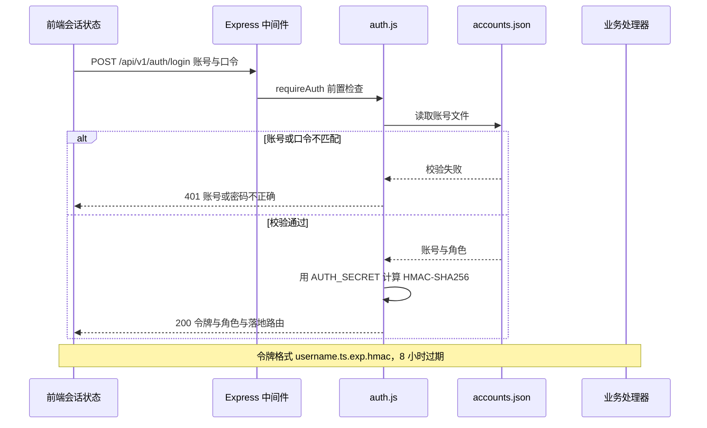

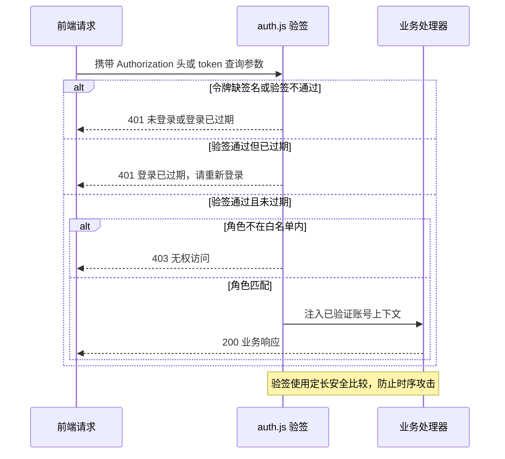

##### §3.2.M1.5 关键流程逻辑

```
触发：前端发起需要鉴权的业务请求

Step 1: 提取令牌（同步）
  ├── 优先从 Authorization 头取 Bearer 令牌
  ├── 回退从 token 查询参数取（原因：SSE 的 EventSource 与图片标签无法自定义请求头，
  │   这是浏览器限制而非鉴权绕过，令牌本身仍需验签）
  └── 都取不到 → 返回 401

Step 2: 三重校验（同步，顺序不可颠倒）
  ├── 校验一：格式必须是四段式 username.ts.exp.hmac
  │     └── 不是 → 401（明确拒绝旧的无签名格式，无签名即可冒充角色）
  ├── 校验二：重算 HMAC-SHA256 并做定长安全比较
  │     └── 不匹配 → 401（防时序攻击，禁止用 === 比较）
  └── 校验三：当前时间早于过期时刻
        └── 已过期 → 401

Step 3: 角色准入（同步）
  ├── 解析账号对应的角色
  ├── 端点声明了角色白名单且当前角色不在其中 → 403
  └── 通过 → 把账号上下文注入请求对象，交业务处理器

Step 4: 密钥缺失兜底（进程启动时一次）
  ├── 读取 AUTH_SECRET
  ├── 未配置 → 生成进程级随机密钥并打印显式警告
  │     └── 后果：每次重启密钥变化，全部旧令牌立即失效（安全侧正确，但演示前必须配置）
  └── 已配置 → 固定密钥，跨重启令牌保持有效
```

**状态机迁移表**：

| 起始状态 | 触发事件 | 终止状态 | 触发条件 / 校验 | 副作用 |
| --- | --- | --- | --- | --- |
| 未登录 | 登录成功 | 已登录 | 账号存在且口令匹配 | 签发令牌并写入前端会话状态 |
| 已登录 | 访问受保护端点且验签通过 | 已登录 | 令牌未过期且角色匹配 | 注入账号上下文 |
| 已登录 | 令牌过期或验签失败 | 未登录 | 超过 8 小时或密钥变更 | 前端清会话并跳登录页 |
| 已登录 | 用户主动退出 | 未登录 | — | 丢弃本地令牌 |

---

#### 3.2.M2 巡店与诊断模块

##### §3.2.M2.1 模块概述

巡店与诊断模块覆盖 BD1 与 BD2 两个强耦合业务域，是全系统差异化锚点「单层可解释深度」的落点。业务链路为「今日巡店线路 → 门店地图 → 冷柜拍照上传 → 视觉出框 → 六维健康分 → 风险预判 → 多轮追问 → 补货建议」。业务逻辑在业务代表（李强）与区域经理（只读查看诊断结果）之间流动，同时涉及视觉大模型、文本大模型、进销存 MCP、真库与文件存储。

##### §3.2.M2.2 接口清单

| 子领域 | 方法 | 路径 | 用途 | 请求 DTO | 响应 VO | 幂等 |
| --- | --- | --- | --- | --- | --- | --- |
| 门店 | GET | `/api/v1/stores` | 拉取门店列表 | 无（查询参数：区域） | `StoreListVO` | 天然 |
| 门店 | GET | `/api/v1/stores/{id}` | 拉取门店详情与陈列标准 | 无 | `StoreDetailVO` | 天然 |
| 巡店 | GET | `/api/v1/visits/today` | 拉取今日巡店线路 | 无（查询参数：业代 ID） | `TodayRouteVO` | 天然 |
| 巡店 | GET | `/api/v1/visits` | 巡店记录列表 | 无（查询参数：门店、状态、条数） | `VisitListVO` | 天然 |
| 巡店 | GET | `/api/v1/visits/{id}` | 巡店详情（含诊断快照） | 无 | `VisitDetailVO` | 天然 |
| 巡店 | POST | `/api/v1/visits` | 提交巡店记录并生成诊断 | `VisitCreateRequest` | `VisitVO` | 是（门店 + 单号唯一约束） |
| 照片 | POST | `/api/v1/uploads` | 上传照片并落盘 | `UploadRequest` | `UploadVO` | 否（同图重复上传会产生新照片 ID） |
| 诊断 | POST | `/api/v1/diagnoses` | 基于照片生成六维诊断 | `DiagnosisCreateRequest` | `DiagnosisDetailVO` | 是（同一诊断 ID 重复提交覆盖） |
| 诊断 | GET | `/api/v1/diagnoses/{id}` | 读取诊断快照 | 无 | `DiagnosisDetailVO` | 天然 |
| 补货 | GET | `/api/v1/forecast/{diagnosisId}` | 取补货推导全过程 | 无 | `ForecastVO` | 天然 |
| 追问 | POST | `/api/v1/ai/chat` | 同步追问应答 | `ChatRequest` | `ChatReplyVO` | 天然 |
| 追问 | GET | `/api/v1/ai/chat/suggestions` | 拉取推荐追问列表 | 无 | `SuggestionListVO` | 天然 |
| 追问（流式） | POST | `/api/v1/ai/chat/stream` | SSE 逐 token 追问应答 | `ChatRequest` | SSE 帧流 | 天然 |

##### §3.2.M2.3 关键结构定义（DTO）

```typescript
// 巡店记录创建请求
export interface VisitCreateRequest {
  // ===== 必填字段 =====
  storeId: string              // 门店编号 S1 至 S5；不存在 → 404
  repId: string                // 业代账号；跨角色提交 → 403
  photoIds: string[]           // 本次拍摄照片 ID 列表，至少 1 张
  shootType: 'cold' | 'ambient' | 'stack'  // 拍摄部位
  // ===== 状态字段 =====
  status?: 'draft' | 'submitted'  // 默认 submitted
}

// 诊断创建请求
export interface DiagnosisCreateRequest {
  // ===== 必填字段 =====
  visitId: string              // 关联巡店记录
  storeId: string              // 门店编号
  photoIds: string[]           // 参与识别的照片
  // ===== 可选字段 =====
  shootType?: string           // 缺省按拍摄部位推断
}

// 诊断详情响应（跨域共享内核 DiagnosisSnapshot）
export interface DiagnosisDetailVO {
  // ===== 基本信息 =====
  id: string                   // 诊断 ID，落 diagnoses 表主键
  storeId: string
  storeName: string
  // ===== 业务字段 =====
  health: HealthScore          // 六维加权总分与分档
  dimensions: Dimension[]      // 六维明细，含每维来源标注
  annotations: Annotation[]    // 标注框，含图层与来源
  issues: Issue[]              // 问题清单，含严重度三档
  risk: RiskForecast           // 风险预判，含五步推导串
  // ===== 扩展字段 =====
  plan?: ActionPlan            // 行动方案（M3 生成）
  aiSource: 'llm' | 'fallback' | null  // 内容来源角标依据；null 表示未完成
}
```

**关键字段定义表**：

| DTO / VO 名 | 字段名 | 类型 | 必填 | 业务含义 | 约束 / 默认值 |
| --- | --- | --- | --- | --- | --- |
| `VisitCreateRequest` | `photoIds` | Array | 是 | 本次拍摄照片 | 至少 1 个 |
| `VisitCreateRequest` | `shootType` | String | 是 | 拍摄部位 | 枚举：cold / ambient / stack |
| `HealthScore` | `score` | Number | 是 | 0 至 100 的加权总分 | 六维权重：D1 0.30 / D2 0.25 / D3 0.15 / D4 0.15 / D5 0.10 / D6 0.05 |
| `HealthScore` | `level` | String | 是 | 健康分档 | 枚举：excellent 85–100 / good 70–84 / warning 60–69 / risk 0–59 |
| `HealthScore` | `expectedScore` | Number | 是 | 整改后可达分数 | 用于整改后复算的基准 |
| `Dimension` | `key` | String | 是 | 维度编号 | 枚举：D1 至 D6，顺序固定 |
| `Dimension` | `source` | String | 是 | 得分来源 | 枚举：vision（视觉模型）/ fixture（陈列标准库） |
| `Dimension` | `weight` | Number | 是 | 维度权重 | 六档固定权重，硬编码于前端常量与后端领域引擎 |
| `Issue` | `severity` | String | 是 | 问题严重度 | 枚举：severe（权重 6）/ medium（权重 4）/ low（权重 2） |
| `RiskForecast` | `weeklyBottles` | Number | 是 | 每周预计流失瓶数 | 毛缺口口径，不含严重度折减 |
| `RiskForecast` | `monthlyBottles` | Number | 是 | 每月预计流失瓶数 | 周值乘 4.3 后取整 |
| `RiskForecast` | `derivation` | String | 是 | 五步推导串 | 页面可展开，含口径说明与业务假设标注 |
| `RiskForecast` | `basis` | String | 是 | 口径标注 | 固定文案「毛缺口损失乘 7 天（不含严重度折减）」 |
| `DiagnosisDetailVO` | `aiSource` | String | 是 | AI 内容来源 | 枚举：llm / fallback / null；null 时界面不得宣称 AI |

##### §3.2.M2.4 模块逻辑时序图

| 编号 | 标题 | 场景类别 | 是否包含异常分支 |
| --- | --- | --- | --- |
| SQ-M2-01 | 巡店与诊断模块 - 拍照到六维诊断 | 核心实体创建 | 是 |
| SQ-M2-02 | 巡店与诊断模块 - 视觉不可用时按层安全网回退 | 异常与降级 | 是 |
| SQ-M2-03 | 巡店与诊断模块 - 补货推导与进销存事实补齐 | 跨系统协作 | 是 |

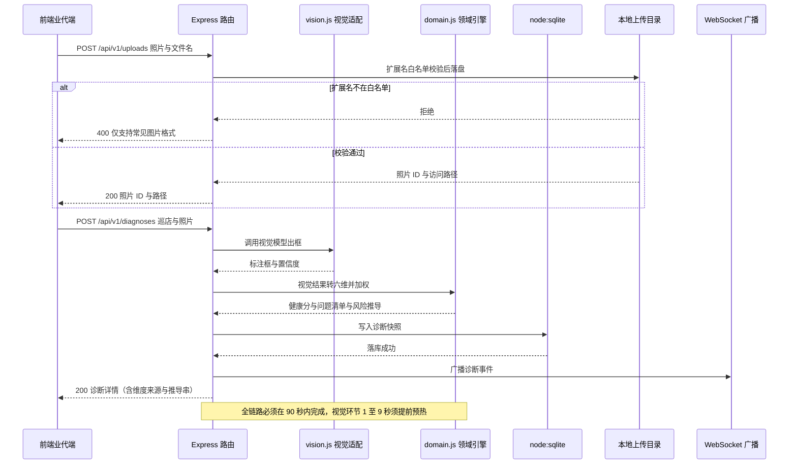

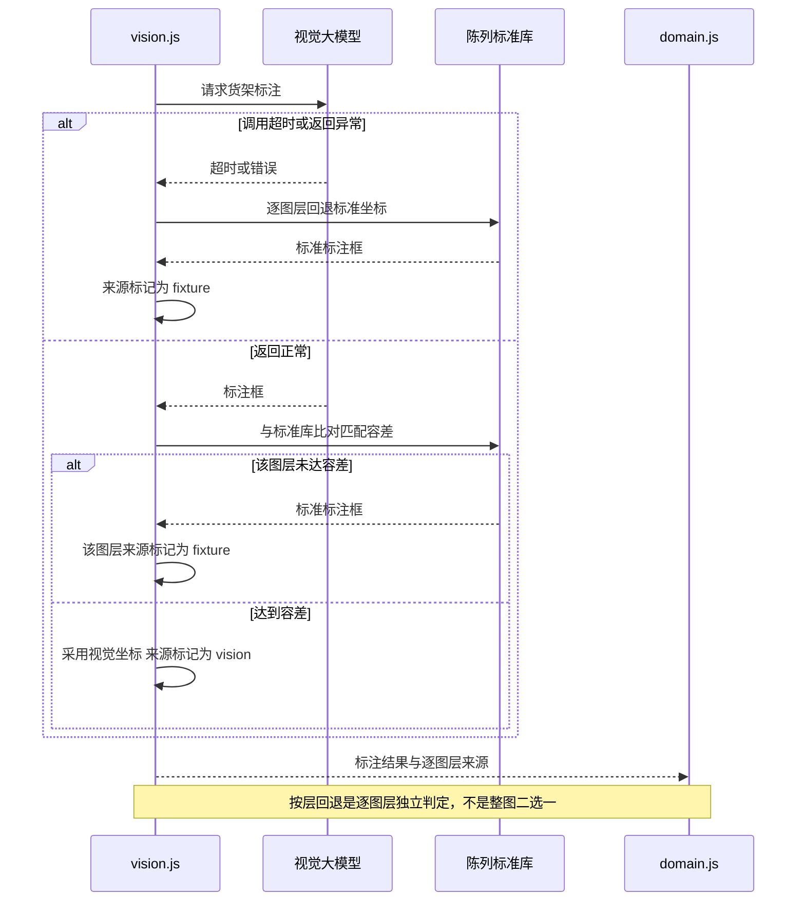

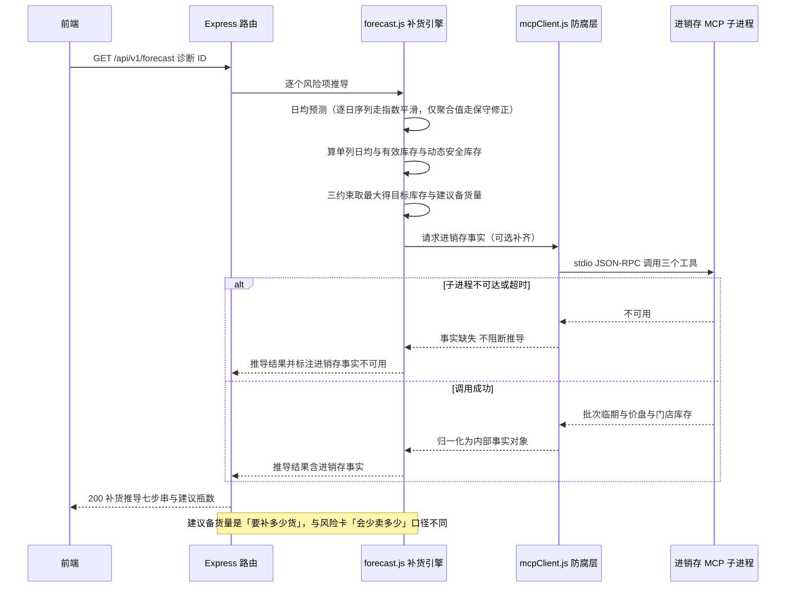

##### §3.2.M2.5 关键流程逻辑

```
触发：业代在门店完成拍照并提交诊断

Step 1: 照片入库（同步）
  ├── 校验：扩展名白名单（jpg/png/webp/gif）
  │     └── 不在白名单 → 400，禁止 500
  ├── 生成照片 ID 并落盘到本地上传目录
  └── 失败 → 返回 400 并给出可读原因

Step 2: 视觉出框（同步，含降级）
  ├── 调用视觉大模型（qwen-vl-ocr），带超时控制
  ├── 降级路径 A：调用失败或超时
  │     └── [完整版替换点] 视觉服务稳定后关闭本分支
  │         动作：全部图层回退标准库坐标，逐图层来源标记 fixture
  │         输出：诊断照常产出，界面来源角标改为「基于陈列标准库生成」
  └── 正常路径：逐图层与标准库比对匹配容差
        ├── 达容差 → 采用视觉坐标，来源标记 vision
        └── 未达容差 → 该图层单独回退标准库坐标，来源标记 fixture

Step 3: 视觉结果转六维（同步，纯计算，无 I/O）
  ├── 以标准基线为底，按视觉结果对各维度施加扣分
  ├── 扣分幅度由阈值分段函数决定（分段点为经验值，见 BA-06）
  └── 加权求和得总分 → 映射四档分档

Step 4: 风险预判（同步，纯计算）
  ├── 毛缺口损失：对每个风险项算 缺口列数 × 单列日均
  ├── 其他损失：从 fixture 推导串的第三步解析追加量
  ├── 周流失 = 日均总损失 × 7；月流失 = 周流失 × 4.3
  ├── 单价：取风险项单价均值；缺失时回退「基线金额 ÷ 基线瓶数」
  └── 生成五步推导串，并附口径说明与业务假设标注（见 §4.6）

Step 5: 诊断快照落库（同步）
  ├── 写 diagnoses 表，data 字段存完整快照 JSON
  └── 写成功后广播诊断事件

Step 6: 补货推导（异步请求触发，同步计算）
  ├── 预测日销：逐日序列长度达标走指数平滑；仅聚合值走区间日均保守修正
  ├── 单列日均 = 日销 ÷ 标准陈列列数
  ├── 有效库存 = 有效排面列数 × 单列日均（缺在库数据时的兜底）
  ├── 动态安全库存 = 变异系数估计 × 服务水平分位数 × 提前期开方
  ├── 目标库存 = max(安全库存下限, 覆盖需求, 缺口补齐量)
  │     └── 覆盖需求按「货架非空」口径：缺口列数 × 单列日均 × (提前期 + 铺货天数)
  └── 建议备货量 = max(0, 目标库存 − 在库 − 在途)，按整箱规格向上取整

Step 7: 多轮追问（同步或 SSE 流式）
  ├── 优先调文本大模型
  ├── 降级路径：无 Key 或上游失败 → 本地关键词匹配 + 陈列标准库应答
  │     └── 动作：SSE 的 done 帧标记来源为 fallback，界面角标改为「基于陈列标准库生成」
  └── 异常路径：网络失败 → 无内容可展示，来源标记为 null，界面显示「内容生成未完成」
```

**状态机迁移表**：

| 起始状态 | 触发事件 | 终止状态 | 触发条件 / 校验 | 副作用 |
| --- | --- | --- | --- | --- |
| 待提交 | 提交巡店 | 已提交 | 门店存在、角色匹配、照片至少 1 张 | 写入 visits 并按门店加单号 |
| 已提交 | 触发诊断 | 已诊断 | 照片可访问 | 写 diagnoses、广播诊断事件 |
| 已诊断 | 视觉回退 | 已诊断（来源为标准库） | 视觉超时或图层未达容差 | 逐图层来源标记变更 |
| 已诊断 | 追问上游失败 | 已诊断（内容降级） | 无 Key 或上游报错 | 来源标记为 fallback |
| 已诊断 | 网络失败 | 已诊断（内容未完成） | 请求异常 | 来源标记为 null，界面不宣称 AI |
| 已诊断 | 读取补货推导 | 已诊断（推导就绪） | 诊断存在 | 实时计算，不落表 |

---

#### 3.2.M3 方案与整改闭环模块

##### §3.2.M3.1 模块概述

方案与整改闭环模块承载 P1 痛点的解法：闭环必须真落库。它覆盖「生成行动方案 → 生成整改单/订货单 → 提交整改留证回执 → 后端复算整改后健康分 → 广播回流看板」五个环节，业务逻辑在业务代表（提交回执、接单）与区域经理（审阅回流结果）之间流动。涉及的内外部系统：文本大模型（方案文案）、真库、实时推送通道、本地文件存储。

**关键设计约束**：整改后的健康分**必须由后端按可解释规则计算，前端无权指定**；操作人**必须由服务端从令牌裁定，不能采信请求体**。

##### §3.2.M3.2 接口清单

| 子领域 | 方法 | 路径 | 用途 | 请求 DTO | 响应 VO | 幂等 |
| --- | --- | --- | --- | --- | --- | --- |
| 方案 | POST | `/api/v1/ai/generate` | 生成千店千面行动方案 | `PlanGenerateRequest` | `ActionPlanVO` | 是（同诊断同类型 60 秒内命中缓存） |
| 方案（流式） | POST | `/api/v1/ai/generate/stream` | SSE 逐 token 生成方案 | `PlanGenerateRequest` | SSE 帧流 | 同上 |
| 单据 | POST | `/api/v1/tickets` | 创建整改单或订货单 | `TicketCreateRequest` | `TicketVO` | 是（同门店同类型 3 秒内返回同单） |
| 单据 | GET | `/api/v1/tickets` | 单据列表（三端读回） | 无（查询参数：门店、类型、状态、条数） | `TicketListVO` | 天然 |
| 单据 | PATCH | `/api/v1/tickets/{id}` | 更新单据状态（业代接单） | `TicketStatusRequest` | `TicketVO` | 是（状态白名单校验） |
| 整改 | POST | `/api/v1/rectifications` | 提交整改留证回执 | `RectificationCreateRequest` | `RectificationVO` | 否（同问题重复提交产生新回执） |
| 整改 | GET | `/api/v1/rectifications` | 整改回执列表 | 无（查询参数：门店、诊断、条数） | `RectificationListVO` | 天然 |

##### §3.2.M3.3 关键结构定义（DTO）

```typescript
// 行动方案生成请求
export interface PlanGenerateRequest {
  // ===== 必填字段 =====
  diagnosisId: string          // 诊断 ID
  type: 'action' | 'restock' | 'chat'  // 方案类型
  // ===== 可选字段 =====
  storeId?: string             // 缺省从诊断快照取
}

// 单据创建请求（整改单与订货单同载体）
export interface TicketCreateRequest {
  // ===== 必填字段 =====
  kind: 'rectify' | 'order'    // 单据类型；缺失或非法 → 400
  storeId: string              // 门店编号；缺失 → 400
  // ===== 可选字段 =====
  items?: TicketItem[]         // 明细；非数组 → 400；数组内每项 bottles 与 amount 必须为有限数字
  placements?: unknown[]       // 陈列位建议（整改单用）
  note?: string                // 备注
}

// 单据明细项
export interface TicketItem {
  skuId?: string
  skuName?: string
  bottles: number              // 瓶数；非有限数字 → 400
  amount: number               // 金额；非有限数字 → 400（缺失会静默变成空值并让看板少算）
}

// 整改回执创建请求
export interface RectificationCreateRequest {
  // ===== 必填字段 =====
  diagnosisId: string          // 诊断 ID；缺失 → 400
  issueId: string              // 问题 ID；缺失 → 400
  // ===== 可选字段 =====
  issueTitle?: string
  severity?: 'severe' | 'medium' | 'low'  // 非法值按 low 处理
  photo?: string               // base64 照片；上传失败不阻断回执，仅记为无照片
  filename?: string
  note?: string
  // 注意：operatorId 不在契约内，操作人一律由服务端从令牌裁定
}

// 单据状态更新请求
export interface TicketStatusRequest {
  // ===== 状态字段 =====
  status: 'pending' | 'accepted'   // 白名单之外的值 → 400，绝不 500
}
```

**关键字段定义表**：

| DTO / VO 名 | 字段名 | 类型 | 必填 | 业务含义 | 约束 / 默认值 |
| --- | --- | --- | --- | --- | --- |
| `TicketCreateRequest` | `kind` | String | 是 | 单据类型 | 枚举：rectify / order |
| `TicketCreateRequest` | `items[].bottles` | Number | 是 | 明细瓶数 | 必须为有限数字 |
| `TicketCreateRequest` | `items[].amount` | Number | 是 | 明细金额 | 必须为有限数字，缺失会让看板汇总少算且无报错 |
| `TicketStatusRequest` | `status` | String | 是 | 单据状态 | 枚举：pending / accepted |
| `RectificationCreateRequest` | `severity` | String | 否 | 问题严重度 | 枚举：severe / medium / low；默认 low |
| `RectificationCreateRequest` | `photo` | String | 否 | 整改照片 base64 | 扩展名须在白名单内；上传失败不阻断 |
| `RectificationVO` | `operatorId` | String | 是 | 操作人账号 | **服务端从令牌裁定**，忽略请求体同名字段 |
| `RectificationVO` | `beforeScore` | Number | 是 | 整改前分数 | 取诊断快照健康分 |
| `RectificationVO` | `afterScore` | Number | 是 | 整改后分数 | 后端按可解释规则复算 |
| `RectificationVO` | `status` | String | 是 | 回执状态 | 枚举：done（有照片）/ pending（无照片） |
| `RectificationVO` | `derivation` | String | 是 | 复算推导串 | 含严重度权重与照片加成系数 |

##### §3.2.M3.4 模块逻辑时序图

| 编号 | 标题 | 场景类别 | 是否包含异常分支 |
| --- | --- | --- | --- |
| SQ-M3-01 | 方案与闭环模块 - 生成行动方案并落单据 | 核心动作执行 | 是 |
| SQ-M3-02 | 方案与闭环模块 - 整改留证与后端复算 | 核心实体创建 | 是 |
| SQ-M3-03 | 方案与闭环模块 - 单据状态非法值拒绝 | 异常与拒绝 | 是 |

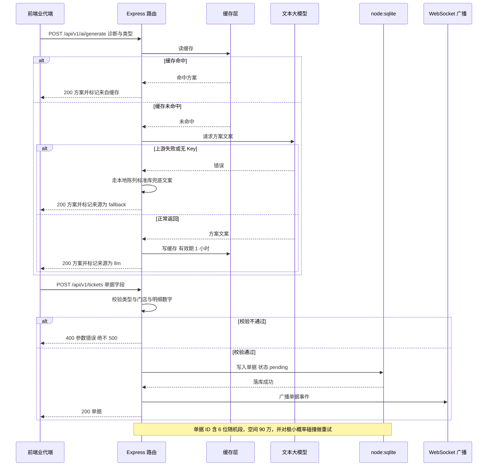

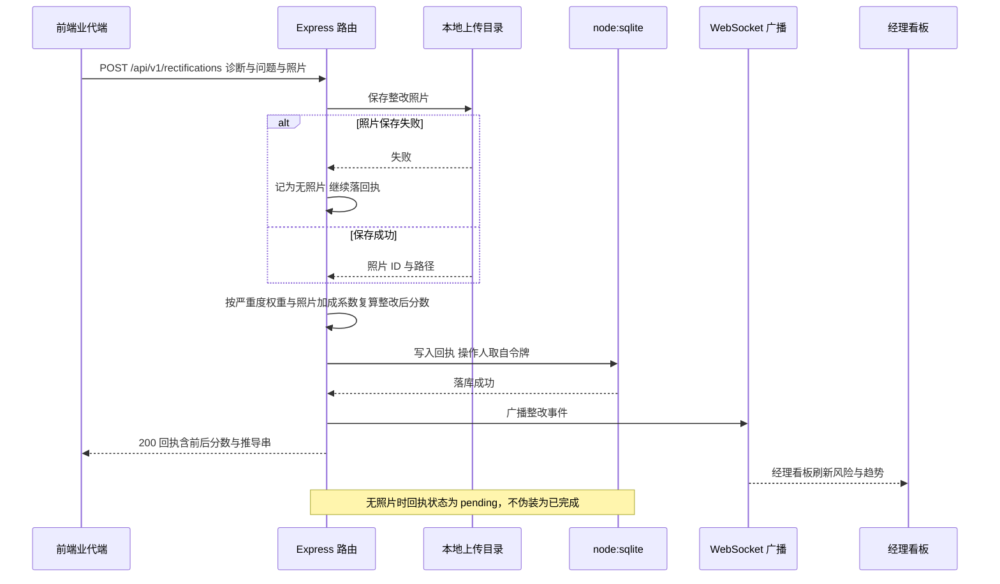

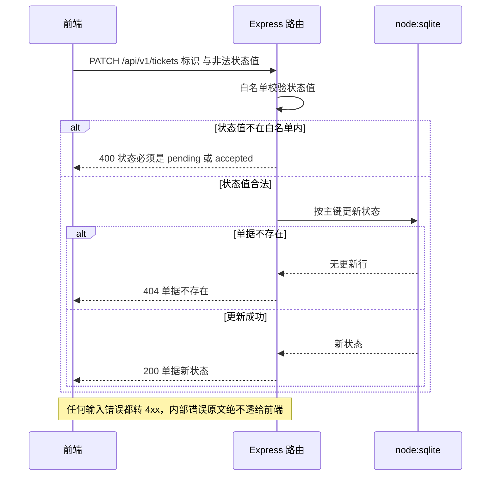

##### §3.2.M3.5 关键流程逻辑

```
触发：业代在诊断结果页点击「标记已处理」或「一键订货」

Step 1: 提交整改回执（同步）
  ├── 校验：诊断 ID 与问题 ID 必填
  │     └── 缺失 → 400
  ├── 定位诊断：优先读已存快照；未命中则按 ID 回退 fixture 重建
  │     └── 都取不到 → 404
  ├── 照片处理：base64 → 复用上传通道落盘（同一套扩展名白名单与内容嗅探头）
  │     ├── 成功 → 记照片 ID 与可访问路径
  │     └── 失败 → 不阻断，记为无照片（回执仍落库，状态为 pending）
  ├── 复算整改后分数（服务端计算，前端无权指定）
  │     ├── 严重度权重：severe 6 / medium 4 / low 2
  │     ├── 修复加成系数：有照片 1.0 / 无照片 0.5
  │     ├── 整改后分数 = 整改前分数 + (可达分数 − 整改前分数) × 权重归一 × 加成系数
  │     └── 生成推导串写入回执，供现场展开
  ├── 操作人裁定：operatorId 一律取自令牌解析结果，**忽略请求体同名字段**
  └── 落库 + 广播整改事件

Step 2: 生成单据（同步）
  ├── 校验：kind 必填且在白名单内；storeId 必填；items 必须是数组且非空
  │     ├── kind 缺失 → 400（曾因未校验直接落库导致 500）
  │     ├── items 非数组 → 400
  │     ├── items[].bottles 非有限数字 → 400
  │     └── items[].amount 非有限数字 → 400（缺失会让金额汇总静默少算）
  ├── 生成单据 ID：前缀 + 时间戳 36 进制 + 6 位随机段
  │     └── 主键碰撞 → 重试（随机段空间 90 万，演示期约第 59 张单才会触及原 3 位随机段的上限）
  ├── 汇总瓶数与金额
  └── 落库（状态 pending）+ 广播单据事件

Step 3: 业代接单（同步）
  ├── 校验：status 必须在白名单内 → 否则 400
  ├── 单据不存在 → 404
  ├── 更新状态
  └── 广播单据状态变更事件（同步给经理端与店主端）

Step 4: 看板回流（异步事件驱动）
  ├── 订阅整改事件与单据事件
  ├── 重新计算区域汇总（KPI、分布、趋势、风险 Top5、订货汇总）
  └── 刷新看板
```

**状态机迁移表**：

| 起始状态 | 触发事件 | 终止状态 | 触发条件 / 校验 | 副作用 |
| --- | --- | --- | --- | --- |
| pending（整改单/订货单） | 业代确认接单 | accepted | status 在白名单内且单据存在 | 写库并广播状态变更事件 |
| 无照片提交回执 | 回执落库 | pending | 照片上传失败 | 仍落库，状态为待处理，不伪装完成 |
| 有照片提交回执 | 回执落库 | done | 照片保存成功 | 写库、复算分数、广播整改事件 |
| 待接单（整改单） | 整改回执关联 | done | 回执写入成功 | 回执与诊断快照双向可溯 |
| 任务待处理 | 业代标记完成 | done | 角色为业务代表且状态在白名单内 | 写库并广播，看板刷新任务统计 |
| 方案未生成 | 首次生成 | 已生成 | 大模型成功 | 写缓存 1 小时 |
| 方案未生成 | 上游失败 | 已降级 | 无 Key 或上游报错 | 走本地标准库文案，来源标记 fallback 且不写缓存 |

---

#### 3.2.M4 经理看板模块

##### §3.2.M4.1 模块概述

经理看板模块是 BD4 的全部实现，也是跨角色闭环的「回流端」与「下派端」。它覆盖「区域 KPI → 健康分布 → 八周趋势 → 风险 Top5 → 门店明细 → 任务下派 → 我派的任务列表」七个环节，业务逻辑在区域经理与业务代表之间流动（经由真库与实时推送）。涉及的内外部系统：真库、区域维度重算逻辑、实时推送通道。

##### §3.2.M4.2 接口清单

| 子领域 | 方法 | 路径 | 用途 | 请求 DTO | 响应 VO | 幂等 |
| --- | --- | --- | --- | --- | --- | --- |
| 看板 | GET | `/api/v1/dashboard/overview` | 区域看板全量聚合 | 无（查询参数：区域） | `DashboardOverviewVO` | 天然 |
| 任务 | GET | `/api/v1/tasks` | 任务列表（按承接人过滤） | 无（查询参数：承接人、状态、条数） | `TaskListVO` | 天然 |
| 任务 | POST | `/api/v1/tasks` | 下派任务（仅区域经理） | `TaskCreateRequest` | `TaskVO` | 否（重复下派产生多条任务，属业务预期） |
| 任务 | PATCH | `/api/v1/tasks/{id}` | 更新任务状态（仅业务代表） | `TaskStatusRequest` | `TaskVO` | 是（状态白名单校验） |
| 演示 | POST | `/api/v1/demo/reset` | 重置演示数据（仅区域经理） | 无 | `ResetResultVO` | 是（重复调用结果一致） |

##### §3.2.M4.3 关键结构定义（DTO）

```typescript
// 任务创建请求
export interface TaskCreateRequest {
  // ===== 必填字段 =====
  storeId: string              // 目标门店
  assigneeId: string           // 承接人账号；非业务代表角色 → 403
  taskType: 'OOS' | 'FACING' | 'PRICETAG' | 'STACK'  // 任务类型
  dueAt: string                // 归一化后的到期日
  // ===== 可选字段 =====
  dueAtLabel?: string          // 原始中文文案（如「本周五前」），展示用
  note?: string
  storeName?: string
  assigneeName?: string
  creatorId?: string
  creatorName?: string
}

// 任务状态更新请求
export interface TaskStatusRequest {
  // ===== 状态字段 =====
  status: string               // 白名单之外的值 → 400，绝不 500
}

// 看板聚合响应
export interface DashboardOverviewVO {
  // ===== 基本信息 =====
  regionId: string             // 区域标识；不传则按全部区域重算
  // ===== 业务字段 =====
  kpi: DashboardKpi            // 平均健康分与环比、红灯门店数、缺货率、铺货率
  distribution: HealthBucket[] // 健康分布四档
  trend: TrendPoint[]          // 八周趋势三点（健康分/缺货率/铺货率）
  riskTop5: RiskRow[]          // 风险 Top5 门店
  storeRows: StoreRow[]        // 门店明细，实测 128 行
  orderSummary: OrderSummary   // 订货汇总：待处理笔数与金额
  taskSummary: TaskSummary     // 任务汇总
  // ===== 时间字段 =====
  demoDate: string             // 演示基准日 2026-10-02
}
```

**关键字段定义表**：

| DTO / VO 名 | 字段名 | 类型 | 必填 | 业务含义 | 约束 / 默认值 |
| --- | --- | --- | --- | --- | --- |
| `TaskCreateRequest` | `taskType` | String | 是 | 任务类型 | 枚举：OOS 缺货补货 / FACING 排面调整 / PRICETAG 价签整改 / STACK 堆头执行 |
| `TaskCreateRequest` | `assigneeId` | String | 是 | 承接人 | 角色须为业务代表 |
| `TaskStatusRequest` | `status` | String | 是 | 任务状态 | 白名单校验；非法值 → 400 |
| `DashboardKpi` | `avgScore` | Number | 是 | 区域平均健康分 | fixture 实测 74.3 |
| `DashboardKpi` | `redStores` | Number | 是 | 红灯门店数 | fixture 实测 12 |
| `DashboardKpi` | `oosRate` | Number | 是 | 本周缺货率 | fixture 实测 7.2% |
| `DashboardKpi` | `coverageRate` | Number | 是 | 蒙牛铺货率 | fixture 实测 86.4% |
| `HealthBucket` | `count` | Number | 是 | 该档门店数 | 四档合计 128 |
| `StoreRow` | — | — | — | 门店明细行 | 实测 128 行；全量展示需虚拟滚动 |
| `DashboardOverviewVO` | `demoDate` | String | 是 | 演示基准日 | 固定 2026-10-02（G-12 已登记） |

##### §3.2.M4.4 模块逻辑时序图

| 编号 | 标题 | 场景类别 | 是否包含异常分支 |
| --- | --- | --- | --- |
| SQ-M4-01 | 经理看板模块 - 区域看板聚合 | 核心查询 | 是 |
| SQ-M4-02 | 经理看板模块 - 任务下派与实时触达 | 跨角色协作 | 是 |
| SQ-M4-03 | 经理看板模块 - 任务状态非法值拒绝 | 异常与拒绝 | 是 |

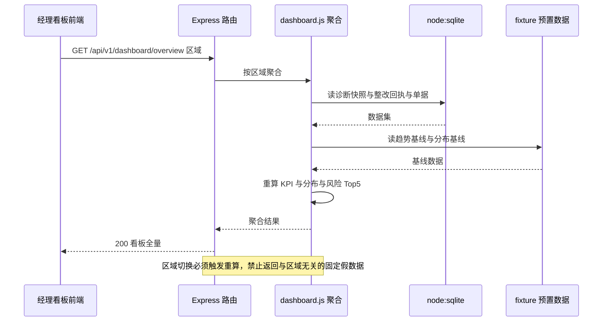

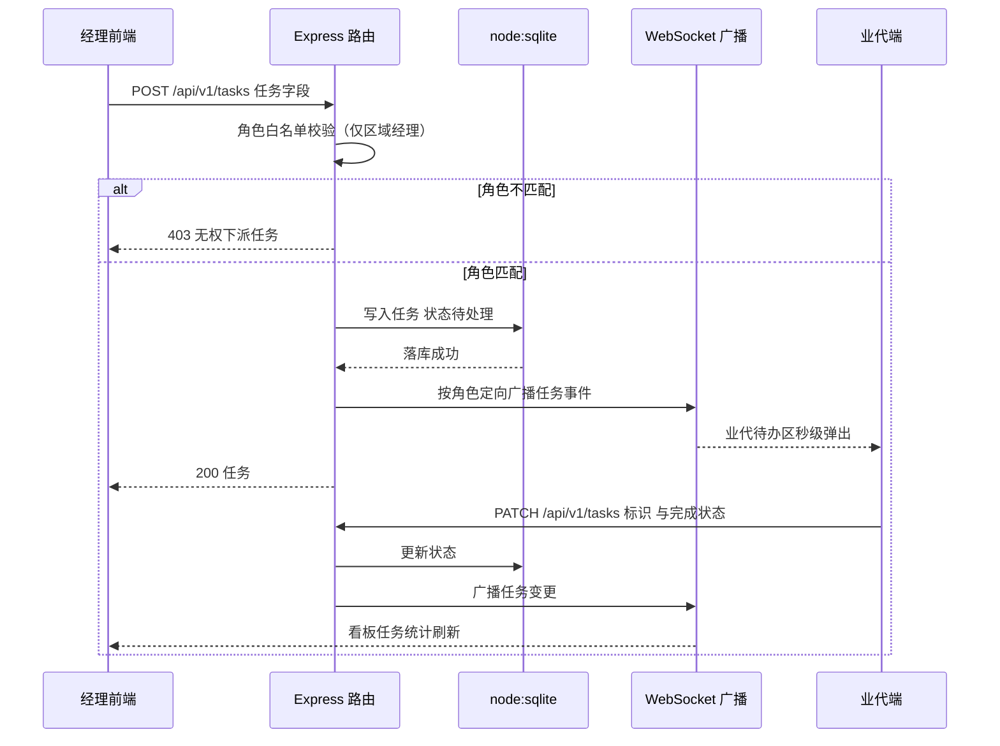

##### §3.2.M4.5 关键流程逻辑

```
触发：区域经理打开看板 或 下派任务

Step 1: 看板聚合（同步，只读）
  ├── 读取真库中的诊断快照、整改回执、单据、任务
  ├── 读取 fixture 中的趋势基线与分布基线
  ├── 按区域重算：平均健康分、红灯门店数、缺货率、铺货率
  ├── 计算健康分布四档、八周趋势序列、风险 Top5、门店明细（128 行）
  ├── 汇总订货（待处理笔数与金额）与任务统计
  └── 返回全量聚合结果

Step 2: 任务下派（同步，写操作）
  ├── 角色校验：仅区域经理可下派，否则 403
  ├── 校验门店与承接人与任务类型
  ├── 归一化到期日：相对演示基准日 2026-10-02 解析中文文案为可比较格式
  │     └── 原始中文文案另存展示字段，避免展示被归一化结果污染
  ├── 写入任务（状态待处理）
  └── 按角色定向广播任务事件

Step 3: 任务上行（同步，写操作）
  ├── 角色校验：仅业务代表可更新，否则 403
  ├── 状态白名单校验：非法值 → 400
  ├── 更新状态
  └── 广播任务变更事件，看板刷新

Step 4: 演示数据重置（同步，破坏性，仅区域经理）
  ├── 清空 tasks、tickets、visits、diagnoses、rectifications 五表
  ├── 重新灌入 fixture 基线
  └── 返回重置结果
```

**状态机迁移表**：

| 起始状态 | 触发事件 | 终止状态 | 触发条件 / 校验 | 副作用 |
| --- | --- | --- | --- | --- |
| 任务待处理 | 下派 | 任务待处理 | 角色为区域经理且字段合法 | 写库并按角色定向广播 |
| 任务待处理 | 业代标记 | 任务已完成 | 角色为业务代表且状态合法 | 写库并广播，看板统计刷新 |
| 单据待接单 | 业代接单 | 单据已接单 | 状态白名单校验通过 | 写库并广播给经理端与店主端 |
| 回执待处理 | 补充照片后重提 | 回执已完成 | 照片保存成功 | 复算整改后分数并再次广播 |
| 看板已加载 | 收到整改/单据事件 | 看板刷新 | 事件类型匹配 | 重算聚合并局部刷新 |

---

#### 3.2.M5 店主自助模块

##### §3.2.M5.1 模块概述

店主自助模块是 BD5 的全部实现，服务受影响方「终端店主/店员（张大姐）」。它覆盖「三步引导 → 口语化轻量诊断 → 一键订货 → 回执读回」四个环节，与业代端共用同一份诊断快照与同一套单据表。**关键设计约束**：店主端界面**不得出现「健康分」「六维」等内部术语**，必须裁剪为口语化表达。

##### §3.2.M5.2 接口清单

| 子领域 | 方法 | 路径 | 用途 | 请求 DTO | 响应 VO | 幂等 |
| --- | --- | --- | --- | --- | --- | --- |
| 自助诊断 | GET | `/api/v1/diagnoses/{id}` | 取诊断并做展示层裁剪 | 无 | `ShopperDiagnosisVO` | 天然 |
| 轻量诊断 | POST | `/api/v1/ai/chat` | 口语化问答（隐藏内部术语） | `ShopperChatRequest` | `ShopperChatReplyVO` | 天然 |
| 下单 | POST | `/api/v1/tickets` | 一键订货创建单据 | `TicketCreateRequest` | `TicketVO` | 是（同门店同类型 3 秒内返回同单） |
| 回执 | GET | `/api/v1/tickets` | 读回本人订单与状态 | 无（查询参数：门店、类型、状态） | `TicketListVO` | 天然 |

> 说明：本模块**不新增后端端点**，全部复用 M2 与 M3 的端点，差异只在「展示层裁剪 + 路由守卫允许 owner 角色」。这是刻意的设计：避免为同一份数据造第二套接口，防止三端口径漂移。

##### §3.2.M5.3 关键结构定义（DTO）

```typescript
// 店主端轻量诊断响应（展示层裁剪后的结构）
export interface ShopperDiagnosisVO {
  // ===== 基本信息 =====
  storeName: string            // 门店名
  // ===== 业务字段（已裁剪） =====
  headline: string             // 一句话结论，如「货架整体不错，两处需要补一下」
  goodPoints: string[]         // 做得好的点（口语化）
  todoPoints: ShopperTodo[]    // 需要做的点（口语化 + 一键动作）
  // 注意：不下发 health.score、dimensions 权重、issues 严重度等内部术语字段
}

export interface ShopperTodo {
  issueId: string              // 供一键订货/整改引用
  title: string                // 口语化标题，如「这排奶放少了，补 2 列」
  actionHint: string           // 动作提示
  bottles?: number             // 涉及补货时给出瓶数
}

// 店主端口语化追问
export interface ShopperChatRequest {
  // ===== 必填字段 =====
  diagnosisId: string
  message: string              // 店主原话，允许口语化与非标准表达
}

export interface ShopperChatReplyVO {
  // ===== 业务字段 =====
  answer: string               // 口语化应答
  suggestions: string[]        // 推荐追问（店主语言）
  aiSource: 'llm' | 'fallback' | null  // 来源角标依据
}
```

**关键字段定义表**：

| DTO / VO 名 | 字段名 | 类型 | 必填 | 业务含义 | 约束 / 默认值 |
| --- | --- | --- | --- | --- | --- |
| `ShopperDiagnosisVO` | `headline` | String | 是 | 一句话结论 | 禁止出现「健康分」「六维」「权重」等内部术语 |
| `ShopperDiagnosisVO` | `todoPoints` | Array | 是 | 待办点 | 每项含口语化标题与动作提示 |
| `ShopperDiagnosisVO` | `health` | — | 否 | **不下发** | 内部字段，店主端裁剪掉 |
| `ShopperTodo` | `bottles` | Number | 否 | 建议补货瓶数 | 仅补货类待办给出 |
| `ShopperChatReplyVO` | `aiSource` | String | 是 | 内容来源 | 枚举：llm / fallback / null |

##### §3.2.M5.4 模块逻辑时序图

| 编号 | 标题 | 场景类别 | 是否包含异常分支 |
| --- | --- | --- | --- |
| SQ-M5-01 | 店主自助模块 - 三步引导到一键订货 | 跨角色协作 | 是 |
| SQ-M5-02 | 店主自助模块 - 订货字段非法拒绝 | 异常与拒绝 | 是 |

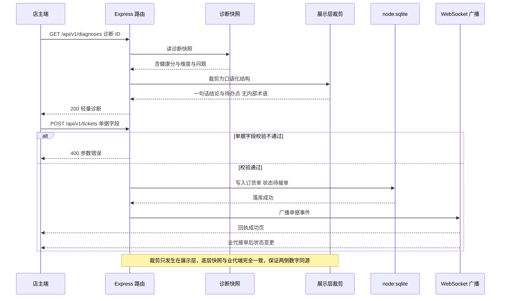

##### §3.2.M5.5 关键流程逻辑

```
触发：店主进入自助入口

Step 1: 三步引导（前端）
  ├── 第一步 拍照 → 复用 M2 的上传通道
  ├── 第二步 AI 看 → 触发诊断，等待六维结果
  └── 第三步 一键订货 → 进入下单确认

Step 2: 展示层裁剪（同步，纯转换）
  ├── 输入：完整诊断快照
  ├── 裁剪规则：删除健康分总分、维度权重、严重度枚举等内部字段
  ├── 转换：一句话结论 + 做得好的点 + 需要做的点
  └── 输出：店主可理解的结构；**不得让术语泄漏到界面**

Step 3: 一键订货（同步）
  ├── 复用 M3 的单据创建链路（校验规则完全一致，不开特例）
  ├── kind 固定为 order
  └── 落库 + 广播

Step 4: 回执读回（同步）
  ├── 店主端按门店与类型查询单据列表
  ├── 展示订货成功回执与当前状态（待接单 / 已接单）
  └── 状态变更经 WebSocket 事件实时同步，无需手动刷新
```

**状态机迁移表**：

| 起始状态 | 触发事件 | 终止状态 | 触发条件 / 校验 | 副作用 |
| --- | --- | --- | --- | --- |
| 引导第 1 步 | 照片上传成功 | 引导第 2 步 | 扩展名在白名单内 | 照片落盘 |
| 引导第 2 步 | 诊断完成 | 引导第 3 步 | 诊断快照可读 | 展示裁剪后的口语化结果 |
| 引导第 3 步 | 单据创建成功 | 回执成功页 | 单据字段校验通过 | 写库并广播 |
| 回执待接单 | 业代接单 | 回执已接单 | 状态白名单校验通过 | 广播状态变更，店主端实时更新 |

---

#### 3.2.M6 平台底座与集成模块

##### §3.2.M6.1 模块概述

平台底座与集成模块是 §2.2.2 中 C-05「Open Host Service」的实现方，为 M1–M5 提供无独立业务边界的通用能力：真库访问、三级缓存、实时推送（WebSocket + SSE）、外部系统适配（文本模型、视觉模型、进销存 MCP）、配置与密钥加载、照片落盘。它不对应界面，全部通过约定接入被其他模块复用。

##### §3.2.M6.2 接口清单

| 子领域 | 方法 | 路径 | 用途 | 请求 DTO | 响应 VO | 幂等 |
| --- | --- | --- | --- | --- | --- | --- |
| 健康检查 | GET | `/health` | 存活探针与依赖自述 | 无 | `HealthVO` | 天然 |
| 实时推送 | WS | `/ws` | 事件广播通道（握手时校验令牌） | 握手查询参数携带令牌 | 事件帧流 | 天然 |
| 流式输出 | SSE | `/api/v1/ai/chat/stream` | 追问逐 token 输出（登记于 M2，此处为通道实现） | `ChatRequest` | SSE 帧流 | 天然 |
| 流式输出 | SSE | `/api/v1/ai/generate/stream` | 方案逐 token 输出（登记于 M3） | `PlanGenerateRequest` | SSE 帧流 | 同上 |

**非 HTTP 能力清单（SDK 形式）**：

| 能力 | 提供方 | 签名 | 被哪些模块复用 |
| --- | --- | --- | --- |
| 真库读写 | `db.js` | 建表、兼容迁移、查询助手、写入函数、演示重置 | M1 M2 M3 M4 M5 |
| 三级缓存 | `cache.js` | `cacheGet` / `cacheSet` / `withCache` / `cacheHealth` / `cacheClear` | M3 M6 |
| 事件广播 | `realtime.js` | `registerClient` / `broadcast` / `clientCount` | M2 M3 M4 |
| 进销存事实 | `mcpClient.js` | `fetchInventoryFacts` / `callMcpTool` / `mcpHealth` / `closeMcp` | M2 |
| 视觉适配 | `vision.js` | `analyzeShelfWithBoxes` / `patchVisionAnnotations` | M2 |
| 领域引擎 | `domain.js` | `resolveHealth` / `visionToDimensions` / `resolveRisk` / `resolvePlan` / `chatReply` | M2 M3 |
| 补货引擎 | `forecast.js` | `buildForecast` / `explainRestock` / `buildForecastAuthoritative` | M2 M3 |
| 鉴权中间件 | `auth.js` | `requireAuth` / `requireRole` / `accountFromToken` / `accountOf` | 全部模块 |
| 配置加载 | `env.js` | `loadEnv` | 全部模块 |

##### §3.2.M6.3 关键结构定义（DTO）

```typescript
// 健康检查响应
export interface HealthVO {
  // ===== 基本信息 =====
  ok: boolean                  // 进程存活
  service: string              // 服务名
  // ===== 依赖自述 =====
  db: 'sqlite'                 // 数据库类型
  llm: string                  // 文本模型自述；未验证连通性时必须自述为未验证
  llmKeyPresent: boolean       // 密钥是否存在（仅表示存在，不表示可用）
  mcp: McpHealth               // 进销存子进程健康
  cache: CacheHealth           // 缓存后端与状态
  realtime: RealtimeHealth     // 在线客户端数与路径
}

// WebSocket 事件帧
export interface RealtimeFrame {
  // ===== 基本信息 =====
  event: string                // 事件名；枚举见下
  ts: number                   // 毫秒时间戳
  // ===== 业务字段 =====
  payload: unknown             // 事件负载
}

// SSE 帧
export interface SseFrame {
  event: 'delta' | 'done' | 'error'  // 增量 / 结束 / 错误
  data: string | { source: 'llm' | 'fallback' | null; text: string }
}
```

**关键字段定义表**：

| DTO / VO 名 | 字段名 | 类型 | 必填 | 业务含义 | 约束 / 默认值 |
| --- | --- | --- | --- | --- | --- |
| `HealthVO` | `llm` | String | 是 | 文本模型自述 | 有密钥时固定为「dashscope(未验证连通性)」；无密钥为「fallback(无 Key)」 |
| `HealthVO` | `mcp` | Object | 是 | 进销存子进程健康 | 含进程存活与最近一次调用结果 |
| `HealthVO` | `cache` | Object | 是 | 缓存后端与状态 | backend 枚举：redis / redis-lite / memory；state 枚举：disabled / connecting / ready / failed |
| `RealtimeFrame` | `event` | String | 是 | 事件名 | 枚举：task:new / diagnosis:new / ticket:new / ticket:status / rectification:new / chat:reply / hello / ack |
| `RealtimeFrame` | `payload` | Object | 是 | 事件负载 | 单据类事件含完整单据对象 |
| `SseFrame` | `event` | String | 是 | 帧类型 | 枚举：delta / done / error |
| `SseFrame` | `data.source` | String | 是 | 内容来源 | 枚举：llm / fallback / null；**前端据此决定角标措辞，禁止一律宣称 AI** |

##### §3.2.M6.4 模块逻辑时序图

| 编号 | 标题 | 场景类别 | 是否包含异常分支 |
| --- | --- | --- | --- |
| SQ-M6-01 | 平台底座与集成模块 - WebSocket 握手鉴权与事件分发 | 核心动作执行 | 是 |
| SQ-M6-02 | 平台底座与集成模块 - 三级缓存降级链 | 降级与容灾 | 是 |
| SQ-M6-03 | 平台底座与集成模块 - 进销存子进程生命周期 | 跨系统协作 | 是 |

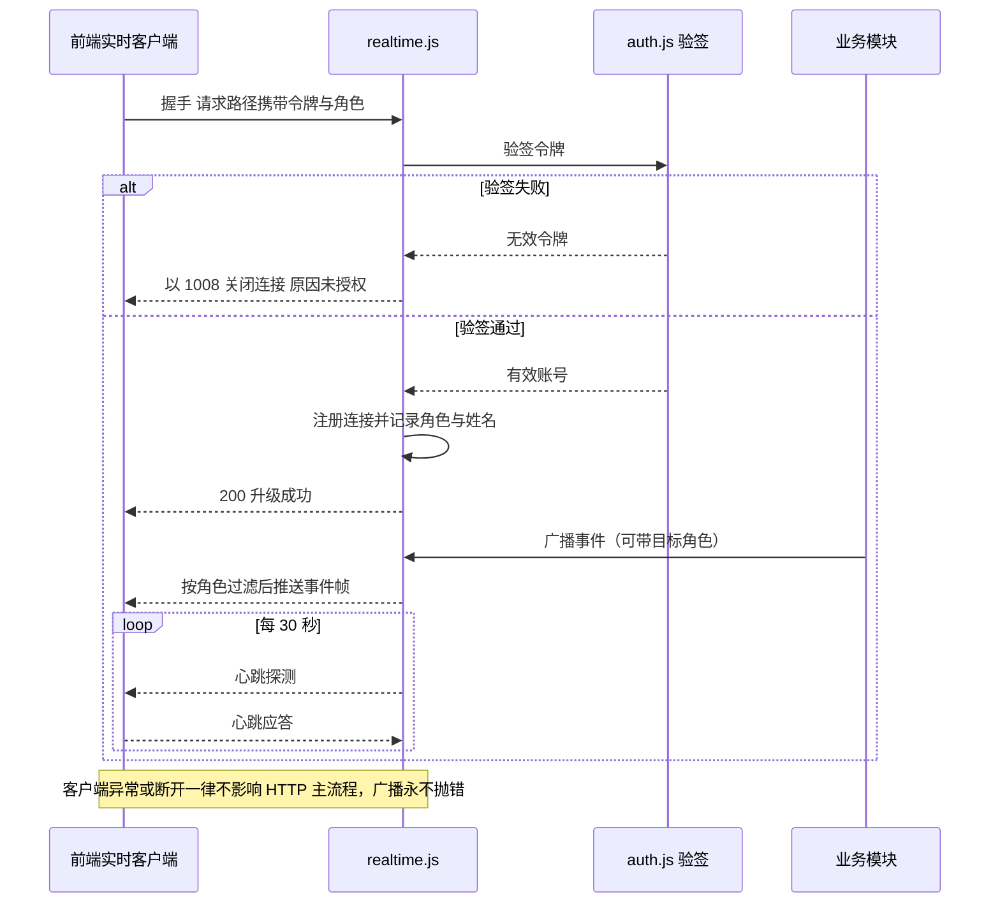

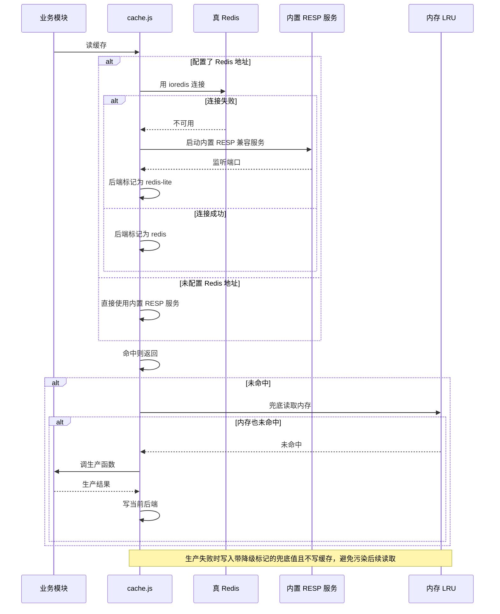

```mermaid
sequenceDiagram
    participant M2 as 诊断模块
    participant MC as mcpClient.js
    participant CP as MCP 子进程
    participant FS as 子进程 stderr

    M2->>MC: 请求进销存事实
    MC->>MC: 懒启动判断（已启动则复用单例）
    alt 未启动
        MC->>CP: 以 stdio 管道拉起子进程
        CP-->>MC: 就绪
    end
    MC->>CP: JSON-RPC 调用三个工具
    alt 调用超时或子进程退出
        CP-->>MC: 错误
        MC-->>M2: 事实不可用 不阻断诊断
    else 调用成功
        CP-->>MC: 三类事实
        MC->>MC: 归一化为内部事实对象 屏蔽外部字段名
        MC-->>M2: 事实对象
    end
    MC->>FS: 子进程 stderr 丢弃 不污染应用日志
    Note over MC,CP: 懒启动 + 单例复用，避免每次请求都 spawn
```

##### §3.2.M6.5 关键流程逻辑

```
触发：进程启动

Step 1: 配置加载（同步，必须最先）
  ├── 各需环境变量的模块自行在 import 后立即调用 loadEnv()
  ├── 原因：ESM 的 import 先于模块体执行，依赖模块会在被 import 时就完成顶层求值
  │        （曾出现 .env 配了签名密钥但启动仍报未配置的坑）
  ├── 解析规则：仅识别 KEY=VALUE；忽略井号注释与空行；去掉成对引号
  └── 不覆盖已存在的环境变量（保证命令行传参可生效）

Step 2: 建表与兼容迁移（同步）
  ├── 以「不存在则创建」方式建五张表
  ├── 迁移一：tickets 缺 status 列 → 先查列清单，缺则补列
  ├── 迁移二：tasks 缺 due_at_label 列 → 补列并把已有到期日归一化
  ├── 迁移三：visits 缺「门店 + 单号」唯一约束
  │     ├── 为什么必须重建表：SQLite 不支持 ALTER TABLE ADD CONSTRAINT
  │     ├── 重建流程：事务内改名 → 建新表 → 搬数据 → 删旧表 → 改名，失败自动回滚
  │     ├── 为什么不用立即写事务：node:sqlite 是同步 API，立即写事务会把事件循环
  │     │   卡住 2 至 4 秒，演示时页面明显冻结；改用「唯一约束 + 应用层重试」
  │     └── 幂等：先查索引清单，已有唯一约束则整段跳过
  └── 建立任务表按「承接人 + 状态」的检索索引

Step 3: 缓存后端初始化（异步，不阻塞启动）
  ├── 配置了 Redis 地址 → 尝试连接
  │     └── 失败 → 启动内置 RESP 兼容服务（用真正的 ioredis 客户端连它，
  │                SET/GET/EX/TTL/过期全部是真实 Redis 行为）
  ├── 未配置 → 直接使用内置 RESP 兼容服务
  └── 任一环节失败 → 降级到内存 LRU（上限 500 条，命中后移到末尾近似 LRU）

Step 4: 实时通道挂载（同步）
  ├── 把 WebSocket 服务挂到既有 HTTP 服务上，路径 /ws
  ├── 握手时校验令牌（**不在 API 前缀的鉴权闸门下，必须自行验签**；
  │   原实现直接读查询参数里自报的角色与姓名，任何人都能连上收全部广播）
  ├── 30 秒一次心跳探测，未应答的连接直接终止，避免僵尸连接
  └── 注册广播函数：按目标角色过滤后推送，**永不抛错**

Step 5: 进程退出清理
  ├── 关闭进销存子进程
  └── 关闭 WebSocket 服务
```

**状态机迁移表**：

| 起始状态 | 触发事件 | 终止状态 | 触发条件 / 校验 | 副作用 |
| --- | --- | --- | --- | --- |
| 缓存未初始化 | 连接真 Redis 成功 | 就绪（redis） | Redis 地址可连 | 后续读写走真 Redis |
| 缓存未初始化 | 连接失败 | 就绪（redis-lite） | 内置 RESP 服务可监听 | 用 ioredis 连内置服务，行为与真 Redis 一致 |
| 缓存未初始化 | 内置服务也不可用 | 就绪（memory） | 启动异常 | 退化为内存 LRU |
| 缓存就绪 | 连接断开 | 降级中 | 心跳失败 | 重新走降级链并标记状态为 failed |
| 推送连接未注册 | 握手且验签通过 | 已连接 | 令牌有效 | 记录角色与姓名，加入广播集合 |
| 推送连接未注册 | 握手但验签失败 | 已拒绝 | 令牌无效 | 以 1008 关闭 |
| 已连接 | 心跳无应答 | 已终止 | 下一轮心跳仍失败 | 终止连接并从集合移除 |
| 子进程未启动 | 首次调用工具 | 运行中 | 无单例实例 | 以 stdio 管道拉起 |
| 运行中 | 进程退出 | 已退出 | 收到退出信号 | 下次调用重新拉起 |

---

### 3.3 核心业务对象清单

#### 3.3.1 对象定义

> 本系统后端为 JavaScript（无强类型类），下表的「代码类名」为**领域函数与数据结构的逻辑对象名**，包路径为实际文件路径；研发以此为共享契约的唯一索引。

| 编号 | 对象名（代码类名） | 对象类型 | 包路径 | 模块归属 | 被哪些模块复用 | 实例化策略 | 序列化约定 | 持久化策略 |
| --- | --- | --- | --- | --- | --- | --- | --- | --- |
| O-01 | `Visit` | 聚合根 | `server/src/db.js` | M2 | M2 M4 | 写入函数创建 | JSON | 落表 → `visits` |
| O-02 | `Diagnosis` | 聚合根 | `server/src/domain.js` | M2 | M2 M3 M4 M5 | `resolveHealth` + `resolveRisk` 组合产出 | JSON | 落表 → `diagnoses`（data 字段整体 JSON） |
| O-03 | `HealthScore` | 值对象 | `server/src/domain.js` | M2 | M2 M3 M4 | `resolveHealth` 内部计算 | JSON | 嵌入 `diagnoses.data` |
| O-04 | `Dimension` | 值对象 | `server/src/domain.js` | M2 | M2 M4 M5 | `visionToDimensions` 产出 | JSON | 嵌入 `diagnoses.data` |
| O-05 | `Issue` | 实体 | `server/src/domain.js` | M2 | M2 M3 M5 | 问题构造逻辑产出 | JSON | 嵌入 `diagnoses.data` |
| O-06 | `RiskForecast` | 值对象 | `server/src/domain.js` | M2 | M2 M3 | `resolveRisk` 产出 | JSON | 嵌入 `diagnoses.data` |
| O-07 | `Ticket` | 聚合根 | `server/src/db.js` | M3 | M3 M4 M5 | `createTicket` 创建 | JSON | 落表 → `tickets` |
| O-08 | `Rectification` | 聚合根 | `server/src/db.js` | M3 | M3 M4 | `createRectification` 创建 | JSON | 落表 → `rectifications` |
| O-09 | `Task` | 聚合根 | `server/src/db.js` | M4 | M1 M4 | `createTask` 创建 | JSON | 落表 → `tasks` |
| O-10 | `ActionPlan` | 值对象 | `server/src/domain.js` | M3 | M3 M5 | `resolvePlan` 产出 | JSON | 嵌入 `diagnoses.data` |
| O-11 | `RestockForecast` | 值对象 | `server/src/forecast.js` | M2 | M2 M3 | `buildForecast` / `explainRestock` 产出 | JSON | 不落表，实时计算 |
| O-12 | `InventoryFact` | 防腐层 ACL | `server/src/mcpClient.js` | M6 | M2 M3 | `fetchInventoryFacts` 聚合产出 | JSON | 不落表，实时拉取 |
| O-13 | `Annotation` | 值对象 | `server/src/vision.js` | M2 | M2 M5 | `analyzeShelfWithBoxes` + `patchVisionAnnotations` 产出 | JSON | 嵌入 `diagnoses.data` |
| O-14 | `Account` | 实体 | `server/src/auth.js` | M1 | 全部模块 | 读 `accounts.json` | JSON | 落文件（**不入 SQLite**，凭证只在后端） |
| O-15 | `Session` | 值对象 | `server/src/auth.js` | M1 | 全部模块 | `issueSession` 签发 | 令牌字符串 | 不落表，8 小时过期 |
| O-16 | `DashboardOverview` | 值对象 | `server/src/dashboard.js` | M4 | M4 | `buildDashboardOverview` 产出 | JSON | 不落表，聚合视图 |
| O-17 | `DimensionMeta` | 共享枚举 | `store-app/src/domain/constants.ts` | M2 | M2 M4 M5 | 常量数组定义 | JSON | 不落表（前后端双份定义，须保持一致） |
| O-18 | `RiskCoef` | 共享枚举 | `store-app/src/domain/constants.ts` | M2 | M2 M3 | 常量定义 + `severityOf` 判定 | JSON | 不落表 |

**对象类型说明**：聚合根 = 业务一致性边界，外部引用必须通过聚合根 ID；值对象 = 无标识不可变；防腐层 ACL = 对接外部系统时的转换层（与 §2.2.2 中 C-03 呼应）；共享枚举 = 跨模块的状态值与类型值。

#### 3.3.2 命名漂移登记表

| 业务实体（§2） | 代码对象名（§3.3.1） | 数据表名（§4.2） | 漂移原因 |
| --- | --- | --- | --- |
| 整改单 / 订货单 | `Ticket` | `tickets` | 两种业务单据共用一张表与一个对象，用 `kind` 字段区分，避免两套几乎同构的表与接口 |
| 演示账号 | `Account` | `accounts.json`（文件，非表） | 凭证数据量仅 3 条且要求「只在后端」，落 SQLite 反而扩大暴露面；文件读取可一次性完成且不引入查询接口 |
| 门店 | `Store` | `stores`（fixture JSON，非表） | 门店为演示固定 5 家只读数据，无写入场景；放 fixture 可让前端与后端共用同一份口径 |
| 用户 | `User`（fixture） | `users`（fixture JSON，非表） | 前端 fixture 中的用户仅用于门店归属展示，真实身份由 `Account` 决定，二者刻意不合并 |
| 单据明细项 | `TicketItem` | `tickets.items`（JSON 列） | 明细项永远随单据整体读写、无独立查询需求，落独立表属过度设计 |

---

### 3.4 跨模块公共能力

> 本节只登记**没有独立业务边界、以函数/中间件形式被多模块共享**的能力。业务模块本身登记在 §3.2；直接使用的云组件登记在 §3.1.3。

**公共能力清单**：

| 公共能力 | 简述 | 提供方 | 被哪些模块复用 | 接入方式 |
| --- | --- | --- | --- | --- |
| 登录鉴权 | 令牌签发、验签、角色准入 | `auth.js` 的 `requireAuth` / `requireRole` / `accountFromToken` | 全部业务模块 | Express 中间件挂载到路由；WebSocket 握手处单独调 `accountFromToken` |
| 统一错误处理 | 把同步返回、Promise、业务异常统一为标准响应 | `index.js` 的 `wrap()` | 全部业务模块 | 路由处理器用 `wrap(handler)` 包装，禁止裸写处理器 |
| 数据访问 | 建表、兼容迁移、条件化查询、写入 | `db.js` 的查询助手与写入函数 | M2 M3 M4 | 直接 import 调用函数，禁止在路由里拼 SQL 字符串 |
| 缓存 | 读、写、读穿透、健康检查、清空 | `cache.js` 的 `withCache` / `cacheGet` / `cacheSet` | M3 M6 | 调 `withCache(key, ttl, producer)`；生产函数内自行处理降级 |
| 实时广播 | 按角色定向广播事件、连接计数 | `realtime.js` 的 `broadcast` | M2 M3 M4 | 写入成功后调 `broadcast(event, payload, toRole)`；**必须永不抛错** |
| 流式响应 | SSE 逐 token 推送、结束帧带来源标记 | `index.js` 的流式处理器 | M2 M3 | 处理器内写 `data:` 帧；结束帧必须带 `source` 字段 |
| 运行时配置加载 | 环境变量加载与优先级 | `env.js` 的 `loadEnv` | 全部模块 | 模块顶层在 import 之后立即调用，且必须早于任何环境变量读取 |
| 外部模型适配 | 文本与视觉模型的请求封装与降级 | `vision.js` 的 `analyzeShelfWithBoxes` + `index.js` 的文本调用封装 | M2 M3 | 调封装函数；降级逻辑在封装内部完成，调用方只读来源标记 |
| 进销存事实获取 | 三个工具的聚合调用与字段归一化 | `mcpClient.js` 的 `fetchInventoryFacts` | M2 | 调聚合函数；不可用时返回空结果而非抛错 |
| 领域计算 | 六维加权、分档、风险测算、方案生成、追问应答 | `domain.js` 的 `resolveHealth` / `resolveRisk` / `resolvePlan` / `chatReply` | M2 M3 | 纯函数调用，无 I/O，可单测 |
| 补货推导 | 预测、安全库存、三约束目标库存 | `forecast.js` 的 `buildForecast` / `explainRestock` | M2 M3 | 纯函数调用，返回七步推导串 |

### 3.5 接口契约

#### 3.5.1 全局错误码体系

**错误码格式**：

| 项 | 取值 |
| --- | --- |
| 错误码格式 | 6 位数字，形如 `300001` |
| 分段规则 | 2 位类别 + 2 位模块 + 2 位错误序号 |
| 类别取值 | `10` = 业务语义失败（HTTP 4xx）/ `20` = 系统错误（HTTP 5xx）/ `30` = 客户端错误（HTTP 4xx） |

**错误响应统一结构**：

```json
{
  "ok": false,
  "status": 400,
  "error": "status 必须是 'pending' 或 'accepted'",
  "traceId": "a1b2c3d4e5f6",
  "path": "/api/v1/tickets/T20261011001",
  "timestamp": "2026-10-11T09:30:00.000Z"
}
```

**错误码注册表**：

| 错误码 | HTTP 状态 | 所属模块 | 含义 | 重试建议 | 用户文案 |
| --- | --- | --- | --- | --- | --- |
| 100101 | 404 | M2 | 门店不存在 | 不重试 | 门店信息不存在，请刷新后重试 |
| 100102 | 404 | M2 | 诊断结果不存在 | 不重试 | 诊断结果不存在，请重新拍照诊断 |
| 100201 | 404 | M3 | 单据不存在 | 不重试 | 单据不存在或已被删除 |
| 100202 | 404 | M3 | 回执关联的诊断不存在 | 不重试 | 诊断结果不存在，无法提交回执 |
| 100301 | 404 | M4 | 任务不存在 | 不重试 | 任务不存在或已被处理 |
| 200001 | 500 | 全局 | 系统内部错误 | 可重试 | 系统繁忙，请稍后再试 |
| 200002 | 500 | M6 | 真库写入失败 | 可重试 | 数据保存失败，请重试 |
| 200003 | 500 | M6 | 进销存子进程异常 | 可重试 | 进销存数据暂不可用 |
| 300001 | 400 | 全局 | 参数校验失败 | 不重试 | 参数有误，请检查后重试 |
| 300002 | 400 | 全局 | 必填字段缺失 | 不重试 | 缺少必要信息，请补充 |
| 300003 | 400 | M3 | 单据类型非法 | 不重试 | 单据类型不正确 |
| 300004 | 400 | M3 | 单据状态不在白名单 | 不重试 | 状态取值不合法 |
| 300005 | 400 | M2 | 明细数字字段非法 | 不重试 | 明细的瓶数或金额必须填写数字 |
| 300006 | 400 | M1 | 账号或口令不匹配 | 不重试 | 账号或密码不正确 |
| 300007 | 401 | M1 | 未携带令牌 | 不重试 | 请先登录 |
| 300008 | 401 | M1 | 令牌验签失败 | 不重试 | 登录已失效，请重新登录 |
| 300009 | 401 | M1 | 令牌已过期（超过 8 小时） | 不重试 | 登录已过期，请重新登录 |
| 300010 | 400 | M1 | 令牌格式非法（无签名旧格式） | 不重试 | 请重新登录 |
| 300011 | 403 | M1 | 角色不满足端点要求 | 不重试 | 无权执行该操作 |
| 300012 | 429 | 全局 | 触发限流 | 退避后重试 | 操作太频繁，请稍后再试 |
| 300013 | 400 | M6 | 上传扩展名不在白名单 | 不重试 | 仅支持常见图片格式 |
| 300014 | 503 | M2 | 视觉模型上游不可用 | 可重试（已自动降级） | 视觉识别暂不可用，已按陈列标准给出 |
| 300015 | 503 | M2 | 文本模型上游不可用 | 可重试（已自动降级） | 智能文案暂不可用，已按陈列标准给出 |

**错误码设计纪律**：任何输入错误都必须转 4xx 并给出可读原因，**500 只留给真正的服务端故障**；内部错误原文绝不透给前端（曾出现参数未校验直接落库导致 500 并泄露内部错误栈的缺陷）。

#### 3.5.2 幂等性约定

| 接口类型 | 是否要求幂等 | 幂等键来源 |
| --- | --- | --- |
| 写入类（POST 创建单据） | **必须幂等** | 门店 + 类型 + 服务端时间窗（3 秒内同门店同类型返回同一单） |
| 写入类（POST 提交诊断） | **必须幂等** | 诊断 ID（同一 ID 重复提交覆盖快照，不新增记录） |
| 写入类（POST 提交回执） | 不要求 | 同一问题重复提交产生新回执（业务上允许多次整改留证） |
| 写入类（POST 下派任务） | 不要求 | 重复下派产生多条任务（业务上允许多次派工） |
| 更新类（PATCH 单据/任务状态） | **必须幂等** | 资源 ID + 目标状态（重复提交同状态返回同一结果） |
| 删除类 | 本系统无删除端点 | — |
| 查询类（GET） | 天然幂等 | — |
| 演示重置（POST reset） | **必须幂等** | 无参；重复调用结果一致 |

**幂等设计需考虑的问题（本系统取值）**：

| 问题维度 | 设计要点 |
| --- | --- |
| 幂等键的生命周期 | 时间窗型幂等键保留 3 秒；诊断 ID 型幂等键随诊断记录生命周期 |
| 重复请求的语义 | 单据类返回同一单而非报「重复提交」；状态类返回同状态结果 |
| 执行中态的处理 | 单进程 Node 天然串行处理同事件循环任务，不存在并发同键竞争；数据库层由「门店 + 单号」唯一约束兜底 |
| 失败请求的可重试性 | 失败（4xx/5xx）不入幂等记录，修正入参后可立即重试 |
| 存储兜底 | `visits` 表的「门店 + 单号」唯一索引是最终防线；并发提交撞唯一约束时应用层重试（不用立即写事务，因 `node:sqlite` 同步 API 会卡住事件循环 2 至 4 秒导致页面冻结） |

#### 3.5.3 限流约定

| 维度 | 默认值 | 触发动作 | 调整方式 |
| --- | --- | --- | --- |
| 单进程并发请求 | 不限流（演示态单用户） | — | — |
| 单账号大模型调用 | 20 次/分钟 | 返回 300012 并提示稍后再试 | 代码内常量 |
| 单账号 SSE 并发流 | 2 条 | 拒绝第 3 条并返回 300012 | 代码内常量（受浏览器同域 6 连接上限约束） |
| 视觉模型调用 | 30 次/分钟 | 返回 300014 并触发按层降级 | 代码内常量 |
| 进销存 MCP 调用 | 60 次/分钟 | 返回 300015 并标记事实不可用 | 代码内常量 |

**降级策略**：

| 策略项 | 内容 |
| --- | --- |
| 前端退避 | 触发限流后前端必须按响应头中的建议等待时间退避重试，禁止立即重放 |
| 后端记录 | 限流命中计入健康检查的调用统计，供现场判断 |
| 红线联动 | 限流红线值与 §5.5 容量水位线的红线档一致（演示态以「不触发限流」为红线，宁可慢也不排队） |

> **本节与生产级模板的差异说明**：生产系统会在网关层做全局 QPS 与单 IP 限流；本系统是单机单用户演示态，没有网关层，因此限流维度收缩为「单账号 + 单类型资源」。**不得**把本节数值照搬到完整版。

#### 3.5.4 默认超时与重试基线

| 调用类型 | 默认超时 | 默认重试 | 重试条件 |
| --- | --- | --- | --- |
| 同步 API（内部，含真库） | 3 秒 | 0 次 | — |
| 同步 API（外部：文本模型） | 30 秒 | 1 次 | 仅网络错误 / 5xx |
| 同步 API（外部：视觉模型） | 30 秒 | 0 次 | 超时即走按层降级，重试会拖慢演示 |
| 流式输出（SSE） | 90 秒（端到端上限） | 0 次 | — |
| 进销存 MCP 调用 | 8 秒 | 0 次 | 超时即标记事实不可用 |
| 照片上传与落盘 | 10 秒 | 0 次 | — |
| WebSocket 推送 | 无超时（长连接） | — | 30 秒心跳，失败即终止 |
| 定时任务 | 本系统无定时任务 | — | — |

**填写要求说明**：超时值禁止无限；所有重试必须有上限；重试不得产生副作用（依赖 §3.5.2 幂等）。**90 秒端到端上限是硬指标**（§2.5.1 Q4），其中视觉环节 1 至 9 秒须在演示前预热。

#### 3.5.5 路由设计规范

**API 路由规范**：

| 维度 | 取值 |
| --- | --- |
| 风格 | RESTful（资源化 URL） |
| 版本控制 | `/api/v1/...`（路径版本） |
| 命名 | 小写 + 中划线（kebab-case） |
| 资源命名 | 名词复数（`/api/v1/stores`、`/api/v1/tickets`） |
| 子资源 | `/api/v1/diagnoses/{id}`、`/api/v1/forecast/{diagnosisId}` |
| 动作类接口 | `/api/v1/tickets/{id}` 用 PATCH 表达状态迁移（不新增 `/action` 路径） |
| 健康检查 | `/health`（不带版本前缀，便于探针） |
| 实时通道 | `/ws`（不带版本前缀） |

**前端页面路由清单**：

| 路径 | 页面 / 功能 | 入口角色 | 鉴权要求 | 关联模块 |
| --- | --- | --- | --- | --- |
| `/login` | 登录页（三账号，身份不可自选） | 全部 | 公开 | M1 |
| `/` | 重定向到登录页 | 全部 | 公开 | M1 |
| `/role` | 重定向到登录页 | 全部 | 公开 | M1 |
| `/rep/today` | 今日巡店（P2 线路 + 概览 + 地图） | 业代 | 已登录 + 角色 rep | M2 |
| `/rep/capture/:storeId?` | 巡店拍照（P3，含视觉预热提示） | 业代 | 已登录 + 角色 rep | M2 |
| `/rep/diagnosis/:id` | 诊断结果（P4 健康分 + 标注图 + 风险 + 追问） | 业代、区域经理 | 已登录 + 角色 rep 或 manager | M2 M3 |
| `/rep/history` | 巡店记录列表 | 业代 | 已登录 + 角色 rep | M2 |
| `/rep/me` | 业代「我的」（含待接单区） | 业代 | 已登录 + 角色 rep | M3 M4 |
| `/manager/dashboard` | 区域经营看板（P5 KPI + 分布 + 趋势 + 风险 Top5 + 下派） | 区域经理 | 已登录 + 角色 manager | M4 |
| `/owner` | 店主自助诊断与订货（P6 三步引导） | 店主店员（业代亦可预览） | 已登录 + 角色 owner 或 rep | M5 |
| `/:pathMatch(.*)*` | 未匹配路径（兜底 404 页） | 全部 | 公开 | — |

**前端路由约定**：

| 维度 | 取值 |
| --- | --- |
| 路由模式 | Hash（锁定；选它是为了静态预览与 `file://` 场景也能跑，history 模式在无服务端 fallback 时会 404） |
| 命名风格 | 路径小写 + 中划线，段名可读（`today` / `capture` / `diagnosis` / `dashboard` / `owner`） |
| 动态参数 | `/:storeId`、`/:id` |
| 鉴权方式 | 路由元信息 `meta.roles` 数组 + 全局路由守卫；未登录跳登录页，角色不匹配跳该角色落地页 |
| 嵌套路由 | 无嵌套（单层扁平路由 + 组件内 Tab 切换） |

**前端路径常量漂移风险（须回写）**：`store-app/src/api/endpoints.ts` 中 `LOGIN` 常量仍写 `/api/v1/session/login`，而实际调用与后端路由均为 `/api/v1/auth/login`；该常量表亦未覆盖 auth/demo-accounts、auth/me、uploads、rectifications、forecast、ai/generate、demo/reset 等新增端点。**开发必须以 `api/index.ts` 中的实际调用路径为准**，`endpoints.ts` 需按 X2 裁决结果回写（属 §0 修订记录待办项）。

---

## 4. 数据库设计

> **本章回答**：每个模块的状态用什么表存、表怎么建、数据怎么清理、缓存怎么用。
> **组织原则**：数据库按业务域组织，与第 2、3 章保持一致。

### 4.1 全局数据约定

| 约定项 | 取值 | 说明 |
| --- | --- | --- |
| 命名规范（表名） | `tasks` / `tickets` / `visits` / `diagnoses` / `rectifications`（无前缀） | **与通用模板不同**：本项目表少（5 张）且全部为演示域专有，加 `t_` 前缀反而割裂与代码中 SQL 的对应关系；此为本项目的一次性锁定决策 |
| 命名规范（字段名） | 小写 + 下划线（snake_case） | 禁止驼峰 |
| 主键类型 | `TEXT`，业务语义 ID（前缀 + 时间戳 36 进制 + 6 位随机段） | 全项目统一；不引入自增整型，因为 ID 需跨端可读且要带类型前缀（如任务 T、诊断 D、单据） |
| 字符集 | UTF-8 | SQLite 内建 |
| 时间字段类型 | `TEXT`，ISO 8601 或归一化日期串 | 演示基准日固定 2026-10-02（G-12 已登记）；到期日额外存展示用中文文案列 |
| 软删除字段 | **不设** | 本系统无删除端点；演示数据清空走整体重置，不需要软删 |
| 审计字段 | `created_at`（tickets、diagnoses、rectifications）、`operator_id` + `operator_name`（rectifications）、`creator_id` + `creator_name`（tasks）、`rep_id`（visits） | 命名按各表语义锁定，不强行统一为同一套四字段 |
| 隔离字段（多租户） | **不设** | 对齐上游 O1「不做真实多租户」；查询不带租户条件 |
| 业务唯一标识 | 主键本身即业务 ID（前缀 + 序列） | 无需额外 `biz_id` 列 |
| 状态枚举 | `TEXT` 字符串 | 全部状态为可读英文枚举值；DDL 注释列出全部取值 |
| 金额字段 | `INTEGER`（单位：元，取整） | 演示数据金额均为整数元；**禁止用 FLOAT/DOUBLE** |
| 瓶数字段 | `INTEGER` | 同上 |
| JSON 字段 | `TEXT` 存 JSON 字符串（`visits.photo_ids`、`tickets.items`、`diagnoses.data`、`rectifications.derivation`） | `node:sqlite` 无原生 JSON 类型；读出侧负责解析 |
| 布尔表达 | 无布尔列，用状态枚举表达（`tickets.status` 用 pending/accepted 代替布尔） | 避免 SQLite 无 BOOLEAN 导致的语义歧义 |

### 4.2 单表设计

#### 4.2.1 visits 表

**库表元信息**：

| 字段 | 取值 |
| --- | --- |
| 数据库类型 | SQLite（Node 22 内置 `node:sqlite`） |
| 库名 | `server/data/store.db` |
| 表名 | `visits` |
| 业务含义 | 业代一次到店拍摄与诊断的业务凭据，含单号编排与照片关联 |
| 模块归属 | M2 巡店与诊断模块 |
| 对应核心对象 | O-01 `Visit` |

**库表结构定义**：

| 列名 | 数据类型 | 可为空 | 约束 | 默认值 | 备注 |
| --- | --- | --- | --- | --- | --- |
| id | TEXT | NOT NULL | PRIMARY KEY | — | 业务 ID，前缀 V_T |
| store_id | TEXT | NOT NULL | — | — | 门店编号；枚举 S1–S5 |
| store_name | TEXT | NOT NULL | — | — | 门店名（冗余存储，避免列表页每行回查） |
| rep_id | TEXT | NOT NULL | — | — | 业代账号 |
| visited_at | TEXT | NOT NULL | — | — | 巡店时间（ISO 8601） |
| visit_no | INTEGER | NOT NULL | UNIQUE(store_id, visit_no) | — | 门店内单号，从 1 递增 |
| photo_ids | TEXT | NOT NULL | — | — | JSON 数组字符串：本张照片 ID 列表 |
| score | INTEGER | NULL | — | NULL | 本次诊断总分（冗余，便于列表直接展示） |
| status | TEXT | NOT NULL | — | 'submitted' | 状态枚举：draft / submitted |

**索引设计**：

| 索引名 | 索引类型 | 字段（含顺序） | 设计目的 | 关联查询场景 |
| --- | --- | --- | --- | --- |
| `PRIMARY` | 主键 | `id` | 唯一标识 | `GET /api/v1/visits/{id}` |
| `sqlite_autoindex_visits_1` | 唯一索引（约束自动生成） | `store_id, visit_no` | 业务唯一性约束，并发提交防重复单号 | `POST /api/v1/visits` |
| `idx_visits_rep_time` | 普通索引 | `rep_id, visited_at` | 业代巡店记录按时间倒序 | `GET /api/v1/visits`（按业代过滤） |
| `idx_visits_store` | 普通索引 | `store_id` | 门店维度反查 | 看板按门店聚合 |

**DDL**：

```sql
CREATE TABLE visits (
  id TEXT PRIMARY KEY,
  store_id TEXT NOT NULL,
  store_name TEXT NOT NULL,
  rep_id TEXT NOT NULL,
  visited_at TEXT NOT NULL,
  visit_no INTEGER NOT NULL,
  photo_ids TEXT NOT NULL,
  score INTEGER,
  status TEXT NOT NULL DEFAULT 'submitted',
  UNIQUE (store_id, visit_no)
);
CREATE INDEX IF NOT EXISTS idx_visits_rep_time ON visits(rep_id, visited_at);
CREATE INDEX IF NOT EXISTS idx_visits_store ON visits(store_id);
```

**扩展逻辑（数据清理机制）**：

| 清理机制 | 适用场景 | 配置 |
| --- | --- | --- |
| 整体重置 | 演示前恢复基线 | `POST /api/v1/demo/reset` 清空本表并重新灌入 fixture（仅区域经理可调） |
| 归档 | 完整版历史数据 | 演示期不启用 |

#### 4.2.2 diagnoses 表

**库表元信息**：

| 字段 | 取值 |
| --- | --- |
| 数据库类型 | SQLite |
| 库名 | `server/data/store.db` |
| 表名 | `diagnoses` |
| 业务含义 | 一次拍摄产出的六维健康分、问题清单、风险预判与推导串的完整快照 |
| 模块归属 | M2 巡店与诊断模块 |
| 对应核心对象 | O-02 `Diagnosis`（内含 O-03/O-04/O-05/O-06/O-10/O-13） |

**库表结构定义**：

| 列名 | 数据类型 | 可为空 | 约束 | 默认值 | 备注 |
| --- | --- | --- | --- | --- | --- |
| id | TEXT | NOT NULL | PRIMARY KEY | — | 业务 ID，前缀 D_ |
| store_id | TEXT | NOT NULL | — | — | 门店编号 |
| data | TEXT | NOT NULL | — | — | JSON 字符串：health / dimensions / annotations / issues / risk / plan / aiSource |
| created_at | TEXT | NOT NULL | — | — | 生成时间（ISO 8601） |

**索引设计**：

| 索引名 | 索引类型 | 字段（含顺序） | 设计目的 | 关联查询场景 |
| --- | --- | --- | --- | --- |
| `PRIMARY` | 主键 | `id` | 唯一标识 | `GET /api/v1/diagnoses/{id}` |
| `idx_diagnoses_store_time` | 普通索引 | `store_id, created_at` | 门店维度取最新诊断 | `GET /api/v1/forecast/{diagnosisId}` 的回退定位、看板聚合 |

**DDL**：

```sql
CREATE TABLE diagnoses (
  id TEXT PRIMARY KEY,
  store_id TEXT NOT NULL,
  data TEXT NOT NULL,
  created_at TEXT NOT NULL
);
CREATE INDEX IF NOT EXISTS idx_diagnoses_store_time ON diagnoses(store_id, created_at);
```

**扩展逻辑（数据清理机制）**：

| 清理机制 | 适用场景 | 配置 |
| --- | --- | --- |
| 整体重置 | 演示前恢复基线 | `POST /api/v1/demo/reset` |
| 快照覆盖 | 同 ID 重复提交 | 直接覆盖 `data`，不新增记录（幂等保证） |

#### 4.2.3 tickets 表

**库表元信息**：

| 字段 | 取值 |
| --- | --- |
| 数据库类型 | SQLite |
| 库名 | `server/data/store.db` |
| 表名 | `tickets` |
| 业务含义 | 整改单与订货单的统一载体，三端（业代下单、经理汇总、店主自助）共用 |
| 模块归属 | M3 方案与闭环模块 |
| 对应核心对象 | O-07 `Ticket` |

**库表结构定义**：

| 列名 | 数据类型 | 可为空 | 约束 | 默认值 | 备注 |
| --- | --- | --- | --- | --- | --- |
| id | TEXT | NOT NULL | PRIMARY KEY | — | 业务 ID；前缀按类型区分（整改单 RC / 订货单 PO） |
| kind | TEXT | NOT NULL | — | — | 单据类型；枚举：rectify / order |
| store_id | TEXT | NOT NULL | — | — | 门店编号 |
| store_name | TEXT | NOT NULL | — | — | 门店名（冗余） |
| items | TEXT | NULL | — | NULL | JSON 数组字符串：[{skuId, skuName, bottles, amount}] |
| placements | TEXT | NULL | — | NULL | JSON 数组字符串：陈列位建议（整改单用） |
| total_bottles | INTEGER | NULL | — | NULL | 明细瓶数汇总（由服务端计算，不采信请求体） |
| total_amount | INTEGER | NULL | — | NULL | 明细金额汇总（由服务端计算） |
| note | TEXT | NULL | — | NULL | 备注 |
| status | TEXT | NOT NULL | — | 'pending' | 状态枚举：pending 待接单 / accepted 已接单 |
| created_at | TEXT | NOT NULL | — | — | 创建时间（ISO 8601） |

**索引设计**：

| 索引名 | 索引类型 | 字段（含顺序） | 设计目的 | 关联查询场景 |
| --- | --- | --- | --- | --- |
| `PRIMARY` | 主键 | `id` | 唯一标识 | `PATCH /api/v1/tickets/{id}` |
| `idx_tickets_store_kind` | 普通索引 | `store_id, kind` | 门店 + 类型过滤 | `GET /api/v1/tickets?storeId=&kind=` |
| `idx_tickets_status_time` | 普通索引 | `status, created_at` | 待接单列表与倒序 | 看板订货汇总、业代待接单区 |

**DDL**：

```sql
CREATE TABLE tickets (
  id TEXT PRIMARY KEY,
  kind TEXT NOT NULL,
  store_id TEXT NOT NULL,
  store_name TEXT NOT NULL,
  items TEXT,
  placements TEXT,
  total_bottles INTEGER,
  total_amount INTEGER,
  note TEXT,
  status TEXT NOT NULL DEFAULT 'pending',
  created_at TEXT NOT NULL
);
CREATE INDEX IF NOT EXISTS idx_tickets_store_kind ON tickets(store_id, kind);
CREATE INDEX IF NOT EXISTS idx_tickets_status_time ON tickets(status, created_at);
```

**兼容迁移说明**：老库中本表无 `status` 列。因「不存在则创建」不会给已存在的表补列，故启动时先查列清单，缺列再补（SQLite 会把已有行的该列置为默认值 `pending`）。

**扩展逻辑（数据清理机制）**：

| 清理机制 | 适用场景 | 配置 |
| --- | --- | --- |
| 整体重置 | 演示前恢复基线 | `POST /api/v1/demo/reset` |

#### 4.2.4 rectifications 表

**库表元信息**：

| 字段 | 取值 |
| --- | --- |
| 数据库类型 | SQLite |
| 库名 | `server/data/store.db` |
| 表名 | `rectifications` |
| 业务含义 | 业代整改留证回执，含前后健康分、操作人与复算推导串 |
| 模块归属 | M3 方案与闭环模块 |
| 对应核心对象 | O-08 `Rectification` |

**库表结构定义**：

| 列名 | 数据类型 | 可为空 | 约束 | 默认值 | 备注 |
| --- | --- | --- | --- | --- | --- |
| id | TEXT | NOT NULL | PRIMARY KEY | — | 业务 ID，前缀 RCF |
| diagnosis_id | TEXT | NOT NULL | — | — | 关联诊断 ID |
| store_id | TEXT | NOT NULL | — | — | 门店编号 |
| store_name | TEXT | NOT NULL | — | — | 门店名（冗余） |
| issue_id | TEXT | NOT NULL | — | — | 关联问题项 ID |
| issue_title | TEXT | NULL | — | NULL | 问题标题（冗余，便于列表展示） |
| before_score | INTEGER | NOT NULL | — | — | 整改前健康分 |
| after_score | INTEGER | NOT NULL | — | — | 整改后健康分（**服务端计算**） |
| photo_id | TEXT | NULL | — | NULL | 整改照片 ID |
| photo_url | TEXT | NULL | — | NULL | 整改照片访问路径 |
| note | TEXT | NULL | — | NULL | 整改说明 |
| operator_id | TEXT | NULL | — | NULL | 操作人账号（**由令牌裁定**） |
| operator_name | TEXT | NULL | — | NULL | 操作人姓名 |
| status | TEXT | NOT NULL | — | — | 状态枚举：done 已完成（有照片）/ pending 待处理（无照片） |
| created_at | TEXT | NOT NULL | — | — | 提交时间（ISO 8601） |
| derivation | TEXT | NULL | — | NULL | JSON 字符串：整改后分数复算推导过程 |

**索引设计**：

| 索引名 | 索引类型 | 字段（含顺序） | 设计目的 | 关联查询场景 |
| --- | --- | --- | --- | --- |
| `PRIMARY` | 主键 | `id` | 唯一标识 | 回执详情 |
| `idx_rect_diagnosis` | 普通索引 | `diagnosis_id` | 按诊断反查全部回执 | `GET /api/v1/rectifications?diagnosisId=` |
| `idx_rect_store_time` | 普通索引 | `store_id, created_at` | 门店维度倒序与看板聚合 | `GET /api/v1/rectifications?storeId=` |

**DDL**：

```sql
CREATE TABLE rectifications (
  id TEXT PRIMARY KEY,
  diagnosis_id TEXT NOT NULL,
  store_id TEXT NOT NULL,
  store_name TEXT NOT NULL,
  issue_id TEXT NOT NULL,
  issue_title TEXT,
  before_score INTEGER NOT NULL,
  after_score INTEGER NOT NULL,
  photo_id TEXT,
  photo_url TEXT,
  note TEXT,
  operator_id TEXT,
  operator_name TEXT,
  status TEXT NOT NULL,
  created_at TEXT NOT NULL,
  derivation TEXT
);
CREATE INDEX IF NOT EXISTS idx_rect_diagnosis ON rectifications(diagnosis_id);
CREATE INDEX IF NOT EXISTS idx_rect_store_time ON rectifications(store_id, created_at);
```

**扩展逻辑（数据清理机制）**：

| 清理机制 | 适用场景 | 配置 |
| --- | --- | --- |
| 整体重置 | 演示前恢复基线 | `POST /api/v1/demo/reset` |

#### 4.2.5 tasks 表

**库表元信息**：

| 字段 | 取值 |
| --- | --- |
| 数据库类型 | SQLite |
| 库名 | `server/data/store.db` |
| 表名 | `tasks` |
| 业务含义 | 区域经理下派给业务代表的待办事项，跨角色闭环的下行载体 |
| 模块归属 | M4 经理看板模块 |
| 对应核心对象 | O-09 `Task` |

**库表结构定义**：

| 列名 | 数据类型 | 可为空 | 约束 | 默认值 | 备注 |
| --- | --- | --- | --- | --- | --- |
| id | TEXT | NOT NULL | PRIMARY KEY | — | 业务 ID，前缀 T |
| store_id | TEXT | NOT NULL | — | — | 目标门店编号 |
| store_name | TEXT | NOT NULL | — | — | 门店名（冗余） |
| assignee_id | TEXT | NOT NULL | — | — | 承接人账号 |
| assignee_name | TEXT | NOT NULL | — | — | 承接人姓名 |
| creator_id | TEXT | NOT NULL | — | — | 下派人账号（区域经理） |
| creator_name | TEXT | NOT NULL | — | — | 下派人姓名 |
| task_type | TEXT | NOT NULL | — | — | 任务类型；枚举：OOS 缺货补货 / FACING 排面调整 / PRICETAG 价签整改 / STACK 堆头执行 |
| task_type_label | TEXT | NULL | — | NULL | 任务类型中文名（展示冗余） |
| due_at | TEXT | NULL | — | '' | 归一化后的到期日（可比较格式） |
| due_at_label | TEXT | NULL | — | '' | 原始中文到期文案（展示用，如「本周五前」） |
| note | TEXT | NULL | — | NULL | 任务说明 |
| status | TEXT | NOT NULL | — | 'pending' | 状态枚举：pending 待处理 / done 已完成 |

**索引设计**：

| 索引名 | 索引类型 | 字段（含顺序） | 设计目的 | 关联查询场景 |
| --- | --- | --- | --- | --- |
| `PRIMARY` | 主键 | `id` | 唯一标识 | `PATCH /api/v1/tasks/{id}` |
| `idx_tasks_assignee` | 普通索引 | `assignee_id, status` | 业代待办按状态过滤（源码已建） | `GET /api/v1/tasks?assigneeId=` |
| `idx_tasks_creator_time` | 普通索引 | `creator_id, created_at` | 「我派的任务」列表 | 经理端回看派工历史 |

**DDL**：

```sql
CREATE TABLE tasks (
  id TEXT PRIMARY KEY,
  store_id TEXT NOT NULL,
  store_name TEXT NOT NULL,
  assignee_id TEXT NOT NULL,
  assignee_name TEXT NOT NULL,
  creator_id TEXT NOT NULL,
  creator_name TEXT NOT NULL,
  task_type TEXT NOT NULL,
  task_type_label TEXT,
  due_at TEXT,
  due_at_label TEXT NOT NULL DEFAULT '',
  note TEXT,
  status TEXT NOT NULL DEFAULT 'pending'
);
CREATE INDEX IF NOT EXISTS idx_tasks_assignee ON tasks(assignee_id, status);
CREATE INDEX IF NOT EXISTS idx_tasks_creator_time ON tasks(creator_id);
```

> **索引数量说明**：本表建 3 条索引（含主键），其中 `idx_tasks_assignee` 为源码中已存在的既有索引；`idx_tasks_creator_time` 为满足「我派的任务」列表需求补建。`created_at` 列在本表不存在（源码表结构无此列），故该索引仅按 `creator_id` 单列建立，属**已知精度边界**，若后续补建时间列需改为联合索引。

**兼容迁移说明**：老库中本表无 `due_at_label` 列。启动时先查列清单，缺列则补列并把已有的中文到期日归一化为可比较格式，同时把原中文串迁移到展示列。

**扩展逻辑（数据清理机制）**：

| 清理机制 | 适用场景 | 配置 |
| --- | --- | --- |
| 整体重置 | 演示前恢复基线 | `POST /api/v1/demo/reset` |

### 4.3 数据部署与备份

#### 4.3.1 存储清单

| 存储类型 | 用途 | 部署模式 | HA 方案 | 备份策略 | 日志 / 审计去向 |
| --- | --- | --- | --- | --- | --- |
| SQLite 单文件（`server/data/store.db`） | 五张业务表 | 单文件单进程 | **无 HA**（单机演示态刻意取舍）；文件损坏时靠备份恢复 | 演示前手动整文件复制一份，保留最近 3 份 | 结构化日志落本地文件 |
| 本地上传目录（`server/data/uploads`） | 整改照片与巡店照片 | 单目录 | 无 HA | 与数据库文件同批复制 | 同上 |
| 演示账号文件（`server/data/accounts.json`） | 三个账号的凭证 | 单文件 | 无 HA | **不备份到演示包之外**（凭证只在后端） | 不落日志 |
| 内存 LRU 缓存 | 大模型结果热点 | 进程内存 | 进程重启即丢（设计如此） | 不备份 | 不适用 |
| 内置 RESP 兼容服务端口 | 缓存中间层 | 进程内 TCP | 随进程重启 | 不持久化 | 不适用 |

> **HA 缺失的显式声明**：本系统**不具备数据库层高可用**。这不是遗漏而是 CON-2 单机演示态的直接后果。恢复手段只有一条：整文件复制回滚。完整版必须替换为具备主备同步与自动切换的关系型数据库。

#### 4.3.2 备份与恢复

| 维度 | 取值 |
| --- | --- |
| 备份方式 | 全量文件复制（冷备）；数据量在 5 MB 以内，不做增量 |
| 备份位置 | 与运行目录不同的本机备份目录（演示态不做跨机与跨可用区隔离，因演示机为单机） |
| 保留策略 | 全量保留最近 **3 份**；每份命名含时间戳 |
| RPO（数据丢失容忍） | **≤ 5 分钟**（演示态口径：每 5 分钟或每个关键动作后手动复制一次数据文件） |
| RTO（恢复时间目标） | **≤ 10 分钟**（停进程、替换文件、重启、跑通一次闭环验证） |
| 恢复演练 | 演示前 **每次** 必做一次「重置数据 + 跑通闭环」验证；耗时目标 ≤ 10 分钟 |
| 恢复验证项 | 登录可用、看板有数、闭环链路（经理下派 → 业代待办 → 接单 → 看板回流）通过 |

**与 §5.3 SLA 自洽性说明**：§5.3 的 RTO/RPO 与本表完全一致（10 分钟 / 5 分钟）。演示窗口为单场约 30 分钟，5 分钟 RPO 意味着最多丢失 5 分钟的操作，符合「现场发现问题可立即重置」的容忍度。

### 4.4 缓存与 Key 规范

#### 4.4.1 Key 命名规范

| 规则项 | 取值 |
| --- | --- |
| 统一前缀 | 按业务域前缀：`plan:`（行动方案）、`forecast:`（补货推导）、`diag:`（诊断快照） |
| 多级分隔符 | 用冒号 `:` 分层，禁止用下划线、点号 |
| 变量占位 | 用花括号标注变量部分，如 `plan:action:{diagnosisId}` |
| 环境隔离 | 演示态单环境，不做前缀隔离；完整版用不同实例而非前缀隔离 |

#### 4.4.2 缓存策略与一致性

| 维度 | 设计内容 |
| --- | --- |
| 读写策略 | Read-Through（`withCache` 封装：命中直接返回，未命中执行生产函数并写缓存）。**理由**：本系统缓存的生产者是一次大模型调用（成本高、耗时长），Read-Through 能把「读缓存」与「生产」合成一次调用，避免调用方各自实现一遍 |
| 一致性级别 | **容忍短暂不一致**。缓存内容为大模型生成的方案文案（只读展示），不做二次修改，无并发写冲突 |
| 更新顺序 | 无主动更新路径（缓存内容不可变）；TTL 到期自然过期 |
| 失效防护 | 击穿：同一 key 的生产函数在单进程内串行执行，天然不会并发重建；穿透：生产函数失败时写入带降级标记的兜底值且**不写缓存**，避免坏值长期驻留；雪崩：TTL 固定 1 小时，演示窗口内最多跨越一次过期，且过期后首次请求会有可感知延迟（已通过演示前预热规避） |
| 降级策略 | 缓存不可用时直接调生产函数（等价于缓存全 miss），**不报错**；三级后端全挂时退化为每次直连大模型，时延上升但功能完整 |

#### 4.4.3 Key 清单

| Key 模式 | 类型 | TTL | 用途 | 写入位置 | 删除时机 |
| --- | --- | --- | --- | --- | --- |
| `plan:action:{diagnosisId}` | String（JSON） | 3600 秒 | 缓存行动方案文案；**为什么缓存而不直连**：一次大模型调用 3 至 15 秒，重复进入诊断页不应重复付出该时延 | `方案生成路由处理器`（命中则跳过模型调用） | TTL 自动过期 |
| `plan:restock:{diagnosisId}` | String（JSON） | 3600 秒 | 缓存补货方案文案；同上 | 同上 | TTL 自动过期 |
| `plan:chat:{diagnosisId}` | String（JSON） | 3600 秒 | 缓存方案类追问应答 | 同上 | TTL 自动过期 |
| `forecast:{diagnosisId}` | String（JSON） | 3600 秒 | 缓存补货推导结果；纯计算虽快但含多次序列化，统一缓存降低重复开销 | 补货推导路由处理器 | TTL 自动过期 |

> **不做缓存的项及原因**：

| 数据 | 不缓存原因 |
| --- | --- |
| 诊断快照 | 写多读少且必须最新（闭环回流依赖实时读），缓存会引入陈旧读风险 |
| 看板聚合 | 含真库实时计算且刷新频率高，缓存收益低于陈旧风险 |
| 会话令牌 | 令牌本身是签名串，无重复计算成本；缓存反而增加泄露面 |

### 4.5 数据迁移与兼容性

> **本节标注为不适用**：本期为新建系统，**无存量数据迁移**。系统需要处理的是「表结构演进兼容性」，已在 §4.2 各表的「兼容迁移说明」中逐表落地（tickets 补列、tasks 补列并迁移数据、visits 重建表加唯一约束）。

**唯一需要的迁移机制：演示数据重置**

| 项 | 内容 |
| --- | --- |
| 触发端点 | `POST /api/v1/demo/reset`（仅区域经理角色可调） |
| 行为 | 依次清空 `tasks`、`tickets`、`visits`、`diagnoses`、`rectifications` 五表，再重新灌入 fixture 基线 |
| 幂等性 | 重复调用结果一致 |
| 适用场景 | 演示前恢复基线；现场演示完一落后重置；数据被误改后回滚 |
| 风险 | 会清空现场已产生的闭环数据，**必须在无人操作时执行** |

### 4.6 冲突 X3 裁决书：风险系数口径

> **裁决人**：系统架构师（高见远）
> **裁决权限来源**：上游《高层架构设计》§附录 C 明确将 X3 的裁决权移交给 system-architect / business-architect，并要求回写 PRD §7.3 与 `constants.ts` 注释。
> **裁决日期**：2026-10-11

**冲突双方**：

| 版本 | 口径 | 出处 | 状态 |
| --- | --- | --- | --- |
| A | 排面弹性系数单一值 **0.35**；`ELASTICITY = 0.35` 仅在兜底路径使用 | PRD v1.1 §7.3 | **不采纳** |
| B | 无 `ELASTICITY` 常量，改为按缺口占比取**三档严重度系数**：`SEVERITY_LOW 0.7`（缺口 ≤20%）/ `SEVERITY_MID 0.95`（缺口 20%–50%）/ `SEVERITY_HIGH 1.4`（缺口 >50%） | `store-app/src/domain/constants.ts` 第 34–53 行；后端领域引擎 `domain.js`；fixture 各店实测值 | **采纳** |

**裁决结论（三项明确回答）**：

| 问题 | 裁决 |
| --- | --- |
| **① 采用哪套口径** | **采用版本 B（代码三档严重度系数 0.7 / 0.95 / 1.4）**，并明确其适用位置是**备货侧**（决定「要补多少货」），**不是**损失侧（决定「会少卖多少」）。损失侧已改为**毛缺口口径**（缺口列数 × 单列日均 × 天数，不乘严重度系数），见 `domain.js` 中风险预判函数的五步推导串第 ④ 步与口径说明行 |
| **② 是否需要「业务假设标注」字段** | **需要，且必须落在三个位置，缺一不可**：① `derivation` 推导串中新增一行显式标注「严重度系数为业务经验值，非实证估计」；② §2.4.2 业务假设登记表新增 BA-01 条目（本文档已登记）；③ 页面风险卡折叠区必须可展开看到该标注。三个位置缺一不可 |
| **③ 需要回写哪些文件** | 见下方回写清单 |

**裁决依据（四条）**：

| 依据 | 内容 |
| --- | --- |
| 依据一：自洽性验算 | 版本 A 的 0.35 与成品数字不自洽。按 PRD 自身的算式复算：`缺口列数 11 × 缺口占比 37.5% × 弹性系数 0.35 = 1.44 瓶/天`，而 PRD 给出的日均综合损失是 **3.9 瓶/天**，两者差 2.7 倍。回退到 0.35 等于同时制造 X3 与 X4 两处新不自洽 |
| 依据二：代码与 fixture 已统一到版本 B | `constants.ts` 中**不存在 `ELASTICITY` 常量**（已逐行核对）；fixture 五家店的实测系数就是 0.7 / 0.95 / 1.4。回退需同时改代码、改 fixture、改推导串三处 |
| 依据三：分档结构有方向性支持，数值没有 | 三档非线性结构与「排面收益边际递减」的现场实验结论方向一致（调研报告 SR-13 / SR-15）；但 **0.7 / 0.95 / 1.4 三个具体数值没有任何公开来源**，且「系数大于 1」的方向与经典空间弹性实证结论相反。因此**结构采纳、数值必须自认是业务假设** |
| 依据四：调研报告评分 | T3-C 方案（三档 + 显式业务假设标注）加权 **3.90** 分，高于 T3-B（3.60）与 T3-A（3.20）；六决策点评分中 T3 的最小分差为 0.30，在权重正负 0.05 抖动范围内推荐排序不会翻转 |

**回写清单（裁决生效后必须执行）**：

| 序号 | 文件 | 回写内容 | 责任方 | 优先级 |
| --- | --- | --- | --- | --- |
| RW-1 | `C:/Users/21820/Desktop/蒙牛/03_产品Demo/PRD.md` §7.3 | 删除「排面弹性系数 0.35」表述，改为「三档严重度调整系数 0.7 / 0.95 / 1.4，按缺口占比分档」；并补一句「该系数为业务经验值，非实证估计」 | 主理人 | 高（文档不自洽会被评委直接发现） |
| RW-2 | `C:/Users/21820/Desktop/蒙牛/03_产品Demo/store-app/src/domain/constants.ts` 第 34 行 | 注释「风险预判系数（PRD 7.3）」改为「风险预判系数（裁决口径：system-architect 2026-10-11，见系统设计 §4.6）；三档严重度系数为业务经验值，非实证估计；本系数仅用于备货侧，损失侧走毛缺口口径」 | 前端 | 高（代码注释是评委现场追问的第一落点） |
| RW-3 | 后端领域引擎风险预判函数的 `derivation` 拼装处 | 在五步推导串后追加一行：「严重度调整系数（0.7/0.95/1.4）为业务经验值，非实证估计；分档结构有行业方向性支持，具体数值待 ERP 数据标定」 | 后端 | 高（页面折叠区直接读这段文案） |
| RW-4 | `C:/Users/21820/Desktop/蒙牛/03_产品Demo/ARCHITECTURE.md` v1.0 §5.5 | 同步 §7.3 的修订（本文件为过期文档，须标注已废弃而非静默修改） | 主理人 | 中 |
| RW-5 | `C:/Users/21820/Desktop/蒙牛/03_产品Demo/server/package.json` 的 `description` 字段 | 「17 个接口契约」改为「30 个接口契约」（X2 裁决配套） | 后端 | 中（换机克隆时第一眼看到的说明） |
| RW-6 | `store-app/src/api/endpoints.ts` 的 `LOGIN` 常量与常量表覆盖范围 | `LOGIN` 改为 `/api/v1/auth/login`；常量表补齐 auth/demo-accounts、auth/me、uploads、rectifications、forecast、ai/generate、demo/reset 等实际调用端点 | 前端 | 中（避免后续开发按错路径接入） |

> **裁决边界声明**：本裁决仅解决「系数取值与适用位置」这一数值口径问题。**视觉框匹配容差**（蒙牛框 0.35 / 其余 0.7，见 §2.4.2 BA-06）是**另一个独立参数**，虽同为经验值但不受本裁决约束，是否收紧由 platform-architect 在陌生照片实测后决定。

---

## 5. 部署架构

> **本章定位**：只承载**对开发产生约束的部署结论**。节点规格、CI/CD 流水线阶段、回滚 SOP 等施工细节见《部署设计》。

### 5.1 环境与集群划分

| 环境名称 | 环境定位 | 集群隔离 | 集群规格 |
| --- | --- | --- | --- |
| dev | 开发自测（Vite dev server + Node 进程） | 与演示环境共用同一台机器，不同端口与数据目录 | 1 台开发机 |
| demo | 演示环境（比赛现场） | **不独立**：与 dev 同机，靠启动顺序与数据重置隔离 | 1 台演示机 |
| （不启用 int / uat / prod） | — | — | — |

**为何只有两个环境**：CON-1 硬约束下，11 天内搭建四级环境是纯浪费；且本系统无真实生产数据。演示环境与开发环境同机，用「演示前重置数据 + 固定端口」保证隔离。

**配置策略**：

| 配置层级 | 存放位置 | 适用内容 | 变更生效 | 对开发的约束 |
| --- | --- | --- | --- | --- |
| L1 代码内 | 代码仓库 | 六维权重、健康分档边界、风险严重度系数、补货参数、错误码、限流阈值 | 重新部署 | 禁止写入：环境差异、口令、密钥、外部地址 |
| L2 运行时开关 | 代码内常量 + 页面可切换项 | 缓存开关、降级开关、覆盖需求口径开关（库存感知开/关）、视觉图层容差 | 立即生效 | 这些开关是「评委追问时可现场切换说明」的设计，必须保持为**可切换常量**而非需要重新部署的配置 |
| L3 环境变量 | `server/.env` 与前端 `.env` | 模型密钥、签名密钥、端口、来源白名单、模型地址与型号、Redis 地址 | 重启进程 | 启动时若签名密钥缺失则打印显式警告并启用进程级随机密钥；**演示前必须配置固定密钥** |
| L4 敏感凭据 | `.env`（**不入代码库**，仅后端可读） | 文本模型密钥、视觉模型密钥、签名密钥 | 重启进程 | 禁止落日志、禁止下发前端、禁止进入截图与答辩材料 |

### 5.2 运行时高可用与弹性

#### 5.2.1 负载均衡

| 维度 | 取值 |
| --- | --- |
| 类型 | 不适用（单机单进程，无负载均衡层） |
| 健康检查路径 | `/health` |
| 健康检查频率 | 人工（演示前自检）+ 页面自动探活 |
| 失败阈值 | 不适用 |
| 会话保持 | 不适用（无会话亲和需求；令牌自带身份信息） |

#### 5.2.2 弹性伸缩

| 维度 | 取值 |
| --- | --- |
| 触发指标 | 不适用（单机单实例） |
| 副本区间 | 固定 1 |
| 冷却时间 | 不适用 |
| 唯一需要的「弹性」 | 缓存与外部模型调用的**超时降级**（见 §3.5.4），替代副本伸缩 |

#### 5.2.3 容灾级别

| 维度 | 取值 |
| --- | --- |
| 容灾级别 | **无容灾**（单机单实例，进程崩溃即服务中断） |
| 故障切换 RTO | ≤ 10 分钟（与 §4.3.2 一致：停进程 → 替换数据文件 → 重启 → 跑通闭环验证） |
| 跨 Region 数据同步 | 不适用 |
| 灾备手段 | 数据文件手动整文件复制（保留最近 3 份）+ 演示数据重置端点 |

#### 5.2.4 可用性来源拆分

| 可用性来源 | 范围 | 责任方 |
| --- | --- | --- |
| 本机资源 SLA | 单机操作系统与文件系统 | 演示机管理员 |
| 本系统自身保障 | 输入校验不产生 500、缓存三级降级、视觉按层降级、外部模型降级、上传白名单 | 研发团队 |
| 强依赖外部故障策略 | 视觉模型（超时即按层回退）、文本模型（无 Key 或失败即走标准库文案）、进销存 MCP（不可用即标记事实缺失）、地图瓦片（断网即切示意图） | 研发团队 |

**对开发的约束**：

| 契约项 | 本系统取值 | 开发实现要求 |
| --- | --- | --- |
| 无状态化 | **进程内有状态**：真库连接、上传目录路径、内存 LRU、MCP 子进程引用 | 有状态项已显式标注；因单实例，不存在多副本一致性问题；**禁止**在 Pod 内落本应共享的文件（本系统只有一个实例，故不构成问题） |
| 优雅停机 | 收到中断信号 → 停止接受新连接 → 关闭 MCP 子进程 → 关闭 WebSocket 服务 → 退出；超时上限 10 秒 | 必须实现子进程清理，否则重启时会残留孤儿进程并占用端口 |
| 存活探针 | `/health` | 返回进程存活与依赖自述；注意 `llm` 字段必须自述为「未验证连通性」，**不得**因为密钥存在就报「已连通」 |
| 就绪探针 | 不适用（无流量摘流机制） | — |
| 幂等性范围 | 全部写接口按 §3.5.2 约定；唯一约束为最终防线 | 幂等键来源与有效期已在 §3.5.2 逐项给出 |
| 超时与重试基线 | 见 §3.5.4 | 跨系统调用必须显式设置超时；重试次数有上限 |

### 5.3 服务级别（SLA）

| SLA 指标项 | 指标定义 | 目标值 | 度量方式 |
| --- | --- | --- | --- |
| 系统开放时间 | 对外提供服务的窗口 | 演示日 08:00 至现场结束（目标 ≥ 7 小时连续可用） | 演示前自检 + 现场观察 |
| 系统可用性 | 演示窗口内可用时长 / 窗口总时长 | ≥ **99%**（单场演示允许最多约 4 分钟中断） | 现场记录 |
| 单接口分位响应时延 | 端到端响应时间 | 同步接口 **P95 ≤ 500 ms / P99 ≤ 1000 ms**；单店诊断端到端 **P99 ≤ 90 秒** | 接口自带耗时统计 + 现场计时 |
| 故障恢复目标 | RTO / RPO | **RTO ≤ 10 分钟；RPO ≤ 5 分钟** | 演练验证（演示前必做一次） |
| 计划内停机窗口 | 重启与数据重置 | 每次 ≤ 10 分钟；须在评委到场前完成 | 现场时间记录 |
| 不可用界定 | 何为不可用 | 连续 **3 次**健康检查失败，或核心链路（登录/诊断/闭环）任一不可用即判不可用 | 健康检查与人工确认 |

> **可用性目标为何是 99% 而非 99.95%**：单机单实例无冗余，99.95% 意味着年停机 4.4 小时，在 7 小时演示窗口内相当于零容忍。99% 是**在本架构下诚实可达**的目标；把它写成 99.95% 会在第一次进程崩溃时被判定为违约。

### 5.4 部署拓扑图

#### 5.4.1 物理拓扑图

```mermaid
flowchart TB
    subgraph 演示机[单台演示机 · 无虚拟化层]
        subgraph 前端进程[前端进程]
            VITE["Vite dev 或 preview 服务 端口 5180"]
        end
        subgraph 后端进程[后端 Node 进程]
            EXP["Express 应用 30 个 HTTP 端点"]
            WSS[WebSocket 服务 /ws]
            SSE[SSE 端点 2 个]
            MCP[MCP 子进程 stdio]
            RL[内置 RESP 兼容服务]
        end
        subgraph 数据目录[数据目录 server/data]
            DBB[(store.db)]
            UP[uploads 目录]
            ACC[accounts.json]
        end
    end
    subgraph 外部在线依赖
        LLM1[文本大模型]
        LLM2[视觉大模型]
        MAP[地图瓦片]
    end
    浏览器[浏览器] -->|HTTP| VITE
    浏览器 -->|REST| EXP
    浏览器 -->|WebSocket| WSS
    WSS -->|推送| 浏览器
    浏览器 -->|SSE| SSE
    SSE -->|流式响应| 浏览器
    浏览器 -->|瓦片直连| MAP
    EXP --> LLM1
    EXP --> LLM2
    EXP --> MCP
    EXP --> RL
    EXP --> DBB
    EXP --> UP
    EXP --> ACC
    VITE -.->|开发态 HMR| 浏览器
```

#### 5.4.2 拓扑要素清单

| 要素 | 取值 |
| --- | --- |
| 跨 Region 部署 | 否；Region 数量 0（单机） |
| 跨 AZ 部署 | 否；AZ 数量 0 |
| 流量入口路径 | 浏览器 → 本机回环 → Vite 服务（静态资源）→ Express（REST）→ 内置 RESP 服务 → 内存 LRU |
| 内部调用路径 | 同进程函数调用（M2→M3→M6 无网络跳转）；MCP 为 stdio 子进程管道调用 |
| 数据库访问路径 | 进程内同步 API 直连单文件；无连接池（同步 API 单连接） |
| 出网路径 | 仅两类：模型 API（DashScope）、地图瓦片（高德） |

#### 5.4.3 故障域划分

| 故障域 | 影响范围 | 容错机制 | 预期 RTO |
| --- | --- | --- | --- |
| 单个图层识别失败 | 该图层坐标 | 按层安全网回退标准库坐标 | 0（自动降级，用户无感） |
| 单次模型调用超时 | 单次 AI 响应 | 视觉按层降级 / 文本走标准库文案 | 0（自动降级） |
| Redis 服务端不可用 | 缓存层 | 降级到内置 RESP 服务 → 内存 LRU | 0（自动降级） |
| MCP 子进程退出 | 进销存事实 | 标记事实不可用，不阻断诊断 | 0（自动降级，下次调用重拉） |
| 数据文件损坏 | 全部业务数据 | 整文件回滚到最近备份 | ≤ 10 分钟 |
| 后端进程崩溃 | 全站后端能力 | 重启进程 + 重置演示数据 | ≤ 10 分钟 |
| 整机故障 | 全部 | **无冗余，必须换机重装** | ≤ 60 分钟（不含重装时间） |

### 5.5 容量规划

#### 5.5.1 业务量预估

| 业务指标 | 当前值 | 演示阶段值 | 完整版阶段值（参考） | 备注 |
| --- | --- | --- | --- | --- |
| 账号数 | 3 | 3（固定） | 按组织扩展 | 演示固定三角色 |
| 门店数 | 5 | 5（固定 S1–S5） | 128（fixture 明细行数即门店总量口径） | 巡店对象 5 家，看板覆盖 128 家 |
| 演示使用人数 | 3 | 3（现场评委 + 演示者） | 按团队规模 | 单机单用户为主 |
| 峰值并发请求 | 1 | 2（演示者与评委同时操作） | 按推广规模 | 无并发压力 |
| 单店诊断耗时 | 8 至 20 秒 | P99 ≤ 90 秒（含视觉 1–9 秒） | — | 硬指标 |
| 数据写入量/天 | 约 50 行 | 约 200 行（4 场演示 × 50 行） | 按门店数 × 巡店频次 | 五表合计 |
| 数据存量 | 小于 100 KB | **小于 5 MB** | 按门店数 × 诊断数线性增长 | 超出即应触发红线 |
| 大模型调用量/天 | 约 30 次 | 约 120 次 | 按巡店数 × 追问深度 | 受 §3.5.3 限流约束 |

#### 5.5.2 资源容量推算

| 资源 | 推算公式 | 当前配置 | 演示阶段配置 | 完整版阶段配置（参考） |
| --- | --- | --- | --- | --- |
| 应用实例数 | 峰值 QPS ÷ 单实例承载 × 冗余 1.5 | 1 | 1（不扩） | 按门店数横向拆分 |
| 内存 | 基础 200 MB + 缓存上限 500 条 × 4 KB + 诊断快照 | 约 400 MB | 约 600 MB（预留 MCP 子进程与内置 RESP 服务） | 按实例数线性 |
| 数据文件 | 五表行数 × 单行字节 | 小于 100 KB | 小于 5 MB | 按门店数 × 诊断数 |
| 上传目录 | 日增照片数 × 单张大小 | 约 20 MB | **不超过 200 MB**（演示后整体清理） | 需迁至对象存储 |
| 磁盘总量 | 数据文件 + 上传目录 + 依赖包 + 备份 3 份 | 约 2 GB | **建议预留 5 GB** | — |
| 模型调用配额 | 单账号 20 次/分钟 | 共享配额 | 共享配额，须演示前确认剩余额度 | 按团队申请独立配额 |

#### 5.5.3 扩容触发与路径

| 资源 | 扩容触发指标 | 扩容方式 | 扩容耗时 |
| --- | --- | --- | --- |
| 应用进程 | 无（固定 1） | 不扩容 | — |
| 内存 | 进程内存占用超过 70% | 重启进程（演示态唯一手段） | ≤ 1 分钟 |
| 数据文件 | 超过 5 MB | 演示后清理；演示中则重置数据 | ≤ 5 分钟 |
| 上传目录 | 超过 200 MB | 清理历史照片 | ≤ 2 分钟 |
| 缓存内存 | 触达 500 条上限 | 无需处理（LRU 自动淘汰最旧） | 0 |
| 模型配额 | 单日调用超 80% | 降级到本地标准库文案 | 0 |

#### 5.5.4 容量水位线

| 水位 | 阈值 | 动作 | 对开发的约束 |
| --- | --- | --- | --- |
| 健康水位 | 低于 60% | 无动作 | — |
| 预警水位 | 60% 至 80% | 告警（人工），准备清理 | 演示前必须清空上传目录 |
| 危险水位 | 高于 80% | 立即清理或重置 | 不得带病上场 |
| 红线 | 数据文件超过 5 MB 或上传目录超过 200 MB | 触发强制清理；模型配额触顶则降级到本地文案（与 §3.5.3 限流红线联动） | 红线值必须与 §3.5.3 限流默认值一致；降级开关为 L2 级可切换常量（§5.1） |

---

## 6. 网络架构

> **本章定位**：只承载**对开发产生约束的网络结论**。VPC、子网、CIDR 划分等运维细节见《部署设计》。

### 6.1 网络环境规划

| 网络环境 | 用途 | 说明 / 访问策略 |
| --- | --- | --- |
| LOOPBACK（本机回环） | 前后端全部交互 | 仅允许从本机访问；浏览器与后端同机，不经任何网络设备 |
| EGRESS（出网） | 两类外部调用 | 严格白名单：模型 API 域名、地图瓦片域名；**其余全部出网禁止** |

> **本章无 DMZ / INT / UAT / PROD / DEV 五段划分**：单机演示态不存在多网络环境划分。强行套用会产出无意义的表格内容。

### 6.2 流量入口与南北向流量

#### 6.2.1 入口流量链路

| 组件 | 作用 | 部署位置 |
| --- | --- | --- |
| DNS | 不使用 | — |
| CDN | 不使用（零 CDN 硬约束） | — |
| 抗 DDoS | 不适用（仅本机回环，无公网暴露） | — |
| WAF | 不适用（同上） | — |
| 公网 LB | 不适用 | — |
| 入口路由与鉴权 | Express 中间件（`requireAuth` / `requireRole`） + 来源白名单中间件 | 后端进程 |
| 前端静态服务 | Vite dev/preview 服务 | 前端进程 |
| WebSocket 入口 | `/ws`（握手时自行验签） | 后端进程 |
| SSE 入口 | 2 个流式端点 | 后端进程 |

**入口决策（对开发的约束）**：

| 决策项 | 取值 | 对开发的约束 |
| --- | --- | --- |
| TLS 终结点 | 不适用（仅本机回环，无网络传输） | 完整版接入公网时必须在此终结 TLS，并解析 `X-Forwarded-*` 头 |
| 限流位置 | 业务自实现（按账号与资源类型，见 §3.5.3） | 无网关层，限流代码在路由处理器内 |
| 鉴权位置 | 业务自鉴权（中间件 + WebSocket 握手处各一份） | 与 §7.2.1 一致；WebSocket 路径不在 API 前缀闸门下，**必须单独验签** |
| 真实客户端 IP 获取 | 不适用（仅回环） | 完整版必须从 `X-Forwarded-For` 取，禁止用 socket 远端 IP |
| 跨域来源白名单 | 后端按配置的环境变量白名单校验来源，**默认放行 4 个本地地址**（两个协议 × 两个端口） | 新增访问地址必须同步更新白名单配置，否则前端请求被拒 |

#### 6.2.2 出口流量

| 决策项 | 取值 | 对开发的约束 |
| --- | --- | --- |
| 出口方式 | 本机直连（无 NAT 网关、无出口代理） | 演示机必须能直连两个外部域名 |
| 是否需要固定出口 IP | **否**（无白名单对方） | 若阿里云侧开启 IP 白名单，则需固定出口并登记 |
| 出口白名单 | ① 文本模型 API 域名（DashScope 兼容模式端点）② 视觉模型 API 域名（同上服务不同路径）③ 地图瓦片域名（高德 4 个分片域名） | **新增任何出网调用必须先在本表登记**；禁止引入字体 CDN、统计脚本、遥测 SDK |
| 跨地域/跨云出口 | 不适用 | — |
| 出网失败的表达 | 如实报错 + 界面提示（BD-01 至 BD-07） | **禁止**把出网失败伪装为「已加载本地演示数据」的假成功文案 |

> **出网纪律（红线）**：本系统是「零 CDN」硬约束项目。任何新增的前端外部资源引用都会在断网演示时暴露。字体、图标库、统计脚本一律必须本地化。

### 6.3 内部互联（东西向流量）

| 决策项 | 取值 | 对开发的约束 |
| --- | --- | --- |
| 服务发现 | 不适用（单进程，无服务间网络调用） | 完整版引入多服务时必须使用统一服务发现 SDK，禁止硬编码 IP |
| 服务间通信协议 | 同进程函数调用 + MCP 子进程 stdio JSON-RPC | MCP 子进程**懒启动 + 单例复用**，禁止每次请求都 spawn |
| 内部 mTLS | 不启用（无网络传输） | — |
| 跨 VPC 互联 | 不适用 | — |
| 跨服务调用幂等性 | 跨模块写操作必须遵循 §3.5.2 幂等约定 | 同进程调用通过参数传递上下文（traceId、幂等键），不透传 HTTP 头 |
| 上下文传递机制 | 请求上下文对象（账号、traceId、幂等键）逐层显式传参 | **禁止**使用模块级全局可变状态传递上下文（会破坏并发安全与可测试性） |

---

## 7. 安全设计

> **本章回答**：本系统在安全维度做了哪些选择、关键机制如何落地。更深的威胁模型与防御细节见《安全设计》。

### 7.1 架构安全全景

| 能力域 | 选用产品 / 机制 | 作用范围 | 是否启用 |
| --- | --- | --- | --- |
| 抗 DDoS | 不适用 | — | 否（仅本机回环，无公网暴露面） |
| WAF | 不适用 | — | 否（同上） |
| 防火墙 / 安全组 | 操作系统主机防火墙（仅允许回环与必要端口） | 本机 | 是 |
| 主机安全 | 操作系统补丁与账号权限最小化 | 演示机 | 是 |
| 容器安全 | 不适用 | — | 否（无容器化） |
| 数据安全审计 | 应用层结构化审计日志（关键写操作留痕） | 五张业务表写操作 | 是 |
| 密钥管理 | `.env` 文件 + 操作系统文件权限（仅当前用户可读） | 模型密钥与签名密钥 | 是（轻量形态） |
| 安全运营中心（SOC） | 不适用 | — | 否（单机演示态无事件中心） |
| 堡垒机 | 不适用 | — | 否（无远程运维通道） |

### 7.2 业务安全架构

#### 7.2.1 用户认证

| 维度 | 取值 |
| --- | --- |
| 账号体系 | **自建**，凭证存后端 `accounts.json`；三个固定账号 liqiang / wangmin / zhangdajie |
| 登录方式 | 账号密码（口令统一为 6 位演示口令）；**前端不允许自选角色** |
| 多因素认证（MFA） | 不启用（演示场景，且无真实用户体系） |
| 密码强度 | 演示口令统一 6 位；**已知弱口令是一对一试演示的代价，正式部署严禁照搬** |
| 登录失败锁定 | 不启用（演示态无暴力破解面）；**完整版必须补齐：连续 5 次失败锁定 15 分钟** |
| Token 有效期 | **8 小时**（`username.ts.exp.hmac` 四段式；过期须重新登录） |
| 令牌签名 | HMAC-SHA256，密钥来自环境变量；验签用定长安全比较防时序攻击 |
| 旧令牌兼容 | **不兼容**。无签名的旧格式令牌一律拒绝（无签名即可冒充任意角色） |
| 会话管理 | 单点登录；前端持有令牌（本地存储）；无刷新令牌；退出即丢弃 |
| 密钥缺失行为 | 使用进程级随机密钥并打印显式警告；后果是重启后全员令牌失效（安全侧正确，演示前必须配置固定密钥） |
| 令牌传递方式 | 优先 `Authorization` 头；**回退** `token` 查询参数（SSE 与图片标签无法自定义请求头，属浏览器限制而非鉴权绕过） |

#### 7.2.2 数据安全

| 维度 | 取值 |
| --- | --- |
| 数据分级 | **L1 公开**（门店名、SKU、陈列标准）/ **L2 内部**（诊断分数、问题清单、区域汇总）/ **L3 敏感**（模型密钥、签名密钥、账号口令） |
| 传输加密 | 不适用（仅本机回环）；**完整版对外暴露时必须强制 TLS** |
| 存储加密 | 不启用数据库级加密（单机演示态）；**L3 凭据以文件权限保护**（仅当前用户可读） |
| 敏感字段清单 | 模型密钥（两个）、签名密钥、三个账号口令 |
| 敏感字段处理 | 密钥与口令**禁止**进入日志、禁止下发前端、禁止进入截图与答辩材料、禁止入代码库 |
| 跨域来源控制 | 后端校验来源白名单，默认放行 4 个本地地址 |
| 数据导出与共享 | 无导出功能；答辩材料中的截图**必须遮蔽密钥区域** |
| 数据落盘范围 | 照片落本地上传目录；**不得**把照片内容写入日志 |

**敏感字段处理策略表**：

| 字段 | 分级 | 存储策略 | 展示策略 | 导出策略 |
| --- | --- | --- | --- | --- |
| 文本/视觉模型密钥 | L3 | `.env` 文件，文件权限仅当前用户 | 永不在任何界面展示 | 禁止导出；禁止入截图 |
| 签名密钥 | L3 | `.env` 文件 | 启动日志**只提示「已配置/未配置」，绝不打印值** | 禁止导出 |
| 账号口令 | L3 | `accounts.json`，仅后端可读 | 永不在界面展示（演示账号接口只返回账号名与角色） | 禁止导出 |
| 账号名与角色 | L2 | `accounts.json` | 登录页展示（演示需要） | 允许（公开演示信息） |
| 门店经营数据 | L2 | SQLite | 按角色可见（业代看负责门店，经理看区域） | 允许（答辩叙事需要） |
| 照片 | L2 | 本地上传目录 | 按静态路径访问 | 允许（答辩叙事需要） |

#### 7.2.3 密钥与凭证

| 维度 | 取值 |
| --- | --- |
| 存储方式 | `.env` 文件（后端唯一读取）+ 文件系统权限控制；**不入代码库** |
| 下发方式 | 仅后端进程读取；前端 `.env` 只含**非敏感**配置（接口地址、来源地址） |
| 轮换策略 | 演示期不轮换；**完整版轮换周期基线 90 天**，轮换需同步刷新已签发令牌（当前为「重启即失效」策略） |
| 红线 | 禁止入库（凭证表不进 SQLite）/ 禁止入代码 / 禁止入前端环境变量 / 禁止落日志 / 禁止跨环境共用同一密钥 |
| 配置加载实现 | 自实现加载器（7 行级），不引第三方依赖；**不覆盖已存在的环境变量**，保证命令行传参优先 |

#### 7.2.4 审计日志

| 维度 | 取值 |
| --- | --- |
| 启用的日志类型 | 业务操作日志（写操作）、异常日志、访问日志 |
| 审计内容 | 必须包含：谁（账号）、何时（时间戳）、对什么资源（资源 ID）、做了什么（动作）、结果如何（状态码）、来源（请求路径） |
| 关键留痕对象 | 五张表的全部写操作（登录、诊断写入、单据创建与状态变更、回执提交、任务下派与上行、演示重置） |
| 不可篡改保障 | **不适用**（单机演示态无独立审计存储）。**完整版必须独立账号 + 独立存储** |
| 保留期 | 本地日志文件保留 **30 天**；安全类日志保留 **90 天**。**完整版合规要求由《安全设计》主导** |
| 敏感信息屏蔽 | 日志中禁止出现密钥、口令、照片内容、完整令牌（令牌只记前两段与过期时刻） |

#### 7.2.5 访问控制

| 维度 | 取值 |
| --- | --- |
| 权限模型 | **RBAC1**（角色 + 权限标签两级）。选它而不选 RBAC0 是因为需要区分「谁可以下派任务」（仅经理）与「谁可以完成任务」（仅业代）；选 RBAC1 而不选 RBAC2 是因为无对象级权限继承需求 |
| 多租户隔离 | 不适用（上游 O1 已冻结不做多租户） |
| 越权防护 | ① 端点级：角色白名单中间件；② 数据级：整改回执的**操作人一律由服务端从令牌裁定，忽略请求体同名字段**（否则任何人可伪造整改人）；③ 前端路由级：路由元信息声明允许角色，守卫拦截 |
| WebSocket 越权防护 | **握手时必须验签**。历史缺陷：曾直接读取查询参数中自报的角色与姓名，任何人构造连接参数即可连上并收全部广播事件；现已改为验签 + 1008 拒绝 |
| 角色与端点对应 | 登录与元数据接口公开；其余端点需登录；下派任务仅经理；完成任务仅业代；演示重置仅经理 |
| 演示账号接口 | 只返回账号名、角色、姓名、门店归属，**绝不返回口令** |

---

## 8. 可观测设计

> **本章回答**：系统跑起来之后怎么知道它健康、出问题怎么定位。
> **三大支柱**：Metrics / Logs / Traces。
> **本项目的特殊约束**：单机演示态无独立监控设施，可观测能力必须**零新增依赖**实现（不引监控 SDK），靠结构化日志 + 健康检查 + 页面内指标面板。

### 8.1 Metrics

#### 8.1.1 指标分层

| 指标层 | 本系统指标 | 工具 |
| --- | --- | --- |
| 业务指标 | 诊断店数、生成单据数、提交回执数、闭环完成率、下派任务数与完成数、订货汇总笔数与金额 | 应用内计数 + 数据库查询（`GET /api/v1/dashboard/overview` 已含订货与任务汇总） |
| 应用指标 | RED：请求速率 / 错误率 / 时延分位；**外加 AI 关键指标：视觉调用成功率、视觉降级率、文本降级率** | 接口内耗时统计 + 结构化日志聚合 |
| 中间件指标 | 真库写入次数与耗时、缓存命中率与当前后端（redis / redis-lite / memory）、MCP 调用成功率、WebSocket 在线连接数 | `GET /health` 已含缓存与推送状态；缓存命中率需补计数 |
| 资源指标 | 进程内存占用、数据文件大小、上传目录大小 | 人工检查（`/health` 需补内存与文件大小字段） |
| 质量指标（AI 特有） | 视觉逐层回退次数、文本来源标记分布（llm / fallback / null） | 结构化日志中的 `aiSource` 与 `sourceText` 字段 |

#### 8.1.2 关键指标 Dashboard 清单

| Dashboard 名 | 受众 | 核心指标 | 刷新频率 | 实现方式 |
| --- | --- | --- | --- | --- |
| 演示就绪大盘 | 演示者（现场） | 签名密钥是否配置、模型连通自述、缓存后端、MCP 状态、推送连接数、照片目录可用性 | 启动后一次 + 随时手动刷新 | `GET /health` 页面化呈现 |
| 闭环健康大盘 | 演示者 / 研发 | 诊断数、单据数、回执数、任务数、闭环完成率、订货汇总 | 30 秒 | 数据库实时聚合（看板接口已含大部分） |
| 接口质量大盘 | 研发 | 各端点调用量、错误率、P95/P99 时延、4xx 分布 | 30 秒 | 结构化日志聚合 |
| AI 质量大盘 | 研发 / 评委关注项 | 视觉调用成功率、按层回退率、文本来源分布、预热耗时 | 1 分钟 | 结构化日志聚合 |
| 资源水位大盘 | 演示者 | 进程内存、数据文件大小、上传目录大小、缓存条目数 | 1 分钟 | 人工检查 + 健康检查补字段 |
| 业务预警大盘 | 演示者 | 当前活跃风险（模型不可用 / 后端未连接 / 密钥缺失 / 配额触顶） | 实时 | 页面黄条与提示条 |

> 六个 Dashboard 均以「零新增依赖」为前提实现：前四个由结构化日志与数据库聚合得出（可用任意文本工具聚合日志），后两个由健康检查与页面提示条直接呈现。

### 8.2 Logs

#### 8.2.1 日志分级与去向

| 日志类型 | 级别 | 保存时间 | 日志去向 |
| --- | --- | --- | --- |
| 应用日志（业务关键动作） | INFO 及以上 | 30 天 | 结构化 JSON 行日志文件 |
| 应用日志（异常） | ERROR 及以上 | 90 天 | 结构化日志文件 + 实时提示（页面黄条） |
| AI 调用日志 | INFO | 30 天 | 结构化日志（含来源标记、耗时、降级原因） |
| 接入日志（每个 HTTP 请求） | INFO | 30 天 | 结构化日志（含路径、状态码、耗时、traceId） |
| 审计日志（关键写操作） | INFO | **90 天**（合规要求由《安全设计》主导） | 结构化日志独立文件，与普通日志分开 |
| 安全日志（登录失败、验签失败、越权拒绝） | WARN | 90 天 | 结构化日志独立文件 |

#### 8.2.2 结构化日志规范

```json
{
  "timestamp": "2026-10-11T09:30:00.000Z",
  "level": "INFO",
  "service": "store-app-server",
  "instance": "pid-12345",
  "traceId": "a1b2c3d4e5f6",
  "spanId": "s1",
  "tenantId": "demo-mengniu",
  "userId": "liqiang",
  "role": "rep",
  "module": "M3",
  "event": "ticket.created",
  "msg": "订货单创建成功",
  "extra": {
    "resourceId": "PO20261011001",
    "durationMs": 42,
    "aiSource": null
  }
}
```

**硬性要求**：

| 要求项 | 内容 |
| --- | --- |
| 必含字段 | 所有日志必须含 `traceId` + `tenantId`。`tenantId` 在本系统恒为常量 `demo-mengniu`（对齐上游 O1 不做多租户；该字段为完整版预留位，届时改为真实租户标识） |
| 必含扩展字段 | `module`（M1–M6）、`event`（事件名）、`role`、`userId`（未登录时为空串） |
| 敏感字段 | 禁止打印密钥、口令、照片内容、完整令牌（令牌只记前两段与过期时刻）、进销存子进程 stderr 原文 |
| ERROR 级别 | 必须含完整堆栈 + 业务上下文（资源 ID、门店 ID、账号） |
| 日志格式 | 每行一条 JSON 对象，便于聚合与检索 |

### 8.3 Traces

| 项 | 取值 |
| --- | --- |
| 协议标准 | **不引入完整链路追踪系统**（零新增依赖硬约束）。以 `traceId` 关联单次请求内的关键节点日志，手工串成链路 |
| traceId 生成 | 服务端在请求入口生成（时间戳 36 进制 + 随机段），随错误响应返回给前端，便于现场报障时直接定位 |
| 采样策略 | **100% 采样**（演示态数据量极小，无需采样；且现场问题必须可完整回溯） |
| 透传方式 | 同一请求内通过上下文对象显式传递；MCP 子进程调用与模型调用在日志中记录 `traceId` |
| 关键 Span 命名（以日志 event 字段体现） | `M2.diagnosis.create` / `M2.vision.analyze` / `M2.forecast.build` / `M3.ticket.create` / `M3.rectification.create` / `M4.dashboard.overview` / `M6.mcp.call` |
| 关键节点必须记录 | 视觉调用（开始/结束/耗时/是否降级/回退图层）、模型调用（同上 + 来源标记）、真库写入、MCP 调用、缓存命中 |

**与时序图的关联**：§3.2 各模块时序图中的关键步骤必须在实现时同步打日志并带 `traceId`，本节是其落地规范。

### 8.4 告警体系

#### 8.4.1 告警分级

| 级别 | 适用场景 | 响应时间 | 通知方式 |
| --- | --- | --- | --- |
| P0 紧急 | 后端进程不可用；签名密钥缺失导致全员令牌失效；数据文件损坏 | ≤ 2 分钟 | 现场口头提醒 + 立即处置 |
| P1 高 | 模型上游全部不可用；视觉与文本同时降级；MCP 子进程反复退出；演示数据被误改 | ≤ 5 分钟 | 页面黄条 + 现场处置 |
| P2 中 | 单次模型调用超时（已自动降级）；缓存降级到内存层；端口漂移导致前端地址变化 | ≤ 15 分钟 | 页面提示 + 记录待修 |
| P3 低 | 单张图层级回退；配额使用超过 80%；上传目录接近水位 | 工作时间 | 记录待观察 |

#### 8.4.2 告警规则编排

| 编号 | 级别 | 触发条件 | 维度 | Owner | Runbook |
| --- | --- | --- | --- | --- | --- |
| AL-01 | P0 | `GET /health` 连续 3 次不可达 | 服务存活 | 演示者 | 立即重启后端进程 → 跑通登录与闭环验证 → 必要时重置演示数据 |
| AL-02 | P0 | 启动日志出现「未配置签名密钥」警告 | 鉴权配置 | 演示者 | 在后端环境变量中配置固定密钥后重启；确认旧令牌全部失效需重新登录 |
| AL-03 | P0 | 数据文件读取异常 | 数据完整性 | 演示者 | 停进程 → 用最近备份整文件替换 → 重启 → 验证五表可读 |
| AL-04 | P1 | `GET /health` 的 `llm` 字段为「fallback(无 Key)」 | AI 依赖 | 演示者 | 检查模型密钥配置 → 重启 → 确认字段变为「dashscope(未验证连通性)」并做一次真实调用验证 |
| AL-05 | P1 | 视觉降级率超过 50%（近 10 次调用） | AI 质量 | 研发 | 检查网络与密钥；现场演示前对目标照片做一次预热并确认来源角标为视觉 |
| AL-06 | P1 | 文本来源标记中 `null`（内容未完成）连续出现 3 次 | AI 质量 | 研发 | 检查模型可用性；必要时切换为本地标准库文案并如实标注来源 |
| AL-07 | P1 | MCP 状态为不可用 | 进销存依赖 | 演示者 | 检查子进程路径与启动异常；不可修复时关闭进销存事实展示并如实说明 |
| AL-08 | P1 | 闭环链路验证失败（下派 → 待办 → 接单 → 看板回流 任一环断） | 业务闭环 | 演示者 + 研发 | 按 §2.5.1 QS-04 逐环排查；必要时重置演示数据后重试 |
| AL-09 | P2 | 单次模型调用超时 | 接口延迟 | 研发 | 确认已自动降级；连续超时则升级为 P1 |
| AL-10 | P2 | 缓存后端为 memory 且条目接近上限 | 中间件 | 研发 | 记录；演示态可接受，提示时延会上升 |
| AL-11 | P2 | 前端访问地址与配置不一致（端口漂移） | 部署配置 | 演示者 | 显式占用配置端口后重启前端，避免自动分配导致地址变化 |
| AL-12 | P3 | 单张图层级回退发生 | AI 质量 | 研发 | 记录该图层；积累样本后按图层标定容差（BA-06） |
| AL-13 | P3 | 单日模型调用超配额 80% | 容量水位 | 演示者 | 减少现场重复演示；必要时降低追问轮次 |
| AL-14 | P3 | 上传目录超过 200 MB 或数据文件超过 5 MB | 容量水位 | 演示者 | 清理历史照片；必要时重置演示数据 |

> **本节与生产级模板的差异说明**：生产级告警依赖监控系统与通知通道；本项目**不引入任何监控依赖**（§8 开头硬约束），因此全部告警的「通知方式」实际为**页面提示 + 人工观察**，`Owner` 为演示者本人。这是演示态的诚实设计——写一套假装会响的告警比不写更危险。

---

## 附录 A：阶段内中间确认自检报告

按 `intermediate_confirmation.md` 公共协议 §2.4，在关键章节完成后各做一次自检（先 §2.1 判定，再 §2.3 反向验证 3 问）。

| 自检点 | §2.1 判定 | Q1 返工成本 | Q2 用户可感知 | Q3 与原始诉求一致 | 结论 |
| --- | --- | --- | --- | --- | --- |
| §2.1 业务域划分（6 个域） | 未命中：业务域划分由 PRD §4 的三端页面结构与 README 的闭环描述显式锁定，无 ≥2 方案待裁决 | 返工范围 = §2.1 业务全景图 + §3.2 六个模块节 + §4.2 五张表归属，切换成本约 0.5 人日 | 用户可感知（业务域名进入答辩材料），但属上游已锁定内容的结构化重述，未新增对外承诺 | PRD §4 明确 P2–P6 五类页面；README 明确三端闭环；本文档的六个域是这两者的最小完备划分 | 未命中，继续 |
| §2.2 上下文映射（5 种关系模式） | 未命中：关系模式选择由外部系统的可议价能力决定（MCP 与模型 API 均为强势不可控上游 → 必须 ACL 与 Conformist），属专业判断唯一解 | 返工范围 = §2.2.2 映射表 + §3.3.1 中 O-12 标注，切换成本不足 0.2 人日 | 用户感知不到（内部设计分层，不进界面） | 用户诉求未显式提及 DDD 概念；但本文档未因此改变任何产品形态或对外承诺 | 未命中，继续 |
| §3.1.3 外部依赖清单（E-01 至 E-05） | 未命中：外部依赖是代码实测事实（模型端点、瓦片域名、MCP 工具），无方案可选 | 返工范围 = §3.1.3 与 §6.2.2 白名单，切换成本不足 0.1 人日 | 用户可感知（断网演示时是否翻车），但结论是「如实报错不伪装」，与上游 X15 口径一致，未新增承诺 | README 与 `client.ts` 均声明无 mock、不降级；本文档只是把该行为写进契约层 | 未命中，继续 |
| §3.5.1 错误码体系 | 未命中：错误码是本系统新建约定，无既有方案竞争 | 返工范围 = §3.5.1 注册表 + 各模块接口清单的错误引用，切换成本约 0.3 人日 | 用户可感知（界面文案），但文案已按「可读中文 + 不泄露内部错误」原则定稿，与 README 的演示友好文案口径一致 | README 要求「页面不得自造报错文案」，本文档的错误码用户文案列即为统一出口 | 未命中，继续 |
| §4.2 表设计（5 张表） | 未命中：表结构是源码实测事实，不存在方案分歧 | 返工范围 = §4.2 五节，切换成本不足 0.2 人日 | 用户感知不到 | 用户诉求未显式提及表设计；本文档严格按现有源码建模，未新增表 | 未命中，继续 |
| §4.3 RPO/RTO 数值 | 未命中：单机单实例架构下 RPO/RTO 由「手动复制频率」直接决定，非方案分歧 | 返工范围 = §4.3.2 与 §5.3 两处数值，切换成本不足 0.1 人日 | 用户可感知（现场故障时的恢复承诺），但 10 分钟恢复与「演示前必做一次恢复验证」互相支撑，未新增不可达承诺 | PRD 要求「90 秒演示不翻车」；本节承诺的是**故障后 10 分钟内恢复**，方向一致 | 未命中，继续 |
| §5.3 可用性目标（99%） | 未命中：单机架构下唯一诚实可达值，无第二方案 | 返工范围 = §5.3 一行，切换成本可忽略 | 用户可感知（对外承诺），但 99% 是本架构下的可达值，写 99.95% 会在首次崩溃时即判违约 | 用户诉求未显式提及可用性数字；本文档未把它包装成对外承诺，而是标注「本架构下诚实可达」 | 未命中，继续 |
| §7 安全设计 | 未命中：安全机制由「无公网暴露 + 单机 + 三个演示账号」三个事实约束直接推出；X14 的降级语义边界归 security-architect，本文档只登记不下结论 | 返工范围 = §7.2 五节，切换成本约 0.3 人日 | 用户感知得到（登录体验、令牌有效期），但均为「更严格」方向（拒绝旧格式令牌、验签防时序攻击），不降低任何既有体验 | README 明确令牌结构与 8 小时有效期；本文档严格继承 | 未命中，继续 |
| §8 可观测设计 | 未命中：零新增依赖硬约束下「不引监控 SDK + 结构化日志 + 健康检查」是唯一方案 | 返工范围 = §8 全章，切换成本不足 0.3 人日 | 用户感知不到（内部能力），但**评委追问「怎么知道系统健康」时会被问到**，故仍需完整 | 用户诉求未显式提及可观测；本文档未引入任何新依赖，未改变产品形态 | 未命中，继续 |

**X3 裁决不发起中间确认的依据**：上游《高层架构设计》§附录 C 明确写「X3 裁决权归 system-architect / business-architect，须回写 PRD §7.3 与 constants.ts 注释」，即**该决策点已由前序成员显式移交给本角色**，构成协议 §2.1 第 3 条意义上的「已冻结」（上游已通过其治理流程做出选择）。同时主理人明确指示「X3 不要发起中间确认，直接裁决并写明依据」。因此本角色直接裁决并写入 §4.6 裁决书，含裁决权限来源、四条依据与六项回写清单。

**差异化话术不重复发起**：D-01 已由用户中间确认裁决为口径 1（改锚点），按协议 §6 禁止同一阶段重复发起，本文档全程继承，不主张「Agent」或「唯一闭环」。

### 附录 B：留给下游的三项阻塞提示

| 编号 | 事项 | 承接方 | 阻塞内容 |
| --- | --- | --- | --- |
| BL-1 | X14（AI 降级语义）与 X13（零外网 vs 地图瓦片）的最终启用范围 | platform-architect / security-architect | 本文档在契约层**同时支持**两种语义（错误码 300014/300015 表达不可用；`aiSource` 三态表达降级），最终启用哪一种不改变本文档结构，只需在 §8.4 告警规则中增删对应条目 |
| BL-2 | X15（mock 是否存在）的部署侧结论 | platform-architect | 本文档已按「无 mock 层」建模；若部署侧结论相反，M4 的降级清单 BD-05 需重写 |
| BL-3 | X9（门店明细行数）与虚拟滚动 | 前端 / product-story-designer | 本文档登记 fixture 实测 128 行；虚拟滚动属前端实现，不影响本文档契约 |

---

`decision: "系统设计冻结，部署和安全可进入"`