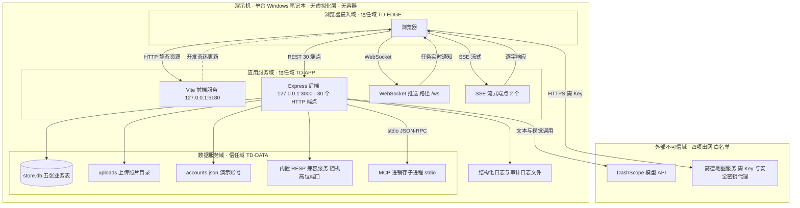

# AICoding 架构设计 · 部署设计

> 本文档为《AICoding 架构设计》核心产物之一，定位为**系统部署设计**。
> 上游输入：《系统设计》第五章部署架构、第六章网络架构、第八章可观测设计（均为对开发产生约束的结论），以及《高层架构设计》已冻结的部署形态决策 D5。
> 下游输出：演示现场的环境与资源清单、端口与网络拓扑、发布与回滚流水线、容量水位与成本口径。
>
> **事实基线声明**：本文档的端口、端点数、缓存层级、模型型号、地图瓦片 URL 等运行态事实，均以 2026-10-11 读取的源码为准（代码根 `C:/Users/21820/Desktop/蒙牛/03_产品Demo/`），运行态事实源为 `README.md v1.1` 与 `启动说明.md`，**不采信已过期的 `ARCHITECTURE.md v1.0`**。凡与源码不一致的历史文档（`server/deploy.md` 中关于 mock 模式与静默降级的表述），本文档按源码裁决并登记冲突。
>
> **深度匹配声明**：本系统是**校园创新大赛的高保真演示原型**，不是生产系统。上游硬约束 CON-2 为「单机演示态，前端 dev/preview 与后端 Node 同机」，本文档不引入 Kubernetes、容器编排、云负载均衡、云数据库等生产级组件；模板中的企业级章节（VPC、AZ、多 Region 容灾、WAF、KMS）在本项目以**「不适用 + 完整版预分配命名」**的方式诚实处理，避免产出无法执行的表格内容。
>
> **差异化口径继承**：差异化话术已由用户中间确认裁决为口径 1（改锚点）——锚定「单层可解释深度 + 三端真库闭环」。本文档全程不主张「我们是 Agent」或「唯一闭环」。

---

## 0. 元信息：修订记录

| 文档版本 | 发布日期 | 修订人 | 修订说明 |
| --- | --- | --- | --- |
| v1.0 | 2026-10-11 | 平台架构师（毕落地） | 文档初始版本。覆盖 §1 引言、§2 环境与资源清单、§3 部署拓扑与高可用、§4 部署流程、§5 监控告警、§6 应急与回滚、§7 安全合规、§8 容量与成本。正式裁决 X15（mock 回退）、X13（签名密钥）、X10/X11/X12/X16 部署侧口径；D-02（地图瓦片合规）曾登记为待用户中间确认项，后于 v1.1 拍板。 |
| v1.1 | 2026-10-11 | 平台架构师（毕落地） | 三项结构性修订。①**D-02 已由用户拍板为方案①（高德 JS API + 正规申请 Key + 绑定域名）**，全文 13 处同步收敛（原推荐项「内置静态底图」未采纳，仅作回退预案保留于 §8.2 取舍表）。②落地 DEPLOY-01 裁决：主理人采纳方案①代码侧绑定回环，修复动作登记为 RW-7，并新增 §7.1.17 代码回写清单（RW-7 至 RW-11）。③新增 7.1.16 将演示账号清单接口的明文口令显式登记为已知风险并接受。 |

**本章未启用内容的说明**：

| 模板章节 | 状态 | 理由 |
| --- | --- | --- |
| §2.3 复用资源清单 | 启用（标注为无） | 本项目无任何云上复用资源；保留表格并如实填「无」，避免读者误以为漏填 |
| §3.3.2 负载均衡 / §3.3.4 弹性伸缩 | 启用（标注为不适用） | 单机单进程无流量入口设备与多副本；保留章节并写明不适用原因，不编造副本数与阈值 |
| §4.2 流水线 | 启用（降级为本地编排） | 受 CON-1「零新增依赖」约束，不引入 CI 平台；八个阶段全部落地为本地 npm 脚本与人工卡点 |
| §5 监控告警 | 启用（对齐系统设计 §8） | 不引监控 SDK（系统设计 §8 硬约束）；告警通道为页面黄条与人工观察 |

**版本管理纪律**：破坏性变更（部署形态、端口矩阵、拓扑命名变更）升 MAJOR；新增章节、补充口径升 MINOR。

---

## 1. 引言

### 1.1 适用范围与部署形态

| 项 | 取值 |
| --- | --- |
| 适用系统 | 店小C · 蒙牛 AI 巡店助手（前端 `store-app/` + 后端 `server/`） |
| 部署形态 | **单机演示态**：前端 dev/preview 服务与后端 Node 进程运行在同一台机器，经本机回环互联 |
| 部署位置 | 演示者自带的笔记本电脑（Windows 11，Node v22.22.2 实测） |
| 网络形态 | **无公网暴露面**；出网白名单共四项（文本模型 API、视觉模型 API、浏览器侧高德地图、后端侧高德安全密钥代理），其余全部本地 |
| 编排方式 | 无容器、无编排；两个进程由 `start-all.bat` 拉起 |
| 目标可用性 | 演示窗口内不低于 99%，故障恢复目标 10 分钟内（继承系统设计 §5.3） |
| 唯一成功标准 | 现场 90 秒演示不翻车（上游 D3 已冻结） |
| 不适用场景 | 本文档不适用于任何真实生产部署、多租户部署或跨机集群部署；完整版部署需重新设计 |

**部署边界声明**：本系统不宣称自己是生产系统，也不产出生产级 SLA 承诺。系统设计 §5.3 已把可用性目标定为 99%（单机单实例架构下诚实可达值），本文档全篇沿用该口径，不上调。

### 1.2 名词与缩写

| 术语 | 英文 / 全称 | 含义 |
| --- | --- | --- |
| 演示机 | Demo Host | 运行前端与后端的单台 Windows 笔记本 |
| 回环 | Loopback | 本机 127.0.0.1 地址段，不经过任何网络设备 |
| 信任域 | Trust Domain | 一组共享同一信任级别的组件集合；具体规则由《安全设计》定义，本文档给出拓扑边界假设 |
| 真后端 | Real Backend | Express 应用，含 29 个 `/api/v1` 路由与 `/health`，共 30 个 HTTP 端点 |
| 三级缓存 | Three-tier Cache | 真 Redis、内置 RESP 兼容服务（redis-lite）、进程内存 LRU 三层回退 |
| 内置 RESP 兼容服务 | redis-lite | `server/src/redisLite.js` 实现的 speaking-RESP TCP 服务，由真实 ioredis 客户端连接 |
| 会话令牌 | Session Token | 四段式签名令牌 `username.ts.exp.hmac`，HMAC-SHA256 签名，有效期 8 小时 |
| 流式端点 | SSE Endpoint | `/api/v1/ai/chat/stream` 与 `/api/v1/ai/generate/stream`，响应类型为 `text/event-stream` |
| 进销存事实 | Inventory Fact | 批次临期、价盘、门店库存三类外部事实，经 MCP 子进程 stdio JSON-RPC 拉取 |
| 端口矩阵 | Port Matrix | 演示态全部监听端口、绑定地址、承载能力与信任域归属的对照表 |
| CI/CD | Continuous Integration / Delivery | 持续集成与持续交付流水线；本项目落地为本地脚本编排加人工卡点 |

### 1.3 上游结论继承台账

| 编号 | 主题 | 本文档处理方式 | 依据 |
| --- | --- | --- | --- |
| CON-1 | 截止日 2026-10-22，零新增依赖 | 全部选型以「换机克隆少失败点」为唯一判据；不引入新框架与云服务 | 系统设计 §1.1 |
| CON-2 | 单机演示态 | 不引入 K8s / 容器 / 云数据库；拓扑以端口矩阵与本机数据目录表达 | 系统设计 §1.1 |
| CON-3 | 唯一在线依赖为模型 API 与高德地图服务两类 | **D-02 已拍板采用高德地图服务（JS API + 正规申请 Key + 绑定域名）**，故唯一在线依赖为模型 API 与高德地图服务两类，且**两者均需 Key 且均需联网**。出口白名单登记四项出网：文本模型、视觉模型、浏览器侧高德地图、后端侧高德安全密钥代理；新增出网须先登记 | 系统设计 §1.1 + D-02 裁决 |
| CON-4 | 无 mock 层 | 裁决 X15，见 §1.4 | 系统设计 §1.1 |
| CON-5 | 不做多租户 | 无租户级隔离设计；日志中的 `tenantId` 为常量占位 | 系统设计 §1.1 |
| D-01 | 差异化口径 1（改锚点） | 本文档不主张 Agent 独占性，部署侧不引入 Agent 运行时 | 高层架构 §4.1 |
| D-5 | 部署形态为单机演示态 | 直接采纳为 §1.1 部署形态 | 高层架构 §1.2 |
| X3 | 风险系数采用代码三档 0.7 / 0.95 / 1.4，损失侧走毛缺口 | 演示机上的补货与风险推导参数按该口径配置；数值须标注「业务经验值，非实证估计」 | 系统设计 §4.6 |
| X4 至 X8 | 数字口径以 fixture 为唯一权威 | 演示数据备份以 `server/data/store.db` 内的 fixture 基线为准，重置端点恢复该基线 | 系统设计 §1.4 |

### 1.4 本文档裁决的冲突

| 编号 | 冲突主题 | 裁决结论 | 裁决依据 | 影响范围 |
| --- | --- | --- | --- | --- |
| X15 | mock 层是否保留为回退 | **不保留 mock 回退。** 保持「全站真后端 + 零 mock」形态，后端不可达时如实报错并显示「后端未连接」提示条 | ①README v1.1 与系统设计 CON-4 已显式锁定无 mock 层；②系统设计 §3 降级纪律红线禁止静默降级为看起来像真数据的假数据；③即使保留带可辨识痕迹的 mock 回退，也会在评委追问「这个数字哪来的」时削弱可溯源论证 | 前端 `client.ts` 不改动；`server/deploy.md` 与 `启动说明.md` 中关于 mock 的历史表述需回写删除 |
| X13 | 未配置签名密钥时启用进程级随机密钥 | **演示环境不可接受。** `AUTH_SECRET` 必须在演示前配置为固定值，缺失即视为 P0 演示门禁项未通过 | ①`server/src/auth.js` 实测：未配置时每次进程启动生成随机密钥并打印警告，重启后全员令牌立即失效；②`启动说明.md` 录屏建议明确要求「保持后端终端开着，中途不要重启」——一旦被迫重启，评委须重新登录，现场即中断；③系统设计 §8.4 告警 AL-02 已把它定为 P0 | §4.5.4 发布门禁、§6.2 Runbook RB-02、§7.2 凭证清单 |
| X10 | 视觉模型型号 qwen-vl-plus 与 qwen-vl-ocr 并存 | 以 `qwen-vl-ocr` 为部署口径 | `vision.js` 默认值与实际 `.env` 配置一致（系统设计 X10 已裁决） | §2.2.4 中间件配置、§4.4 配置分层 |
| X11 | 文本模型默认 DeepSeek 与实际 qwen-plus 并存 | 以 `qwen-plus` 为部署口径，代码默认值仅在无 `.env` 时生效 | `.env` 优先级高于代码默认（系统设计 X11 已裁决） | §2.2.4 中间件配置 |
| X12 | Leaflet 版本 4 与 1.9.4 并存 | 以实测 1.9.4 为准 | `store-app/package.json` 实测（系统设计 X12 已裁决） | §2.2.1 计算资源 |
| X16 | 前端端口 5173 与 5180 冲突 | 演示统一用 5180，且必须以严格端口模式固定，详见 §3.2.1 端口矩阵与 §4.5.4 | `vite.config.ts` 中 `strictPort: false`，端口被占用时会静默漂移 | §3.2.1、§4.5.4、§6.2 Runbook RB-04 |
| D-02 | 高德瓦片合规二选一 | **用户已拍板（2026-10-11）：方案① 高德 JS API + 正规申请 Key + 绑定域名。** 原推荐项（方案② 内置静态底图）**未被采纳**，仅作回退预案保留。差异化处置与取舍见 §8.2 取舍表；EG-3a 与 EG-3b 出网拆分及白名单前置条件见 §3.2.3 | 命中中间确认协议 §2.2 第 2 条「跨界感知」，故已发起 `[中间确认]` 并由用户拍板。方案①换取合规确定性（消除免密钥直连的条款不确定性）与真实地图观感，代价是必须联网、必须持 Key、增加前端改造工时，并因官方推荐的安全密钥代理形态新增一处后端出网面（EG-3b） | §3.2.3 出网白名单 EG-3a 与 EG-3b、§4.4 配置分层 L4、§5.2 大盘、§7.2 凭证清单 CRED-05 与 CRED-06、§8.2 成本与取舍表、§7.1.17 RW 清单 |
| D7-B4 | `node:sqlite` 版本标志陷阱 | 演示机锁定 Node 22.13.0 及以上；启动前必须核对 `node -v` | `node:sqlite` 自 22.5.0 引入，22.5.0 至 22.12 区间必须加 `--experimental-sqlite` 标志，22.13.0 起该标志不再需要（稳定性等级 1.1 Active development）；`启动说明.md` 仅写「Node 大于等于 22.5」，未提该标志 | §3.2.1 端口矩阵前置条件、§4.5.2 首次发布流程、§6.2 Runbook RB-01 |
| DEPLOY-01 | 后端 3000 端口监听全部网卡接口（**本文档源码核对时发现的新问题，上游未登记**） | **主理人已裁决（2026-10-11）：采纳方案①代码侧绑定回环**。修复动作 = `server/src/index.js:1467` 的启动调用补 host 参数 | 后端启动调用为不带主机参数的形式，Node 默认监听全部网卡接口；而演示账号清单接口会连同明文口令下发。会场若接入公共网络，同网段设备可直接读取演示数据。**更隐蔽的根因**：`index.js:1473` 的启动日志打印 `http://127.0.0.1:3000`，与实际监听行为不符——正是这条自述日志误导了 README 与全部下游文档「仅回环、无公网暴露面」的表述 | §3.1.1 硬约束 TD-C4、§3.2.1 端口矩阵与 PRE-6、§3.3.1 故障域、§7.1 表 7.1.2 与 7.1.15、§6.2 Runbook RB-11、§7.1 RW 清单 RW-7 |

**DEPLOY-01 三方案对比与裁决记录（保留决策过程，不抹除）**：

| 方案 | 处置方式 | 裁决结论 | 理由 |
| --- | --- | --- | --- |
| ① | 代码侧启动调用补 host 参数，仅绑定回环 | **采纳** | 零新增依赖；改动一行；彻底消除暴露面（治根）；换机重装不失效；**可被评委在代码中直接验证** |
| ② | 主机防火墙入站规则拒绝 3000 端口外部访问 | 否决 | 不改代码则根因仍在；换机或重装系统即失效；**演示现场无法快速验证**，属「看起来安全」 |
| ③ | 改用个人热点或有线专网 | 否决 | 受会场条件限制，不可控；与方案①叠加时属冗余 |

**方案① 与现有前端的兼容性（已核实）**：前端 Vite 在 5180、后端 3000 在同一台机演示，前端经 `http://127.0.0.1:3000` 访问后端，绑回环后**功能完全不受影响**。仅「用手机或另一台电脑访问本机 Demo」这一玩法会被阻断，而该玩法本就不应在评委面前演示。

**方案① 未覆盖的残留风险（不可忽略）**：即使绑定回环，`GET /api/v1/auth/demo-accounts` 仍**免鉴权返回三个账号的明文口令**（`auth.js:253` 直接下发 `password` 字段）。绑定回环后暴露面收敛到本机单机，同网段设备不可达，**但本机任意本地进程仍可读取**。该项为已知取舍，处置见 §7.1 表 7.1.16。

**X15 裁决的权衡说明**：演示稳定性与「数字不造假」在本项目中并非真实对立。真实风险不是「后端挂了」，而是「后端挂了就切换到假数据」。因此本裁决不采用「保留 mock 作为回退」，而是把稳定性预算全部投到**真实链路的确定性**上：

| 稳定性诉求 | 本裁决给出的真实手段（不含假数据） |
| --- | --- |
| 后端进程崩溃后快速恢复 | 启动门禁 + 恢复 Runbook，目标 10 分钟内恢复（继承系统设计 RTO） |
| 现场数据被改乱后回到基线 | `POST /api/v1/demo/reset` 重置五表到 fixture 基线，幂等可重复调用 |
| 前端产物损坏 | `npm run build:single` 产出内联单文件 `dist/index.html`，双击即开 |
| 模型超时导致页面空白 | SSE 端点降级为一帧全文，响应头带来源标记，界面如实标注降级 |
| 地图断网 | `MapView.vue` 统计瓦片加载成功数，连续失败且零成功即切灰底并显示提示条 |
| 端口漂移导致评委看到错误地址 | 启动脚本以严格端口模式固定 5180 |

以上六项**没有一项依赖假数据**，因此无需在「稳定性」与「数字不造假」之间做取舍。

**X15 反向验证（中间确认协议 §2.3）**：

| 问题 | 答案与证据 |
| --- | --- |
| Q1 若三个月后被推翻，返工成本可控吗 | 可控。返工范围 = §1.4 的 X15 行、§3.2.3 出网白名单、§4.4 配置分层三处，加前端 `client.ts` 一个文件的回退逻辑（当前不存在，需新增）。切换成本估算：若改为「保留带痕迹的 mock 回退」，需重新引入一套 fixture 导出层与来源角标渲染，约 2 至 3 人日，属周级而非月级 |
| Q2 结果用户、客户、监管能感知到吗 | 能感知，但感知方向是「更诚实」。评委在后端未起时看到的是黄条「后端未连接」与空态，而不是一份看似完整的假看板。感知点为界面错误态，不涉及功能增减、合同条款或监管属性 |
| Q3 与用户原始诉求是否一致 | 一致。直接引用 README v1.1 运行态声明原文：「后端不可用时**如实报错并提示**，不再偷偷降级为假数据」；以及 PRD D3 硬约束原文（material_digest D1，§0 硬约束）「无 mock 兜底」。上游已冻结文档对该决策点本身做出了明确选择，属协议 §2.1 第 3 条意义上的已冻结，故不发起中间确认 |

**X13 反向验证（中间确认协议 §2.3）**：

| 问题 | 答案与证据 |
| --- | --- |
| Q1 若三个月后被推翻，返工成本可控吗 | 可控。返工范围 = §4.5.4 门禁表两行、§6.2 Runbook RB-02 一节、§7.2 凭证表两行。切换成本不足 0.5 人日，属纯流程条目 |
| Q2 结果用户、客户、监管能感知到吗 | 能感知。演示者与评委在配置签名密钥后，重启后端不再被强制登出，登录体验更好。感知点为登录态是否跨重启保持，属运行质量改善而非产品功能变化 |
| Q3 与用户原始诉求是否一致 | 一致。直接引用 README v1.1 演示注意事项原文：「保持后端终端开着，中途不要重启后端（重启需重新登录，token 会失效）」。本裁决把该口头建议升级为可检查的门禁项，方向与原始诉求同向 |

---

## 2. 环境与资源清单

### 2.1 环境矩阵

**为何是四行而实际只用两行**：模板要求四环境齐备以保持交付规格完整，但上游 CON-2 与 CON-1 已冻结「单机演示态、11 天交付」。在 11 天内搭建四级独立环境是纯浪费，且本系统无真实生产数据可隔离。本文档因此保留四行规格、如实标注启用状态，并写明**合并映射规则**：int 与 uat 不启用，其职责由 dev 兼任；prod 在本项目指代「大赛现场演示态」，而非真实生产环境。

环境合并映射规则：dev 兼作联调与开发自测环境，int 与 uat 本期不启用其职责由 dev 兼任，prod 在本项目语义为大赛现场演示态；三套隔离手段为独立端口、独立数据目录与启动顺序。

| 环境 | 用途 | 集群隔离 | 数据 | 网络访问 | 启用状态 |
| --- | --- | --- | --- | --- | --- |
| dev | 开发自测与联调 | 不独立：与演示环境同机，靠独立端口与独立数据目录隔离 | fixture 基线 + 开发过程产生的数据 | 仅本机回环 | **启用** |
| int | 联调 | 合并至 dev | 合并至 dev | 仅本机回环 | 不启用（职责由 dev 兼任） |
| uat | 预发与验收 | 合并至 dev | 合并至 dev | 仅本机回环 | 不启用（职责由 dev 兼任） |
| prod | 生产 | 不适用：本项目语义为大赛现场演示态 | fixture 基线 + 现场产生的闭环数据 | 仅本机回环 + 四项出网白名单 | **启用（语义为演示态）** |

**两环境隔离实现方式**：

| 隔离维度 | dev | prod（演示态） | 隔离手段 |
| --- | --- | --- | --- |
| 前端端口 | 5173 | 5180（严格端口模式固定） | 端口不同 |
| 后端端口 | 3100 | 3000 | 通过 `PORT` 环境变量覆盖，命令行传参优先于 `.env` |
| 数据目录 | `server/data` | 同目录，演示前整文件复制快照 | 备份文件名含时间戳 |
| 启动方式 | 两个终端手动 | `start-all.bat` 一键启停 | 启动顺序不同 |

**为何不启用独立 uat**：系统设计 §5.1 已给出同源判断——本系统的验收标准是「现场 90 秒演示不翻车」，其验证方式是**在演示机上真跑一遍闭环**（重置数据、经理下派、业代实时收到待办、提交回执、看板回流），而不是在预发环境跑测试用例。独立预发环境会产生第二份需要维护的数据与配置，反而多一个「两边不一致」的失败点。

### 2.2 云资源清单

> **重要声明**：本项目为**本地单机演示态，不涉及腾讯云环境**，因此 CloudQ 资源核对步骤已跳过。下表中的「资源 ID」列填的是**本地可复现的定位标识**（目录路径加端口加文件名），不是云资源实例 ID。本文档**不编造任何云资源 ID、实例 ID、负载均衡 ID 或 KMS 实例 ID**。

#### 2.2.1 计算资源

| 资源编号 | 类型 | 产品 | 资源 ID（本地定位标识） | 名称 | 规格 | 数量 | 环境 | 复用 / 新建 | HA 方案 | 用途 |
| --- | --- | --- | --- | --- | --- | --- | --- | --- | --- | --- |
| R-C-001 | 物理机 | 自备笔记本电脑 | 演示者自备资产，资产编号由演示者自行登记 | 演示机 | Windows 11，8 核 16 GB，实测开发期可用内存充足 | 1 台 | dev 与 prod | 复用 | 无（单机，无冗余） | 承载全部前后端进程与本地数据 |
| R-C-002 | 前端进程 | Node.js + Vite 5 | 进程入口 `store-app/node_modules/.bin/vite`，监听 127.0.0.1:5180 | 店小C-前端 | Node 22.22.2，Vue 3 加 Vite 5 加 TypeScript，Leaflet 1.9.4，ECharts 5 | 1 实例 | dev 与 prod | 复用 | 无 | 提供页面与静态资源 |
| R-C-003 | 后端进程 | Node.js + Express 4.19.2 | 进程入口 `server/src/index.js`，监听 127.0.0.1:3000 | 店小C-后端 | Node 22.22.2，进程内存实测约 400 MB（含内置 RESP 服务与 MCP 子进程） | 1 实例 | dev 与 prod | 复用 | 无 | 承载 30 个 HTTP 端点与 `/ws` |
| R-C-004 | 子进程 | Node.js stdio JSON-RPC | `server/mcp/inventory-server.mjs`，由后端懒启动并单例复用 | 进销存 MCP 服务 | 零依赖，暴露三个工具 | 1 实例 | dev 与 prod | 复用 | 无（后端重启即重建） | 提供批次临期、价盘、门店库存事实 |
| R-C-005 | 子进程 | 内置 RESP 兼容服务 | `server/src/redisLite.js`，监听 127.0.0.1 随机高位端口 | redis-lite | speaking-RESP TCP 服务，由真实 ioredis 客户端连接 | 1 实例 | dev 与 prod | 复用 | 无（随后端进程生命周期） | 缓存中间层，使真实 Redis 协议路径可跑通 |

**计算资源扩容结论**：五个计算单元全部为单实例。系统设计 §5.2.2 已裁决「副本区间固定 1，唯一需要的弹性是缓存与外部模型调用的超时降级，替代副本伸缩」。本文档不设副本数区间。

#### 2.2.2 存储资源

| 资源编号 | 类型 | 产品 | 资源 ID（本地定位标识） | 名称 | 规格 | 容量 | 环境 | 复用 / 新建 | HA 方案 | 备份策略 |
| --- | --- | --- | --- | --- | --- | --- | --- | --- | --- | --- |
| R-S-001 | 单文件数据库 | `node:sqlite` 内置 SQLite | `server/data/store.db` | 业务库 | 五张业务表：tasks、tickets、visits、diagnoses、rectifications | 演示态小于 5 MB（红线值） | dev 与 prod | 复用 | 无 HA，文件损坏靠整文件回滚 | 演示前手动整文件复制，保留最近 3 份 |
| R-S-002 | 目录 | 本地文件系统 | `server/data/uploads/` | 上传照片目录 | 整改照片与巡店照片，扩展名白名单加 `nosniff` 响应头 | 演示态不超过 200 MB（红线值） | dev 与 prod | 复用 | 无 | 与数据库文件同批复制 |
| R-S-003 | 单文件凭证 | 本地文件系统 | `server/data/accounts.json` | 演示账号文件 | 三个账号的角色与口令，仅后端可读 | 小于 1 KB | dev 与 prod | 复用 | 无 | 不随演示包外发 |
| R-S-004 | 备份目录 | 本地文件系统 | 与运行目录不同的本机备份目录，含时间戳命名 | 演示前快照 | 全量冷备，数据量在 5 MB 以内，不做增量 | 3 份，每份小于 5 MB | prod | 新建 | 无 | 保留最近 3 份，超出自动丢弃最旧 |
| R-S-005 | 前端产物 | 本地文件系统 | `store-app/dist/` | 前端静态包 | 标准构建为多文件；`build:single` 产出内联单文件 `index.html` | 标准构建约 276 KB（单文件形态实测） | prod | 复用 | 无 | 由构建命令重新生成，不单独备份 |
| R-S-006 | 环境变量文件 | 本地文件系统 | `server/.env` 与 `store-app/.env` | 配置与密钥文件 | 后端含模型密钥与签名密钥；前端仅含非敏感地址配置 | 小于 4 KB | dev 与 prod | 新建 | 无 | 不入仓库，换机克隆后重新复制模板 |
| R-S-007 | 日志文件 | 本地文件系统 | 后端标准输出重定向得到的日志文件 | 结构化日志 | JSON 行格式，含 `traceId` 与 `tenantId` | 按演示时长累积 | dev 与 prod | 新建 | 无 | 应用日志 30 天，异常与审计与安全日志 90 天 |

**存储 HA 缺失的显式声明**：本系统**不具备存储层高可用**。这不是遗漏，而是 CON-2 单机演示态的直接后果。恢复手段只有一条——整文件复制回滚。完整版必须替换为具备主备同步与自动切换的关系型数据库。该声明与系统设计 §4.3.1 完全一致。

#### 2.2.3 网络资源

> 本项目**无云上 VPC、无子网、无弹性网卡、无公网 IP、无负载均衡实例、无 NAT 网关**。下表以「逻辑网络分区」形式给出端口与信任域归属，其作用是：①给《安全设计》提供一份可引用的拓扑边界假设；②为完整版预留一套不与常见企业网段冲突的命名规范。表中 CIDR **当前未绑定任何真实网卡**，仅作命名锚点。

**完整版预分配的网络命名（当前未启用，供《安全设计》引用）**：

| 命名对象 | 命名标识 | CIDR | 用途 | 当前状态 |
| --- | --- | --- | --- | --- |
| 私有网络 | `vpc-dxd-mengniu` | 10.66.0.0/16 | 本系统未来上云时的私有网络边界 | 未启用（演示态无 VPC 实体） |
| 应用子网 | `sn-dxd-app` | 10.66.10.0/24 | 前后端应用实例所在子网 | 未启用 |
| 数据子网 | `sn-dxd-data` | 10.66.20.0/24 | 数据库、缓存、上传目录所在子网 | 未启用 |
| 出口子网 | `sn-dxd-egress` | 10.66.30.0/24 | 对外模型与地图请求的出口策略锚点 | 未启用 |

**命名规范说明**：`10.66.0.0/16` 为本项目在完整版中申请的私有地址段，选择 10.66.0.0 而非常见的 10.0.0.0 与 172.16.0.0，目的是降低与企业既有内网段冲突的概率。命名规则为「区域短码加业务短码加环境短码」，本文档是该规范的**唯一权威定义方**，《安全设计》在引用时应保持一致而非另起命名。

**演示态实际网络资源**：

| 资源编号 | 类型 | 绑定地址 | 监听端口 | 协议 | 承载内容 | 信任域（待《安全设计》确认规则） |
| --- | --- | --- | --- | --- | --- | --- |
| R-N-001 | 本机回环 | 127.0.0.1 | 3000 | HTTP 与 WebSocket | 30 个 HTTP 端点、WebSocket 推送、两个 SSE 流式端点。**注意：实测该端口监听全部网卡接口，非仅回环，见 PRE-6** | 应用服务域 |
| R-N-002 | 本机回环 | 127.0.0.1 | 5180 | HTTP | 前端页面与静态资源 | 浏览器接入域 |
| R-N-003 | 本机回环 | 127.0.0.1 | 4173 | HTTP | `vite preview` 产物预览（备用启动方式） | 浏览器接入域 |
| R-N-004 | 本机回环 | 127.0.0.1 | 随机高位端口 | RESP over TCP | 内置 RESP 兼容服务，端口在启动时分配 | 数据服务域 |
| R-N-005 | 本机回环 | 127.0.0.1 | 不适用（文件系统） | 文件读写 | `server/data/` 全目录 | 数据服务域 |
| R-N-006 | 出网 | 网卡默认路由 | 443 | HTTPS | 模型 API 端点 | 外部不可信域 |
| R-N-007 | 出网 | 网卡默认路由 | 443 | HTTPS | 高德地图服务**浏览器侧**（D-02 方案① EG-3a），需正规申请 Key 后填入前端环境变量 | 外部不可信域 |
| R-N-008 | 出网 | 网卡默认路由 | 443 | HTTPS | 高德地图服务**后端侧安全密钥代理**（D-02 方案① EG-3b），由后端自建代理转发，**与模型 API 出网并列**，属新增后端出网面 | 外部不可信域 |

#### 2.2.4 中间件与平台服务

| 资源编号 | 类型 | 产品 | 资源 ID（本地定位标识） | 名称 | 规格 | 环境 | 复用 / 新建 | HA 方案 | 用途 |
| --- | --- | --- | --- | --- | --- | --- | --- | --- | --- |
| R-M-001 | 嵌入式数据库 | Node 内置 `node:sqlite` | 由 `server/src/db.js` 以 `DatabaseSync` 打开 `server/data/store.db` | 业务库驱动 | 同步 API，单连接，无连接池 | dev 与 prod | 复用 | 无 | 五张业务表的读写 |
| R-M-002 | 缓存客户端 | ioredis 6 | 由 `server/src/cache.js` 动态引入 | 缓存客户端 | 连接超时 1500 毫秒，单次重试，失败即回落 | dev 与 prod | 复用 | 无 | 承载三级缓存的真实 Redis 协议路径 |
| R-M-003 | 缓存服务端（可选） | 外部 Redis | 由 `server/.env` 的 `REDIS_URL` 指定 | 真 Redis 服务端 | 演示机通常无法安装 Redis 服务端，默认不配置 | prod | 复用（可选） | 无 | 配置后即成为缓存首选层 |
| R-M-004 | 进程内缓存 | Node Map 结构 | `server/src/cache.js` 内存层 | 内存 LRU | 上限 500 条，TTL 3600 秒，容量超限淘汰最旧条目 | dev 与 prod | 复用 | 无 | 缓存最后一级回退 |
| R-M-005 | 实时推送 | ws 8 | `server/src/realtime.js`，挂载于后端 3000 端口的 `/ws` 路径 | 实时推送通道 | 握手时验签，异常时以关闭码 1008 拒绝 | dev 与 prod | 复用 | 无 | 经理下派任务到业代端的实时通知 |
| R-M-006 | 流式传输 | Express 原生响应 | 后端 3000 端口的两个 SSE 路由 | 流式端点 | 响应类型 `text/event-stream`，生成完毕即关闭流 | dev 与 prod | 复用 | 无 | 多轮追问与文案生成的逐字输出 |
| R-M-007 | 跨源策略 | cors 2.8.5 | 由 `server/.env` 的 `VITE_ORIGIN` 指定白名单 | 跨域白名单中间件 | 逗号分隔多地址，默认放行两个协议乘两个端口共四个本地地址 | dev 与 prod | 复用 | 无 | 限制浏览器可读取接口的来源 |
| R-M-008 | 外部模型服务 | DashScope 千问（OpenAI 兼容模式） | `server/.env` 的 `LLM_BASE_URL` 与 `LLM_VL_BASE_URL` | 文本与视觉模型 | 文本 `qwen-plus`，视觉 `qwen-vl-ocr`（X10 与 X11 已裁决） | prod | 复用 | 无（外部服务） | 诊断追问、小结、订货理由、货架视觉识别 |
| R-M-009 | 补货算法 | 自研模块 | `server/src/forecast.js` | 补货推导引擎 | Holt 指数平滑加动态安全库存，九成服务水平；按 X3 口径取三档严重度系数 | dev 与 prod | 复用 | 无 | 建议补货量逐步可溯源推导 |

**中间件配置的部署纪律**：模型型号与地址属 L3 环境变量（见 §4.4），改动后必须重启后端进程；Redis 地址同样属 L3。缓存开关与降级开关属 L2 运行时开关，改动立即生效，用于评委追问时可现场切换说明。

#### 2.2.5 可观测资源

> 归口说明：可观测资源的**指标体系、告警分级与日志规范由《系统设计》第八章定义**，本文档只负责「这些可观测数据落在哪里、保留多久、谁去看」。保留期的最终口径由《安全设计》主导（审计字段与保留期为该文档权威项），本文档引用其结论而不自行定义信任边界。

| 资源编号 | 类型 | 产品 | 资源 ID（本地定位标识） | 名称 | 规格 | 环境 | 复用 / 新建 | 承载可观测维度 |
| --- | --- | --- | --- | --- | --- | --- | --- | --- |
| R-O-001 | 健康检查端点 | Express 原生路由 | `GET /health`（127.0.0.1:3000） | 演示就绪探针 | 返回存活、数据库类型、模型自述、进销存状态、缓存后端与命中率、推送连接数 | dev 与 prod | 复用 | 进程存活与依赖自述；模型字段固定自述为「未验证连通性」，不因密钥存在而报已连通 |
| R-O-002 | 结构化日志 | Node 标准输出重定向 | 日志文件 | 应用日志 | JSON 行格式，必含 `traceId` 与 `tenantId`，必含 `module`、`event`、`role`、`userId` | dev 与 prod | 新建 | 业务关键动作、异常、AI 调用来源标记、每个 HTTP 请求的路径状态码与耗时 |
| R-O-003 | 审计日志 | 结构化日志独立文件 | 审计日志文件 | 审计日志 | 五张表全部写操作留痕，含谁、何时、对什么资源、做了什么、结果如何、来源路径 | prod | 新建 | 关键写操作不可篡改性在演示态不适用，完整版必须独立账号与独立存储 |
| R-O-004 | 安全日志 | 结构化日志独立文件 | 安全日志文件 | 安全日志 | 登录失败、验签失败、越权拒绝事件 | prod | 新建 | 认证与授权异常 |
| R-O-005 | 页面内指标面板 | Vue 3 前端 | 前端设置面板与页面提示条 | 演示现场可观测面板 | 黄色提示条与缓存命中计数展示 | dev 与 prod | 复用 | 无监控 SDK 约束下的现场可观测手段 |
| R-O-006 | 缓存计数 | 应用内计数 | `server/src/cache.js` 导出的命中与未命中计数 | 缓存命中率 | 接口可查当前后端类型、条目数、命中率 | dev 与 prod | 复用 | 缓存有效性的现场证明 |

**可观测方案与生产级方案的差异**：生产级方案依赖指标采集代理、日志服务与链路追踪系统。本项目受系统设计 §8 硬约束（零新增依赖）限制，**不引入任何监控 SDK 与独立监控设施**，全部可观测能力由结构化日志、健康检查端点与页面内面板承载。因此本文档不产出采集代理地址、日志服务接入点与链路追踪采样配置，相关条目按「不适用」处理而非留空。

#### 2.2.6 安全资源

> 归口说明：**信任域规则、安全组规则、WAF、密钥分级、审计字段与保留期均为《安全设计》的权威项**，本文档只做三件事：①给出拓扑侧的信任域边界假设（见 §3.2.2）；②登记安全资源的存在性与定位标识；③在策略对齐阶段回填《安全设计》给出的命名与阈值。安全资源在演示态的形态是操作系统级轻量防护，不是云上安全产品。

| 资源编号 | 类型 | 产品 | 资源 ID（本地定位标识） | 名称 | 规格 | 环境 | 复用 / 新建 | HA 方案 | 用途 |
| --- | --- | --- | --- | --- | --- | --- | --- | --- | --- |
| R-Sec-001 | 主机防火墙 | Windows Defender 防火墙 | 演示机本机配置 | 出站限制规则 | 入站侧引用安全组 **SG-01 至 SG-05**（仅回环可接入，非回环来源拒绝）；出站侧引用 **SG-06（模型 API）、SG-06b（高德服务端代理）、SG-07（白名单之外一律拒绝）、SG-08（非 443 拒绝）**。**安全组规则的权威方为《安全设计》§5.3，本行仅为引用**（详见 §3.2.2 安全组引用表） | dev 与 prod | 复用 | 无 | 落实 CON-3 出口白名单与 §3.2.3 出网纪律 |
| R-Sec-002 | 密钥承载 | 本地文件权限 | `server/.env`，权限仅当前用户可读 | 敏感配置承载 | 模型密钥两个、签名密钥一个；启动日志只提示是否已配置，绝不打印值 | prod | 新建 | 无 | 密钥不入库、不入代码、不入前端环境变量 |
| R-Sec-003 | 认证中间件 | 应用层实现 | `server/src/auth.js` 的 `requireAuth` 与 `requireRole` | 接口鉴权 | HMAC-SHA256 签名令牌，定长安全比较防时序攻击，角色白名单 | dev 与 prod | 复用 | 无 | 除登录与公开元数据外全部接口强制鉴权 |
| R-Sec-004 | 跨源白名单 | 应用层中间件 | cors 中间件加 `VITE_ORIGIN` | 来源校验 | 不在白名单内的来源不返回跨域响应头 | dev 与 prod | 复用 | 无 | 防止第三方网页跨域读取演示账号清单 |
| R-Sec-005 | 上传防护 | 应用层实现 | `server/src/index.js` 上传公共实现 | 上传白名单 | 扩展名白名单，`nosniff` 响应头，`inline` 内容处置；请求体上限 20 MB | dev 与 prod | 复用 | 无 | 阻断上传内容被当作脚本解释 |
| R-Sec-006 | 实时通道鉴权 | 应用层实现 | `server/src/realtime.js` 握手逻辑 | WebSocket 验签 | 握手时验签，失败以关闭码 1008 拒绝 | dev 与 prod | 复用 | 无 | 修复历史缺陷：曾直接信任自报角色的查询参数 |

**云上安全资源适用性裁决**：WAF、抗分布式拒绝服务、云安全运营中心、堡垒机、云密钥管理服务在本项目**全部不适用**，原因是无公网暴露面且无远程运维通道。密钥管理的当前形态是「文件权限加不入库红线」，不是云密钥管理服务。这些条目在完整版上云时必须重新评估，本文不做占位式编排。

---

## 3. 部署拓扑与高可用设计

### 3.1 物理拓扑

#### 3.1.1 物理拓扑图



**信任域边界与数据流向的三条硬约束**（拓扑侧，规则由《安全设计》定义）：

| 约束编号 | 内容 |
| --- | --- |
| TD-C1 | `TD-EDGE` 与 `TD-APP` 之间的唯一合法方向是浏览器主动发起的请求；后端不得主动向浏览器推送请求 |
| TD-C2 | `TD-APP` 与 `TD-DATA` 之间只有后端进程可发起访问；`TD-DATA` 内没有任何监听端口对外暴露（内置 RESP 服务仅绑定回环且端口不固定） |
| TD-C3 | `TD-APP` 与 `EXT` 之间只有已登记的出网请求；新增任何出网调用必须先登记到 §3.2.3 出网白名单 |
| TD-C4 | `TD-APP` 的 3000 端口**在实测中监听全部网卡接口而非仅回环**，因此「仅本机可访问」当前不成立。**已裁决处置方案①（代码侧绑定回环）**，修复动作 = RW-7（`index.js:1467` 补 host 参数）；修复完成并经 `netstat` 复测前，本约束仍视为未满足 |

#### 3.1.2 拓扑要素清单

| 要素 | 取值 |
| --- | --- |
| 跨 Region 部署 | 否；Region 数量 0（单机演示态，无云上地域概念） |
| 跨 AZ 部署 | 否；可用区数量 0 |
| Region 级容灾 | 否；无灾备 Region，无跨地域数据同步。恢复手段只有本机整文件复制回滚 |
| 流量入口路径 | 浏览器经本机回环访问前端服务 5180 取页面与静态资源，再经回环访问后端 3000 取数据、推送与流式内容；数据最终落到进程内缓存或内置 RESP 兼容服务 |
| 内部调用路径 | 同进程函数调用（六模块之间无网络跳转）；进销存为 stdio 子进程管道调用，懒启动且单例复用 |
| 数据库访问路径 | 进程内同步 API 直连单文件，无连接池（同步 API 天然单连接） |
| 出网路径 | 仅两类：DashScope 模型 API 端点、地图瓦片服务 |
| 容器与编排 | 无容器、无编排、无镜像仓库 |
| 负载均衡 | 无（单机单进程，见 §3.3.2） |

### 3.2 流量与网络链路（连通视图）

#### 3.2.1 端口矩阵与前置条件

**前置条件（不满足则后端无法启动）**：

| 编号 | 前置条件 | 校验方式 | 不满足的后果 |
| --- | --- | --- | --- |
| PRE-1 | Node.js 版本处于 22.13.0 及以上 | `node -v` | 版本落在 22.5.0 至 22.12 区间时，`node:sqlite` 需要 `--experimental-sqlite` 标志才能加载，未加则后端启动即失败；低于 22.5.0 则根本没有该模块 |
| PRE-2 | `server/.env` 已存在且含固定 `AUTH_SECRET` | 检查文件存在且该行非空、非模板占位值 | 启用进程级随机密钥，重启后全员令牌失效（X13 已裁决为不可接受） |
| PRE-3 | `store-app/.env` 已存在且 `VITE_API_BASE` 指向后端真实地址 | 检查文件存在且地址非空 | 退化为空串后请求打到前端服务自身，返回页面内容导致解析失败，故障现象被实时通道兜底地址掩盖 |
| PRE-4 | 3000 端口未被占用 | 浏览器访问 `http://127.0.0.1:3000/health` | 后端启动失败 |
| PRE-5 | 5180 端口未被占用，且以严格端口模式固定 | 严格端口模式启动后访问 `http://127.0.0.1:5180/` | 非严格模式下端口被占用会静默漂移到下一个可用端口，评委拿到打不开的地址（X16 已裁决） |
| PRE-6 | **后端 3000 端口已限制为仅本机可访问（绑定地址为 127.0.0.1）** | 演示前**必跑一次** `netstat -ano \| findstr :3000`，确认显示 `127.0.0.1:3000` 而非 `0.0.0.0:3000` | **实测风险项（已裁决，修复动作 = `server/src/index.js:1467` 补 host 参数）**：原启动调用不带主机参数，Node 默认监听全部网卡接口而非仅回环。会场若接入公共网络，同网段任意设备可直接访问全部三十个端点，其中包含返回三个演示账号明文口令的清单接口。**若验证命令显示 `0.0.0.0:3000`，门禁直接不通过，必须先改代码并重启，不得以「防火墙已挡」为由放行** |
| PRE-7 | **高德 Key 白名单已登记本地地址且已生效** | 演示前须确认高德 Key 的白名单已含 `localhost` 与 `127.0.0.1`（两者分别登记，只认 `host[:port]` 形态、不支持通配符），且**已生效不少于 30 分钟** | 白名单配置存在生效延迟（数分钟至半小时），刚配完立即演示会静默失效；**host 不在白名单时静默失效**——地图表面看着正常，但调用后端代理失败且浏览器控制台无报错，极难当场发现。**方案①机制上可行**（白名单允许登记本地地址，本地演示态无需公网域名），本条为配置生效性检查而非机制障碍 |

**端口矩阵**：

| 组件 | 协议与端口 | 绑定地址 | TLS 终结 | 作用 | 信任域 |
| --- | --- | --- | --- | --- | --- |
| 前端服务（R-C-002） | HTTP，5180 | 127.0.0.1（配置显式指定） | 不终结（仅回环，无传输加密场景） | 提供页面、静态资源、开发态热更新 | TD-EDGE |
| 前端产物预览（R-C-002 备用） | HTTP，4173 | 127.0.0.1（配置显式指定） | 不终结 | `vite preview` 预览构建产物 | TD-EDGE |
| 后端服务（R-C-003） | HTTP，3000 | **⚠ 实测现状为全部网卡接口（未指定回环绑定）**；目标态为 127.0.0.1，详见下方 PRE-6 | 不终结 | 30 个 HTTP 端点：二十九个 `/api/v1` 路由加 `/health` | TD-APP |
| 实时推送（R-M-005） | WebSocket，3000 上的 `/ws` | 127.0.0.1 | 不终结 | 经理下派任务到业代端的实时通知 | TD-APP |
| 流式端点（R-M-006） | HTTP，3000 上两个 SSE 路由 | 127.0.0.1 | 不终结 | 多轮追问与文案的逐字流式输出 | TD-APP |
| 上传照片静态挂载 | HTTP，3000 上的 `/uploads` | 同后端服务（全部网卡接口） | 不终结 | 提供已上传照片的访问，带 `nosniff` 响应头 | TD-APP |
| 内置 RESP 服务（R-C-005） | RESP over TCP，随机高位端口 | 127.0.0.1 | 不适用（明文回环） | 缓存中间层，由真实 ioredis 客户端连接 | TD-DATA |
| 模型 API（R-M-008） | HTTPS，出网 | 网卡默认路由 | 在对端终结（服务端 TLS） | 文本与视觉模型调用 | EXT |

**端口矩阵的实测现状与目标态对照（必须分开读，不可混淆）**：

| 项 | 现状（代码实测，截至 2026-10-11） | 目标态（主理人已裁决，修复后） |
| --- | --- | --- |
| 后端 3000 绑定地址 | 全部网卡接口（启动调用不带主机参数） | 127.0.0.1（`index.js:1467` 补 host 参数） |
| 上传照片静态挂载绑定地址 | 同后端服务，随之监听全部网卡接口 | 同后端服务，随之收敛为 127.0.0.1 |
| WebSocket 与 SSE 绑定地址 | 同 HTTP 服务端口，随之监听全部网卡接口 | 同 HTTP 服务端口，随之收敛为 127.0.0.1 |
| 启动日志自述地址 | 打印 127.0.0.1，**与实际监听行为不符**（这是误导下游文档「仅回环」表述的根因） | 修复后自述与行为一致，日志不再误导 |
| 验证方法 | `netstat -ano \| findstr :3000` 显示 `0.0.0.0:3000` | 同一命令显示 `127.0.0.1:3000` |

> **本表登记的是代码现状与修复目标，不代表已完成修复**。在 `index.js:1467` 实际修改并重启验证之前，§7.1 表 7.1.2 保持「未通过」状态。

**端口漂移的处置（X16 落地方式）**：`vite.config.ts` 中 `strictPort` 当前为 `false`，端口被占用时会静默漂移到下一个可用端口。三种可选处置如下，本文档推荐第一种：

| 处置方式 | 做法 | 优点 | 缺点 |
| --- | --- | --- | --- |
| 启动参数固定（推荐） | 启动脚本以 `--port 5180 --strictPort --host 127.0.0.1` 启动前端 | 零代码改动；端口被占用时直接报错而非静默漂移，故障现象明确 | 需在启动脚本中固化参数 |
| 配置文件固定 | 将 `vite.config.ts` 的 `strictPort` 改为 `true` | 行为落到配置文件，不依赖启动命令 | 需改代码，且与 dev 态下故意换端口调试的习惯冲突 |
| 端口预检 | 启动前检查端口占用并提示 | 不改行为 | 存在检查与启动之间的竞态窗口，不能单独作为保障 |

**SSE 与反向代理的部署纪律（必须遵守）**：本项目演示态不部署反向代理，但该纪律必须写明以防后续演进踩坑。

| 纪律项 | 内容 |
| --- | --- |
| 纪律一 | **不得用 HTTP/1.1 反向代理长时间挂起 SSE 流**。原因：HTTP/1.1 协议下浏览器对单个域名有 6 个并发连接上限，每个 SSE 流会长期占用其中一个；本项目虽有 2 个 SSE 端点且为短生命周期（生成完毕即关闭），实测不构成瓶颈，但代理层的默认缓冲与默认读超时会让流式响应被攒住，表现为「AI 一直在思考」 |
| 纪律二 | 后端已在 SSE 响应上设置 `X-Accel-Buffering: no`，但该响应头只对 Nginx 类代理有效。若未来引入代理，须同时关闭响应缓冲并把读超时放宽到 3600 秒 |
| 纪律三 | 若必须挂起多个 SSE 连接，代理须支持 HTTP/2 或 HTTP/3 多路复用，避免受 6 连接上限约束 |
| 纪律四 | SSE 端点在上游失败时降级为一帧全文，响应头已固定为流式类型，此时无法再返回标准错误信封，因此降级必须携带来源标记并在前端如实标注，不得伪装为正常流式输出 |

**WebSocket 与 HTTP/1.1 的关系**：实时推送走独立的 `/ws` 路径（WebSocket 协议），与 SSE 不争抢连接槽位。但 WebSocket 同样占用一个浏览器连接，因此**不得把 WebSocket 改造成 SSE 承载**（现有实现未这样做，无需整改）。

#### 3.2.2 内部互联链路

| 项 | 说明 |
| --- | --- |
| 服务发现 | 不适用（单进程，六模块之间无服务间网络调用）；完整版引入多服务时必须使用统一服务发现机制，禁止硬编码 IP |
| 服务间协议 | 同进程函数调用；进销存为 stdio 子进程 JSON-RPC（懒启动加单例复用，禁止每次请求重新创建子进程） |
| 内部 mTLS | **不启用**。理由：全部内部通信为回环上的进程内调用与子进程管道，无网络传输，无可被窃听的中继点 |
| 数据库连接 | 应用进程直连 SQLite 单文件，无 Proxy 与读写分离；同步 API 单连接 |
| 缓存连接 | 应用进程先尝试配置的真 Redis，未配置则连内置 RESP 兼容服务，两者都失败则退化为进程内存 LRU；三级回退均不报错 |
| 消息队列连接 | **不适用**。本系统无消息队列，跨模块的异步通知走 WebSocket 广播与 SSE 直连 |
| 实时通道握手 | WebSocket 握手时验签，失败以关闭码 1008 拒绝 |
| 上下文传递 | 请求上下文对象（账号、链路追踪标识、幂等键）逐层显式传参；禁止用模块级全局可变状态传递上下文 |
| 流式端点与连接池 | SSE 响应建立后连接长期占用，**不得**为 SSE 端点设置过短的服务端空闲超时，否则会在生成中途被切断 |

**信任域边界与安全组规则的对应（规则以《安全设计》§5.3 为准，本表已按其最终结论对齐）**：

| 信任域 | 边界结论 | 跨域规则 | 对应安全组编号 |
| --- | --- | --- | --- |
| TD-EDGE 浏览器接入域 | 前端 5180 与预览 4173 全部绑定回环，不接受非本机来源 | 仅回环地址可接入 | SG-01、SG-02 入站允许；SG-05 非回环来源拒绝 |
| TD-APP 应用服务域 | 后端 3000 全部绑定回环（修复后，见 PRE-6）；白名单四类接口免鉴权，其余强制鉴权 | 来源白名单之外一律不给跨域响应头 | SG-03、SG-04 入站允许；SG-05 拒绝非回环 |
| TD-DATA 数据服务域 | 数据目录与内置 RESP 服务均不出回环；无对外监听端口 | 禁止任何非后端进程的访问 | SG-04 入站允许；SG-05 拒绝非回环 |
| EXT 外部不可信域 | 仅四项已登记出网；响应内容一律视为外部输入 | 仅放行白名单端点；非 443 拒绝 | SG-06、SG-06b 出站允许；SG-07 拒绝非白名单；SG-08 拒绝非 443 |

> **归口声明**：安全组规则、信任域规则、WAF 与密钥分级的**最终定义权在《安全设计》**。本表与下方安全组引用表均按《安全设计》§5.3 的最终编号对齐后回填，本文档不自行定义安全边界。WAF 适用性结论已在《安全设计》§5.5 完成两态裁定，详见 §7.1 表 7.1.4。

**安全组引用表**：

> **规则权威方为《安全设计》§5.3，本表为引用。** 下表逐条引用《安全设计》给出的最终安全组编号（已确认不会变更），本文档不另行定义安全组规则。「对应本文章节」列指向本文档中该规则所约束的部署内容，便于评委从安全侧规则反查到部署侧落点。

| SG 编号 | 方向 | 源 | 目标 | 协议 | 动作 | 对应本文章节 |
| --- | --- | --- | --- | --- | --- | --- |
| SG-01 | 入 | 127.0.0.1 | 127.0.0.1:5180 | TCP | 允许 | §3.2.1 端口矩阵前端服务；§2.2.1 R-C-002 |
| SG-02 | 入 | 127.0.0.1 | 127.0.0.1:4173 | TCP | 允许 | §3.2.1 端口矩阵前端产物预览 |
| SG-03 | 入 | 127.0.0.1 | 127.0.0.1:3000 | TCP | 允许 | §3.2.1 端口矩阵后端服务、实时推送、流式端点、上传静态挂载；§2.2.1 R-C-003 |
| SG-04 | 入 | 127.0.0.1 | 127.0.0.1:随机高位 | TCP | 允许 | §3.2.1 端口矩阵内置 RESP 兼容服务；§2.2.1 R-C-005 |
| SG-05 | 入 | 任意非回环地址 | 上述全部端口 | TCP | **拒绝** | **PRE-6**（演示前 `netstat` 复测绑定地址）、§3.1.1 硬约束 TD-C4、§7.1 表 7.1.2 与 7.1.15、RW-7 |
| SG-06 | 出 | 后端进程 | 模型 API 端点 | TCP 443 | 允许 | §3.2.3 出网白名单 EG-1 与 EG-2；§2.2.4 R-M-008 |
| **SG-06b** | 出 | 后端进程 | **高德服务端点（JS API 资源域与 REST 端点域）** | TCP 443 | 允许，**仅 `serviceHost` 代理形态需要** | §3.2.3 出网白名单 **EG-3b**；§2.2.3 R-N-008；§7.2 CRED-06 安全密钥代理；RW-15 |
| SG-07 | 出 | 后端与浏览器 | 任意非白名单主机 | 任意 | **拒绝** | §3.2.3 出口纪律 EX-1（出网白名单四项之外一律禁止）；§2.2.6 R-Sec-001 |
| SG-08 | 出 | 后端与浏览器 | 模型 API 与高德端点 | 非 TCP 443 | **拒绝** | §3.2.3 出口纪律 EX-1；强制高德与模型调用只走 443 |

**两套编号的对应关系**（评委追问「出网白名单与安全组怎么对上」时的完整链条）：

| 出网白名单（本文档 §3.2.3 定义） | 对应安全组规则（安全侧 §5.3 定义） | 说明 |
| --- | --- | --- |
| EG-1 文本模型 API | SG-06 | 后端出网，TCP 443 |
| EG-2 视觉模型 API | SG-06 | 后端出网，TCP 443 |
| EG-3a 浏览器侧高德地图 | SG-05（入站侧约束配合）+ SG-08（非 443 拒绝） | 浏览器直连，受 SG-07 限制为仅白名单主机 |
| EG-3b 后端侧高德安全密钥代理 | **SG-06b** | **采用 `serviceHost` 代理形态才需要**；若改用明文直填安全密钥则不产生该出网（但官方标注为不推荐） |
| 白名单之外一律禁止 | SG-07 | 「仅放行回环与已登记的四项出网目标」的防火墙规则实现即依赖 SG-07 |

#### 3.2.3 跨网络互联

| 互联类型 | 通道 | 带宽 | 加密 | 用途 |
| --- | --- | --- | --- | --- |
| 跨 VPC | 不适用（演示态无 VPC 实体） | 不适用 | 不适用 | — |
| 跨账号 | 不适用（无多账号体系） | 不适用 | 不适用 | — |
| 跨 Region 容灾 | 不适用（无灾备 Region） | 不适用 | 不适用 | 恢复手段为本机整文件复制 |
| 浏览器到前端服务 | 本机回环 5180 | 回环带宽，不构成瓶颈 | 无（无传输加密场景） | 页面与静态资源 |
| 浏览器到后端服务 | 本机回环 3000 | 回环带宽 | 无（令牌以签名保证不可伪造，非传输加密） | 三十个端点、实时推送、流式输出、照片访问 |
| 跨域来源校验 | 应用层中间件加 `VITE_ORIGIN` 白名单 | 不适用 | 不适用 | 限制可读取接口的页面来源 |

**出网白名单（CON-3 落地，全系统仅两项）**：

| 编号 | 目标 | 域名与路径形态 | 发起方 | 用途 | 断网或失败时的行为 |
| --- | --- | --- | --- | --- | --- |
| EG-1 | 文本模型 API | DashScope 兼容模式端点，模型 `qwen-plus` | 后端进程 | 多轮追问、巡店小结、订货理由、店主话术 | 降级为本地标准库文案，界面如实标注来源 |
| EG-2 | 视觉模型 API | DashScope 兼容模式端点，模型 `qwen-vl-ocr` | 后端进程 | 货架照片识别与坐标标注 | 按层回退到本地陈列标准库坐标，界面如实标注回退图层 |
| EG-3a | 高德地图服务（浏览器侧，JS API 主资源与瓦片，D-02 方案①） | 高德地图服务接入端点；**需正规申请 Key 并填入前端环境变量** | **浏览器**（前端直连） | 巡店地图底图 | **落地前置改造项**：现状代码为免密钥直连瓦片 URL，方案①落地需改造 `MapView.vue` 接入 JS API 并配置 Key（预估 1.5 至 2 人日）。改造完成前沿用现状实现的灰底降级：统计瓦片成功数，连续失败且零成功即切灰底并显示提示条，点位与健康分仍准确 |
| EG-3b | 高德地图服务（**后端侧，安全密钥代理转发**） | 高德地图服务端点，由后端自建代理转发；**采用官方推荐的安全密钥代理形态，属新增后端出网面** | **后端进程**（经自建代理端点转发） | 为前端 JS API 提供安全签名转发，**这是采用官方推荐形态的代价** | 若代理不可用则前端 JS API 签名失败，表现为底图加载异常；须纳入 §5.2「高德服务端调用失败率」监控，并按 RB-05 处置 |
| **EG-3 前置条件说明** | 不适用（说明行） | **方案①机制上可行**：高德 Key 的域名白名单允许登记 `localhost` 与 `127.0.0.1`，本地演示态**无需公网域名**。**落地时须关注三条真实风险**：①白名单配置存在生效延迟（数分钟至半小时）；②白名单只认 `host[:port]` 形态且**不支持通配符**，须分别登记 `localhost` 与 `127.0.0.1`；③**host 不在白名单时静默失效**——地图表面看着正常，但调用后端服务失败且浏览器控制台无报错，极难当场发现 | 不适用 | 不适用 | **演示前置条件（与 PRE-7 同级）**：演示前须确认高德 Key 白名单已含 `localhost` 与 `127.0.0.1`，且**已生效不少于 30 分钟**。若实机验证不通过，处置预案为：①核对白名单登记的 host 形态与端口是否精确匹配；②或退回方案②（内置静态底图）——该预案已登记在 §8.2 取舍表，方案②当前状态为「未采纳，仅作回退预案保留」 |

**出口纪律（红线）**：

| 编号 | 纪律 |
| --- | --- |
| EX-1 | 出网白名单共四项：EG-1 文本模型、EG-2 视觉模型、EG-3a 浏览器侧高德地图、EG-3b 后端侧高德安全密钥代理。新增任何出网调用必须先在本表登记 |
| EX-2 | 禁止引入字体 CDN、图标库 CDN、统计脚本、遥测 SDK。静态资源全部本地打包 |
| EX-3 | 出网失败必须如实表达，**禁止**把出网失败伪装为「已加载本地演示数据」的假成功文案 |
| EX-4 | 不需要固定出口 IP（无对端白名单要求）。若模型服务侧开启 IP 白名单，则需固定出口并登记到本表 |
| EG-3a 与 EG-3b 方案①说明 | 高德地图服务按**官方推荐的安全密钥代理形态**接入，相应拆为两项出网：EG-3a 为浏览器侧 JS API 主资源与瓦片，EG-3b 为后端侧安全密钥代理转发。**EG-3b 是采用官方推荐形态的代价，属新增出网面**。方案①相对方案②新增的演示前置条件：**必须联网**、**必须已申请并配置 Key**、**后端必须可达**（代理端点由后端承载）；另新增 `MapView.vue` 接入 JS API 的改造工作量（预估 1.5 至 2 人日）。合规收益为消除免密钥直连的条款不确定性，代价是必须联网且必须持 Key。方案②（内置静态底图）未被采纳，仅作回退预案保留 |

---

### 3.3 高可用与故障容错

> **本章定位**：单机单实例架构下「高可用」的真实含义不是多副本冗余，而是**故障发生后能多快恢复、以及哪些故障对用户完全无感**。本章不做「单机也算高可用」的粉饰叙述。

#### 3.3.1 故障域划分

| 故障域 | 影响范围 | 容错机制 | 预期 RTO |
| --- | --- | --- | --- |
| 单个图层识别失败 | 该图层的识别坐标 | 按层安全网回退到本地陈列标准库坐标，界面标注回退图层 | 0（自动降级，用户基本无感） |
| 单次视觉模型调用超时 | 单次 AI 响应 | 视觉按层降级，来源角标切换为本地标准库 | 0（自动降级） |
| 单次文本模型调用失败 | 单次文案生成 | 文本走本地标准库文案，SSE 降级为一帧全文并携带来源标记 | 0（自动降级） |
| 单次 AI 请求超长 | 该次请求 | 输入长度统一截断（500 字），防止 token 成本失控与超长请求打爆上下文 | 0（前置拦截） |
| 缓存服务端不可用 | 缓存层 | 三级回退：真 Redis 至内置 RESP 兼容服务至进程内存 LRU，均不报错 | 0（自动降级） |
| 进销存 MCP 子进程退出 | 三类进销存事实 | 标记事实不可用，不阻断诊断主链路，下次调用重拉 | 0（自动降级） |
| WebSocket 连接中断 | 实时推送 | 页面提示推送断开；闭环演示需重新建立连接 | 人工重连，约 10 秒 |
| SSE 流中途断开 | 单次流式输出 | 生成已完成部分保留；重新点击触发时命中缓存则秒回 | 人工重试 |
| 上传照片超出白名单 | 单次上传 | 扩展名白名单拦截并回落为默认扩展名，附 `nosniff` 响应头 | 0（前置拦截） |
| 单条数据写入被篡改 | 单条记录 | 无自动回滚，靠数据重置端点回到 fixture 基线 | 10 秒以内 |
| 数据文件损坏 | 全部业务数据 | 停进程，用最近 3 份备份之一整文件替换，重启后验证五表可读 | 10 分钟以内 |
| 后端进程崩溃 | 全站后端能力 | 重启进程，重新登录（令牌因重启失效），重置演示数据 | 10 分钟以内 |
| 前端服务进程崩溃 | 页面与静态资源 | 重启前端服务；或改用单文件产物直接打开 | 3 分钟以内 |
| 演示机整机故障 | 全部 | **无冗余，必须换机重装**；需重新克隆、安装依赖、复制环境变量、灌 fixture 数据 | 60 分钟以内（不含重装时间） |
| 会场内同网段设备访问后端端口 | 全部后端能力（可被读取或写入业务数据） | 演示前按方案①绑定回环（RW-7），并以 `netstat` 复测确认 | 修复耗时 5 分钟以内（改一行重启） |

**跨 AZ 与跨 Region 说明**：本项目**无跨可用区部署、无跨地域部署、无灾备地域**。可用区数量 0，地域数量 0。完整版上云时，本文第三章预分配的 `sn-dxd-app`、`sn-dxd-data` 两个子网应分别落在不同可用区以获得可用区级容错，该要求由《安全设计》与云侧方案共同确认。

**可用性来源拆分**（哪部分由外部保障、哪部分由本系统自身保障）：

| 可用性来源 | 覆盖范围 | 责任方 | 本文档的诚实说明 |
| --- | --- | --- | --- |
| 本机硬件与操作系统 | 整机可用性、文件系统 | 演示者本人 | 无冗余，故障即中断 |
| 本系统自身的业务容错 | 输入校验不产生 500、缓存三级降级、视觉按层降级、模型降级、上传白名单、数据重置端点 | 研发团队 | 这是本项目**唯一可控的可用性来源**，也是把 SLA 目标定在 99% 的底气 |
| 强依赖外部（模型 API）的故障 | AI 文案与识别 | 模型服务方 | 无 SLA 兜底，故策略是「失败即降级且如实标注」，而非等待恢复 |
| 强依赖外部（高德地图底图，D-02 方案①）的故障 | P2 地图观感 | 地图服务方。**失效场景**：Key 失效、绑定域名与实际访问地址不匹配、JS API 加载失败、断网 | 现有实现已有灰底降级，不阻断主链路；方案①落地后须为 Key 与加载失败补充可观测（见 §5.2） |

#### 3.3.2 负载均衡

| 维度 | 取值 | 说明 |
| --- | --- | --- |
| 负载均衡类型 | **不适用** | 单机单进程，无多实例可均衡；不存在四层或七层负载均衡设备 |
| 后端实例数 | 固定 1 | 系统设计 §5.2.2 已裁决副本区间固定 1 |
| 前端实例数 | 固定 1 | 同上 |
| 健康检查策略 | 不适用 | 无负载均衡设备执行健康检查与摘流 |
| 会话保持 | 不适用 | 无会话亲和需求；令牌自带身份信息，任何节点都可独立完成鉴权（前提是共享同一签名密钥，当前单机已满足） |
| 若未来需要水平扩展的前置条件 | ①`node:sqlite` 替换为可多客户端并发连接的服务端数据库；②上传目录迁移至对象存储或共享文件系统；③签名密钥迁出进程内环境变量；④内存 LRU 替换为共享缓存 | 四项缺一不可 | 这是完整版水平扩展的**最小必要条件集**，本文档列出以避免误判「改个启动参数就能多开」 |

**明确不做什么**：本文档不产出「多副本 + 轮询」的配置表。单机演示态产出这样的表格会误导后续读者以为系统已具备水平扩展能力。

#### 3.3.3 健康检查配置

| 项 | 取值 | 说明 |
| --- | --- | --- |
| 健康检查路径 | `/health` | 后端 3000 端口，唯一免鉴权端点之一 |
| 检查频率 | 演示前自检一次 + 页面打开时自动探活 | 不适用「每 5 秒一次」的持续探活，因为无流量摘流机制，持续探活无收益 |
| 失败阈值 | 连续 3 次不可达判定为不可用 | 与系统设计 §5.3 的「不可用界定」一致 |
| 连续成功阈值 | 1 次 | 无摘流机制，成功即视为恢复 |
| 检查内容 | 进程存活、数据库类型、模型密钥是否配置（**自述为未验证连通性**）、进销存状态、缓存后端与命中率、推送连接数 | 健康检查返回的是**依赖自述**而非主动探测结果 |
| 返回体中不得出现的内容 | 密钥值、口令、完整令牌、照片内容、进销存子进程标准错误原文 | 硬性红线，见系统设计 §8.2.2 |
| 前端健康 | 无独立探针 | 前端为静态页面，其可用性由浏览器能否加载判断 |

**健康检查的一个诚实约束**：模型字段必须固定自述为「未验证连通性」，**不得**因为密钥存在就报「已连通」。这条约束的来源是实战教训——错配的 Key 也会让「密钥存在」检查通过，从而误导现场判断。健康检查能做的是告诉你「配置在了」，不能告诉你「能用」；后者只能靠真实调用一次来验证，而这一步在演示流程中由「拍照诊断预热」承担。

#### 3.3.4 弹性伸缩配置

| 维度 | 取值 | 说明 |
| --- | --- | --- |
| 触发指标 | **不适用**（无多副本可伸缩） | 不配置 CPU、QPS、队列长度触发规则 |
| 伸缩区间 | 固定 1 实例，无最小值与最大值之分 | |
| 冷却时间 | 不适用 | |
| 替代机制 | **超时降级替代副本伸缩** | 当单实例无法承载时（模型慢、缓存未命中），系统的响应是降级与预热，而不是加副本 |
| 真正的容量调节手段 | ①AI 文案预热（首次调用后写缓存，二次进入秒回）；②演示前清理上传目录与重置数据以降低磁盘压力；③控制现场追问轮次以避免打满模型配额 | 这三条是本项目**唯一的容量调节手段**，全部为人工操作 |

#### 3.3.5 容灾切换配置

| 维度 | 取值 |
| --- | --- |
| 容灾级别 | **无容灾**。单机单实例，进程崩溃即服务中断 |
| 单可用区容灾 | 不适用（可用区数量 0） |
| 多可用区容灾 | 不适用 |
| 多地域容灾 | 不适用（地域数量 0，无灾备地域） |
| 跨地域数据同步 | 不适用 |
| 唯一容灾手段 | 数据文件手动整文件复制，保留最近 3 份 |
| 故障切换 RTO | 10 分钟（停进程、替换文件、重启、跑通闭环验证），与系统设计 §4.3.2 及 §5.3 完全一致 |
| 数据丢失容忍 RPO | 5 分钟（每 5 分钟或每个关键动作后手动复制一次数据文件） |
| 恢复演练要求 | 演示前**每次**必做一次「重置数据 + 跑通闭环」验证，耗时目标 10 分钟以内 |
| 恢复验证项 | 登录可用、看板有数、闭环链路四环通过（经理下派至业代待办、接单、看板回流） |

**与可用性目标的自洽性说明**：系统设计 §5.3 把可用性目标定为 99%（单场演示约 7 小时窗口内允许约 4 分钟中断）。本文档全篇不承诺更高数值。把它写成 99.95% 会在第一次进程崩溃时即被判定为违约，而那正是本架构下最可能发生的事故。

---

## 4. 部署流程

### 4.1 代码仓库与分支

| 项 | 规范 / 值 | 说明 |
| --- | --- | --- |
| 代码仓库地址 | 演示者本机 Git 仓库，代码根 `C:/Users/21820/Desktop/蒙牛/03_产品Demo/`；远端地址由演示者在提交大赛材料时自定 | 本文档**不编造远端仓库 URL**（仓库地址属团队私有信息，且本文档不掌握） |
| 分支管理 | 单长期分支 `main` + 标签管理版本；演示前 11 天内不做特性分支并行 | 演示型项目的分支策略服务于「随时能回到可用状态」，不服务于并行开发 |
| 合并规范 | 合并前必须通过 §4.5.4 全部门禁；`node_modules`、`.env`、`server/data`、`dist` 一律不入库 | 忽略规则已在仓库根 `.gitignore` 中固化 |
| 标签规范 | 演示版本打形如 `demo-2026-10-22` 的标签，附一行变更说明 | 每个演示前关键节点打一个标签，使「出问题时回到哪个版本」有确定答案 |

**为什么不做 CI 平台接入**：受 CON-1「零新增依赖」约束，引入 CI 平台会带来服务账号配置、网络出网、密钥托管三项新的失败点，而收益（自动构建）在「单机演示、11 天、单人交付」的场景下接近于零。

### 4.2 流水线（CI / CD）

**流水线形态声明**：本项目**不引入 CI/CD 平台**，八个阶段全部落地为**本地脚本编排 + 人工卡点**。下表的「触发条件」与「关键动作」均为可在演示机上手动执行的命令序列。

| 阶段 | 触发条件 | 关键动作 | 失败处理 |
| --- | --- | --- | --- |
| 1 环境校验 | 手动，演示前必做 | 执行 `node -v` 确认版本不低于 22.13.0；确认 3000 与 5180 端口未被占用；确认两个环境变量文件均已就位且签名密钥非空 | **阻断后续全部阶段**。版本或密钥不满足时必须先解决，不得带病上场 |
| 2 构建 | 手动 | 后端执行 `npm install`；前端执行 `npm install` 后执行 `npm run build` | 阻断后续阶段 |
| 3 代码扫描 | 构建后 | 前端执行 `npm run typecheck`（TypeScript 类型检查，零新增依赖）；人工走查是否存在未登记的外部资源引用 | 类型不通过即阻断；发现新增出网调用即阻断（须先登记到出网白名单） |
| 4 安全扫描 | 构建后 | 执行 `npm audit` 检查依赖漏洞；确认密钥文件未入库；确认 `.env` 模板中只有占位值 | 高危漏洞阻断；发现密钥入库即视为安全事件 |
| 5 集成测试 | 构建与扫描通过后 | 启动后端，执行一次闭环验证：登录、看板取数、拍照诊断、生成整改单与订货建议、提交整改回执、经理下派任务并确认业代端实时收到 | 任一环失败即阻断 |
| 6 制品打包 | 测试通过 | 执行 `npm run build:single` 生成内联单文件 `dist/index.html`，作为现场灾备产物；同时对数据文件做一次带时间戳的整文件备份，保留最近 3 份 | 打包失败可退回标准多文件构建产物；备份失败即阻断（无备份不得上场） |
| 7 部署集成环境 | 手动触发 | 部署到 dev 环境（后端 3100 端口、前端 5173 端口），跑一次冷启动全链路 | 失败回退到上一版本标签对应的产物 |
| 8 部署演示环境 | 人工审批后手动 | 按 §4.5.3 顺序执行：重置数据到 fixture 基线、启动后端、验证健康检查、启动前端、验证页面、预热视觉模型 | 按 §6.1 回滚策略恢复 |

**流水线的诚实评价**：这套流水线**没有自动化编排、没有并行加速、没有度量看板**。它唯一的价值是把「演示前该做什么」从口头约定变成可逐条勾选的清单，并强制在最后一步留一个人工审批点。若在 11 天内引入真正的 CI 平台，本地脚本的这套约束才是第一件被绕过的东西。

### 4.3 构建产物与制品管理

| 配置项 | 配置值 / 规则 | 说明 |
| --- | --- | --- |
| 产物类型 | 前端静态包（标准多文件与内联单文件两种形态）；后端为源码目录 + 本地依赖，无独立二进制制品 | 无容器镜像 |
| 制品仓库 | 不适用（无镜像仓库、无制品服务器）。产物保留在本机 `store-app/dist/` 与 `server/` 目录 | 受 CON-1 约束不引入制品管理服务 |
| 产物命名 | 前端目录 `store-app/dist/`；灾备产物单文件 `dist/index.html` | 前端使用相对路径基址加哈希路由，产物可放任意目录 |
| 制品保留期 | 前端产物随每次构建覆盖（构建时清空输出目录）；数据备份保留最近 3 份；演示版本标签永久保留 | 无历史产物归档，因为 Git 标签已可回溯源码 |
| 制品溯源 | 前端产物内嵌源码映射；数据备份文件名含时间戳；演示版本标签对应一次明确提交 | |
| 签名与校验 | **不启用**数字签名。理由：产物为本机自用，无分发场景；签名校验需要引入公钥管理，与零新增依赖冲突 | 替代校验手段：构建后立即打开产物验证可加载；后端启动后验证健康检查自述 |
| 产物完整性校验 | 前端通过页面能否正常加载校验；后端通过 `/health` 返回体自述校验；数据通过重置端点返回后核对五表行数校验 | |

### 4.4 配置管理

**配置中心选型**：**不使用配置中心**。受 CON-1「零新增依赖」约束，引入配置中心会带来服务依赖、出网依赖、密钥托管依赖三重失败点。本项目的配置来源只有两处：代码内常量与环境变量文件。

**四层配置分层（继承并细化系统设计 §5.1）**：

| 层级 | 名称 | 存放位置 | 适用内容 | 变更生效方式 | 对开发的约束 |
| --- | --- | --- | --- | --- | --- |
| L1 | 代码内固化配置 | 代码仓库 | 六维权重、健康分档边界、风险严重度系数三档取值、补货算法参数、错误码、限流阈值、缓存条目上限与生存时间 | 重新部署后生效 | **禁止写入**：环境差异、口令、密钥、外部地址。风险系数按 X3 裁决取代码三档 0.7 / 0.95 / 1.4，损失侧走毛缺口，界面与文档中须标注「业务经验值，非实证估计」 |
| L2 | 运行时开关 | 代码内常量 + 页面可切换项 | 缓存开关、降级开关、库存感知口径开关、视觉图层容差、演示加载速度倍率 | 立即生效 | 这些开关是「评委追问时可现场切换说明」的设计，必须保持为可切换常量而非需重新部署的配置。**但降级开关只影响「用什么」，绝不影响「是否如实标注」**——关掉降级必须表现为如实报错，不得表现为静默出假结果 |
| L3 | 环境变量（敏感） | `server/.env`，**不入仓库** | 文本模型密钥、视觉模型密钥、签名密钥、**高德安全密钥 `securityJsCode` 与代理地址 `serviceHost`**、后端端口、跨源白名单、模型地址与型号、缓存地址 | 重启后端进程生效 | 启动时若签名密钥缺失则打印显式警告并启用进程级随机密钥；**演示前必须配置固定密钥**（X13 已裁决为 P0 门禁项）。日志只提示是否已配置，**绝不打印值**。**高德安全密钥仅存本层，严禁进入前端构建产物** |
| L4 | 环境变量（非敏感） | `store-app/.env`，**不入仓库** | 后端基地址、接口模式字段（固定为 `http`，仅保留字段以兼容旧配置）、演示加载倍率、高德地图服务 Key 与**代理地址**（D-02 方案①新增）、可选的推送地址与跨源白名单 | 重新构建前端后生效 | 只含非敏感配置，**禁止**放入模型密钥、签名密钥与**高德安全密钥**。**例外说明**：地图服务 Key 属受配额约束的服务凭据，按 §7.2 分级；前端只拿到**代理地址**，安全密钥仅存 L3 后端。改完必须重新构建——这是最常见的「改了没生效」原因 |

**环境隔离**：

| 环境 | 差异落在哪一层 | 隔离手段 |
| --- | --- | --- |
| dev | L3 的后端端口（3100）与 L4 的前端端口（5173）；L4 的接口模式字段保持 `http` | 端口不同、数据目录共享 |
| prod（演示态） | L3 的后端端口（3000）与 L4 的前端端口（5180） | 端口不同；演示前整文件备份数据 |

**版本管理**：配置文件本身不入仓库，因此**没有版本历史**。这是有意的取舍——真实密钥绝不能进版本库。代价是「上次演示用的配置是什么」无法追溯，处置办法是在演示材料中附一份不含密钥的配置项清单（只列变量名与取值范围，不列真实值）。

**动态配置下发**：不支持。演示态无配置中心、无配置推送；所有变更经「改文件 + 重启进程」两步生效。

### 4.5 发布策略

#### 4.5.1 发布方式

**全系统采用「人工审批 + 全量替换」方式**，不做灰度、不做蓝绿、不做金丝雀。

| 模块 | 发布方式 | 说明 |
| --- | --- | --- |
| 后端进程 | 人工审批后全量替换：停进程、替换文件、重启 | 单实例无灰度意义；停机窗口控制在 10 分钟以内 |
| 前端产物 | 全量替换：重新构建后覆盖输出目录 | 前端为静态文件，覆盖即生效，无需停机 |
| 数据文件 | 不随代码发布 | 数据变更一律通过重置端点回到 fixture 基线，不做数据迁移 |
| 配置（环境变量文件） | 人工修改后重启进程 | 不随代码发布 |

**不做灰度的理由**：灰度的前提是有多实例与流量分配能力。本项目单实例单进程，「灰度」等于「停机或不停止」，不存在中间态。强行套用灰度表格会产出一套无法执行的步骤。

#### 4.5.2 发布标准流程

**首次发布标准流程（含资源初始化）**：

| 序号 | 步骤 | 命令或动作 | 通过判据 |
| --- | --- | --- | --- |
| 1 | 环境校验 | `node -v` | 版本不低于 22.13.0 |
| 2 | 环境校验 | 检查两个环境变量文件 | 文件存在，签名密钥非空且非模板占位值 |
| 3 | 初始化 | 后端目录执行 `npm install` | 安装无报错 |
| 4 | 初始化 | 前端目录执行 `npm install` | 安装无报错 |
| 5 | 初始化 | 后端执行数据种子命令 | 五张表建成且有基线数据 |
| 6 | 构建 | 前端执行 `npm run build` | 输出目录生成标准多文件产物 |
| 7 | 灾备构建 | 前端执行 `npm run build:single` | 生成内联单文件产物 |
| 8 | 类型检查 | 前端执行 `npm run typecheck` | 无类型错误 |
| 9 | 启动后端 | 后端目录执行 `npm start` | 控制台打印后端已启动与端点数就绪两行 |
| 10 | 后端自检 | 浏览器访问健康检查路径 | 返回存活，模型字段显示已配置密钥但自述未验证连通性，进销存状态可用，缓存后端已就绪 |
| 11 | 启动前端 | 前端目录以严格端口模式启动 | 访问前端端口返回角色选择页 |
| 12 | 闭环验证 | 按 AL-08 的四环逐环走查 | 四环全通 |
| 13 | 预热 | 点击一次拍照诊断 | 首次约 1 至 9 秒完成，之后秒回 |
| 14 | 数据备份 | 复制数据文件并带时间戳命名 | 备份存在且大小合理 |

**常规迭代发布流程**：

| 序号 | 步骤 | 通过判据 |
| --- | --- | --- |
| 1 | 改代码后执行前端类型检查 | 无类型错误 |
| 2 | 改后端后重启进程 | 启动无报错 |
| 3 | 重跑闭环验证 | 四环全通 |
| 4 | 打演示版本标签 | 标签对应一次明确提交 |
| 5 | 演示前重复首次发布流程第 9 至 14 步 | 全部通过 |

**资源变更流程**：本项目的「资源」只有数据目录与配置文件两类。数据变更走重置端点（幂等）；配置变更走「改文件 + 重启」。两类变更**均不需要审批**，因为都不改变系统拓扑与安全边界。

#### 4.5.3 灰度路径与观测窗口

**不适用**：本项目无灰度能力（见 §4.5.1）。替代的「观测窗口」设计如下——这是演示型项目真正需要的观测形态：

| 观测窗口 | 时机 | 观测内容 | 判定 |
| --- | --- | --- | --- |
| 冷启动观测 | 启动后端与前端后立即执行，持续约 3 分钟 | 健康检查自述、页面加载、登录、看板取数、拍照诊断 | 任一环不通即当场修复，不等评委到场 |
| 预热观测 | 首次拍照诊断完成后，持续至第二次进入诊断页 | 首次与二次耗时差 | 二次明显快于首次即证明缓存生效 |
| 走场观测 | 评委到场前 30 分钟执行一次完整闭环 | 四环闭环 + 数据重置 | 通过后方可开场 |
| 现场观测 | 演示窗口内持续 | 页面黄条是否出现、是否有报错态、模型是否降级 | 出现黄条即当场处置，不等问题扩大 |

**演示前的强制演练**：系统设计已要求「演示前每次必做一次重置数据加跑通闭环的验证」。本文档把它升级为**四条不可省略的演练动作**：①数据重置到基线；②完整闭环走查；③视觉模型预热；④数据文件备份。任意一条未做，即视为未达演示就绪状态。

#### 4.5.4 发布门禁

| 门禁项 | 拦截条件 | 检查时机 |
| --- | --- | --- |
| Node 版本 | 低于 22.13.0 即拦截（22.5.0 至 22.12 区间需加 `--experimental-sqlite` 标志，否则后端启动失败） | 环境校验阶段 |
| 签名密钥已配置 | 环境变量文件中该项缺失、为空或等于模板占位值即拦截 | 环境校验阶段 |
| 后端地址已配置 | 前端环境变量中接口基址为空即拦截（退化为空串会导致请求打到前端服务自身，故障被实时通道兜底地址掩盖） | 环境校验阶段 |
| 端口固定 | 前端未以严格端口模式启动即拦截（防止端口静默漂移） | 环境校验阶段 |
| 后端绑定回环 | `netstat -ano \| findstr :3000` 显示 `0.0.0.0:3000` 即拦截（RW-7 未修复） | 环境校验阶段 |
| 高德白名单已生效 | 白名单未含 `localhost` 与 `127.0.0.1`，或配置后未满 30 分钟即拦截（PRE-7，白名单为静默失效） | 环境校验阶段 |
| 类型检查 | 前端类型检查有任一错误即拦截 | 代码扫描阶段 |
| 依赖漏洞 | `npm audit` 报出高危漏洞即拦截；中危需人工评估 | 安全扫描阶段 |
| 密钥入库 | 发现密钥文件被纳入版本库即拦截（视为安全事件） | 安全扫描阶段 |
| 新增出网调用 | 发现未登记到出网白名单的外部请求即拦截 | 代码扫描阶段 |
| 闭环验证 | 四环链路任一环不通即拦截 | 集成测试阶段 |
| 数据备份 | 备份文件不存在即拦截（无备份不得上场） | 制品打包阶段 |
| 人工审批 | 至少 1 名负责人在演示前逐条确认门禁项 | 部署演示环境阶段 |

---

## 5. 监控告警接入

> **本章定位**：指标体系、告警分级与日志规范由《系统设计》第八章定义（已冻结）。本文档只回答三个部署侧问题：**数据落在哪里、谁来响应、通知怎么送达**。

### 5.1 监控架构与数据流

```text
单台演示机（无容器、无采集代理、无监控服务）
  │
  ├─ 健康检查端点 (R-O-001)  ──► 演示者浏览器直接打开查看
  │     输出：进程存活 / 模型自述 / 进销存状态 / 缓存后端与命中率 / 推送连接数
  │
  ├─ 结构化日志 (R-O-002)   ──► 本地日志文件 (R-S-007)
  │     每行一条 JSON，必含 traceId 与 tenantId
  │
  ├─ 审计日志 (R-O-003)     ──► 独立日志文件，保留 90 天
  │     五张表全部写操作留痕
  │
  ├─ 安全日志 (R-O-004)     ──► 独立日志文件，保留 90 天
  │     登录失败 / 验签失败 / 越权拒绝
  │
  └─ 页面内面板 (R-O-005)   ──► 浏览器内的黄条与缓存计数展示
        告警的唯一"送达"路径：演示者眼睛看到
```

**与生产级方案的差异（必须写明，否则会误导）**：生产级方案依赖指标采集代理、日志服务与链路追踪系统。本项目受系统设计 §8 硬约束（零新增依赖）限制，**不引入任何监控 SDK、采集代理、日志服务与链路追踪系统**。因此：

| 维度 | 生产级做法 | 本项目做法 |
| --- | --- | --- |
| 指标采集 | 采集代理定时拉取 | **无定时采集**；查询健康检查端点时即时计算 |
| 日志去向 | 日志服务集中存储与检索 | 本地日志文件 + 人工用文本工具检索 |
| 链路追踪 | 追踪系统采集与存储 | **无追踪系统**；以链路追踪标识关联单次请求内的关键节点日志，手工串成链路 |
| 告警送达 | 电话、短信、即时通讯 | **页面黄条 + 演示者口头提醒**；没有会响的告警通道 |
| 值班响应 | 7 乘 24 小时轮值 | 演示窗口内演示者本人 |

**为什么把这条写进文档**：写一套「假装会响的告警」比不写更危险。若评审方误以为本系统接入了监控平台，会在追问「告警怎么送达」时得到一个无法兑现的回答。因此本章选择把差距显式化。

### 5.2 关键 Dashboard 清单

> 六个大盘的定义继承自系统设计 §8.1.2，本文档补充「数据来源」与「谁看」两列。全部为零新增依赖实现。

| 大盘 | 用户 | 指标 | 数据来源 | 刷新频率 | 演示用途 |
| --- | --- | --- | --- | --- | --- |
| 演示就绪大盘 | 演示者（现场） | 签名密钥是否配置、模型连通自述、缓存后端、进销存状态、推送连接数、照片目录可用性 | 健康检查端点 | 启动后一次加随时手动 | **开场前必看的一张表** |
| 闭环健康大盘 | 演示者与研发 | 诊断数、单据数、回执数、任务数、闭环完成率、订货汇总 | 数据库实时聚合（看板接口已含大部分） | 30 秒 | 闭环演示后确认数据真的落库了 |
| 接口质量大盘 | 研发 | 各端点调用量、错误率、P95 与 P99 时延、四百类响应分布 | 结构化日志聚合 | 30 秒 | 研发自查用，现场不看 |
| AI 质量大盘 | 研发与评委关注项 | 视觉调用成功率、按层回退率、文本来源分布、预热耗时 | 结构化日志中的来源标记与耗时字段 | 1 分钟 | **评委追问「AI 真的调了吗」时的证据** |
| 资源水位大盘 | 演示者 | 进程内存、数据文件大小、上传目录大小、缓存条目数 | 健康检查端点补字段 + 人工检查 | 1 分钟 | 演示前确认磁盘未积压 |
| 业务预警大盘 | 演示者 | 当前活跃风险：模型不可用、后端未连接、密钥缺失、配额触顶 | 页面黄条与提示条 | 实时 | **现场唯一会自动跳出来的大盘** |

**地图底图相关指标（按方案①新增）**：本大盘**新增两项指标并纳入预警**。①**底图加载成功率**：Key 失效、域名未登记、JS API 加载失败三类异常须可被监控捕获；②**高德服务端调用失败率**：对应 EG-3b 后端代理转发链路，代理不可用或安全签名失败时前端会表现为底图加载异常，须单独可观测以区分「前端问题」与「后端代理问题」。两项指标的阈值与告警级别参照同表既有 P2 规则，处置流程见 §6.2 Runbook RB-05（Key 缺失或不可用）。

### 5.3 告警规则清单

> 编号沿用系统设计 §8.4.2 的 AL-01 至 AL-14，避免与上游产生两套编号。Owner 全部为演示者本人或研发，**无专职值班团队**。

| 编号 | 级别 | 触发条件 | 关联资源 | Owner | Runbook |
| --- | --- | --- | --- | --- | --- |
| AL-01 | P0 | 健康检查端点连续 3 次不可达 | R-C-003 | 演示者 | RB-03 |
| AL-02 | P0 | 启动日志出现未配置签名密钥警告 | R-Sec-002 | 演示者 | RB-02 |
| AL-03 | P0 | 数据文件读取异常 | R-S-001 | 演示者 | RB-04 |
| AL-04 | P1 | 健康检查的模型字段显示无密钥的降级态 | R-M-008 | 演示者 | RB-05 |
| AL-05 | P1 | 视觉降级率超过 50%（近 10 次调用） | R-M-008 | 研发 | RB-06 |
| AL-06 | P1 | 文本来源标记中内容未完成连续出现 3 次 | R-M-008 | 研发 | RB-06 |
| AL-07 | P1 | 进销存状态为不可用 | R-C-004 | 演示者 | RB-07 |
| AL-08 | P1 | 闭环链路验证失败（任一环断） | R-C-003 与 R-S-001 | 演示者与研发 | RB-08 |
| AL-09 | P2 | 单次模型调用超时（已自动降级） | R-M-008 | 研发 | RB-06 |
| AL-10 | P2 | 缓存后端为内存层且条目接近上限 | R-M-004 | 研发 | RB-09 |
| AL-11 | P2 | 前端访问地址与配置不一致（端口漂移） | R-C-002 | 演示者 | RB-01 |
| AL-12 | P3 | 单张图层级回退发生 | R-M-008 | 研发 | RB-06 |
| AL-13 | P3 | 单日模型调用超配额 80% | R-M-008 | 演示者 | RB-06 |
| AL-14 | P3 | 上传目录超过 200 MB 或数据文件超过 5 MB | R-S-001 与 R-S-002 | 演示者 | RB-10 |
| AL-15 | P0 | 后端进程启动即失败（含 Node 版本不满足导致模块加载失败） | R-C-003 | 演示者 | RB-01 |
| AL-16 | P1 | 演示机所处网络为不可信或公共网络，且后端 3000 端口未被限制为仅本机可访问 | R-N-001 | 演示者 + 研发 | RB-11 |
| AL-17 | P1 | 高德服务端调用失败率上升（EG-3b 后端代理不可达或安全签名失败） | R-N-008 | 研发 | RB-05 |
| AL-18 | P1 | 高德 Key 白名单未含本地地址，或配置后未满 30 分钟即开演（白名单静默失效风险） | R-N-007 | 演示者 | RB-05 |

**AL-15 为本文档新增**：上游系统设计在版本问题上的告警覆盖不足（版本陷阱属部署前置条件而非运行时条件），本文档补齐，Runbook 见 RB-01。

### 5.4 告警通道

| 级别 | 响应时间 | 通知方式 | 上升机制 |
| --- | --- | --- | --- |
| P0 | 5 分钟内 | 演示者口头提醒加页面黄条；立即处置 | 5 分钟未恢复即中止当前演示，重启进程并重跑闭环验证；仍失败则改用单文件产物加数据重置 |
| P1 | 15 分钟内 | 页面黄条加提示条；现场处置 | 15 分钟未闭环即降级为「关闭该能力并如实说明」，不得静默出假结果 |
| P2 | 演示窗口内 | 页面提示，记录待修 | 若同一告警在窗口内重复出现 3 次，升级为 P1 处置 |
| P3 | 工作时间 | 记录待观察 | 窗口结束前汇总处理 |

**本项目没有电话、短信与即时通讯通道**。上表「通知方式」列是诚实描述而非模板占位。演示场景下「通知谁」的问题只存在于一个场景：演示者本人就在现场。

---

## 6. 应急与回滚

### 6.1 回滚机制

#### 6.1.1 回滚触发条件

| 触发条件 | 判定方式 | 对应级别 |
| --- | --- | --- |
| 后端进程不可达 | 健康检查连续 3 次失败 | P0 |
| 闭环链路任一环断裂 | 走场观测中实测 | P0 |
| 启动日志出现签名密钥警告 | 启动时读取控制台 | P0 |
| 数据文件读取异常 | 健康检查返回异常或页面报错 | P0 |
| 现场出现「后端未连接」黄条且 1 分钟内未恢复 | 页面观察 | P0 |
| 视觉与文本同时降级 | AI 质量大盘观察 | P1 |
| 进销存不可用 | 健康检查观察 | P1 |
| 单端点错误率显著上升 | 日志聚合观察 | P2 |
| 端口漂移导致评委拿到打不开的地址 | 页面观察 | P2 |

#### 6.1.2 回滚决策人

| 场景 | 决策人 | 说明 |
| --- | --- | --- |
| 演示窗口内的 P0 回滚 | **演示者本人可独立决定，不需任何人审批** | 演示现场只有一人在场，等待审批等于放弃窗口 |
| 演示窗口内的 P1 处置 | 演示者本人决定 | 同上 |
| 演示窗口外的 P0 回滚 | 演示者与研发共同决定 | 非现场，允许更谨慎 |
| 代码版本回滚（回退到上一个演示标签） | 演示者决定 | 因演示前已有打标签，回退是确定动作 |

**与生产级流程的差异**：生产级流程要求「On-call 主值班可独立决定 P0 回滚，其他级别由 Owner 决定」。本项目只有一个角色（演示者），该分层在此退化为单点决策。文档不虚构不存在的值班团队。

#### 6.1.3 回滚执行 SOP

| 对象 | 回滚方式 | 预计耗时 | 有损风险与数据丢失 |
| --- | --- | --- | --- |
| 前端产物 | 用上一个演示标签重新构建并覆盖输出目录；或直接改用单文件产物 | 3 分钟以内 | 无 |
| 后端代码 | 停进程，回到上一个演示标签，重启 | 10 分钟以内 | 无数据丢失；但重启会使全员令牌失效，需重新登录 |
| 配置文件 | 改回上一版本取值后重启进程。**注意配置文件无版本历史**，须凭 §4.4 的配置项清单人工还原 | 5 分钟以内 | 无 |
| 数据文件 | 停进程，用最近 3 份备份之一整文件替换，重启，重置演示数据 | 10 分钟以内 | **有损**：备份点之后的操作丢失，最多丢失 5 分钟 |
| 数据库结构变更 | 本项目本期无破坏性结构变更；未来若有不可回滚的结构变更，必须与代码分离发布并前置执行 | 30 分钟以内 | 有，且不可逆 |

**不可回滚变更的红线**：本期无表结构删除操作，因此无该类红线。但本文档把该纪律固化下来——未来引入结构变更时，`DROP` 类不可回滚语句禁止与代码同发布，必须拆成「先执行结构变更，确认无误后再发布代码」两步。

### 6.2 故障应急 Runbook

#### 6.2.1 Runbook 索引

| Runbook 编号 | 关联告警 | 故障场景 | Owner |
| --- | --- | --- | --- |
| RB-01 | AL-15、AL-11 | 后端进程启动失败（Node 版本不满足导致模块加载失败）；前端端口漂移 | 演示者 |
| RB-02 | AL-02 | 签名密钥未配置导致重启后全员令牌失效 | 演示者 |
| RB-03 | AL-01 | 后端进程崩溃或不可达 | 演示者 |
| RB-04 | AL-03 | 数据文件损坏或数据被误改 | 演示者 |
| RB-05 | AL-04、AL-17、AL-18 | 模型密钥缺失或不可用；高德服务端代理调用失败；高德 Key 白名单静默失效 | 演示者 + 研发 |
| RB-06 | AL-05、AL-06、AL-09、AL-12、AL-13 | AI 调用降级、超时、配额触顶 | 研发 |
| RB-07 | AL-07 | 进销存进销存事实不可用 | 演示者 |
| RB-08 | AL-08 | 闭环链路断裂 | 演示者与研发 |
| RB-09 | AL-10 | 缓存降级到内存层且条目接近上限 | 研发 |
| RB-10 | AL-14 | 上传目录或数据文件超水位 | 演示者 |
| RB-11 | AL-16 | 会场网络下后端端口暴露范围过大 | 演示者 + 研发 |

#### 6.2.2 Runbook 编写规范

每条 Runbook 按四段结构编写：**症状**（可观测特征）、**诊断**（按顺序执行的定位步骤）、**缓解**（分场景处置动作）、**升级**（未生效时的升级条件与对外说明口径）。

**贯穿全部 Runbook 的一条纪律**：任何缓解动作都**不得**以「让页面看起来有内容」为目标。宁可如实显示降级来源标注、宁可关闭该能力、宁可当场对评委说明「这一项当前不可用」，也不得用预置内容冒充真实调用结果。这条纪律是 X15 裁决在运维层面的落地。

#### 6.2.3 RB-01：后端进程启动失败 / 前端端口漂移

- **症状**：后端终端控制台报错并退出；或前端启动后实际地址不是配置端口，浏览器打不开。
- **诊断（按顺序执行）**：
  1. 执行 `node -v` 确认版本。
  2. 若控制台报 `node:sqlite` 相关的模块找不到错误：版本低于 22.13.0。若版本落在 22.5.0 至 22.12 区间，升级 Node 到 22.13.0 及以上可免加标志；若无法立即升级，只能以 `--experimental-sqlite` 标志启动，**但不作为长期方案**。版本低于 22.5.0 则该模块不存在，必须升级。
  3. 若版本正常仍失败：检查端口 3000 是否被占用；确认两个环境变量文件是否就位。
  4. 端口漂移场景：确认前端是否以严格端口模式启动；查启动时的实际输出地址。
- **缓解**：
  - 版本问题：升级 Node 后重装依赖并重启。这是**唯一根治手段**，不可长期依赖标志绕过。
  - 端口占用：结束占用进程后重启；**不得**改用其他端口，因为配置里的地址与答辩材料一致。
  - 端口漂移：以严格端口模式重启前端；端口被占用时按占用处理，不要接受自动分配的新地址。
- **升级**：10 分钟内未能恢复即中止当前演示，转 RB-03；若后端无法恢复，改用单文件产物配合口头讲解继续。

#### 6.2.4 RB-02：签名密钥未配置

- **症状**：启动日志出现「未配置签名密钥，已启用进程级随机密钥」警告；或后端重启后所有人被登出。
- **诊断（按顺序执行）**：
  1. 读启动日志确认是否出现该警告。
  2. 检查后端环境变量文件中签名密钥是否存在、非空、且不等于模板占位值。
  3. 确认该文件权限仅当前用户可读。
- **缓解**：
  - 用 Node 内置加密模块生成 32 字节随机十六进制串写入配置文件，重启后端。
  - 重新登录一次，之后不再受重启影响。
  - **不得**为了让令牌「看起来有效」而绕过鉴权或接受旧格式无签名令牌。
- **升级**：密钥配置后仍频繁被登出，说明配置文件可能在重启后被覆盖或丢失，检查文件是否被清理工具误删。

#### 6.2.5 RB-03：后端进程崩溃或不可达

- **症状**：页面顶部出现「后端未连接」黄条；健康检查端点无法访问。
- **诊断（按顺序执行）**：
  1. 打开健康检查端点确认是否可达。
  2. 检查后端终端窗口是否仍在运行、控制台是否有崩溃堆栈。
  3. 确认最近是否刚执行过数据重置或大批量写入。
- **缓解**：
  - 进程仍在但接口不通：重启进程；重启后**全员令牌必然失效**，需重新登录——这是安全侧的正确行为，不要试图规避。
  - 进程已退出：重启进程并立即重跑闭环验证。
  - 数据可能不一致：执行演示数据重置端点，回到基线状态。
  - 确认无备份时不得继续演示（门禁项）。
- **升级**：10 分钟内未恢复即换机或改用单文件产物配合讲解；对外说明口径是「后端进程重启中，页面功能稍后恢复」，**不得**谎称已恢复。

#### 6.2.6 RB-04：数据文件损坏或数据被误改

- **症状**：页面报错且数据明显异常（门店数不对、看板空白、单据丢失）。
- **诊断（按顺序执行）**：
  1. 执行演示数据重置端点（仅经理角色可调）。**先试这一条**——多数「数据异常」在这一步就被解决，且它幂等可重复。
  2. 重置后仍异常：停进程，用最近 3 份备份之一整文件替换数据文件。
  3. 重启后端，核对五张表可读、看板有数。
- **缓解**：
  - 优先重置（10 秒内），其次整文件回滚（10 分钟内）。
  - 回滚会丢失备份点之后的操作；演示场景下这通常可接受，但需在演示后核对。
  - **不得**通过手工改数据库文件的方式「修数据」。
- **升级**：三份备份全部不可用时，只能重装依赖并重新灌 fixture 基线；对外说明口径是「数据文件已重建，演示数据回到初始基线」。

#### 6.2.7 RB-05：模型密钥缺失或不可用

- **症状**：健康检查的模型字段显示无密钥的降级态；AI 追问、小结、订货理由等返回预置文案并带来源标注。
- **诊断（按顺序执行）**：
  1. 读健康检查端点的模型字段判断是「无密钥」还是「已配置但未验证连通性」。
  2. 检查后端环境变量文件中文本与视觉两处密钥是否存在且非占位值。
  3. **做一次真实调用验证**——这是唯一能确认密钥可用的方法，健康检查做不到。
- **缓解**：
  - 密钥缺失：补配置后重启进程，重新登录，做一次真实调用确认。
  - 密钥存在但调用失败：先确认是网络问题还是密钥问题（换一次调用看是否稳定失败）。若是额度耗尽，切换到备用模型配置。
  - **D-02 方案①相关排查（底图异常时同样适用本 Runbook）**：先区分是 EG-3a（浏览器侧）还是 EG-3b（后端安全密钥代理）问题——直接访问后端代理端点，看是否可达、是否返回签名错误。**特别注意白名单静默失效**：host 不在白名单时地图表面看着正常，但调用后端服务失败且浏览器控制台无报错，极难当场发现；此时须核对白名单是否已含 `localhost` 与 `127.0.0.1` 且**已生效不少于 30 分钟**（见 PRE-7）。若代理侧不可修复，按 §8.2 预案退回方案②（内置静态底图）。
  - 确实无法恢复时：走降级路径并在界面**保留来源标注**；对外如实说明「当前为本地标准库文案，非模型实时生成」。
- **升级**：**严禁**为了「让评委看到 AI 在动」而用预置文案冒充模型输出。这是本项目最不可触碰的底线。

#### 6.2.8 RB-06：AI 调用降级、超时或配额触顶

- **症状**：界面出现降级来源角标；诊断速度变快（因为没走模型）；或提示配额不足。
- **诊断（按顺序执行）**：
  1. 区分是**按层回退**（视觉，多层中的某一层失败）还是**完全降级**（全部层失败走本地标准库）。
  2. 查看是否为单次超时（会自动恢复）还是连续失败（上游真有问题）。
  3. 检查单日调用量是否接近配额上限。
- **缓解**：
  - 单次超时：无需处理，已自动降级；重新点击触发时若命中缓存则秒回。
  - 按层回退：当场执行一次预热调用（先点击一次拍照诊断再展示），使视觉识别层跑通。
  - 配额接近上限：减少现场重复演示，控制追问轮次；优先演示缓存已命中的门店。
  - 全程保持来源标注，**不得**清除降级标记。
- **升级**：连续降级超过 5 分钟即升级为 P1，按 RB-05 处理。

#### 6.2.9 RB-07：进销存事实不可用

- **症状**：健康检查显示进销存状态不可用；诊断页的效期与价签信息缺失或标注为事实不可用。
- **诊断（按顺序执行）**：
  1. 读健康检查的进销存状态字段。
  2. 检查进销存子进程文件是否存在（预期路径 `server/mcp/inventory-server.mjs`）。
  3. 确认后端启动时子进程是否成功拉起（子进程为懒启动，首次调用时才创建）。
- **缓解**：
  - 子进程文件缺失：恢复文件后重启进程。
  - 拉起失败：先做一次调用触发懒加载，再看状态。
  - 确实不可用时：诊断主链路**不阻断**，仅三类进销存事实缺失；对外如实说明「效期与价签来自进销存系统，当前该接口不可用」，**不得**用看图猜测的结果冒充进销存事实（这是本项目「真实数据」论证的关键一环）。
- **升级**：10 分钟内未恢复即在演示中跳过依赖该事实的讲解环节，不影响其他功能演示。

#### 6.2.10 RB-08：闭环链路断裂

- **症状**：经理端下派任务后，业代端未实时收到待办提醒；或提交回执后看板无变化。
- **诊断（按顺序执行）**：
  1. 确认两个浏览器窗口连的是**同一个后端**（看健康检查端点的实例标识或直接看两个页面的接口地址）。
  2. 检查实时推送连接数（健康检查返回体含在线连接数）。为 0 说明推送未连上。
  3. 直接调用任务列表接口，看数据是否已落库——**这可区分「没写进去」与「写进去了但没推出去」**。
  4. 检查两个账号的角色是否正确（下派需经理角色，接单需业代角色）。
- **缓解**：
  - 数据未落库：检查角色权限（越权会返回 403），换正确角色账号重试。
  - 数据已落库但未推送：重新建立连接（刷新页面）；仍失败则改为「刷新页面查看」的演示方式，并如实说明推送当前不可用。
  - 权限不匹配：403 是**正确行为**，不得为了演示通过而绕过角色校验。
- **升级**：闭环是本项目差异化锚点「三端真库闭环」的核心证据，断裂即视为 P1；无法修复时应主动改讲其他功能，不硬撑。

#### 6.2.11 RB-09：缓存降级到内存层且条目接近上限

- **症状**：健康检查显示缓存后端为内存层；接口响应变慢（每次都真实调模型）。
- **诊断（按顺序执行）**：
  1. 读健康检查的缓存字段：后端类型、驱动、条目数、命中率。
  2. 判断是「未配置缓存服务地址因而走内置服务」还是「内置服务也失败因而走内存」。
  3. 查看命中率走势；命中率持续为 0 说明缓存路径未生效。
- **缓解**：
  - 功能完整，仅时延上升；演示态可接受。
  - 降低时延的手段是预热：对要演示的门店先各点一次，让缓存条目生成。
  - 内存条目上限为 500 条，触达后自动淘汰最旧条目，无需人工干预。
- **升级**：若演示中连续多次明显卡顿，改为演示已预热的门店，跳过未预热的诊断。

#### 6.2.12 RB-10：上传目录或数据文件超水位

- **症状**：健康检查或人工检查发现上传目录超过 200 MB 或数据文件超过 5 MB。
- **诊断（按顺序执行）**：
  1. 查上传目录大小与文件数量。
  2. 查数据文件大小。
  3. 判断是否因多场演示累计导致。
- **缓解**：
  - 演示后清理历史照片（保留当前演示所需的）。
  - 数据文件超限时执行演示数据重置，回到基线。
  - 演示中（不宜停机）优先清理照片，不动数据文件。
- **升级**：磁盘余量不足会影响写入与数据库操作，此时立即清理并中止新增写入操作。

---

## 7. 安全合规

> **归口声明**：本章为**部署侧安全落地清单**，不是安全架构设计。威胁模型、攻击面分析、防御机制设计由《安全设计》主导。本章只回答「部署时必须做什么、谁来检查、不做会怎样」。

### 7.1 上线前安全自检

> 下表「检查内容与标准」列中，标注为**引用安全侧**的条目待《安全设计》回填最终口径；本文档给出的是部署侧的执行要求。

| 编号 | 检查项 | 检查内容与标准 | 责任人 | 检查时机 | 是否通过 |
| --- | --- | --- | --- | --- | --- |
| 7.1.1 | 《安全设计》清单自检 | 逐条对照《安全设计》的上线前检查清单，全部通过。G5 交叉对账已完成六项收口：安全组规则与信任域边界、密钥分级、日志保留期、WAF 两态结论、KMS 与 Vault 适用性、审计字段 | 演示者 + 研发 | 每次演示前 | **已在 G5 交叉对账阶段收口；每次演示前仍需执行检查清单本身** |
| 7.1.2 | 公网暴露面评估 | 前端两端口配置显式绑定回环；**后端 3000 端口实测监听全部网卡接口，处置动作已裁决为代码侧绑定回环**（详见 PRE-6、7.1.15 与 RW-7） | 演示者 + 研发 | 每次演示前 | **未通过，已裁决，处置动作 = 改 `server/src/index.js:1467` 一行；修复并复测通过后方可转「已满足」** |
| 7.1.15 | 后端端口暴露范围处置 | **方案①代码侧绑定回环（已采纳）**。验收判据：`netstat -ano \| findstr :3000` 显示 `127.0.0.1:3000` 而非 `0.0.0.0:3000`；并用另一台设备访问本机局域网地址的 3000 端口确认不可达 | 演示者 + 研发 | 每次演示前 | **未通过，待执行修复动作**（裁决已完成，修复未完成） |
| 7.1.16 | 演示账号清单接口明文口令（**已知风险，显式接受**） | 即使按方案①绑定回环，`GET /api/v1/auth/demo-accounts` 仍**免鉴权返回三个账号明文口令**（该接口在免鉴权白名单内，口令由 `auth.js:253` 直接下发）。**接受理由**：①绑定回环后暴露面收敛到本机单机，同网段设备不可达；②校园演示场景需评委自助登录，回传口令是达成演示目标的必要代价；③三个账号口令统一为 6 位演示口令，无真实价值。**残留风险**：本机任意本地进程仍可读取。**整改条件**：正式部署时必须移除该接口的口令下发，改由服务端一次性校验或验证码登录 | 演示者 + 研发 | 每次演示前 | **已知风险，已显式接受并登记** |
| 7.1.3 | 主机防火墙出站限制 | 仅放行回环与已登记的四项出网目标；其余出网禁止 | 演示者 | 首次部署时配置，之后抽查 | 已配置 |
| 7.1.4 | 安全组件接入适用性（WAF 两态裁定） | **WAF 两态均为「不适用」，但理由不同，不可混用**（详见《安全设计》§5.5）。**修复前实测态（RW-7 未落地）**：WAF 不适用，理由是**局域网暴露面 WAF 拦不住**——WAF 拦的是公网流量；此时正确控制点是主机防火墙入站默认拒绝加修复应用层监听（SG-05 在修复前未由应用层落实，靠防火墙兜底）。**修复后目标态（RW-7 落地并复测）**：WAF 不适用为**常设结论**，理由是暴露面收敛至回环，**攻击者与源站之间不存在任何网络路径**，WAF 无可插入位置。**其余组件**（抗分布式拒绝服务、堡垒机、云安全运营中心）在本项目均不适用，理由为无远程运维通道与无云上资源；完整版上云时须重新评估 | 演示者 + 研发 | 每次演示前（随 7.1.2 状态联动） | **不适用（两态结论已在 G5 交叉对账阶段收口）**。注意：本判定**不覆盖** 7.1.2，在 RW-7 修复复测通过前 7.1.2 仍为「未通过」 |
| 7.1.5 | 密钥管理（明文票据检查） | 确认环境变量文件权限仅当前用户可读；确认配置文件不在版本库中；确认版本库中只有含占位值的模板 | 演示者 + 研发 | 每次演示前 | 已满足 |
| 7.1.6 | 签名密钥已配置 | 确认签名密钥非空且不等于模板占位值；确认启动日志无该警告 | 演示者 | 每次演示前 | **X13 裁决为 P0 必检项** |
| 7.1.7 | 依赖漏洞扫描 | 执行依赖审计命令；高危漏洞为 0，中危已评估 | 研发 | 每次构建后 | 已满足 |
| 7.1.8 | 代码漏洞扫描 | 前端类型检查通过；后端无未处理的输入校验缺失 | 研发 | 每次构建后 | 已满足 |
| 7.1.9 | 启动日志密钥泄露检查 | 翻查启动日志，确认无密钥值、无口令、无完整令牌 | 演示者 | 每次启动后 | 已满足 |
| 7.1.10 | 跨源白名单配置 | 确认白名单仅含本机所需地址；确认无通配来源 | 演示者 | 每次演示前 | 已满足 |
| 7.1.11 | 演示账号口令回传风险确认 | 确认演示账号清单接口会连同口令下发，并已确认这是校园演示场景的已知取舍 | 演示者 | 每次演示前 | **已知取舍，非缺陷**（详见 7.1.13） |
| 7.1.12 | 截图与答辩材料脱敏 | 确认截图与材料中不出现密钥区域、配置文件内容、完整令牌 | 演示者 | 材料提交前 | 已满足 |
| 7.1.13 | 演示态专用设计登记 | 演示账号清单接口回传口令、前端路由守卫在演示态不拦截直达链接两项为**演示场景专门设计**，正式部署严禁照搬；已登记为完整版必须整改项 | 演示者 + 研发 | 交付时登记 | 已登记 |
| 7.1.14 | 审计与安全日志启用 | 确认审计日志与安全日志在独立文件中输出 | 演示者 | 每次演示前 | 已满足 |

**7.1.13 的处置说明**：这两项在《安全设计》中可能被视为缺陷。本文档的立场是——它们是**有意识的取舍**，不是遗漏。校园演示场景需要评委自助登录，因此在登录页回传口令是达成演示目标的必要代价；前端不拦截直达链接同样是为了让评委点任何链接都能打开。两者的共同前提是「这是演示态、三个固定账号、单一现场观众」。正式部署时必须同时整改，当前已登记。

### 7.1.17 代码回写清单（RW 清单）

> 与《系统设计》§4.6 的 RW-1 至 RW-6 并列。系统设计侧的 RW 清单处置 X3 风险系数口径的回写；本清单处置部署侧发现的代码与文档不一致。**RW-7 是本清单中优先级最高的一项**，因为它是当前唯一会导致演示现场数据与口令泄露的问题。

| 编号 | 目标文件与位置 | 回写内容 | 责任人 | 优先级 |
| --- | --- | --- | --- | --- |
| RW-7 | `C:/Users/21820/Desktop/蒙牛/03_产品Demo/server/src/index.js:1467` | 启动调用补 host 参数，仅绑定回环。改前为不带主机参数的形式，Node 默认监听全部网卡接口；改后应仅监听回环。同步修正 `index.js:1473` 的启动日志表述，使自述地址与实际监听行为一致（当前日志打印回环地址而实际监听全部网卡，这一不一致是误导 README 与全部下游文档「无公网暴露面」表述的根因）。**验收**：`netstat -ano \| findstr :3000` 显示 `127.0.0.1:3000` | 后端 | **最高**（唯一会导致现场数据与口令泄露的问题） |
| RW-8 | `C:/Users/21820/Desktop/蒙牛/03_产品Demo/README.md` 与 `启动说明.md` | 两份文档的「仅本机回环、无公网暴露面」表述在 RW-7 修复后方成立。修复前应改为「默认监听全部网卡接口，需绑定回环或以防火墙限制」，避免文档继续宣称一个不成立的边界 | 演示者 | 高（文档与代码不一致会在评审追问时暴露） |
| RW-9 | `C:/Users/21820/Desktop/蒙牛/03_产品Demo/server/deploy.md` | 该文件仍记载「前端 `.env` 保持 `VITE_API_MODE=mock` 可走纯离线」与「任何 LLM 缺 key 都静默降级到关键词匹配加 mock 识别」。前者已被 X15 裁决推翻（mock 层已移除），后者与「如实报错不降级」冲突。同时补充 Node 22.13.0 以上的版本要求与 PRE-6 的验证命令 | 演示者 | 中（换机部署时第一份被打开的文档） |
| RW-10 | `C:/Users/21820/Desktop/蒙牛/03_产品Demo/store-app/vite.config.ts` | `strictPort` 当前为 `false`，与演示统一使用 5180 的口径冲突，导致端口被占用时静默漂移。按 X16 裁决改为 `true`（或统一以启动参数 `--strictPort` 固化，二选一并在文档中写明采用哪种） | 前端 | 中（端口漂移会导致评委拿到打不开的地址） |
| RW-11 | `C:/Users/21820/Desktop/蒙牛/03_产品Demo/启动说明.md` | 补写 `node:sqlite` 的版本标志陷阱：22.5.0 至 22.12 区间必须加 `--experimental-sqlite` 标志，22.13.0 起不需要。当前文档只写「Node 大于等于 22.5」，复现环境若落在该区间后端直接起不来 | 演示者 | 中（换机复现时的首个阻断点） |
| RW-12 | `C:/Users/21820/Desktop/蒙牛/03_产品Demo/store-app/src/components/business/MapView.vue` | **D-02 方案①落地改造**：现状为免密钥直连瓦片 URL，须改造为接入高德 JS API 并读取 `VITE_AMAP_KEY`。同时保留现有的瓦片失败灰底降级与提示条逻辑作为失效兜底。预估 1.5 至 2 人日 | 前端 | **高**（D-02 已拍板方案①，不改造则 P2 地图不合规） |
| RW-13 | `C:/Users/21820/Desktop/蒙牛/03_产品Demo/store-app/.env.example` | 新增地图服务 Key 变量条目与占位值（真实值不入库），并补一句「本 Key 会下发到浏览器端，只能绑定授权域名加配额限流」 | 前端 | 中（换机复现时的配置项缺失） |
| RW-14 | `C:/Users/21820/Desktop/蒙牛/03_产品Demo/README.md` 技术栈章节 | 「地图：Leaflet 4 + 高德瓦片（免 key 直连）」的表述在 RW-12 完成后须更新为高德 JS API 接入形态；另需补写 Node 版本要求与后端端口绑定回环要求 | 演示者 | 中 |
| RW-15 | `C:/Users/21820/Desktop/蒙牛/03_产品Demo/server/src/index.js` | **新增高德安全密钥代理端点**（D-02 方案① EG-3b）。高德官方要求 2021-12-02 之后申请的 Key 必须配安全密钥 `securityJsCode`，仅传 Key 参数无效；官方推荐自建代理并把明文直填安全密钥标注为「不推荐」。前端侧改为配置代理地址而非直填安全密钥。**注意：该端点是新增的出网点，须同步登记到 §3.2.3 出网白名单 EG-3b 与 PRE-7** | 后端 | **高**（不做则高德侧签名校验不通过，底图不可用） |
| RW-16 | `C:/Users/21820/Desktop/蒙牛/03_产品Demo/server/.env.example` | 新增安全密钥 `securityJsCode` 与代理地址 `serviceHost` 的变量名与占位值（真实值不入库），并注明「本项仅存后端，严禁进入前端构建产物」 | 后端 | 中 |

### 7.2 凭证与密钥清单

> **归口声明**：**密钥分级、轮换周期、存储方式的安全结论由《安全设计》权威**。下表只列部署侧的事实清单与存放位置，不自行给出分级判定。

| 凭证编号 | 类型 | 存储方式 | 所有人 | 用途 |
| --- | --- | --- | --- | --- |
| CRED-01 | 文本模型密钥 | `server/.env`，不入库，文件权限仅当前用户可读 | 演示者（研发持有） | 多轮追问、巡店小结、订货理由、店主话术 |
| CRED-02 | 视觉模型密钥 | `server/.env`，同 CRED-01 | 演示者（研发持有） | 货架照片识别与坐标标注 |
| CRED-03 | 签名密钥 | `server/.env`，同 CRED-01 | 演示者（研发持有） | 会话令牌签名；**缺失即 P0 门禁项未通过**（X13 裁决） |
| CRED-04 | 三个演示账号口令 | `server/data/accounts.json`，仅后端可读 | 演示者 | 三个角色的登录凭证 |
| CRED-05 | 高德地图服务 Key | `store-app/.env` 的 `VITE_AMAP_KEY`（属 L4 前端非敏感配置层，但**其语义上是受配额约束的服务凭据**） | 演示者与研发持有 | P2 巡店地图底图（EG-3a 浏览器侧） | **落地前置：必须完成正规申请并把 `localhost` 与 `127.0.0.1` 登记进白名单，缺失则 P2 地图不可用** |
| CRED-06 | 高德安全密钥 `securityJsCode` 与代理地址 `serviceHost` | **仅存于 `server/.env`**，严禁进入前端构建产物与浏览器 | 演示者与研发持有 | 为前端 JS API 提供安全签名转发（EG-3b 后端侧代理） | **高德官方要求：2021-12-02 之后申请的 Key 必须配置安全密钥，仅传 Key 参数无效。** 采用自建代理形态时，安全密钥与代理路径**只存于后端环境变量**，由后端转发签名，前端只拿到代理地址 |

**JS API Key 的分级说明（不可省略）**：**JS API Key 必然下发到浏览器端、无法保密**。这与模型密钥（仅后端读取、绝不进前端环境变量）有本质区别，因此不能沿用模型密钥的存放与信任假设。其控制手段只能是**绑定授权域名 + 配额限流**，而非保密。具体纪律：

| 维度 | 模型密钥（CRED-01、CRED-02） | 地图服务 Key（CRED-05） |
| --- | --- | --- |
| 是否进前端 | **禁止**进前端环境变量 | **必然**进前端环境变量（浏览器端运行要求） |
| 可否保密 | 可以（仅后端进程读取） | **不可保密**，须按「公开凭据」对待 |
| 主要控制手段 | 不下发 + 文件权限 + 不落日志 | **绑定授权域名 + 配额限流** |
| 泄露后果 | 模型能力被他人盗用，产生费用 | 在授权域名外被滥用，导致配额耗尽或服务被停用 |
| 风险等级定位 | 敏感凭据 | **受配额约束的服务凭据**（泄露后果有限但真实存在） |

**高德安全密钥 `securityJsCode` 的分级与红线（与 CRED-05 严格区分）**：

| 维度 | 取值 |
| --- | --- |
| 分级 | **高敏凭据**，等同模型密钥级别，**严禁**进入前端构建产物、浏览器控制台与截图 |
| 存放位置 | **仅 `server/.env`**，权限仅当前用户可读，不入版本库 |
| 与 Key 的本质区别 | Key（CRED-05）必然下发到浏览器端、不可保密，安全控制靠绑定域名加配额限流；安全密钥与代理地址（CRED-06）**可以且必须保密**，靠不下发给前端实现 |
| 为何必须保密 | 安全密钥一旦泄露，攻击者可在授权域名外伪造签名调用高德服务，导致配额被他人盗用或服务被停用 |
| 前端只应拿到 | 代理地址（形如指向本系统后端的路径），**不包含安全密钥本身** |
| 落地必要性 | 高德官方要求 2021-12-02 之后申请的 Key 必须配置安全密钥，仅传 Key 参数无效。官方推荐走自建代理并把明文直填安全密钥标注为「方式二：不推荐」 |
| 完整链路 | 前端 JS API → 本系统后端代理端点（EG-3b）→ 附安全签名转发 → 高德地图服务端 |

**凭证的部署纪律**：

| 纪律项 | 内容 |
| --- | --- |
| 生成方式 | 签名密钥用 Node 内置加密模块生成 32 字节随机十六进制串，**不得**使用可猜测的值 |
| 存放红线 | 禁止入库、禁止入代码、禁止入前端环境变量、禁止落日志、禁止进截图与答辩材料、禁止跨环境共用同一密钥 |
| 版本库红线 | 版本库中只允许存在含占位值的模板文件 |
| 日志纪律 | 启动日志只提示「已配置」或「未配置」，**绝不打印值** |
| 演示态轮换 | 演示期不轮换；完整版轮换周期由《安全设计》确定 |
| 换机处置 | 换机或重新克隆后必须重新复制配置文件并填入真实值；旧文件不随仓库分发 |

### 7.3 访问审计接入

> **归口声明**：审计字段与保留期的最终口径由《安全设计》权威。下表为部署侧落地形态，保留期引用系统设计 §8.2.1，待安全侧确认。

| 审计源 | 去向 | 保留期 | 是否启用 |
| --- | --- | --- | --- |
| 登录事件（含成功与失败） | 安全日志独立文件 | 90 天 | 是 |
| 令牌验签失败事件 | 安全日志独立文件 | 90 天 | 是 |
| 越权拒绝事件（角色不匹配返回 403） | 安全日志独立文件 | 90 天 | 是 |
| 实时推送通道握手拒绝 | 安全日志独立文件 | 90 天 | 是 |
| 五张业务表的全部写操作 | 审计日志独立文件 | 90 天 | 是 |
| 演示数据重置操作 | 审计日志独立文件 | 90 天 | 是 |
| 上传照片写入 | 应用日志 | 30 天 | 是 |
| 一般业务读取操作 | 不记录 | 不适用 | 否（演示态无数据外泄面，读取审计收益低于日志量成本） |
| 每个 HTTP 请求的路径与状态码与耗时 | 应用日志 | 30 天 | 是 |
| 模型调用记录（来源标记与耗时） | 应用日志 | 30 天 | 是 |
| 异常与错误堆栈 | 应用日志 | 90 天 | 是 |

**审计字段清单**：谁（账号名与角色）、何时（时间戳）、对什么资源（资源标识）、做了什么（动作名）、结果如何（状态码或结果标识）、来源（请求路径）。所有日志必含链路追踪标识与租户标识（租户标识在本系统恒为常量占位，为完整版预留）。

**审计不可篡改性**：**演示态不适用**。审计与应用日志同在本机文件系统，无独立账号与独立存储。当前不具备防篡改能力这一事实已如实登记；完整版必须改为独立账号加独立存储。

**审计中禁止出现的内容**：密钥值、账号口令、照片内容、完整令牌（令牌只记前两段与过期时刻）、进销存子进程标准错误原文。

---

## 8. 容量与成本

### 8.1 容量规划

#### 8.1.1 业务量预估

| 业务指标 | 当前值 | 演示阶段值（prod，即现场演示态） | 完整版阶段值（参考，非本期承诺） | 备注 |
| --- | --- | --- | --- | --- |
| 账号数 | 3 | 3（固定三角色） | 按组织扩展 | 演示固定，身份由账号裁定 |
| 巡店门店数 | 5 | 5（固定五家预置门店） | 128 家（区域总量口径） | 巡店对象 5 家，看板覆盖 128 家 |
| 演示使用人数 | 3 | 3（演示者与评委同时操作） | 按团队规模 | 单机单用户为主 |
| 峰值并发请求 | 1 | 2 | 按推广规模 | 无并发压力 |
| 单店诊断端到端耗时 | 8 至 20 秒 | 99 分位不超过 90 秒 | 按门店数与模型能力 | 硬指标 |
| 数据写入量（每天） | 约 50 行 | 约 200 行（四场演示累计） | 按门店数乘巡店频次 | 五张业务表合计 |
| 数据存量 | 小于 100 KB | 小于 5 MB | 按门店数乘诊断数线性增长 | 超出即触发红线 |
| 上传照片增量 | 约 20 MB | 不超过 200 MB（演示后清理） | 需迁至对象存储 | 含整改回执照片 |
| 模型调用量（每天） | 约 30 次 | 约 120 次 | 按巡店数乘追问深度 | 受限流约束保护 |
| 缓存条目数 | 数十条 | 上限 500 条 | 按门店数乘内容类型 | 触达上限自动淘汰最旧 |

#### 8.1.2 资源容量推算

| 资源 | 推算公式 | 当前配置 | 演示阶段配置（prod） | 完整版阶段配置（参考） |
| --- | --- | --- | --- | --- |
| 应用实例数 | 峰值请求数除以单实例承载乘冗余系数 1.5 | 1 | 1（不扩，冗余系数在单实例下无意义） | 按门店数横向拆分 |
| 后端进程内存 | 基础 200 MB 加缓存上限 500 条乘单条约 4 KB 加诊断快照 | 约 400 MB | 约 600 MB（预留进销存子进程与内置 RESP 服务） | 按实例数线性增长 |
| 前端进程内存 | 构建工具常驻开销 | 约 300 MB | 约 400 MB | 按实例数线性增长 |
| 数据文件容量 | 五张表行数乘单行字节 | 小于 100 KB | 小于 5 MB | 按门店数乘诊断数 |
| 上传目录容量 | 日增照片数乘单张大小乘保留天数 | 约 20 MB | 不超过 200 MB | 迁至对象存储后按桶策略 |
| 磁盘总量 | 数据文件加上传目录加依赖包加备份三份 | 约 2 GB | 建议预留 5 GB | 按数据规模 |
| 模型调用配额 | 单账号每分钟上限乘可用分钟数 | 共享配额 | 共享配额，**演示前必须确认剩余额度** | 按团队申请独立配额 |
| 缓存内存 | 单键平均大小乘键数量乘冗余系数 | 上限 500 条 | 上限 500 条 | 迁至共享缓存后重算 |
| 出网带宽 | 模型响应体大小乘调用次数 | 极低 | 极低（文本与视觉响应均为 KB 量级） | 按规模 |

**本项目不产出带宽与吞吐的精细估算**：单机两用户场景下，回环与外网带宽均远未接近任何瓶颈，编造精确数字会给人「已做容量测算」的错觉。

#### 8.1.3 扩容触发与路径

| 资源 | 扩容触发指标 | 扩容方式 | 扩容耗时 |
| --- | --- | --- | --- |
| 后端进程 | 无扩容路径（固定 1 实例） | 不扩容 | 不适用 |
| 后端进程内存 | 占用超过物理内存的 70% | 重启进程（演示态唯一手段） | 1 分钟以内 |
| 数据文件 | 超过 5 MB | 演示后清理；演示中执行数据重置 | 5 分钟以内 |
| 上传目录 | 超过 200 MB | 清理历史照片 | 2 分钟以内 |
| 缓存条目 | 触达 500 条上限 | 无需处理（自动淘汰最旧条目） | 0 |
| 模型配额 | 单日调用超过额度 80% | 减少现场重复演示，控制追问轮次；必要时切换备用模型 | 0 |
| 磁盘总量 | 剩余空间低于 1 GB | 清理上传目录与构建产物 | 5 分钟以内 |
| 前端进程 | 崩溃 | 重启前端服务 | 3 分钟以内 |

**扩容路径的现实说明**：上表八行中有六行的「扩容方式」实际是「清理」或「重启」。这不是偷懒——单机演示态没有可扩容的对象。把「扩容」写成「加副本」会直接误导。

#### 8.1.4 容量水位线

**水位分层定义（四级）**：

| 水位 | 含义 | 动作 |
| --- | --- | --- |
| 健康水位 | 占用率在 60% 以内 | 无动作 |
| 预警水位 | 占用率 60% 至 80% | 告警（人工），启动清理或扩容评审 |
| 危险水位 | 占用率 80% 至 95% | 立即清理或重置，不得带病上场 |
| 红线水位 | 触达 95% 或突破绝对红线值 | 强制清理；必要时中止新增写入 |

**各资源水位阈值**：

| 资源 | 监控指标 | 健康 | 预警 | 危险 | 红线 | 说明 |
| --- | --- | --- | --- | --- | --- | --- |
| 后端进程内存 | 物理内存占用率 | 60% 以内 | 60% 至 80% | 80% 至 95% | 95% 以上 | 超 95% 时重启进程 |
| 磁盘总量 | 已用空间占 5 GB 配额比 | 60% 以内 | 60% 至 80% | 80% 至 95% | 95% 以上 | 红线时中止上传写入 |
| 数据文件 | 数据文件大小占 5 MB 红线比 | 60% 以内（约 3 MB） | 60% 至 80%（约 3 至 4 MB） | 80% 至 95%（约 4 至 4.75 MB） | 超过 5 MB | 超红线执行数据重置 |
| 上传目录 | 上传目录大小占 200 MB 红线比 | 60% 以内（约 120 MB） | 60% 至 80%（约 120 至 160 MB） | 80% 至 95%（约 160 至 190 MB） | 超过 200 MB | 超红线清理历史照片 |
| 缓存条目数 | 条目数占 500 条上限比 | 60% 以内（300 条） | 60% 至 80%（300 至 400 条） | 80% 至 95%（400 至 475 条） | 触达 500 条 | 红线时自动淘汰最旧，无人工动作 |
| 模型调用配额 | 单日用量占额度比 | 60% 以内 | 60% 至 80% | 80% 至 95% | 95% 以上 | 超 80% 即减少现场重复演示 |
| 数据备份份数 | 已备份份数占 3 份上限比 | 3 份齐备 | 少于 3 份 | 仅 1 份 | 0 份 | **红线为 0 份**：无备份不得上场 |

**水位的两个刻度说明**：本项目的水位线同时用**百分比刻度**（统一按占用率划分四级）与**绝对红线值**（数据文件 5 MB、上传目录 200 MB、备份 3 份、缓存 500 条）。两者的关系是：百分比用于早期预警，绝对红线用于硬拦截。系统设计 §5.5.4 已给出绝对红线口径，本文档在其上补齐百分比刻度，使四级模型完整可用。

### 8.2 成本计算

> **前提声明**：本项目为本地单机演示态，**无云资源、无腾讯云环境**，因此 CloudQ 成本查询步骤已跳过。下表的成本项分为两类：**一次性投入**（演示者自备）与**运行期支出**（模型 API 调用费）。所有金额为**估算值**，标注估算依据，不作为采购依据。

#### 8.2.1 一次性投入

| 项目 | 数量 | 单价 | 一次性金额 | 说明 |
| --- | --- | --- | --- | --- |
| 演示用笔记本电脑 | 1 台 | 演示者自备 | 0 元（不计入项目成本） | 若需采购，按 8 千至 1.2 万元估算 |
| U 盘（灾备产物与备份介质） | 2 个 | 约 50 元 | 约 100 元 | 单文件产物与数据备份各存一份 |
| 零额外软件授权 | — | — | 0 元 | 全部使用开源与免费组件 |
| 云资源费用 | 0 | 0 | **0 元** | 无云环境、无容器、无托管服务 |

**一次性投入合计：约 100 元**（不含自备设备折旧）。

#### 8.2.2 运行期支出（按月度与年度分项）

| 成本项 | 计费方式 | 月度估算 | 年度估算 | 估算依据 |
| --- | --- | --- | --- | --- |
| 文本模型调用费 | 按 token 计费 | 约 20 元 | 约 240 元 | 每日约 120 次调用，集中于演示日；按演示每月 4 场、每场约 30 次计 |
| 视觉模型调用费 | 按次计费 | 约 60 元 | 约 720 元 | 视觉识别单次成本高于文本；每场演示约 15 至 20 次识别 |
| 地图底图费用 | 按配额计费 | **0 元** | **0 元** | 高德地图服务在演示量级下配额费用为 0 元（单场演示瓦片请求量极低）。**注意**：方案①另有前置改造工时成本，`MapView.vue` 接入 JS API 加后端安全密钥代理端点，预估 1.5 至 2 人日，该成本计入研发工时而非运行期费用 |
| 计算资源 | — | 0 元 | 0 元 | 本地单机，无云主机 |
| 存储资源 | — | 0 元 | 0 元 | 本地磁盘，无对象存储 |
| 网络资源 | — | 0 元 | 0 元 | 演示机自有网络，无云网络计费 |
| 中间件 | — | 0 元 | 0 元 | 全部开源组件；真 Redis 为可选配置且演示机不部署 |
| 安全资源 | — | 0 元 | 0 元 | 无云安全产品，无 WAF 与 KMS 费用 |
| 可观测资源 | — | 0 元 | 0 元 | 无监控服务，按零新增依赖约束实现 |
| 电费 | 按演示机功耗 | 约 5 元 | 约 60 元 | 演示机整机功耗约 60 瓦，每场演示按 2 小时计 |

**运行期月度合计：约 85 元**
**运行期年度合计：约 1020 元**

**成本构成分析**：总成本的 **94% 来自模型 API 调用**，其余为零。这一结构本身就是一个结论——本项目把「零新增依赖、零云资源」的约束贯彻到底后，唯一的持续成本就是 AI 能力本身的调用费。若某天模型调用费成为压力，第一选择应是减少重复调用（靠缓存命中），而不是砍掉其他部分（因为其他部分已经是 0）。

#### 8.2.3 成本优化建议

| 建议 | 预估节约 | 代价 |
| --- | --- | --- |
| 演示前预热缓存（同一门店同一诊断的文案只生成一次） | 视觉与文本调用量可减少约 40% | 预热本身消耗一次调用，总量略降 |
| 优先演示已预热的门店 | 现场调用量进一步减少 | 需提前规划演示路线 |
| 控制现场追问轮次（限流已内置） | 单日调用量下降 | 追问深度受限 |
| **已选**：D-02 方案①（高德 JS API + 正规 Key + 白名单登记 + 官方推荐的安全密钥代理形态） | 换取合规确定性（消除免密钥直连的条款不确定性）与真实地图观感 | 代价是必须联网、必须持 Key、增加前端改造工时（`MapView.vue` 接入 JS API 预估 1.5 至 2 人日）、**官方推荐形态需后端新增代理端点（EG-3b），增加一处后端出网面与一个端点**，且必须配置安全密钥 `securityJsCode` |
| **未采纳，仅作回退预案保留**：方案②（内置静态底图） | **若实机验证失败**（如白名单登记形态或端口不匹配导致前端无法调用后端代理），则退回该方案；该方案无外部依赖、无 Key、无安全密钥、无合规风险 | P2 页面观感由真实地图变为示意图底图（评委可感知），需回写高层架构 D5 |

---

## 附录 A：阶段内中间确认自检报告

按中间确认协议 §2.4，在关键章节完成后各做一次自检（先按 §2.1 判定，再按 §2.3 反向验证 3 问）。

| 自检点 | §2.1 判定 | Q1 返工成本 | Q2 用户可感知 | Q3 与原始诉求一致 | 结论 |
| --- | --- | --- | --- | --- | --- |
| X15 mock 是否保留为回退 | **未命中**：上游已冻结文档对该决策点本身做出了明确选择（README v1.1 运行态声明「无任何 mock 兜底」「如实报错并提示」，系统设计 CON-4 同），属协议 §2.1 第 3 条意义上的已冻结 | 返工范围 = §1.4 一行 + 前端 `client.ts` 一个文件，切换成本约 2 至 3 人日（周级） | 能感知，但方向是「更诚实」：评委看到黄条与空态而非假看板 | 直接引用 README v1.1 原文「后端不可用时如实报错并提示，不再偷偷降级为假数据」 | 未命中，直接裁决不发起 |
| X13 签名密钥缺失是否可接受 | **未命中**：单机演示态下「重启即全员登出」的唯一解是配置固定密钥，专业判断唯一，无第二方案 | 返工范围 = §4.5.4 两行 + §6.2 RB-02 一节 + §7.2 两行，不足 0.5 人日 | 能感知，方向是改善：重启后登录态保持 | 直接引用 `启动说明.md` 原文「保持后端终端开着，中途不要重启后端」 | 未命中，直接裁决不发起 |
| D-02 地图瓦片合规二选一 | **已命中并已闭环**：命中 §2.2 第 2 条（跨界感知）与第 3 条（偏离原始诉求），故发起 `[中间确认]` 并由用户拍板 | 方案①返工范围 = `MapView.vue` 接入改造 + 后端代理端点 + §3.2.3 EG-3a 与 EG-3b 行 + §7.2 CRED-05 与 CRED-06 + §5.2 新增两项指标 + §8.2 取舍表，约 2 人日；方案②返工范围 = 恢复瓦片调用 + §3.2.3 一行 + §4.4 一行，约 0.5 人日。均非月级 | **能感知**，感知方为评委与用户，感知点为 P2 地图形态。方案①保持真实地图（与原诉求同向），代价落在不可见的工时与前置条件上 | **原诉求不一致，故必须由用户拍板**：直接引用 material_digest D1 §0 硬约束①「唯一需要网络的是 P2 巡店地图底图（高德在线瓦片）」。**用户拍板结果：选方案①（高德 JS API + 正规 Key + 绑定域名），原推荐项方案②未被采纳，仅作回退预案保留** | **已闭环（经中间确认·用户拍板）** |
| 高德 Key 白名单登记本地地址的生效性 | **方案①机制上可行**（白名单允许登记 `localhost` 与 `127.0.0.1`，本地演示态无需公网域名），本文档不预判配置生效结论 | 不适用（属落地期配置检查事项，非文档返工） | 白名单静默失效时地图表面正常但后端代理调用失败，评委可能看到无提示的地图异常 | 用户诉求未显式提及白名单机制 | 登记为**演示前置条件 PRE-7**，附三条真实风险与预案，见 §3.2.3 EG-3 说明行 |
| 环境矩阵只启用两个环境（int 与 uat 不启用） | **未命中**：CON-1 截止日 11 天加 CON-2 单机演示态已冻结，唯一解是合并不建环境 | 返工范围 = §2.1 环境矩阵一表，不足 0.2 人日 | 用户感知不到（环境划分不进入界面），但会进入答辩材料的工程严谨性叙述 | 用户诉求未显式提及环境数量；但 PRD §0 要求「单机」，本决策与之一致 | 未命中，直接裁决 |
| 流水线不引入 CI 平台（八阶段落为本地脚本） | **未命中**：CON-1 零新增依赖已冻结，引入 CI 平台需新增服务账号、出网、密钥托管三项依赖 | 返工范围 = §4.2 一表 + §4.1 一行，约 0.5 人日 | 用户感知不到 | 用户诉求未显式提及 CI；本决策未改变产品形态 | 未命中，直接裁决 |
| 可用性目标沿用 99% 不上调 | **未命中**：系统设计 §5.3 已裁决，本文档为继承而非新决策 | 返工范围 = 一行，可忽略 | 能感知（对外承诺），但属已冻结结论的重述 | 与系统设计 §5.3 一致 | 未命中，直接继承 |
| 端口固定方式（启动参数固定为首选） | **未命中**：三种处置方式中启动参数固定是唯一零代码改动且故障现象明确的方案 | 返工范围 = §3.2.1 一表，切换成本不足 0.1 人日 | 能感知（评委拿到可打开的地址），但方向是改善 | `启动说明.md` 宣称统一端口 5180，本决策是使代码行为与宣称一致 | 未命中，直接裁决 |
| VPC 与 CIDR 以「完整版预分配命名」形式给出 | **未命中**：本项目无云环境，无真实网络可设计；产出真实 CIDR 分配等于编造 | 返工范围 = §2.2.3 三行，不足 0.1 人日 | 用户感知不到 | 用户诉求未显式提及；本决策不改变任何产品形态 | 未命中，直接裁决 |
| DEPLOY-01 后端端口暴露（本文档源码核对发现） | **未命中（不由本文档裁决）**：暴露策略的裁决权归《安全设计》与主理人。本文档只登记事实与可选处置，不自行定义暴露边界。裁决已由主理人给出（方案①代码侧绑定回环），本文档负责落地 | 返工范围 = §1.4 一行 + §3.2.1 两处 + §7.1 三处 + §6.2 RB-11 若干行 + RW 清单，切换成本不足 0.5 人日 | **能感知**：暴露面收敛后同网段设备不可达，评委现场不会被他人设备读到演示数据与口令 | 与用户原始诉求一致：README 自述「无公网暴露面」，本裁决使代码行为回到与自述一致的状态 | 未命中，主理人裁决后直接落地 |
| `demo-accounts` 明文口令风险是否可接受 | **未命中**：上游 README v1.1 已自述该项为「校园演示专用」设计，属已冻结的显式取舍；且本次不修改该接口 | 返工范围 = §7.1 表 7.1.16 一行，切换成本可忽略 | 能感知（评委自助登录依赖它），但属已明示的演示场景设计 | 直接引用 README v1.1 原文「演示环境为方便评委自助登录，该接口会连同密码一起下发演示账号清单 —— 这是校园演示专用设计，真实系统绝不会回传密码」 | 未命中，显式接受并登记为已知风险 |

**X3 与差异化话术不重复发起**：X3 风险系数口径已由 system-architect 裁决（备货侧三档 0.7 / 0.95 / 1.4，损失侧走毛缺口，标注「业务经验值，非实证估计」），本文档 §4.4 的 L1 层配置已按该口径登记。差异化话术已由用户中间确认裁决为口径 1（改锚点），本文档全程不主张 Agent 独占性。按协议 §6 禁止对已裁决论题重复发起。

## 附录 B：与《安全设计》的交接与权威方对账

### B.1 权威方分配对照

| 重叠项 | 权威方 | 本文档的处理 |
| --- | --- | --- |
| VPC / 子网 / CIDR 拓扑 | **本文档（部署侧）** | 已在 §2.2.3 定义 `vpc-dxd-mengniu` 与三个子网命名，供《安全设计》引用 |
| 安全组 / 信任域规则 | 《安全设计》 | 本文档只在 §3.2.2 给出**边界假设**，规则以《安全设计》为准 |
| KMS / Vault 实例命名 | 《安全设计》 | 本文档按「演示态不适用」登记，完整版命名待安全侧给出 |
| 密钥分级 | **《安全设计》** | 本文档只列事实清单与存放位置（§7.2），不自行分级 |
| 审计字段与保留期 | **《安全设计》** | 本文档 §7.3 引用系统设计 §8.2.1 的 30 天与 90 天口径，待安全侧确认 |
| WAF | **《安全设计》** | 本文档按「无公网暴露面故不适用」登记，待安全侧确认 |
| 公网暴露策略 | **《安全设计》** | **本文档未定义任何公网暴露策略**，全部端口绑定回环 |

### B.2 待回填清单

| 回填位置 | 待《安全设计》提供 | 当前占位内容 |
| --- | --- | --- |
| §2.2.6 安全资源 | KMS 与 Vault 的完整版规范命名 | 标注「演示态不适用」 |
| §2.2.5 可观测资源、§7.3 | 审计字段与保留期最终口径 | 引用系统设计 §8.2.1 的 30 天与 90 天 |
| ~~§3.2.2 信任域与安全组规则~~ | ~~信任域规则与安全组规则最终版~~ **已闭环**：《安全设计》§5.3 已给出最终编号，本文档已回填 §3.2.2 安全组引用表（SG-01 至 SG-08 含 SG-06b）、信任域与安全组对应表、EG 与 SG 两套编号对应表，并同步 §2.2.6 R-Sec-001 防火墙规则引用 | 已闭环，引用已回填 |
| §2.2.6、§3.2.3 | WAF 适用性结论 | 标注「不适用」并说明理由 |
| §7.1 表 7.1.1、7.1.4 | 《安全设计》上线前检查清单 | 标注「待回填」。**由主理人在 G5 交叉对账阶段统一收口，本轮不阻塞本文档冻结** |
| §7.1 表 7.1.16 | `demo-accounts` 明文口令的最终风险接受结论（本文档已按「已知风险显式接受」登记，若安全侧不接受该结论需覆盖） | 标注「已知风险，已显式接受」 |
| ~~§7.1 表 7.1.15~~ | ~~DEPLOY-01 暴露策略裁决~~ **已闭环**：主理人裁决采纳方案①代码侧绑定回环 | 已闭环，无需安全侧再回填 |
| ~~§3.2.3 EG-3a 与 EG-3b~~ | ~~D-02 地图瓦片方案裁决~~ **已闭环**：用户拍板方案①（高德 JS API + 正规 Key + 白名单登记 + 官方推荐安全密钥代理形态）。回填位置：§1.4 D-02 行、§3.2.3 EG-3a 与 EG-3b 行、§5.2 资源水位大盘（两项指标）、§7.2 CRED-05 与 CRED-06、§8.2 取舍表、§2.2 网络与安全资源、PRE-7 | 已闭环，七处已同步 |
| ~~§4.4 L4 层~~ | ~~地图 Key 的配置层级归属~~ **已闭环**：归 L4 前端非敏感配置层，语义上按「受配额约束的服务凭据」分级 | 已闭环 |

## 附录 C：配套工具

### MCP

- 本阶段**未使用任何 MCP 工具**。本项目为本地单机演示态，不涉及云资源查询与腾讯云文档查询。

### Skill

- **CloudQ**：腾讯云资源自动查询技能。**本阶段跳过**——本项目为本地单机演示态，不涉及腾讯云环境，无资源可核对。文档中不出现任何云资源实例标识。
- **tcloud-arch-diagram**：腾讯云风格架构图绘制。本阶段**未使用**——本项目无云上资源，绘图会产出与实际不符的架构图。本文档 §3.1.1 的物理拓扑图采用中性流程图表达，并在图上如实标注「无虚拟化层、无容器」。

---

`decision: "部署设计冻结，可进入 G5 审核"`

> **冻结范围说明**：本文档已冻结。G5 交叉对账六项中，**信任域与安全组规则已闭环**（《安全设计》§5.3 的 SG-01 至 SG-08 含 SG-06b 已回填至 §3.2.2 与 §2.2.6）。以下三项**保留占位，由主理人在 G5 交叉对账阶段统一收口**，不构成本文档冻结的阻塞：①§7.1 表 7.1.1《安全设计》上线前检查清单；②§7.1 表 7.1.4 WAF 适用性结论（**因 DEPLOY-01 推翻了「无公网暴露面」前提，安全侧正在重做，本文档不代填**）；③KMS 与 Vault 完整版规范命名。另有两项**落地前置条件待验证**，已在正文显式登记：①DEPLOY-01 的代码侧绑定回环修复（RW-7，修复复测前 §7.1 表 7.1.2 保持未通过）；②D-02 方案①的高德 Key 白名单生效性（见 §3.2.3 EG-3 前置条件说明与 PRE-7，方案①机制上可行，此为配置生效检查；实机验证失败时按 §8.2 预案退回方案②）。

#### 6.2.13 RB-11：会场网络下后端端口暴露范围过大

- **症状**：演示前自检发现演示机所处网络为公共网络、共享热点或不可信局域网，且后端 3000 端口未被限制为仅本机可访问。
- **诊断（按顺序执行）**：
  1. 确认当前网络类型：是个人热点、有线专网，还是会场公共网络。
  2. 确认后端启动方式是否指定了仅回环绑定（实测当前未指定，默认监听全部网卡接口）。
  3. 用另一台设备尝试访问本机的局域网地址加 3000 端口，确认是否可达。
  4. 检查主机防火墙入站规则中是否存在允许 3000 端口外部访问的条目。
- **缓解**（**已裁决采纳方案①**，方案②与③已否决）：
  - 方案一（**采纳**）：代码侧启动调用补 host 参数，仅绑定回环。零新增依赖、改一行、治根、换机不失效、可被评委在代码中直接验证。对应回写项 RW-7。
  - 方案二（否决）：主机防火墙入站规则拒绝 3000 外部访问。不改代码则根因仍在，换机即失效，演示现场无法快速验证，属「看起来安全」。
  - 方案三（否决）：改用个人热点或有线专网。受会场条件限制不可控，与方案①叠加属冗余。
  - **不得**为了省事而直接关闭鉴权或删除演示账号清单接口——那会同时破坏 X15 裁决的「数字不造假」与安全侧的鉴权基线。
  - 修复后的残留风险仍需知晓：演示账号清单接口免鉴权返回明文口令，绑定回环后本机任意本地进程仍可读取（见 §7.1 表 7.1.16）。
- **升级**：修复后仍显示 `0.0.0.0:3000` 即判定方案①未生效，不得开场；此时改为断开网络并说明「当前离线演示，AI 与地图能力暂不可用」。
