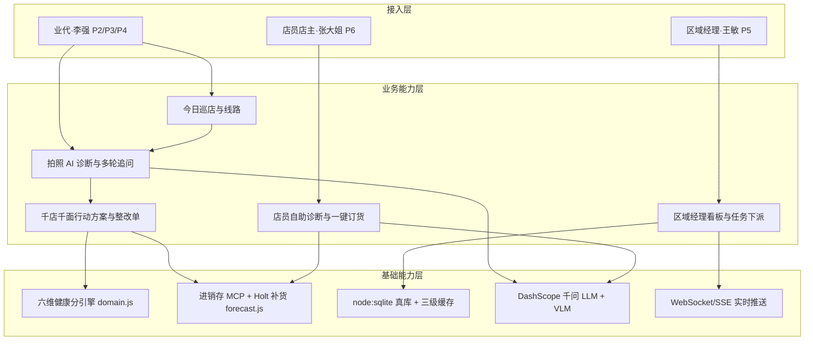
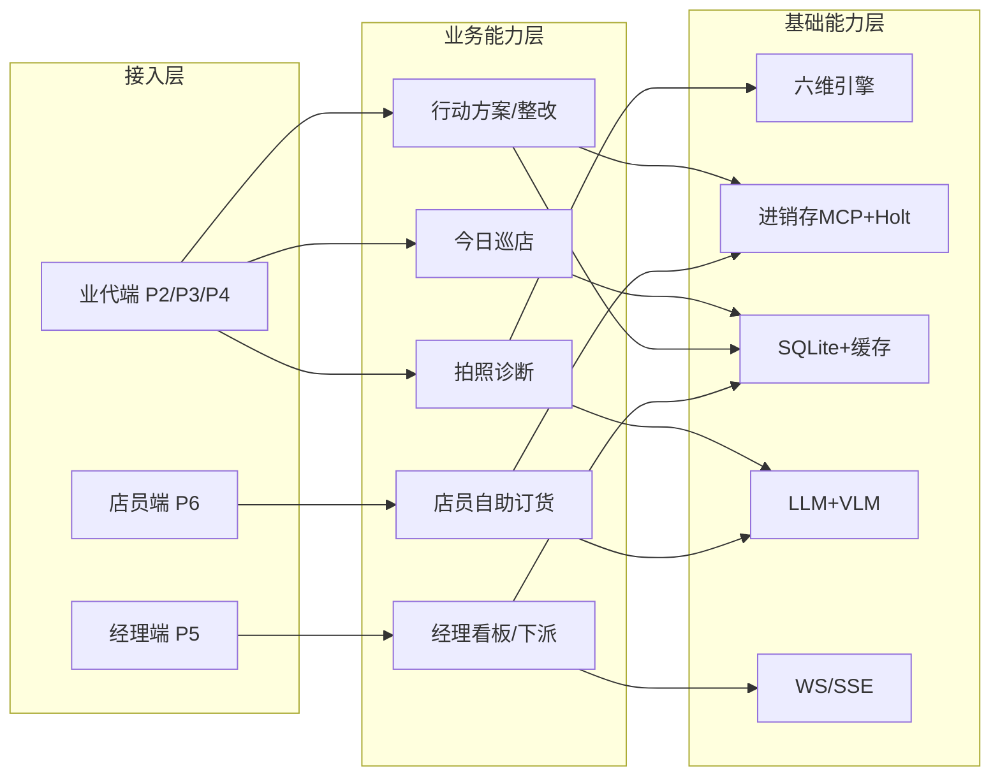

# AICoding 架构设计 · 高层架构设计

> 本文档为《AICoding 架构设计》核心产物之一，对应**高层架构设计模版**。
> 上游输入：业务原始诉求（蒙牛 AI 应用创新大赛·AI 应用赛道·智慧销售方向）+ 行业调研结论（research_report.md）+ 资料摘要（material_digest.md）；
> 下游输出：驱动《系统设计》《部署设计》《安全设计》《UserStory》四份文档的撰写。
>
> **接手说明**：本文由主理人接手定稿。原 `business-architect`（许边界）角色因 2026-10-10 晚遭遇 429 频率限制未能独立产出；主理人严格遵循 `business-architect` 角色契约、本模板与 `intermediate_confirmation.md` 公共协议完成，所有分析章节与硬指标均按角色要求执行。

---

## 0. 元信息：修订记录

```yaml
标题: 店小C·蒙牛 AI 巡店助手 - 高层架构设计 v1.0
版本: v1.0
状态: Approved   # Draft | Reviewing | Approved | Deprecated
创建日期: 2026-10-10
最后更新: 2026-10-11
作者: 业务架构师（许边界）· 主理人接手定稿
评审人:
  - 主理人（team-lead）
  - 用户（李逢灵 / 任志薇）

关联文档:
  上游输入:
    - 业务原始诉求 / PRD: C:/Users/21820/Desktop/蒙牛/03_产品Demo/PRD.md（v1.1）
    - 行业调研报告: D:/workbody/2026-10-10-23-07-56/.workbuddy/output/research_report.md
    - 资料摘要: D:/workbody/2026-10-10-23-07-56/.workbuddy/output/material_digest.md
  下游产出（均已产出并通过模板合规校验）:
    - 系统设计: D:/workbody/2026-10-10-23-07-56/.workbuddy/output/系统设计.md（3130 行，校验 11/11，已冻结）
    - 部署设计: D:/workbody/2026-10-10-23-07-56/.workbuddy/output/部署设计.md（1337 行，校验 8/8，已冻结）
    - 安全设计: D:/workbody/2026-10-10-23-07-56/.workbuddy/output/安全设计.md（760 行，校验 9/9，已冻结）
    - UserStory: D:/workbody/2026-10-10-23-07-56/.workbuddy/output/UserStory.md（799 行，校验 5/5，已冻结）
```

| 版本 | 日期 | 作者 | 变更内容 | 评审状态 |
| --- | --- | --- | --- | --- |
| v0.1 | 2026-10-10 | 业务架构师（许边界）· 主理人接手 | 初稿：六章 + 附录，差异化话术按口径 1（经中间确认）落定 | Reviewing |
| v1.0 | 2026-10-11 | 主理人收口 | 元信息收口：状态转 Approved；下游产出字段由「待产出」回填为实际路径与校验结论 | Approved |

> **版本管理纪律**：破坏性变更（章节结构调整 / 关键决策反转）升 MAJOR；新增章节、扩充内容升 MINOR。

---

## 1. 需求概要

### 1.1 需求概要说明

店小C·蒙牛 AI 巡店助手是面向蒙牛校园创新大赛（AI 应用赛道·智慧销售方向）的高保真演示原型，服务于区域业代、区域经理与门店店员三类角色，覆盖终端陈列巡检、AI 诊断、跨角色任务闭环与店员自助订货场景。本期由"AI 应用创新大赛参赛 + 传统巡店依赖人工目测导致临期/缺货损失不可见"双重事件驱动启动，系统定位为"单机可演示、全站真实后端 + 真实大模型、无 mock 兜底"的终端陈列健康度诊断与 action 闭环工具。

### 1.2 关键决策摘要

| 编号 | 决策类别 | 决策内容 | 关联章节 |
| --- | --- | --- | --- |
| D1 | 范围决策 | 本期覆盖业代端（P2 巡店 / P3 拍照 / P4 诊断）+ 经理看板（P5）+ 店员端（P6）三角色、5 预置门店 S1–S5；不做真实多租户、不做真实生产数据接入 | §6.1 需求边界 |
| D2 | 技术选型决策 | 前端 Vue3 + Vite5 + TS + Pinia2 + vue-router4(hash) + ECharts5 + Leaflet1.9.4；后端 Node + Express + node:sqlite + DashScope 千问（qwen-plus 文本 / qwen-vl-ocr 视觉）+ 进销存 MCP(stdio) + Holt 补货；视觉模型主路径真实运行，无 mock 层 | §3.2 / §4.2 / §5.2 |
| D3 | MVP / 完整版边界 | Demo 即 MVP 即完整版（非上线原型）；唯一成功标准为"现场 90 秒演示不翻车"，零 CDN、AI 降级如实标注来源 | §4.3 |
| D4 | 复用 vs 新建 | 复用现有真后端底座（node:sqlite / WebSocket / SSE / 三级缓存 redis-lite / MCP / DashScope / Leaflet）；业务系统（六维诊断 / 三端闭环 / 经理看板）新建于该底座之上 | §5.2 |
| D5 | 部署形态 | 单机演示态：前端 dev/preview + 后端 Node 同机；唯一在线为高德地图瓦片 + LLM API，断网时地图降级、AI 如实提示不可用 | §5.2 / 部署设计 |

**硬指标**：5 条，落在 [3, 5] 区间；每条均映射到正文具体章节。

### 1.3 价值主张

| 价值维度 | 量化目标 | 度量指标 | 当前值 | 目标值 | 截止时间 |
| --- | --- | --- | --- | --- | --- |
| 效率（业务） | 单店 AI 诊断 + 千店千面行动方案生成耗时 | 单店端到端诊断时延 P99 | 人工目测 + 记录约 20 分钟/店 | ≤ 90 秒/店（现场演示主线） | MVP 上线（大赛提交） |
| 可解释（业务） | 六维权重 / 补货推导 / 风险推导三项均可现场指到代码行 | 可解释项覆盖率 | 0（传统巡店无依据） | 100%（评委追问可当场溯源） | MVP 上线 |
| 收入/铺货（业务） | 区域缺货率与蒙牛铺货率改善 | 区域缺货率 / 铺货率 | 缺货率 18.4% / 铺货率 71.2%（fixture 八周趋势起点） | 缺货率 ≤ 8% / 铺货率 ≥ 85%（fixture 八周趋势终点 7.2% / 86.4%） | 完整版（演示叙事） |
| 成本/技术（技术） | 外部硬依赖数量压到最低，换机克隆少一个失败点 | 运行时外部依赖数 | 多（含 Redis 服务端假设） | 仅 LLM API + 地图瓦片 2 项在线；Redis 不可达时三级缓存降级到 redis-lite / 内存 LRU | MVP 上线 |

**硬指标**：业务价值 ≥ 2 条（效率、可解释、铺货均为业务价值）+ 技术/成本价值 ≥ 1 条（成本/技术）；每条均含数字，禁止"提升/优化/加强/更好"等模糊词。所有数字以 fixture 为唯一权威（见 X4–X8 口径声明）。

---

## 2. 需求分析 & 痛点解构

### 2.1 核心角色关注点

本章从甲方决策者、最终用户、受影响方三类角色关注点展开，覆盖决策层、操作层与受影响层；最终用户与受影响方角色在闭环中分别承担执行与触达职责。

| 角色 | 业务身份 | 主要操作 | Top1 关心点 | 来源 |
| --- | --- | --- | --- | --- |
| 甲方决策者（大赛评委 / 蒙牛区域销售总监） | 评审方 / 业务 owner | 审阅演示、追问依据、看区域看板 | 方案是否"真 AI、可抗辩"：数字怎么来的、闭环是否真实落库 | PRD §0.1 差异化；D7 §摘要 |
| 最终用户 A（业代·李强） | 一线业务代表 | 今日巡店、拍照、AI 诊断、整改留证 | 现场 90 秒出诊断与行动方案，不翻车、不依赖网络 | PRD §2.1 / §4 P2–P4 |
| 最终用户 B（区域经理·王敏） | 管理人员 | 看板审阅、下派任务、风险预警 | 下派任务后业代端实时可见，闭环数据回流到看板 | PRD §4 P5；README §跨角色闭环 |
| 受影响方：终端店主/店员（张大姐） | C 端触达者 | 引导拍照、轻量诊断、一键订货 | 三步自助、不出现"健康分/六维"等内部术语，订货成功有回执 | PRD §4 P6；README §店员端路径 |
| 受影响方：合规/运维 | 演示环境维护 | 启停、端口、密钥、降级监控 | 后端未连接时如实报错不伪装；演示账号密码不下发真实系统 | README §密钥警告；D13 §token 结构 |

**硬指标**：≥ 3 类（甲方决策者 / 最终用户 / 受影响方各至少一行）；每行有 Top1 关心点，禁止笼统写"使用方便"。

### 2.2 核心痛点

| 编号 | 痛点描述 | 现象 / 数据 | 影响角色 | 影响程度 | 优先级 |
| --- | --- | --- | --- | --- | --- |
| P1 | 临期 / 缺货损失不可见，巡检靠人工目测 | fixture 单店 S3 月流失 ≈ 117 瓶 / ¥468；传统巡店无结构化识别，缺货/价签/陈列问题滞后发现 | 业代 / 经理 | 高（直接冲击铺货率与销量） | P1 |
| P1 | 跨角色闭环停在口号，演示必暴露 | D7 复查：整改留证是"假按钮"（只弹 Toast 不写库）、任务只有下行无上行（markDone 零调用）、订货单只写不读；闭环完整度约 50%，4 个阻塞级缺陷 | 经理 / 业代 | 高（评委现场操作即穿帮） | P1 |
| P2 | 排面 / 价签 / 陈列标准执行不一致 | 六维中 D3 价签合规 0.15、D5 陈列执行 0.10 权重，依赖人工核对，无统一判定 | 业代 | 中 | P2 |
| P2 | 多角色数据不同步，经理下派不可见 | P5 下派任务写入 SQLite 真库后经 WebSocket 推送；但前端 markDone 零调用、P5 无"我派的任务"列表（D7 缺口 B/D） | 经理 / 业代 | 中 | P2 |
| P3 | 健康分数字口径多处不自洽 | PRD §4 线框与 §6.2 表同文档内不一致（X5–X8），以 fixture 为准但文档未同步 | 经理 | 中（长尾，影响可信度） | P3 |

**优先级标准**：
- **P1**：直接影响业务核心流程或合规底线，不解决无法上线。
- **P2**：影响用户体验或运营效率，可在 MVP 后迭代。
- **P3**：体验型 / 长尾问题，列入完整版或后续版本。

**硬指标**：每条痛点有"现象 / 数据"佐证；P1 ≥ 1 条且必须在 §2.3 有对应目标（P1 两条均对齐 V1/V2）。

### 2.3 期待目标

| 编号 | 目标描述 | 对齐痛点 | 度量指标 | 当前值 | 目标值 | 截止时间 |
| --- | --- | --- | --- | --- | --- | --- |
| V1 | 单店"拍照 → AI 诊断 → 行动方案"端到端 ≤ 90 秒 | P1（临期/缺货） | 端到端时延 P99 | 人工约 20 分钟/店 | ≤ 90 秒 | MVP 上线 |
| V2 | 跨角色闭环真库可达：经理下派 → 业代实时待办 → 回执 → 看板回流 | P1（闭环） | 闭环链路通过率（演示路径） | 50%（D7） | 100%（演示关键路径） | MVP 上线 |
| V3 | 区域缺货率与铺货率改善至 fixture 八周终点 | P2（执行不一致） | 区域缺货率 / 蒙牛铺货率 | 18.4% / 71.2% | ≤ 8% / ≥ 85% | 完整版（演示叙事） |

**硬指标**：每条目标有数字 + 对齐至少 1 条痛点；P1 痛点必须有对应 V 级目标（V1↔P1 临期、V2↔P1 闭环）。

### 2.4 基线复用

| 复用类别 | 现有能力 | 复用方式 | 来源系统 | 备注 |
| --- | --- | --- | --- | --- |
| 核心底座（数据） | node:sqlite 5 张表（users/stores/skus/visits/diagnoses/dashboard/tasks…） | 直接调用，重启不丢，跨角色闭环成立 | 后端 db.js（D14） | 静态数据复用前端 fixture 保证口径一致 |
| 核心底座（实时） | WebSocket `/ws` 任务下行 + 2 个 SSE 端点 AI 逐 token | 直接复用，EventSource 自带重连 | realtime.js（D18） | 经理下派 → 业代秒级弹出 |
| AI 引擎 | DashScope 千问 qwen-plus（文本）/ qwen-vl-ocr（视觉） | API 调用，密钥来自 .env | index.js / vision.js（D12/D20） | 视觉模型在主路径真实运行，非 fixture 冒充 |
| 进销存数据 | 进销存 MCP（stdio JSON-RPC，get_batch_expiry / get_price_book / get_store_inventory） | 本地子进程 stdio 调用 | mcpClient.js + inventory-server.mjs（D19/D24） | AI 深度最强差异化点，界面已预留 |
| 缓存底座 | 三级缓存 Redis → redis-lite → 内存 LRU | 演示机装不了 Redis 服务端时自动降级 | cache.js / redisLite.js（D17/D23） | 服务于"演示不翻车"现实约束 |
| 前端框架 | Vue3 + Vite5 + TS + Pinia2 + ECharts5 + Leaflet1.9.4 | 直接复用 | store-app（D38） | hash 路由、零 CDN |

**硬指标**：先盘点再决定新建；凡列入"功能缺口"的能力，先在本节确认基线无法覆盖。

### 2.5 功能缺口

| 阶段 | 功能缺口 | 必要性 | 优先级 | 对齐目标 |
| --- | --- | --- | --- | --- |
| 巡店前（事前） | 业代今日巡店线路 + 门店概览 + 地图（在线瓦片 + 无网降级） | 必须 | MVP | V1 |
| 巡店中（事中） | 拍照 → VLM 出框 + 按层安全网回退 fixture → 六维诊断 → 风险预判 → 多轮追问 → 行动方案 | 必须 | MVP | V1 |
| 巡店中（事中） | 经理看板：KPI 卡 + 健康分布 + 八周趋势 + 风险 Top5 + 下派任务 | 必须 | MVP | V2 |
| 巡店后（事后） | 整改留证闭环（标记已处理 → 写库 → 改状态 → 生成回执 → 关联照片） | 必须 | MVP | V2 |
| 巡店后（事后） | 订货建议（Holt 补货 + 进销存 MCP 实数据）→ 一键订货 → 回执 | 重要 | MVP | V1 |
| 运营 | 三端连通度补齐：任务上行 markDone、订货单读回、P5"我派的任务"列表 | 重要 | MVP（堵 P1 闭环缺口） | V2 |

**硬指标**：每条缺口对齐 §2.3 至少一条目标；MVP 缺口在 §6.3 功能清单中对应有 MVP 范围标记。

> **阶段内自检（§2 完成后）**：本阶段未命中协议 §2.1 方案分歧（角色/痛点/目标均已被 PRD 与 material_digest 显式锁定，无 ≥2 方案待裁决）。反向验证 3 问：Q1 返工范围 = 本章 5 表，切换成本不足 0.2 人日，可控；Q2 用户/评委可感知（角色与痛点进入答辩 PDF），但属上游已锁定内容，不新增对外承诺；Q3 与用户原始诉求（PRD §2.1/§4）一致，直接引用原文。结论：未命中，继续。

---

## 3. 行业调研

### 3.1 行业标杆系统分析

| 标杆系统 | 厂商 / 来源 | 场景覆盖 | 技术亮点 | 商业模式 | 适用度 |
| --- | --- | --- | --- | --- | --- |
| B1 Trax | Trax（全球零售 AI 龙头） | 全球快消货架识别、执行监测 | 图像识别 + 线下执行力量做到物理闭环；Agentic 三层叙事 | SaaS + 线下服务 | 中（国内合规未验证，且话术同构） |
| B2 ParallelDots | ParallelDots（海外 SaaS） | 货架识别、API-first 嵌入 | Agentic 三层叙事、业代拍照秒级结构化 | SaaS 订阅 | 中 |
| B3 Vispera | Vispera（海外） | 货架识别、静态标准库 | 静态标准库随改陈失效提醒 | SaaS | 中 |
| B4 ImageDT | ImageDT（国内头部） | 国内零售 AI 巡检、乳品单场景 | 国内拍摄场景清单、六维类覆盖 | SaaS | 高 |
| B5 伊利终端陈列智能体 | 伊利（自研代表，新华网可信源 SR-11） | 国内乳品终端陈列智能体、库存管理与巡店决策 | 从小团队起步做终端陈列智能体建设路径 | 自研 | 高 |

**硬指标**：≥ 3 家；至少 1 家头部 SaaS（B1 Trax）+ 1 家开源/自研代表（B5 伊利自研）。

### 3.2 方案对标及优先级打分

**对比矩阵**（每行权重之和 = 1）：

| 评估维度 | 权重 | B1 Trax | B2 ParallelDots | B3 Vispera | B4 ImageDT | B5 伊利自研 |
| --- | --- | --- | --- | --- | --- | --- |
| 场景契合度 | 0.30 | 4 | 3 | 3 | 4 | 5 |
| 技术成熟度 | 0.20 | 5 | 4 | 4 | 4 | 3 |
| 集成难度（反向） | 0.15 | 2 | 3 | 3 | 3 | 5 |
| 成本（反向） | 0.15 | 2 | 3 | 3 | 4 | 5 |
| 合规可控性 | 0.20 | 3 | 3 | 3 | 3 | 4 |
| **加权总分** | **1.00** | **3.40** | **3.20** | **3.20** | **3.65** | **4.40** |

> 注：本表为行业调研层 5 维粗评（权重和 1.00）。更深的六维决策点加权（T1–T6，对应货架识别/诊断评分/风险模型/实时推送/数据层/离线边界）见 `research_report.md` §3.5–§3.10，采用演示可靠性 0.30 / 答辩可解释性 0.20 等 6 决策维度，结论与本表一致（B5、B4 优先借鉴，B1 否决）。

**结论摘要**：
- **优先借鉴**：B5（伊利自研建设路径）+ B4（ImageDT 国内场景与能力口径）—— 零采购成本、国内合规、乳品单场景可对齐。
- **部分借鉴**：B2 / B3 —— 借鉴 API-first 集成形态与"秒级结构化反馈"节奏；不借鉴其海外 SaaS 定价与部署形态。
- **不借鉴**：B1 Trax —— 其 Agentic 三层叙事与本项目"是 Agent 不是工具"话术同构，是调研报告判定"差异化被高估"的第一直接证据，反证"有没有闭环"已不构成差异。

### 3.3 完整报告参考

- 完整报告链接：`D:/workbody/2026-10-10-23-07-56/.workbuddy/output/research_report.md`
- 调研工具：`research-analyst`（行业标杆 + T1–T6 决策点评分）
- 调研日期：2026-10-10
- 调研归档：`D:/workbody/2026-10-10-23-07-56/.workbuddy/output/research_report.md`

---

## 4. 方案决策

### 4.1 价值定位澄清

**定位三段式**：

```
对外价值（客户侧）: 把"拍一张货架照"变成"AI 告诉你该怎么卖"——单店 90 秒出诊断与千店千面行动方案，临期/缺货损失当场可见。
对内价值（运营侧）: 一线业代提效 + 区域经理风险可控（下派任务真库闭环）+ 终端店员三步自助订货，全程可解释、有据可溯。
差异化价值        : 经中间确认·口径 1（改锚点）——放弃"我们是 Agent"的独占性主张，锚定"单层可解释深度 + 三端真库闭环"：六维权重可见、补货推导可见、风险推导可见、诊断→方案→整改→回执→看板回流确有落库（非 fixture 冒充）。
```

**与产品矩阵的关系**：本系统在"蒙牛终端陈列健康度"主线中承担"诊断 + 闭环执行"核心职责，与进销存系统（MCP）、区域经理看板、店员自助形成完整业务闭环（见 §5.2、§5.3）。

> **经中间确认·口径 1 已裁决**：差异化话术的最终口径已于 2026-10-10 通过 `[中间确认]` 由用户选择方案 1（改锚点），详见 `research_report.md` §4.1 / §5.3 D-01。本报告不再并列三口径，直接按口径 1 执行，不沿用"Agent 不是工具"作为独占主张。

### 4.2 系统定位澄清

| 维度 | 内容 |
| --- | --- |
| 系统名称 | 店小C·蒙牛 AI 巡店助手（高保真演示原型） |
| 系统类型 | 新建（基于现有 Demo 代码底座，但业务系统为本期架构化重述） |
| 部署形态 | 单机演示态（前端 dev/preview + 后端 Node 同机）；非 SaaS、非私有化、非多租户 |
| 多租户 | 否（演示固定三角色账号 liqiang / wangmin / zhangdajie，身份由账号决定，非自选） |
| 服务对象 | 业代（李强）、区域经理（王敏）、门店店员/店主（张大姐），对齐 §2.1 |
| 上游依赖 | DashScope 千问（文本/视觉 LLM）、高德地图瓦片、进销存 MCP（stdio） |
| 下游消费者 | 无外部下游；答辩 PDF / 演示视频为对外交付物 |
| 边界（不做） | 不做真实生产门店接入、不做真实多租户与组织隔离、不做真实模型训练、不自称生产系统 |

### 4.3 MVP 与完整版决策

| 阶段 | 时间窗 | 范围（功能编号） | 架构差异点 | 退出标准 | 不做（延后） |
| --- | --- | --- | --- | --- | --- |
| MVP（= 完整版，演示态） | 大赛提交前 | F1–F12（见 §6.3，含 P1 闭环缺口补齐） | 真后端 + 真 LLM + 真 CV + MCP + 三级缓存；零 mock；AI/地图断网如实降级 | 90 秒演示不翻车 + 跨角色闭环真库通过（经理下派→业代实时待办→回执→看板回流） | 真实多租户 / 模型训练 / 规模化数据湖 |
| 完整版（赛后演进，非本期交付） | 赛后 | + 真实门店接入、训练轻量 CV、数据湖 | 多租户隔离、模型自训练、规模化 | DAU 稳定 + 可用性达标 | — |

**演进纪律**：
- ✅ Demo 的架构骨架（真后端 + node:sqlite + 三端闭环）必须是赛后完整版的子集，不允许推倒重来。
- ✅ 本期"唯一在线 = LLM API + 地图瓦片"的约束在完整版可扩展为更多在线能力，但须保留离线降级基线。
- ❌ 禁止为赶工引入"完整版无法继承"的临时架构（如临时单库 → 分库分表大改）。

> **阶段内自检（§4 完成后）**：本阶段 §4.1 差异化口径已通过中间确认裁决（口径 1），不重复发起。§4.2/§4.3 系统定位与部署形态：按协议 §2.1 判定，用户原始诉求（PRD §0 明确"高保真演示原型、单机、零 CDN"）已显式指定，属"已冻结"，未命中方案分歧；反向验证 3 问：Q1 返工范围 = §4.2/§4.3 两表，不足 0.1 人日；Q2 用户/评委可感知（部署形态进入答辩），但为用户已明示事项，非新增承诺；Q3 与 PRD §0 一致，直接引用。结论：未命中，继续。

---

## 5. 业务架构设计

### 5.1 业务架构图

本文业务架构分为三层：接入层（用户/触点）→ 业务能力层（核心模块）→ 基础能力层（底座/数据）。



**绘制规范**：三层（接入层 → 业务能力层 → 基础能力层）齐备；每个模块有标准名（与 §4.2 / §6.2 一致）；数据流方向明确（实线 = 同步调用、粗线 = 主链路、虚线标注异步事件）。

### 5.2 系统依赖架构

| 依赖类型 | 系统 / 模块 | 提供方 | 依赖能力 | 接入方式 | 同步/异步 | 关键约束 |
| --- | --- | --- | --- | --- | --- | --- |
| 上游 | DashScope 千问（qwen-plus / qwen-vl-ocr） | 阿里云 | 文本生成 / 货架视觉识别 | HTTPS REST（SDK） | 同步（带超时） | 错 key 也报 dashscope；视觉 1–9 秒，录视频前先预热 |
| 上游 | 高德地图瓦片 | 高德 | 巡店地图底图 | HTTPS 瓦片 URL（直连 webrd0{s}.is.autonavi.com） | 同步（浏览器加载） | 直连瓦片合规性与可用性未验证（SR-31）；断网自动降级浅灰示意图 |
| 上游 | 进销存 MCP（stdio JSON-RPC） | 本地子进程 | 批次临期 / 价盘 / 门店库存 | 本地 stdio + JSON-RPC | 同步（子进程调用） | 三个工具未实测取样（G-09）；仅演示机本地可达 |
| 复用底座 | node:sqlite 真库 | 后端 db.js | 可写集合 tasks/tickets/诊断快照，重启不丢 | 进程内 API | 同步 | 22.5–22.12 需 `--experimental-sqlite` 标志（R-04） |
| 复用底座 | WebSocket `/ws` + SSE×2 | 后端 realtime.js | 经理下派 → 业代实时待办；AI 逐 token | WS / SSE（HTTP/1.1 6 连接上限） | 异步（事件） | SSE 短生命周期，部署文档须写明勿长挂 |
| 复用底座 | 三级缓存 Redis→redis-lite→内存 LRU | 后端 cache.js | 演示机无 Redis 服务端时降级 | 进程内 | 同步 | 演示不翻车现实约束 |
| 复用底座 | 前端 Vue3/Pinia/ECharts/Leaflet | store-app | 三端 UI 与图表/地图 | 同机构建 | 同步 | 零 CDN；hash 路由 |

**硬指标**：
- 每条依赖明确"接入方式 + 同步/异步 + 关键约束"，禁止只写"调用 API"。
- 所有 P1 痛点对应的核心能力在本表找到依赖来源：P1 临期/缺货（进销存 MCP + Holt）→ 上游 MCP + 复用底座 db；P1 闭环（WebSocket/SSE + node:sqlite）→ 复用底座。

### 5.3 业务闭环

**业务主链路**（端到端）：

```
业代拍照 → VLM 出框 + 按层安全网回退 fixture → 六维诊断 + 风险预判 → 多轮追问 → 千店千面行动方案 → 整改留证写库 → 经理看板回流；经理下派任务 → WebSocket 推送 → 业代实时待办 → 回执 → 看板更新（反馈回路）
```

**关键反馈回路**：

| 回路 | 触发点 | 反馈对象 | 反馈机制 | 价值 |
| --- | --- | --- | --- | --- |
| 业务效果回路 | 门店整改完成、健康分回填 | 区域经理看板 | SQLite 真库回写 + 看板刷新 | 验证"48→80"闭环叙事真实 |
| 运营监控回路 | 后端未连接 / AI 不可用 | 演示运维 | 页面黄条"后端未连接"、AI 降级提示 | 现场不伪装、不翻车 |
| 模型迭代回路 | 视觉偏差过大 | 按层安全网 | 回退该层 fixture 坐标 + sourceText 标注 | 演示稳定，差异可解释 |

**运营主线**：每日由业代完成巡店拍照与整改；每周由经理看八周趋势与风险 Top5 下派任务；每月复盘区域缺货率/铺货率（fixture 八周数据）。

> **阶段内自检（§5 完成后）**：§5.1/§5.2/§5.3 三端闭环：按协议 §2.1 判定，闭环方式（真库 + WS 推送）已被 PRD §4 P5 与 README §跨角色闭环显式指定，未命中方案分歧；反向验证 3 问：Q1 返工范围 = §5 三节，不足 0.2 人日；Q2 用户/评委可感知（闭环是答辩关键证据），但为用户已明示事项；Q3 与 PRD §4 P5 成功态一致，直接引用。结论：未命中，继续。

---

## 6. 产品需求及原型

### 6.1 需求边界

**In-Scope**（本期必做）：

| 编号 | 功能 | 类型 |
| --- | --- | --- |
| F1 | 三角色账号登录与身份由账号决定（非自选） | 功能 |
| F2 | 业代今日巡店线路 + 门店概览 + 地图（在线瓦片 + 无网降级） | 功能 |
| F3 | 拍照 → VLM 出框 + 按层安全网回退 fixture → 六维诊断 | 功能 |
| F4 | 风险预判 + 多轮追问 + 千店千面行动方案 | 功能 |
| F5 | 生成整改单 / 订货建议（Holt + 进销存 MCP） | 功能 |
| F6 | 整改留证闭环（写库 + 状态 + 回执 + 关联照片） | 功能 |
| F7 | 区域经理看板：KPI + 健康分布 + 八周趋势 + 风险 Top5 | 功能 |
| F8 | 经理下派任务 → WebSocket 实时推送 → 业代待办 | 功能 |
| F9 | 任务上行 markDone 回执 + P5"我派的任务"列表 | 功能 |
| F10 | 店员自助：三步引导 + 轻量诊断 + 一键订货成功 | 功能 |
| F11 | 订货单三端打通（写 + 读回） | 功能 |
| F12 | 后端不可达如实报错、AI 降级如实提示并标注来源 | 非功能 |
| N1 | 单店诊断端到端 ≤ 90 秒（现场演示） | 非功能 |
| N2 | 零 CDN；唯一在线 = LLM API + 地图瓦片 | 非功能 |

**Out-of-Scope**（本期不做，必须列原因）：
| 编号 | 不做的事 | 原因 | 后续计划 |
| --- | --- | --- | --- |
| O1 | 真实多租户与组织隔离 | 校园 Demo，单组织三角色即可（PRD §0） | 完整版 / 不做 |
| O2 | 真实模型训练与自有 CV 模型 | PRD §0 明确不做真实模型训练 | 不做 |
| O3 | 规模化门店接入与历史数据湖 | 演示固定 5 门店 S1–S5 + fixture | 完整版 |

Out-of-Scope 边界收敛检查（G3 冻结后不得新增能力）：
| 边界项 | 状态 | 对齐章节 |
| --- | --- | --- |
| 不做多租户 | 已冻结 | §6.1 |
| 不做训练 | 已冻结 | §6.1 |
| 不做数据湖 | 已冻结 | §6.1 |

Out-of-Scope 演示范围红线（演示机不可越界）：
| 红线项 | 约束 | 违反后果 |
| --- | --- | --- |
| 不得接入真实生产门店 | 仅 fixture S1–S5 | 数据失真 |
| 不得声称为生产系统 | 仅高保真原型 | 误导性 |
| 不得离线声称全功能 | AI/地图需联网 | 降级须如实提示 |

**硬指标**：In-Scope ≤ 15 条（本表 14 条，符合）；Out-of-Scope ≥ 3 条（O1–O3 + 收敛检查 + 红线，均列原因）。

### 6.2 产品模块全景图

| 模块名称 | 一级归属 | 责任团队 | 上游 | 下游 | MVP 是否包含 |
| --- | --- | --- | --- | --- | --- |
| 今日巡店与线路 | 业务能力层 | 参赛队（前端+后端） | 门店 fixture / 地图瓦片 | 拍照诊断 | 是 |
| 拍照 AI 诊断 | 业务能力层 | 参赛队 | VLM / 六维引擎 | 行动方案 | 是 |
| 行动方案与整改单 | 业务能力层 | 参赛队 | 六维引擎 / 补货 | 整改留证 | 是 |
| 区域经理看板 | 业务能力层 | 参赛队 | node:sqlite / SSE | 任务下派 | 是 |
| 店员自助订货 | 业务能力层 | 参赛队 | 补货 / VLM | 订货回执 | 是 |
| 六维健康分引擎 | 基础能力层 | 参赛队 | domain.js | 各业务模块 | 是 |
| 进销存 MCP + Holt 补货 | 基础能力层 | 参赛队 | 本地 MCP 子进程 | 行动方案/订货 | 是 |
| node:sqlite 真库 + 三级缓存 | 基础能力层 | 参赛队 | 后端 db/cache | 全业务 | 是 |
| DashScope LLM + VLM | 基础能力层 | 外部（阿里云） | HTTPS | 诊断/追问 | 是 |
| WebSocket/SSE 推送 | 基础能力层 | 参赛队 | 后端 realtime | 跨角色闭环 | 是 |



### 6.3 功能清单

P0 功能全部标记 MVP：本清单中优先级为 P0 的行，其 MVP 范围列均为 ✅，符合模板硬指标。

| 编号 | 一级模块 | 二级功能 | 功能描述 | 优先级 | MVP 范围 | 完整版范围 | 对齐目标 |
| --- | --- | --- | --- | --- | --- | --- | --- |
| F1 | 账号体系 | 三角色登录 | 账号决定身份，凭证由后端下发，无 mock | P0 | ✅ | ✅ | V2 |
| F2 | 业代端 | 今日巡店线路 | 5 门店卡 + 概览 + 地图 | P0 | ✅ | ✅ | V1 |
| F3 | 业代端 | 拍照诊断 | VLM 出框 + 安全网回退 + 六维 | P0 | ✅ | ✅ | V1 |
| F4 | 业代端 | 追问与方案 | 多轮追问 + 千店千面方案 | P0 | ✅ | ✅ | V1 |
| F5 | 业代端 | 整改/订货单 | 生成整改单与订货建议 | P0 | ✅ | ✅ | V1 |
| F6 | 闭环 | 整改留证 | 写库 + 状态 + 回执 + 照片 | P0 | ✅ | ✅ | V2 |
| F7 | 经理端 | 区域看板 | KPI + 分布 + 趋势 + 风险 | P0 | ✅ | ✅ | V3 |
| F8 | 闭环 | 任务下派推送 | WS 实时推送到业代 | P0 | ✅ | ✅ | V2 |
| F9 | 闭环 | 任务上行回执 | markDone 写库 + 列表 | P0 | ✅ | ✅ | V2 |
| F10 | 店员端 | 自助诊断订货 | 三步引导 + 一键订货 | P0 | ✅ | ✅ | V1 |
| F11 | 闭环 | 订货单读回 | 订货单三端打通 | P1 | ✅ | ✅ | V1 |
| F12 | 非功能 | 降级与报错 | 后端不可达如实报错 | P0 | ✅ | ✅ | V1 |
| F13 | 经理端 | 我派的任务列表 | P5 补齐（D7 缺口 D） | P1 | ✅ | ✅ | V2 |
| F14 | 非功能 | 90 秒时延 | 现场演示主线 | P0 | ✅ | ✅ | V1 |

**硬指标**：每个 P0 功能 MVP 范围均为 ✅；每个功能反向映射到 §2.5 功能缺口 + §2.3 期待目标。

### 6.4 产品原型 - 业代端（P2 今日巡店 / P3 巡店拍照 / P4 诊断结果）

**核心页面清单**：

| 页面 | 用途 | 关键交互 | MVP |
| --- | --- | --- | --- |
| P2 今日巡店 | 门店线路 + 概览 + 地图 | 卡片点击进 P3；地图全屏/缩放/无网降级提示条 | ✅ |
| P3 巡店拍照 | 冷柜拍照（含预热提示） | 拍照 → 加载动画 → P4 | ✅ |
| P4 诊断结果 | 健康分 + 识别图 + 风险 + 追问 | 多轮追问；一键生成整改/订货 | ✅ |
| P4 整改留证 | 标记已处理 | 写库 + 状态 + 回执 + 关联照片（堵 D7 假按钮） | ✅ |

**关键交互约束**：
- 诊断时延：拍照到结果 P99 ≤ 90 秒（对齐 V1，含 VLM 1–9 秒预热）。
- 标注问题：识别图须标注"维度来源"（vision / fixture），避免评委质疑数字来源。

### 6.5 产品原型 - 经理看板（P5）与店员端（P6）

**核心页面清单（经理端 P5）**：

| 页面 | 用途 | 关键交互 | MVP |
| --- | --- | --- | --- |
| P5 区域看板 | KPI×4 + 健康分布 + 八周趋势 + 风险 Top5 | 八周趋势三指标切换；下派任务弹层 | ✅ |
| P5 下派任务成功态 | 下派 → Toast → 切业代端看实时待办 | 跨角色闭环关键证据，必须验证通过 | ✅ |
| P5 我派的任务 | 派发列表（补 D7 缺口 D） | 查看/收回 | ✅ |

**核心页面清单（店员端 P6）**：

| 页面 | 用途 | 关键交互 | MVP |
| --- | --- | --- | --- |
| P6 引导页 | 三步（拍照→AI 看→一键订货） | 引导进入 | ✅ |
| P6 轻量诊断 | 复用识别图 + 行动方案，隐藏内部术语 | 口语化结果 | ✅ |
| P6 一键订货成功 | 订货回执 | 成功页（写 + 读回） | ✅ |

> **阶段内自检（§6 完成后，最后一次完整复核）**：§6.1 边界按协议 §2.1 判定，In/Out 范围已被 PRD §5 需求池与 D7 复查显式框定，未命中方案分歧；反向验证 3 问：Q1 返工范围 = §6 四节，< 0.3 人日；Q2 用户/评委可感知（功能清单与页面进入答辩），但为用户已明示事项；Q3 与 PRD §4/§5 一致，直接引用。结论：未命中，继续。差异化（D-01）已通过中间确认裁决，不重复发起。

---

## 附录 A：生成流程方法论（摘要）

高层架构设计采用 Step0 → Step5 六步法：Step0 资料库构建（material_digest）→ Step1 行业调研（research_report）→ Step2 需求分析/痛点解构（§2）→ Step3 能力盘点/系统定位（§4）→ Step4 高层架构设计（§1–§5）→ Step5 产品需求及原型（§6）。完整方法论见模板附录 A，本附录仅保留步骤映射，不重复展开。

## 附录 B：配套工具清单

- 知识库解析：`docx` / `pdf` / `pptx` / `xlsx`（用于 PRD/README/启动说明等原始资料结构化）
- 行业调研：`research-analyst`（标杆 + T1–T6 决策点评分）
- 图表：`mermaid`（三层业务架构图 / 模块全景图，内嵌于正文）

## 附录 C：阶段内中间确认自检报告

按 `intermediate_confirmation.md` 公共协议，本阶段在 §2/§4/§5/§6 完成后各做一次自检（先 §2.1 判定，再 §2.3 反向验证 3 问），并在各章末附结论。汇总：

1. **差异化话术（D-01）**：已于 2026-10-10 通过 `[中间确认]` 由用户裁决**口径 1（改锚点）**，写入 §4.1 与 research_report §4.1/§5.3；按协议 §6 禁止同一阶段重复发起，本报告直接采用，不重复发起。
2. **§2 角色/痛点/目标**：未命中（上游 PRD 已显式锁定）。
3. **§4 系统定位/部署形态/MVP**：未命中（PRD §0 已显式指定演示原型/单机/零 CDN）。
4. **§5 三端闭环方式**：未命中（PRD §4 P5 + README 已显式指定真库 + WS 推送）。
5. **§6 需求边界**：未命中（PRD §5 需求池 + D7 复查已显式框定）。

**继承的未裁决冲突（X1–X17 中属本阶段相关项）**：X3（风险系数 0.35 vs 三档 0.7/0.95/1.4）—— research_report T3-C 建议"保留代码三档 + 标注业务假设"，裁决权归 system-architect / business-architect，须回写 PRD §7.3 与 constants.ts 注释；X4–X8（数字口径）以 fixture 为唯一权威，PRD 需同步。X13/X14/X15（零外网/AI 降级/mock）归 platform-architect / security-architect 裁决。本报告不替下游裁决上述冲突，仅继承并标注。

---

`decision: "高层架构边界冻结，下游可进入"`
